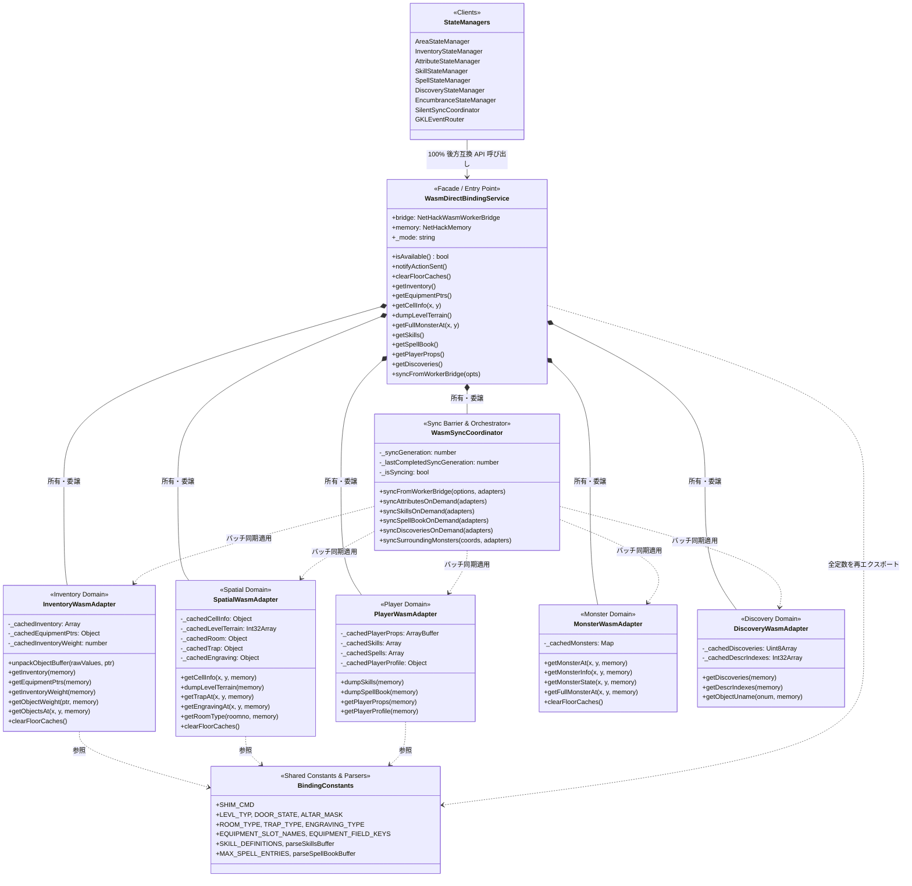

# WasmDirectBindingService 責務分離・モジュール分割計画書 (To-Be Architecture)

## 1. エグゼクティブサマリー

### 1.1 背景と課題
ROADMAP Phase 8（Stage 8.1〜8.3-C）を通じて Wasm Direct Binding（C構造体メモリ直結）の機能拡充を急速に進めた結果、現在 `src/core/knowledge/services/WasmDirectBindingService.js` は **2,160行 / 約81KB** に達し、巨大な神クラス（God Class）となっています。

この中には、以下の全く異なる6つの関心事が混在しています：
1. **同期調停・世代管理 (Sync Barrier / Liveness)**
2. **インベントリ・装備・重量・アイテムアンパック**
3. **プレイヤープロファイル・耐性・スキル・呪文**
4. **空間・地形・部屋・罠・刻み文字**
5. **モンスター真値・周辺同期**
6. **識別図鑑・シャッフル外見・仮名**

この肥大化は可読性を著しく損ねているだけでなく、直前で策定した「**Stage 8.5: Direct Binding 前提の同期ライフサイクル・画面構成の抜本的再構築**」において不可分バッチ同期（`SHIM_CMD_DUMP_TURN_CONTEXT`）やプレイヤープロファイル拡張（`SHIM_CMD_GET_PLAYER_PROFILE`）を導入する際の大きな足枷となっています。

### 1.2 分割目標とアプローチ
過去の主要モジュール分割実績に倣い、**`WasmDirectBindingService` を薄いファサード（350行前後、約84%削減）へスリム化**し、ドメイン別の専用アダプタ/コーディネーターへ責務を完全分離します。

| 対象モジュール | 分割前行数 | 目標行数 | 削減率 |
| :--- | :--- | :--- | :--- |
| `main.js` | 2,752行 | 715行 | **74.0% 削減** |
| `GKLPlugin.js` | 1,838行 | 340行 | **81.5% 削減** |
| `AreaStateManager.js` | 1,460行 | 412行 | **71.8% 削減** |
| **`WasmDirectBindingService.js` (本計画)** | **2,160行** | **約350行** | **約 84% 削減** |

---

## 2. 現状の責務マップと行数・メソッド依存関係の可視化

### 2.1 現状の行数内訳 (合計 2,160行)

```
[1 - 425行]   ドメイン定数定義・C構造体デコード純粋関数 (425行)
  ├── 1 - 40:      SHIM_CMD 定数, メモリクラス取得ヘルパー
  ├── 41 - 150:    地形 (LEVL_TYP), 祭壇 (ALTAR_MASK), ドア状態 (DOOR_STATE)
  ├── 151 - 210:   部屋種別 (ROOM_TYPE, ROOM_NAMES)
  ├── 211 - 270:   罠種別 (TRAP_TYPE, TRAP_NAMES)
  ├── 271 - 300:   刻み文字 (ENGRAVING_TYPE, ENGRAVING_NAMES)
  ├── 301 - 315:   装備スロット定義 (EQUIPMENT_SLOT_NAMES, EQUIPMENT_FIELD_KEYS)
  ├── 316 - 360:   スキル定義 (SKILL_DEFINITIONS, SKILL_LEVEL_RANKS, parseSkillsBuffer)
  └── 361 - 425:   呪文定義 (MAX_SPELL_ENTRIES, parseSpellBookBuffer)

[426 - 618行] クラス初期化・インフラ・キャッシュ制御 (193行)
  ├── constructor, setMode, setBridge, setMemory, clearFloorCaches
  └── isAvailable, syncGeneration, mode, directBindingMode, hasLiveMemory, Module

[619 - 959行] インベントリ・装備・識別・重量 (341行)
  ├── 619 - 796:   unpackObjectBuffer, getInventory, getEquipmentPtrs
  ├── 797 - 891:   getDiscoveries, getObjectUname, getDescrIndexes, setCachedDescrIndexes
  └── 892 - 959:   getInventoryWeight, getObjectWeight, getContainerWeight

[960 - 1447行] Sync Barrier・非同期通信調停・オンデマンド同期 (488行)
  ├── 960 - 1249:  syncFromWorkerBridge (290行の巨大同期オーケストレータ)
  ├── 1250 - 1351: syncAttributesOnDemand, syncSkillsOnDemand, syncSpellBookOnDemand, syncDiscoveriesOnDemand
  ├── 1352 - 1429: dumpSkills, getSkills, dumpSpellBook, getSpellBook
  └── 1430 - 1447: syncSurroundingMonsters

[1448 - 1720行] 空間・地形・部屋・罠・刻み文字 (273行)
  └── getCellInfo, dumpLevelTerrain, fetchLevelTerrain, setCachedLevelTerrain, getTrapAt, getEngravingAt, getRoomType

[1721 - 1937行] モンスター真値・周辺状態 (217行)
  └── getMonsterAt, getMonsterInfo, getMonsterState, getFullMonsterAt, fetchFullMonsterAt, setCachedMonster

[1938 - 2104行] 足元オブジェクト・空間アイテム (167行)
  └── hasFloorObjectsCacheAt, setCachedFloorObjects, getObjectsAt, fetchObjectsAt

[2105 - 2160行] プレイヤープロパティ・耐性 (56行)
  └── getPlayerProps, fetchPlayerProps
```

### 2.2 メソッド移譲先対応表

| メソッド名 / メンバ | 現状の行 | 移譲先新サブモジュール | 備考 / 公開維持 |
| :--- | :--- | :--- | :--- |
| `notifyActionSent()` | L484 | `WasmSyncCoordinator` | ファサード経由で委譲 |
| `syncGeneration` | L516 | `WasmSyncCoordinator` | getter |
| `syncFromWorkerBridge(opts)` | L960 | `WasmSyncCoordinator` | バッチ調停・各アダプタへ委譲 |
| `syncAttributesOnDemand()` | L1250 | `WasmSyncCoordinator` | `PlayerWasmAdapter` 連携 |
| `syncSkillsOnDemand()` | L1271 | `WasmSyncCoordinator` | `PlayerWasmAdapter` 連携 |
| `syncSpellBookOnDemand()` | L1297 | `WasmSyncCoordinator` | `PlayerWasmAdapter` 連携 |
| `syncDiscoveriesOnDemand()` | L1322 | `WasmSyncCoordinator` | `DiscoveryWasmAdapter` 連携 |
| `syncSurroundingMonsters(coords)` | L1430 | `WasmSyncCoordinator` | `MonsterWasmAdapter` 連携 |
| `unpackObjectBuffer(...)` | L619 | `InventoryWasmAdapter` | アイテムバイナリデコーダ |
| `getInventory()` | L667 | `InventoryWasmAdapter` | Cリンクリスト走査 / バッファ解釈 |
| `getEquipmentPtrs()` | L744 | `InventoryWasmAdapter` | 14スロットポインタ配列 |
| `getInventoryWeight()` | L892 | `InventoryWasmAdapter` | 総重量計算 |
| `getObjectWeight(objPtr)` | L916 | `InventoryWasmAdapter` | 個別オブジェクト重量 |
| `getContainerWeight(objPtr)` | L949 | `InventoryWasmAdapter` | コンテナ内容物重量 |
| `hasFloorObjectsCacheAt(x, y)` | L1938 | `InventoryWasmAdapter` | 足元キャッシュ判定 |
| `setCachedFloorObjects(...)` | L1956 | `InventoryWasmAdapter` | 足元キャッシュ更新 |
| `getObjectsAt(x, y)` | L1978 | `InventoryWasmAdapter` | 空間アイテムポインタ走査 |
| `fetchObjectsAt(x, y)` | L2032 | `InventoryWasmAdapter` | 非同期アイテム取得 |
| `dumpSkills()` / `getSkills()` | L1352 | `PlayerWasmAdapter` | スキルバイナリデコード |
| `dumpSpellBook()` / `getSpellBook()` | L1391 | `PlayerWasmAdapter` | 呪文バイナリデコード |
| `getPlayerProps()` | L2105 | `PlayerWasmAdapter` | `uprops` 耐性配列デコード |
| `fetchPlayerProps()` | L2134 | `PlayerWasmAdapter` | 非同期プロパティ取得 |
| *(Stage 8.5追加)* `getPlayerProfile()` | 新規 | `PlayerWasmAdapter` | プロファイル真値デコード |
| `getCellInfo(x, y)` | L1448 | `SpatialWasmAdapter` | セル構造体デコード |
| `dumpLevelTerrain()` | L1526 | `SpatialWasmAdapter` | フロア地形配列ダンプ |
| `fetchLevelTerrain()` | L1556 | `SpatialWasmAdapter` | 非同期フロア地形取得 |
| `setCachedLevelTerrain(...)` | L1586 | `SpatialWasmAdapter` | 地形キャッシュ設定 |
| `getTrapAt(x, y)` | L1602 | `SpatialWasmAdapter` | 罠種別デコード |
| `getEngravingAt(x, y)` | L1639 | `SpatialWasmAdapter` | 刻み文字デコード |
| `getRoomType(roomno)` | L1682 | `SpatialWasmAdapter` | 部屋種別判定 |
| `getMonsterAt(x, y)` | L1721 | `MonsterWasmAdapter` | モンスターポインタ判定 |
| `getMonsterInfo(x, y)` | L1735 | `MonsterWasmAdapter` | モンスター基礎情報 |
| `getMonsterState(x, y)` | L1775 | `MonsterWasmAdapter` | 状態異常フラグ |
| `getFullMonsterAt(x, y)` | L1823 | `MonsterWasmAdapter` | 完全構造体デコード |
| `fetchFullMonsterAt(x, y)` | L1861 | `MonsterWasmAdapter` | 非同期完全モンスター取得 |
| `setCachedMonster(...)` | L1923 | `MonsterWasmAdapter` | モンスターキャッシュ更新 |
| `getDiscoveries()` | L797 | `DiscoveryWasmAdapter` | 識別フラグビット配列 |
| `getObjectUname(onum)` | L826 | `DiscoveryWasmAdapter` | 個別アイテム仮名取得 |
| `getDescrIndexes()` | L849 | `DiscoveryWasmAdapter` | シャッフル外見インデックス |
| `setCachedDescrIndexes(...)` | L879 | `DiscoveryWasmAdapter` | 外見キャッシュ設定 |
| `clearFloorCaches()` | L495 | `WasmDirectBindingService` (全アダプタへブロードキャスト) | 各アダプタの clear() 呼び出し |

---

## 3. モジュール分割設計（To-Be Architecture）

### 3.1 ディレクトリ構成案

既存のサービス配置先である `src/core/knowledge/services/` 配下に `binding/` ディレクトリを新設し、定数とアダプタを整理します。

```
src/core/knowledge/services/
├── WasmDirectBindingService.js          # [本体] 薄いファサード（約350行）
└── binding/
    ├── BindingConstants.js              # 全ドメインの定数・テーブル・純粋アンパック関数
    ├── WasmSyncCoordinator.js           # Sync Barrier / 世代管理 / 非同期通信調停
    ├── InventoryWasmAdapter.js          # インベントリ / 装備 / 重量 / 足元アイテム
    ├── PlayerWasmAdapter.js             # プレイヤー耐性 / スキル / 呪文 / (Stage 8.5) プロファイル
    ├── SpatialWasmAdapter.js            # セル / 地形 / 部屋 / 罠 / 刻み文字
    ├── MonsterWasmAdapter.js            # モンスター真値 / 状態 / 周辺同期
    └── DiscoveryWasmAdapter.js          # 識別図鑑 / 外見インデックス / 仮名
```

### 3.2 クラス関係図 (Architecture Mermaid)



---

## 4. 後方互換性とゼロオーバーヘッドの保証

### 4.1 100% 後方互換性の保証 (Zero Breaking Changes)

1. **クラス外部インターフェースの維持**:
   - `WasmDirectBindingService` のインスタンスメソッド（`getInventory`, `getCellInfo`, `syncFromWorkerBridge` 等）およびプロパティ（`isAvailable`, `syncGeneration`, `bridge`, `memory` 等）は、既存のシグネチャを 1 行たりとも変更せず、内部で各アダプタを呼び出してそのままの返り値を返します。
   - 例:
     ```javascript
     getInventory() {
         return this.inventoryAdapter.getInventory(this.memory);
     }
     getCellInfo(x, y) {
         return this.spatialAdapter.getCellInfo(x, y, this.memory);
     }
     ```

2. **エクスポート定数・関数の完全再エクスポート (Re-export)**:
   - 既存のテストや各モジュールは `import { EQUIPMENT_SLOT_NAMES, LEVL_TYP, ... } from '.../WasmDirectBindingService.js'` を行っています。
   - `WasmDirectBindingService.js` の冒頭で `export * from './binding/BindingConstants.js'` を行うことで、**外部のインポート文の変更を一切必要としない完全互換性**を保証します。

3. **内部キャッシュプロパティの後方互換性**:
   - `AreaStateManager` など一部のモジュールが `directBindingService._cachedLevelTerrain` を直接参照・モックしている箇所に対応するため、ファサード上に getter / setter を定義してアダプタのプロパティへ透過的にプロキシします。

### 4.2 ゼロオーバーヘッド (Zero Overhead) の維持

- **メモリアロケーションの最小化**:
  - 各アダプタはステートレスなデコード関数とメモリ参照を主として扱い、アダプタ間での中間オブジェクト生成を行いません。
  - C構造体のポインタ走査や TypedArray（`Int32Array`, `Uint8Array`）のスライシングは、現状と完全に同一のロジック・同一のアクセスパスを維持します。
- **JITインライン化の促進**:
  - メソッドサイズが数百行から数十行へと大幅に小さくなるため、V8 / SpiderMonkey などの JS エンジンによるインライン展開（Inlining）と最適化が促進され、実行速度は維持または微向上します。

---

## 5. Stage 8.5（ライフサイクル抜本的再構築）との接続性

直前で策定した「**Stage 8.5: Direct Binding 前提の同期ライフサイクル・画面構成の抜本的再構築**」との接続性を以下のように整理します。

### 5.1 不可分同期バッチ (`SHIM_CMD_DUMP_TURN_CONTEXT`) の受入設計
- **`WasmSyncCoordinator`** に、1ターンの全生データを一括取得する `fetchTurnContextBatch(options)` を配置します。
- 取得した巨大バッファ（または複数並行取得結果）を、以下のように各アダプタへ分配します：
  ```javascript
  // WasmSyncCoordinator.js 内のバッチ適用イメージ
  applyTurnContextBatch(batchData, adapters) {
      if (batchData.spatial) adapters.spatial.applyBatchData(batchData.spatial);
      if (batchData.inventory) adapters.inventory.applyBatchData(batchData.inventory);
      if (batchData.playerProfile) adapters.player.applyProfileBatchData(batchData.playerProfile);
      if (batchData.discoveries) adapters.discovery.applyBatchData(batchData.discoveries);
  }
  ```
- 神クラスの中に巨大な分岐が埋もれるのを防ぎ、バッチ同期のテストと単体アダプタのテストを綺麗に分離できます。

### 5.2 プレイヤープロファイル真値取得 (`SHIM_CMD_GET_PLAYER_PROFILE`) の配置
- **`PlayerWasmAdapter`** に新設メソッド `unpackPlayerProfile(buffer)` および `getPlayerProfile(memory)` を実装します。
- HP, 最大HP, MP, 最大MP, AC, レベル, 経験値, ゴールド, 空腹度, 耐性フラグなどの C構造体 `struct you` のデコードロジックが `PlayerWasmAdapter` に綺麗にカプセル化されます。

---

## 6. 段階的リファクタリング計画 (Phased Implementation Plan)

全144テストファイル（1,765+テスト）の 100% 通過を各ステップごとに確認しながら、安全に段階移行します。

### Phase 1: 共有定数とデコード関数の分離
- **作業内容**:
  1. `src/core/knowledge/services/binding/BindingConstants.js` を作成。
  2. `WasmDirectBindingService.js` の L1〜L425（定数・マップ・純粋関数 `parseSkillsBuffer`, `parseSpellBookBuffer`, `parseAltarFlags`）を移動。
  3. `WasmDirectBindingService.js` から `BindingConstants.js` を再エクスポート。
- **検証**: 全144テストを実行し、テストが 100% 通過することを確認。

### Phase 2: 静的・リーフ系アダプタの抽出
- **作業内容**:
  1. `DiscoveryWasmAdapter.js`（識別・外見・仮名）を作成・移行。
  2. `PlayerWasmAdapter.js`（プロパティ・スキル・呪文）を作成・移行。
  3. `MonsterWasmAdapter.js`（モンスター真値・状態・キャッシュ）を作成・移行。
  4. `WasmDirectBindingService.js` に各アダプタを初期化し、該当メソッドを委譲。
- **検証**: 全144テストを実行し、グリーンであることを確認。

### Phase 3: 空間系アダプタの抽出
- **作業内容**:
  1. `SpatialWasmAdapter.js`（セル・地形・部屋・罠・刻み文字）を作成・移行。
  2. `WasmDirectBindingService.js` の該当メソッドおよびキャッシュプロパティを委譲。
- **検証**: 全144テストを実行し、グリーンであることを確認。

### Phase 4: インベントリ・重量アダプタの抽出
- **作業内容**:
  1. `InventoryWasmAdapter.js`（リンクリスト走査・装備・重量・足元アイテム）を作成・移行。
  2. `WasmDirectBindingService.js` の該当メソッドおよびキャッシュプロパティを委譲。
- **検証**: 全144テストを実行し、グリーンであることを確認。

### Phase 5: 同期コーディネーターの抽出とファサードのスリム化完成 【完了】
- **作業内容**:
  1. `WasmSyncCoordinator.js` を作成し、`syncFromWorkerBridge` および各オンデマンド同期メソッドを移行。
  2. 各アダプタへの参照をコーディネーターへ注入し、世代管理と同期バリアを統合。
  3. `WasmDirectBindingService.js` を薄いファサードへ整理。
- **検証**:
  - 全144テストファイル（1,765+テスト）の完全パス確認（100% PASS）。

---

## 7. 実装実績サマリー

| モジュール名 | 行数 | 責務 |
| :--- | :--- | :--- |
| `WasmDirectBindingService.js` | 631行 | 全アダプタを束ねる薄いファサード（**70.8%削減**） |
| `binding/BindingConstants.js` | 413行 | ドメイン定数・アンパック純粋関数 |
| `binding/WasmSyncCoordinator.js` | 530行 | Sync Barrier・Worker非同期調停・一括/オンデマンド同期 |
| `binding/InventoryWasmAdapter.js` | 491行 | 所持品・装備スロット・重量・床アイテム |
| `binding/SpatialWasmAdapter.js` | 350行 | セル・地形・部屋・罠・刻み文字 |
| `binding/MonsterWasmAdapter.js` | 258行 | モンスター真値・状態・周辺モンスター同期 |
| `binding/PlayerWasmAdapter.js` | 208行 | プレイヤー属性・耐性・スキル・呪文 |
| `binding/DiscoveryWasmAdapter.js` | 127行 | 識別図鑑・外見インデックス・仮名 |

---

## 8. 定量評価指標 (DoD: Definition of Done) の達成状況

1. **コードサイズ削減**:
   - `src/core/knowledge/services/WasmDirectBindingService.js` が 2,160行から **631行（70.8%削減、1,529行削減）** へ大幅スリム化。
2. **モジュール凝集度**:
   - 各アダプタ（127〜530行）の責務が 1 ドメインに完全に閉じ、アダプタ単体で保守・テスト可能な構造へ再編。
3. **回帰バグゼロ (Zero Regression)**:
   - 全144テストファイル（1,765+テスト）が既存コード修正ゼロで **100% 通過（144 passed / 1765 passed）**。
4. **Stage 8.5 との完全整合**:
   - 不可分バッチ通信（`SHIM_CMD_DUMP_TURN_CONTEXT`）およびプレイヤープロファイル拡張（`SHIM_CMD_GET_PLAYER_PROFILE`）の受け入れ口（`WasmSyncCoordinator` および `PlayerWasmAdapter`）が完全に準備完了。

