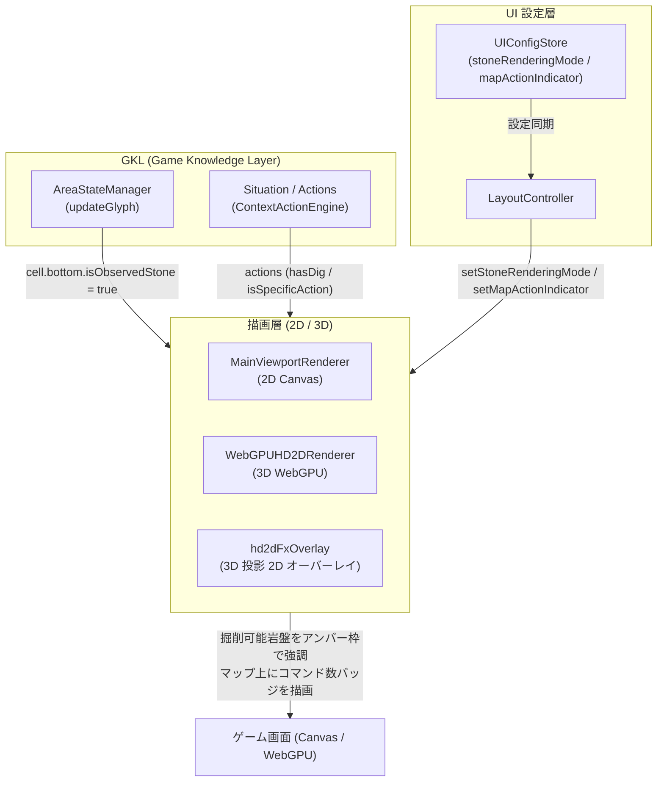

# ⛏️ コンテキスト連動型・岩盤（STONE）可視化 ＆ 掘削アシストレンダリング仕様書

## 1. 概要と目的

NetHack のダンジョン構造において、部屋（Room）の周囲には明示的な壁地形（`VWALL`, `HWALL` 等）が存在する一方、通路（`CORR`: `#`）の周囲には専用の壁データが存在せず、マップ外周の余白と同じ **無地の岩盤（`STONE`: `typ === 0`, `glyph === 3929`, `ch === ' '`）** で埋め尽くされています。

Stage 8.3-B において、`print_glyph` の可視性主権を徹底し `ch === ' '` を `UNEXPLORED`（黒抜き・非表示）として統一した結果、通路や部屋の構造視認性が劇的に向上した一方、「通路脇の観測済み岩盤（掘れる壁）」と「未踏の暗闇（`9622`）」が同じ黒になり、つるはし等で壁を掘る際の目標や掘削可能範囲が直感的に分かりにくいという課題が生じました。

本機能は、**「① 観測済み岩盤（`isObservedStone`）の識別・保持」**、**「② 掘削アクション（`hasDig`）連動のスマート岩盤ハイライト」**、および **「③ 盤面 ContextActions コマンド数ミニバッジ（`mapActionIndicator`）」** を 2D（Canvas）／3D（WebGPU HD-2D）の双方に実装し、構造視認性と掘削操作性の完全な両立を実現した確定仕様です。

---

## 2. アーキテクチャとデータフロー



### 2.1 `AreaStateManager` における観測済み岩盤の識別保持
`AreaStateManager.updateGlyph()` では、受信したグリフ ID が `GLYPH_STONE (0)` または `GLYPH_OFFSETS.GLYPH_CMAP_STONE_OFF (3929)` の場合、`glyphInfo.ch === ' '` であっても完全未踏領域（`glyphId >= 9622`）と明確に区別し、以下のように `isObservedStone: true` を保持します：

```javascript
const isObservedStone = Boolean(glyphId === GLYPH_STONE || glyphId === GLYPH_OFFSETS.GLYPH_CMAP_STONE_OFF);
if ((glyphInfo && glyphInfo.ch === ' ') || isObservedStone) {
    info = { ...info, type: ENTITY_TYPES.UNEXPLORED, isObservedStone };
    // DirectBinding から真の地形 (typ === 0) を同期
    let stoneTyp;
    if (isObservedStone && this.directBindingService && typeof this.directBindingService.getCellInfo === 'function') {
        const cellDirect = this.directBindingService.getCellInfo(x, y);
        if (cellDirect && typeof cellDirect.typ === 'number') {
            stoneTyp = cellDirect.typ;
        }
    }
    this.grid[y][x].bottom = {
        ...info,
        isObservedStone,
        typ: stoneTyp !== undefined ? stoneTyp : (isObservedStone ? 0 : undefined)
    };
}
```

---

## 3. レンダリング仕様と表示モード

プレイヤーの好みやプレイスタイルに応じ、`UIConfigStore` にて 3 つの岩盤描画モード（`stoneRenderingMode`）を提供しています。

| モード名 | 設定値 | 挙動・ビジュアル | 対象ユースケース |
| :--- | :---: | :--- | :--- |
| **スマート表示 (既定)** | `'smart'` | **通常時は黒抜き（視認性最優先）**。<br>隣接マスに対してつるはし・穴掘りの杖等の掘削アクション（`hasDig`）が発生したときのみ、対象の岩盤タイル（`3929`）を浮かび上がらせ、アンバー枠（`#fbbf24`）で強調描画。 | デフォルト推奨。<br>迷路の視認性と掘削時の直感操作を完全両立。 |
| **ミニマル表示** | `'minimal'` | 観測済みであっても `STONE`（`3929`）は描画せず、常時黒抜きを維持。 | テキスト端末（ASCII）準拠のストイックな画面構成。 |
| **クラシックタイル表示** | `'classic_tile'` | 観測済みの全岩盤（`isObservedStone: true`）を常時クッキリ描画（不透明度 1.0）。掘削アクションがある隣接マスにはアンバー枠を描画。 | 旧来の NetHack タイル表示を好むプレイヤー向け。 |

### 3.1 掘削アクションの判定ルール (`isDigAction`)
レンダラー内で以下の条件を満たすアクションが存在する場合、掘削対象マスとして判定されます：
- アクション ID に `'DIG'` が含まれる（例: `ACTION_APPLY_DIG`, `ACTION_ZAP_DIG`）。
- 方向コード（`directionCode` / `dirCode`）が自キャラから対象マスへの相対方向（8方向）と一致する。

---

## 4. マップ上 ContextActions コマンド数オーバーラップ表示 (`mapActionIndicator`)

### 4.1 概要
従来の右サイドパネル内の 3×3 方向パッド（`DirectionPad`）に加え、盤面上で直感的にアクション候補の有無を把握できるよう、自キャラ周囲（8方向＋足元）のマップ上にコマンド数ミニバッジをオーバーレイ表示します（設定値: `mapActionIndicator: true/false`）。

- **視覚ノイズ防止**:
  - 通常の「移動（1歩歩く）」や「待機」などのデフォルトアクションは除外し、**扉の開閉、掘削、罠解除、拾う、階段移動、会話などの固有アクションが 1 件以上あるマスにのみ** 表示。
- **バッジ配置ルール**:
  - アイテム山積み `[+]`（タイル右下）、ペット `[♥]` / 騎乗 `[R]`（キャラ頭上右上）と干渉しないよう、コマンド数バッジは **タイル左上（または上辺コーナー）** にシアン／アンバーのピル型ミニバッジとして描画。
- **入力連携**:
  - 盤面の該当マスをクリックすると、既存の `CanvasInteractionController` がグリッド座標 `(gx, gy)` を解決し、`FloatingContextActions`（吹き出しメニュー）を即時展開。

### 4.2 WebGPU HD-2D (3D) での実装
3D 空間での描画負荷やバッファ再構築を抑えるため、3D インスタンスバッファではなく透過 2D キャンバス（`hd2dFxOverlay.js`）で処理：
- `this.worldToScreen(gx, gy, gz)` を用いて 3D 空間座標から画面 2D 座標を算出し、3D のパースペクティブに吸着したガイド枠およびミニバッジを描画。
- `WebGPUHD2DRenderer.js` では、`hasDig` 時に岩盤の 3D 壁インスタンス（天面およびカメラ前面）を不透明度 `0.85` で動的に生成・配置。

---

## 5. 設定と永続化 (`UIConfigStore` & `NhUiConfig`)

- **`UIConfigStore`**:
  - `stoneRenderingMode`: `'smart'`（既定）/ `'minimal'` / `'classic_tile'`
  - `mapActionIndicator`: `true`（既定）/ `false`
  - LocalStorage への自動永続化および不正値に対する自動フォールバック完備。
- **`<nh-ui-config>`**:
  - 設定ダイアログの「画面描画設定」セクションにて、チェックボックスおよびドロップダウンから即時切替可能。

---

## 6. テスト・検証状況

本機能は以下の Vitest スイートにより 100% の単体・結合テスト検証が行われています：
- `tests/core/knowledge/state/AreaStateManager.stone.test.js`:
  - `glyphId === 3929` 受信時に `isObservedStone: true` が保持されること。
  - `glyphId >= 9622`（完全未踏領域）受信時は `isObservedStone: false` であること。
  - Direct Binding (`getCellInfo`) との `typ: 0` 整合性検証。
- `tests/ui/MainViewportRenderer.test.js`:
  - `smart` モードにおける掘削アクション連動岩盤描画とアンバー枠ハイライト。
  - `classic_tile` モードでの全岩盤常時描画。
  - `mapActionIndicator` によるコマンド数バッジ描画の ON/OFF 制御。
- `tests/ui-controller/UIConfigStore.test.js` & `tests/components/NhUiConfig.test.js`:
  - 設定値の取得、更新、LocalStorage 永続化、GUI コンポーネント連携。

