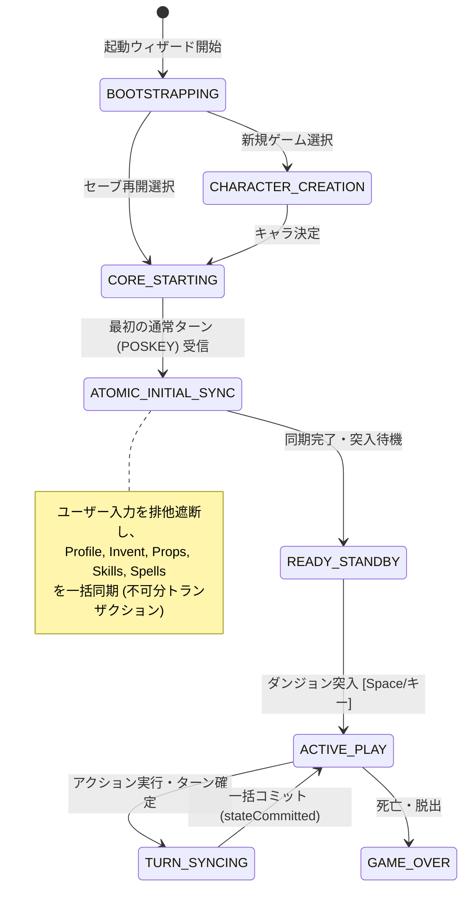

# Direct Binding 前提の同期ライフサイクル・画面構成の抜本的再構築 計画書
## (Direct Binding Native Lifecycle & UI Pipeline Reconstruction Plan)

- **文書ステータス**: `🚧 in-progress (75% implemented: Phase 1, 2, 4 完了 / Phase 3 UI刷新待ち)`
- **策定日**: 2026-10-15 (最終更新: 2026-10-16)
- **対象領域**: Wasm Cコア (`shim_bridge.c`)、Direct Binding サービス (`WasmDirectBindingService`)、GKL ライフサイクル (`GKLEventRouter`, `StartupFlowController`, `WebUICore`)、UI画面構成 (`main.js`, `StatusView`, 各種モーダル)

> [!IMPORTANT]
> **【2026-10-16 実装進捗アップデート（75% 完了）】**  
> 本計画書の全4フェーズのうち、基盤領域である以下の3フェーズは **Stage 8.5 にて 100% 実装・テスト完了** しています：
> - **✅ Phase 1 完了**: `shim_bridge.c` への `SHIM_CMD_GET_PLAYER_PROFILE (0x33)` 追加、`PlayerWasmAdapter.getPlayerProfile()`、および `AttributeStateManager.syncPlayerProfileFromDirectBinding()` による真値プロファイル同期。
> - **✅ Phase 2 完了**: `StartupFlowController.completeStartup` の完全 `async` 化（`setTimeout` 遅延ハック全廃）、および `InventoryStateManager` の未同期時空配列上書き防止ガード。
> - **✅ Phase 4 完了**: `src/core/lifecycle/GameLifecycleState.js` (`GameLifecycleManager`) の新設と散在フラグの一元化。
> 
> **残る実装スコープは Phase 3（UI側：ステータスバー「▽」アコーディオン廃止・オンデマンドのキャラクター詳細ダイアログ新設・上部 Quick Dock 整備・キー透過モード調停）のみ** です。

---

## 1. 背景と課題（Phase 1, 2, 4 にて基盤解決済み）

ROADMAP Stage 8.3-B, C 以降、Wasm Direct Binding（`shim_bridge.c` / `WasmDirectBindingService`）の導入により、Cコア構造体メモリの直接同期が進められてきました。当初発生していた以下の 3 大課題のうち、1 と 2 は Stage 8.5 で解消済みであり、現在は 3（UI層の整理）が残存スコープとなっています。

### 当初の具体的病巣と解消状況

1. **【✅ Stage 8.5 解消済】セーブ再開時のインベントリ未取得・空化**:
   - `completeStartup` の `async/await` 化および `InventoryStateManager` の空配列上書きガードにより解決済み。

2. **【✅ Stage 8.5 解消済】ステータス（種族・職業等）が「考古学者/人間」に固定化**:
   - `SHIM_CMD_GET_PLAYER_PROFILE (0x33)` の新設と `AttributeStateManager` への直結により解決済み。

3. **【⏸️ Phase 3 残存課題】通常時キー横取りとUIステータス表示の整理**:
   - 通常プレイ中の `/`（What is this?）や `\`（Known objects）の扱いについて、ネイティブ素通し（Vanilla）と拡張ダイアログ（Enhanced）の調停、および常時表示ステータスバーのスリム化（インライン「▽」展開の廃止と専用ダイアログ化）を行う。

---

## 2. 基本設計原則 (Architectural Principles)

### 原則1: Direct Binding 第一級市民（Ground Truth）原則
Cコアの構造体メモリ（`struct you`, `gu.urole`, `gu.urace`, `gi.invent`, `svl.level`）が唯一の真実（Single Source of Truth: SSOT）である。テキストパースやマクロによる推測は補助またはフォールバックに限定し、UIへのデータ供給はDirect Bindingから一元的に行う。

### 原則2: NetHack ネイティブ操作の尊重と WebUI 専用操作の直交分離
- **通常プレイ中（モーダル非表示時）のゲームキー入力の透過制御**:
  - `InputCoordinator.js` の `bypassEnhancedSignals`（または UI 設定トグル）と連動し、ネイティブ透過時は `/`, `\`, `^X` 等を 100% C コアへ素通し（`PASSTHROUGH_GAME_KEY`）する。
  - Enhanced モード有効時は `/`・`\` からのリッチインスペクター起動も選択可能としつつ、**WebUI 拡張機能には上部「統合ツールバー（Quick Dock）」からマウス/タッチでも常時ワンクリックでアクセス可能**とする。
- **UIモーダル（キャラクター作成、コンテナ、ペーパードール、新設ステータス等）がアクティブな間のみ、キー入力を適切にトラップ（横取り）する**。
  - Escape でのキャンセル、矢印キーやタブでのフォーカス移動など、ダイアログが開いている間だけキー制御を行う。

### 原則3: ステータス表示の On-Demand 化（表示更新タイミング ＝ 開くタイミング）
- **常時表示ステータスバー（Always-on）**: `statusUpdate` に直結する軽量・リアルタイム情報（HP, Pw, AC, Gold, Dlvl, 状態異常バッジ）のみを表示し、旧来の「▽」インライン展開アコーディオンを廃止する。
- **キャラクター詳細画面（On-Demand Dialog）**: 専用の独立ダイアログとして新設し、ユーザーが開いた瞬間に Direct Binding から最新の C コアメモリ（プロファイル、能力値、属性耐性、スキル、呪文）を一括参照して描画する。

---

## 3. To-Be アーキテクチャ設計

### 3.1 単一トランザクショナル・ライフサイクルステートマシン（✅ 実装完了）

`src/core/lifecycle/GameLifecycleState.js` にて導入済み。



### 3.2 プレイヤープロファイル真値取得パイプライン（✅ 実装完了）

`shim_bridge.c` の `SHIM_CMD_GET_PLAYER_PROFILE` (0x33) および `PlayerWasmAdapter.js` にて実装済み。

### 3.3 アトミック同期＆確定描画コミット境界（✅ 実装完了）

`StartupFlowController.js` および `InventoryStateManager.js` にて実装済み。

### 3.4 画面構成・WebUI 統合ツールバーと専用ダイアログ（⏸️ Phase 3 実装対象）

WebUI拡張機能は画面上の「統合ツールバー（Quick Dock）」に集約する。

```
+-----------------------------------------------------------------------------------+
| [Hero] [Dlvl:1] [HP:16(16)] [Pw:4(4)] [AC:10] [$0] [Normal]    | [👤][📖][🔍][🛡️] |
+-----------------------------------------------------------------------------------+
  常時ステータスバー (Always-on)                                  WebUI 統合ツールバー
```

- **`[ 👤 ]` キャラクター詳細ダイアログ**:
  - クリックまたはステータスバーのキャラ名クリックで開く。
  - 開いた瞬間に Direct Binding から最新のプロファイル、能力値、属性耐性、スキル、呪文を読み込み、リッチなキャラクターシートとして表示（啓蒙時の表示UIとしても共用可能）。
- **`[ 📖 ]` 冒険手帳 / ディスカバリー図鑑**:
  - クリックで開く。
- **`[ 🔍 ]` ナレッジインスペクター**:
  - クリックで開く。
- **`[ 🛡️ ]` ペーパードール装備換装**:
  - クリックで開く。

---

## 4. 段階的移行・リファクタリング計画 (Phased Migration Plan)

| フェーズ | 状態 | 対象スコープ | 主な作業内容 | 担保するテスト / 検証項目 |
| :--- | :---: | :--- | :--- | :--- |
| **Phase 1** | **✅ 完了**<br>*(Stage 8.5)* | **Cコア＆Direct Binding拡張<br/>(プレイヤープロファイル真値取得)** | 1. `shim_bridge.c` に `SHIM_CMD_GET_PLAYER_PROFILE` を実装。<br/>2. `WasmDirectBindingService` / `PlayerWasmAdapter` に `getPlayerProfile()` を追加。<br/>3. `AttributeStateManager` を Cコア真値同期と結合。 | `AttributeStateManager.test.js` 等 PASS |
| **Phase 2** | **✅ 完了**<br>*(Stage 8.5)* | **アトミック同期パイプライン化<br/>(セーブ復帰時インベントリ空化の撲滅)** | 1. `syncFromWorkerBridge` の初期同期保護を強化。<br/>2. `InventoryStateManager` の空配列確定誤認ガードを実装。<br/>3. `completeStartup` の `setTimeout` 遅延ハックを Promise 確定待ちへ置換。 | `SaveRestoreDirectBindingSync.test.js`, `FirstTurnFullSync.test.js` PASS |
| **Phase 3** | **⏸️ 未着手**<br>*(残タスク)* | **ステータス画面のOn-Demand化＆<br/>Quick Dock・キー透過調停** | 1. ステータスバーから「▽」インライン展開領域を整理。<br/>2. キャラクター詳細ダイアログを新設し、開いた瞬間に Direct Binding から一括描画する On-Demand 描画パイプラインを実装。<br/>3. 上部 Quick Dock ツールバーの整備と `InputCoordinator.js` のキー透過設定連携。 | `StatusView.test.js` の改修・新設ダイアログテスト追加 |
| **Phase 4** | **✅ 完了**<br>*(Stage 8.5)* | **ライフサイクルステートマシン統合＆クリーンアップ** | 1. `StartupFlowController` と `WebUICore` の散在フラグを `GameLifecycleState` に統合。<br/>2. 不要な遅延ハックを全廃。<br/>3. 全テスト（149ファイル、1,811テスト）の一括回帰検証。 | `npm test` 全通過済 |

---

## 5. テスト戦略と後方互換性保証

1. **Rank S/A テスト（絶対死守）**:
   - Direct Binding 経由の真値取得、Cコアメモリとの整合性、セーブ復元時の全データ保持を検証するテストを最優先で維持・強化。
2. **UI操作分離のテスト**:
   - 通常時のゲームキー押下と Enhanced モード切替、およびモーダル表示時の `BLOCK_INPUT` / `CLOSE_TOP_MODAL` ルーティングを `InputCoordinator.test.js` で検証。
