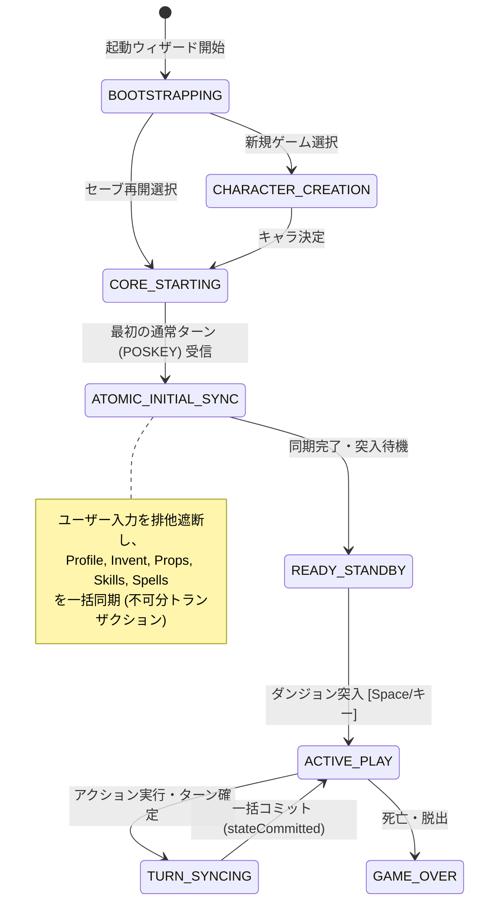

# Direct Binding 前提の同期ライフサイクル・画面構成の抜本的再構築 計画書
## (Direct Binding Native Lifecycle & UI Pipeline Reconstruction Plan)

- **文書ステータス**: `⏸️ pending` (設計完了・全体調整・合意形成中)
- **策定日**: 2026-10-15
- **対象領域**: Wasm Cコア (`shim_bridge.c`)、Direct Binding サービス (`WasmDirectBindingService`)、GKL ライフサイクル (`GKLEventRouter`, `StartupFlowController`, `WebUICore`)、UI画面構成 (`main.js`, `StatusView`, 各種モーダル)

---

## 1. 背景と現状の深刻な課題 (Problem Statement)

ROADMAP Stage 8.3-B, C 以降、Wasm Direct Binding（`shim_bridge.c` / `WasmDirectBindingService`）の導入により、Cコア構造体メモリの直接同期が進められてきました。しかし、デバッグを進めるほどに既存機能が破壊される「対症療法の悪循環」が発生しています。

その根本原因は、**「かつての端末メッセージパース（`botl` / `putstr`）やキー入力マクロ駆動を前提とした画面構成・起動シーケンス・キーハンドリングの上に、非同期Direct Bindingをツギハギで継ぎ足したことによるライフサイクルと同期確定境界の構造的破綻」**にあります。

### 現状発生している具体的病巣

1. **セーブ再開時のインベントリ未取得・空化**:
   - `syncFromWorkerBridge` が10回以上のShim呼び出しを直列に `await` しているため、Workerとの通信遅延が発生する。
   - プレイヤーがダンジョン突入操作（Space/移動キー）を行った瞬間に `notifyActionSent()` が走り、同期世代（`_syncGeneration`）が進んでしまう。
   - これにより、実行中だったインベントリ同期が `isStale()` 判定によって Stale Cancel（自己中断）され、`_cachedInventory` が空配列 `[]` のまま残る。
   - その後 `renderGklUi()` 等で呼ばれる `InventoryStateManager.syncFromDirectBinding()` が、空配列を「所持品ゼロ」と誤認して `this.items = []`, `isSynced = true` と確定上書きしてしまう。
   - `completeStartup` 内の `setTimeout(..., 50)` 等の遅延ハックに依存しており、タイミング保証が崩壊している。

2. **ステータス（種族・職業等）が「考古学者/人間」に固定化**:
   - Cコアメモリ（`flags.initrole`, `flags.initrace`, `gu.urole`, `gu.urace`, `flags.female`, `u.ualign.type`）には真のデータが正しく復元されている。
   - しかし、`shim_bridge.c` の `SHIM_CMD_GET_PLAYER_SUMMARY` (0x30) はダンジョン階層やターン数しか返しておらず、プロファイルを取得するShimコマンドが存在しない。
   - JS側の `AttributeStateManager` に `this.characterInfo = { race: 'human', role: 'archeologist' }` が初期値としてハードコードされており、Cコアから一度も更新されないまま、ステータスバー、ペーパードール、願い・虐殺サービス等に露出・固定化している。

3. **通常時キー横取りとUIライフサイクルの競合**:
   - 通常プレイ中に `/`（What is this?）や `\`（Known objects）といったNetHack標準キーをJavaScript側で横取り（`e.preventDefault`）し、独自モーダルを開いている。
   - これが原因で、Cコアの入力待ちステートマシンとWebUIモーダルのライフサイクルが非同期に分裂し、キー入力判定の条件分岐が肥大化・複雑化している。

---

## 2. 基本設計原則 (Architectural Principles)

### 原則1: Direct Binding 第一級市民（Ground Truth）原則
Cコアの構造体メモリ（`struct you`, `gu.urole`, `gu.urace`, `gi.invent`, `svl.level`）が唯一の真実（Single Source of Truth: SSOT）である。テキストパースやマクロによる推測は補助またはフォールバックに限定し、UIへのデータ供給はDirect Bindingから一元的に行う。

### 原則2: NetHack ネイティブ操作の尊重と WebUI 専用操作の直交分離
- **通常プレイ中（モーダル非表示時）のゲームキー入力は、原則 100% Cコアへ素通し（ネイティブパススルー）する**。
  - `/` を押せば NetHack 本来の "What is this?" が起動する。
  - `\` や `¥` を押せば NetHack 本来の "Known objects" が起動する。
  - `^X` を押せば NetHack 本来の属性確認画面（テキストウィンドウ）が起動する。
- **UIモーダル（キャラクター作成、コンテナ、ペーパードール、新設ステータス等）がアクティブな間のみ、キー入力を適切にトラップ（横取り）する**。
  - Escape でのキャンセル、矢印キーやタブでのフォーカス移動など、ダイアログが開いている間だけキー制御を行う。
- **WebUI拡張機能は専用ダイアログ・統合ツールバーから明示的に開く形式とする**。

### 原則3: ステータス表示の On-Demand 化（表示更新タイミング ＝ 開くタイミング）
- **常時表示ステータスバー（Always-on）**: `statusUpdate` に直結する軽量・リアルタイム情報（HP, Pw, AC, Gold, Dlvl, 状態異常バッジ）のみを表示し、旧来の「▽」インライン展開アコーディオンを全廃する。
- **キャラクター詳細画面（On-Demand Dialog）**: 専用の独立ダイアログとして新設し、ユーザーが開いた瞬間に Direct Binding から最新の C コアメモリ（プロファイル、能力値、属性耐性、スキル、呪文）を一括フェッチして描画する。閉じた状態では毎ターンの再描画を行わない。

---

## 3. To-Be アーキテクチャ設計

### 3.1 単一トランザクショナル・ライフサイクルステートマシン

散在しているフラグ（`core.isResumingSave`, `StartupFlowController.isSaveResuming`, `_isSyncing`, 各Managerの `isSynced`）を廃止し、起動・セーブ再開・通常ターン遷移を包括する単一のステートマシン（`GameLifecycleState`）を導入する。



### 3.2 プレイヤープロファイル真値取得パイプライン

`shim_bridge.c` に `SHIM_CMD_GET_PLAYER_PROFILE` (0x33) を新設し、Cコアから真のプレイヤー情報を一括取得する。

```c
/* SHIM_CMD_GET_PLAYER_PROFILE (0x33) 出力フォーマット */
/* buf = long[16], len = sizeof(long)*16 + 256 bytes (名前文字列バッファ) */
out[0] = (long) flags.initrole;     /* 初期職業インデックス */
out[1] = (long) flags.initrace;     /* 初期種族インデックス */
out[2] = (long) (flags.female ? 1 : 0); /* 性別 */
out[3] = (long) u.ualign.type;      /* 陣営 (A_LAWFUL, A_NEUTRAL, A_CHAOTIC) */
out[4] = (long) gu.urole.mnum;      /* 現在の職業モンスター番号 */
out[5] = (long) gu.urace.mnum;      /* 現在の種族モンスター番号 */
out[6] = (long) u.ulevel;           /* 経験レベル */
/* 文字列領域に plname (プレイヤー名) を安全にコピー */
```

### 3.3 アトミック同期＆確定描画コミット境界 (Atomic Commit Barrier)

- **直列RPCの不可文化**:
  - 初回同期（`ATOMIC_INITIAL_SYNC`）中は、ユーザー操作による世代インクリメント（`notifyActionSent()`）を遮断し、同期完了を 100% 保証する。
- **生データ未到着時の空配列確定ガード**:
  - `InventoryStateManager.syncFromDirectBinding()` は、生メモリ走査が完了していない（`_cachedInventory` が未設定または同期中）状態での呼び出しに対し、既存アイテムを空配列で上書きしないフェイルセーフを設ける。
- **確定描画シグナルの一本化**:
  - 全マネージャー（Area, Inventory, Attributes, Skills, Spells）の同期が整った段階で単一のコミットシグナル（`gameStateCommitted`）を発火し、UIはこれを受信して一括描画する。
  - `completeStartup` や描画処理内の `setTimeout` 遅延ハックを全廃し、Promise チェーンによる完全同期に移行する。

### 3.4 画面構成・WebUI 統合ツールバーと専用ダイアログ

NetHackオリジナルのキー入力を阻害しないよう、WebUI拡張機能は画面上の「統合ツールバー（Quick Dock）」に集約する。

```
+-----------------------------------------------------------------------------------+
| [Hero] [Dlvl:1] [HP:16(16)] [Pw:4(4)] [AC:10] [$0] [Normal]    | [👤][📖][🔍][🛡️] |
+-----------------------------------------------------------------------------------+
  常時ステータスバー (Always-on)                                  WebUI 統合ツールバー
```

- **`[ 👤 ]` キャラクター詳細ダイアログ**:
  - クリックまたはステータスバーのキャラ名クリックで開く。
  - 開いた瞬間に Direct Binding から最新のプロファイル、能力値、属性耐性、スキル、呪文を読み込み、リッチなキャラクターシートとして表示。
- **`[ 📖 ]` 冒険手帳 / ディスカバリー図鑑**:
  - クリックで開く（素の `\` キーは NetHack の Known objects へパススルー）。
- **`[ 🔍 ]` ナレッジインスペクター**:
  - クリックで開く（素の `/` キーは NetHack の What is this? へパススルー）。
- **`[ 🛡️ ]` ペーパードール装備換装**:
  - クリックで開く。

※ 各ダイアログが開いている最中は、キーボードの Escape で閉じる、矢印キーでタブ切り替えを行う等のキートラップを適切に有効化する。

---

## 4. 段階的移行・リファクタリング計画 (Phased Migration Plan)

全144ファイル、1,765テストのパスを維持しながら、安全に4段階で移行する。

| フェーズ | 対象スコープ | 主な作業内容 | 担保するテスト / 検証項目 |
| :--- | :--- | :--- | :--- |
| **Phase 1** | **Cコア＆Direct Binding拡張<br/>(プレイヤープロファイル真値取得)** | 1. `shim_bridge.c` に `SHIM_CMD_GET_PLAYER_PROFILE` を実装。<br/>2. `WasmDirectBindingService` に `getPlayerProfile()` メソッドを追加。<br/>3. `AttributeStateManager` のハードコードデフォルト値（`archeologist/human`）を排除し、Cコア真値同期と結合。 | 既存テスト全通過 + `AttributeStateManager.directBinding.test.js` にプロファイル同期テスト追加 |
| **Phase 2** | **アトミック同期パイプライン化<br/>(セーブ復帰時インベントリ空化の撲滅)** | 1. `syncFromWorkerBridge` の初期同期保護を強化し、ユーザー操作による Stale Cancel 破棄を防止。<br/>2. `InventoryStateManager` における生データ未到着時の「空配列確定誤認」ガードを実装。<br/>3. `completeStartup` の `setTimeout` 遅延ハックを Promise 確定待ちへ置換。 | `SaveRestoreDirectBindingSync.test.js`, `FirstTurnFullSync.test.js` の強化・完全通過 |
| **Phase 3** | **ステータス画面のOn-Demand化＆<br/>ネイティブキー横取り整理** | 1. ステータスバーから「▽」インライン展開領域と毎ターンの耐性・呪文・スキルDOM更新を撤廃（スリム化）。<br/>2. `InputCoordinator.js` から通常プレイ中の `/`, `\`, `^X` 等のキー横取り（`e.preventDefault`）を全廃し、Cコアへの 100% 透過を復元。<br/>3. キャラクター詳細ダイアログを新設し、開いた瞬間に Direct Binding から一括描画する On-Demand 描画パイプラインを実装（モーダル表示中のみキートラップ有効化）。 | `StatusView.test.js` の改修・新設ダイアログテスト追加 |
| **Phase 4** | **ライフサイクルステートマシン統合＆クリーンアップ** | 1. `StartupFlowController` と `WebUICore` の散在フラグを `GameLifecycleState` に統合。<br/>2. 旧マクロ同期（`querySequenceSilent` 等）の残骸と不要な遅延ハックを全廃。<br/>3. 全テスト（144ファイル、1,765+テスト）の一括回帰検証。 | `npm test` 144ファイル全通過 |

---

## 5. テスト戦略と後方互換性保証

1. **Rank S/A テスト（絶対死守）**:
   - Direct Binding 経由の真値取得、Cコアメモリとの整合性、セーブ復元時の全データ保持を検証するテストを最優先で維持・強化。
2. **UI操作分離のテスト**:
   - 通常時のゲームキー押下が正しく `PASSTHROUGH_GAME_KEY` として返ること、およびモーダル表示時のみ `BLOCK_INPUT` / `TEXT_WINDOW_DISMISS` 等にルーティングされることを `InputCoordinator.test.js` で検証。
3. **無停止・段階的コミット**:
   - 各フェーズ完了ごとに `npm test`（144ファイル、1,765+テスト）が完全にパスすることを確認し、リグレッションをゼロに抑える。
