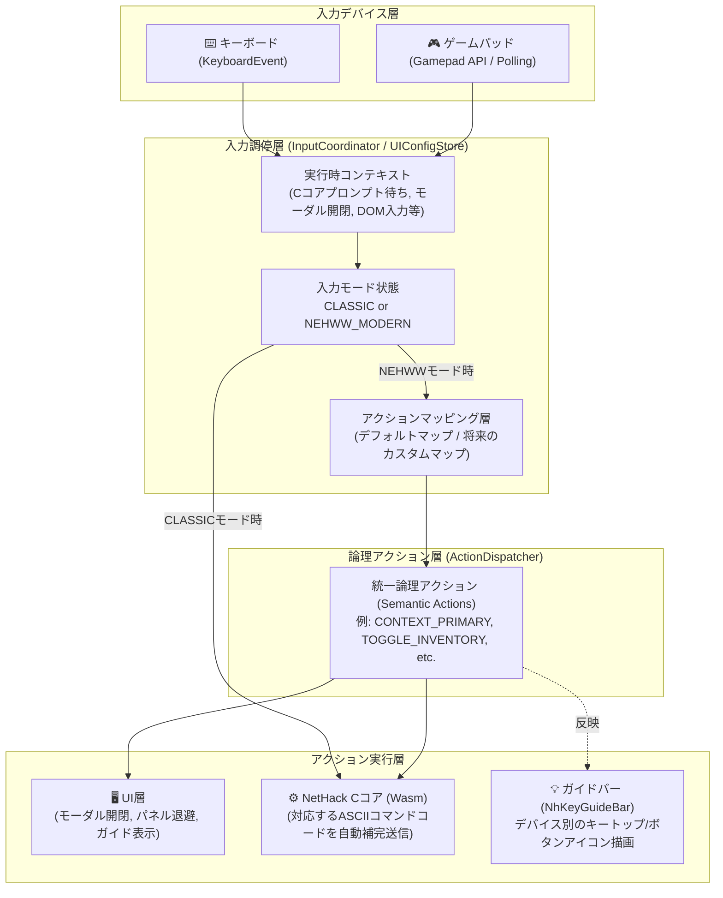
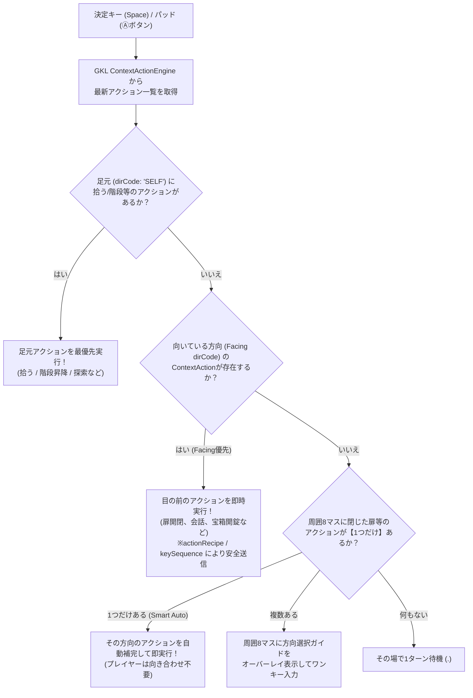
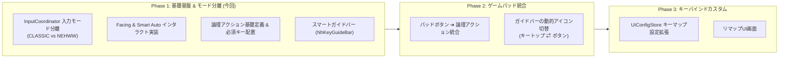
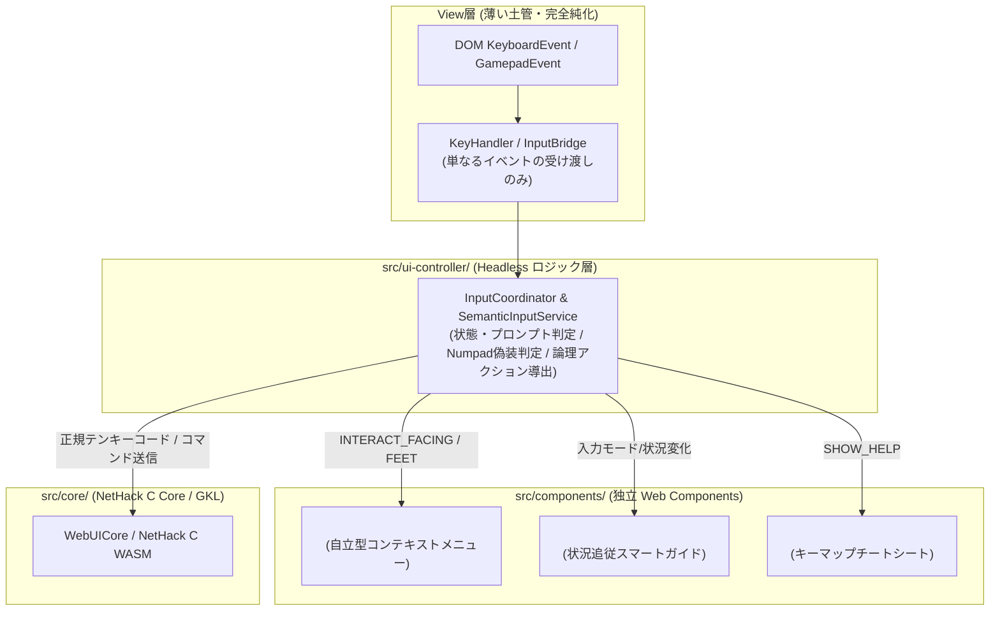

# Nehww 入力モード分離 ＆ 論理アクション（Semantic Action）駆動アーキテクチャ構想仕様書

## 1. 基本設計思想 (Design Philosophy)

> **「キーが空いているからとキーアサインを増やすのはシステムの都合を押し付けるだけであり、真のモダン化ではない」**

NetHackには膨大なコマンドが存在しますが、それらを単に別の空きキーに再配置したり、`qweasdzxc` 等の多段操作キーでキーボードを埋め尽くすことは、プレイヤーに新たな暗記負担を強いる「システムの都合の押し付け」に過ぎません。

本アーキテクチャの真の目的は以下の2点です：
1. **クラシック操作の完全保護**: 原作のキーアサインに習熟したプレイヤーには、一切の干渉を行わない100%パススルーの `CLASSIC` モードを提供する。
2. **直感的な状況判断（Facing ＆ Smart Auto）によるモダン化**: `NEHWW_MODERN` モードでは、プレイヤーが**「目の前の対象に向き合って決定（Space）を押すだけ」**、あるいは**「周囲の状況から自明な操作をスマート自動補完する」**ことで、キーを覚えることなく自然かつスピーディーにプレイできるようにする。

---

## 2. システムアーキテクチャ全体像

開発ガイドライン（`AGENTS.md`）の「Cコア絶対真値（SSOT）」と「レイヤー境界」を厳守し、入力パイプラインを設計します。

---

## 3. 入力モードの定義と動作仕様

### 3.1 `CLASSIC` モード（NetHackネイティブ完全透過）
- **対象**: 原作NetHackのキー操作に習熟したベテランプレイヤー、Telnet/端末クライアント同等の操作感を求めるプレイヤー。
- **仕様**:
  - `Escape`, `Enter`, アルファベット全52文字、記号、数字、Ctrl/Altキーは、UIで一切ハイジャックせず100% Cコアへ直接送信。
  - 例外はモーダルが開いている場合のESC閉塞、およびモード切り替えキー（`F1` 等）のみ。

### 3.2 `NEHWW_MODERN` モード（論理アクション駆動・左手WASD+右手マウス）
- **対象**: WebUIの高度なGUI（ペーパードール、手帳、詳細ステータス、フロア記録）と、直感的な左手WASD+Space操作を活用したいプレイヤー。
- **仕様**:
  - **移動 (WASD / テンキー)**: WASD / QWEADZXC / テンキーで8方向移動。NetHack Cコア側へは正規のテンキー文字（`'8','2','4','6','7','9','1','3'`）として偽装返却され、確実な歩行とプロンプト応答を保証。
  - **ダッシュ (Ctrl + WASD)**: `Ctrl + WASD`（または `Ctrl + 矢印`）で、その方向へ一気にダッシュ移動（連続歩行）。
  - **その場向き転換 (Shift + WASD)**: ターン消費ゼロで自キャラ足元向きマーカー（▲）と目の前のフォーカス枠のみを回転。
  - **目の前インタラクト (Space)**: 向いている目の前の対象（扉開閉、蹴破り、攻撃、会話等）に対してアクションメニューを提示。数字キー `1`〜`9` または `Space` で即座に実行。
  - **足元インタラクト (Shift + Space)**: 向きに関係なく、足元（アイテム拾う、階段昇降、祭壇、調べる等）のアクションメニューを強制展開。
  - **GUI画面呼び出し**: `I` (所持品・ペーパードール)、`P`/`V` (キャラ詳細・耐性)、`B` (冒険手帳)、`Tab` (地図)、`?` (操作ヘルプ)、`F1` (モード切替)。

### 3.3 自動スマートフォールバック（コンテキスト優先原則）
Nehwwモード中であっても、以下の状況では**自動的に入力処理が適切に切り替わります**：
1. **Cコアがテキスト入力を要求中（Prompt: `getlin`, `#extcmd` など）**:
   - アルファベットはショートカットにならず、そのままCコアへ直接タイピングされる。
2. **CコアがYes/No等の選択肢を要求中（Prompt: `ynq`, `menu` など）**:
   - `y`, `n`, `q` などの応答キーはCコアへ直接応答（`respond`）される。
3. **DOM入力要素（INPUT / TEXTAREA）にフォーカス中**:
   - ブラウザ標準の文字入力をネイティブ透過。

---

## 4. 方向指定・文脈アクションのコア仕様（Facing ＆ Smart Auto）

GKLにはすでに [`ContextActionEngine`](../../src/core/knowledge/engines/ContextActionEngine.js) が実装されており、足元（`SELF`）および隣接8方向（`N`, `NE`, `E`, `SE`, `S`, `SW`, `W`, `NW`）の状況・エンティティに応じた最適な推奨アクション群が、標準化された `dirCode` 付きでリアルタイムに生成・提示されています。

本アーキテクチャでは、この既存の強力な知見をそのまま活用し、新たなキーアサインを覚えることなく **「直前の移動入力（Facing）と Space 1つ」** で直感的にアクションを実行できるようにします。

### 4.1 目の前優先原則（Facing Context ＆ ContextActionEngine連携）
- プレイヤーの直前の移動キー入力（またはテンキー/矢印/Viキー）から現在の向き（`facingDir`: `'N'|'E'|'S'|'W'|'NE'|'NW'|'SE'|'SW'`）を保持。
- `Space` が押された際、`ContextActionEngine.generateActions()` の結果から `act.dirCode === facingDir` となる最高優先度のアクションを抽出。
- 該当アクションが存在すれば、その `actionRecipe` または `keySequence`（例: `['o', 'l']`）を `WebUICore` 経由で即時実行。
  - 例：東を向いて扉の前で `Space` ➔ 東の扉を開く（`o` + `l`）。
  - 例：北を向いて店主の前で `Space` ➔ 店主に話しかける（`#chat` + `k`）。

### 4.2 スマート自動補完（Smart Auto-Resolution）
- 足元（`SELF`）にアクションがなく、かつ目の前（`facingDir`）にもアクションがない場合でも、周囲8マスの `actions` をスキャン。
- 実行可能な隣接アクション（閉じた扉のオープン等）が**周囲に1つだけ**存在する場合、わざわざ向きを合わせる必要すらなく、そのアクションを自動で選択・実行。
- これにより、ダンジョン探索でのドア開閉などのストレスが完全にゼロになります。

### 4.3 複数候補時の方向選択（Disambiguation HUD）
- 周囲に扉やNPCが複数存在し、自動決定が不可能な場合に限り、画面周囲マスに視覚的な方向リングをポップアップし、1キーで方向を確定。

---

## 5. 論理アクション（Semantic Action）体系

### 5.1 UIモーダル・ビュー制御系
| 論理アクション名 | 説明 | Nehww標準キー | 将来のパッド割当 |
| :--- | :--- | :---: | :---: |
| `TOGGLE_INVENTORY` | 所持品 ＆ 装備ペーパードール開閉 | `I` | Ⓨ ボタン |
| `TOGGLE_CHARACTER_STATUS` | キャラクター詳細ステータス開閉 | `C` | Back / View ボタン |
| `TOGGLE_MAP_TRACKER` | ミニマップ最大化 / フロア記録手帳開閉 | `M` (または `Tab`) | RB または 押し込み |
| `TOGGLE_MESSAGE_LOG` | 過去ログドロワー開閉 | `L` | 方向キー下 + 修飾 |
| `TOGGLE_CODEX` | 冒険手帳・ディスカバリー図鑑開閉 | `B` | ラジアルメニュー |
| `TOGGLE_INSPECTOR` | 知識・詳細インスペクター開閉 | `K` (または `/`) | Ⓡ スティック押し込み |
| `TOGGLE_SIDE_PANEL` | サイドパネル一時退避 / 再展開 | `F2` | LB ボタン |
| `CLOSE_ACTIVE_MODAL` | 最前面モーダルを閉じる / キャンセル | `Escape` | Ⓑ ボタン |

### 5.2 インタラクト ＆ アクション系
| 論理アクション名 | 説明 | Nehww標準キー | 将来のパッド割当 |
| :--- | :--- | :---: | :---: |
| `CONTEXT_PRIMARY` | 足元・目の前の対象とインタラクト（Facing ＆ Smart Auto） | `Space` / `Enter` | Ⓐ ボタン |
| `CONTEXT_ACTION_1〜4` | 推奨アクション候補の直接選択実行 | `1` 〜 `4` | D-pad 各方向 |
| `QUICK_WAIT` | その場で1ターン待機 / 警戒 | `.` (ピリオド) | Ⓧ ボタン |

### 5.3 システム ＆ 支援系
| 論理アクション名 | 説明 | Nehww標準キー |
| :--- | :--- | :---: |
| `SWITCH_INPUT_MODE` | Classic ⇄ Nehww モード即時トグル | `F1` |
| `SHOW_KEYMAP_HELP` | キーレイアウトヘルプ・チートシート表示 | `?` |
| `OPEN_SETTINGS` | UI詳細設定モーダル開閉 | `F10` |

---

## 6. キーレイアウトヘルプ ＆ ガイド支援機能

### 6.1 スマートガイドバー (`<nh-key-guide-bar>`)
- 画面下部に常時（またはコンテキストに応じて）配置。
- 現在の状況で押せる代表的なキーをキートップアイコン付きで表示。
- デバイス追従: ゲームパッド操作時は自動的に `[Ⓐ] 調べる/開く` `[Ⓨ] 装備` 等のボタンアイコンに切り替わる。

### 6.2 オーバーレイヘルプ (`<nh-keymap-dialog>`)
- `?` キーやヘッダーアイコンで呼び出し。
- カテゴリ別に整理された機能一覧とキー割り当てをグラフィカルに表示。

---

## 7. 実装ロードマップ

---

## 8. UI層肥大化の解消とコンポーネント化 (`<nh-*>`) への移行方針

### 8.1 現状の課題（View-Handlerへの責務集中）
現行の実装では、Nehww独自のモダン操作系（WASD移動、テンキー偽装返却、Facing向き管理、スマート文脈メニュー展開、プロンプトガード等）を迅速に成立させるため、暫定的に `examples/gkl-pure-js-client/modules/handlers/KeyHandler.js` に多くの調停ロジックが集約されています。

この結果、以下のような責務の重複・肥大化が発生しています：
- **文脈判定の二重持ち**: `InputCoordinator` と `KeyHandler` の双方がプロンプトカテゴリや状態判定を行っている。
- **GKL/Coreアクセスの混在**: `KeyHandler` が直接 GKL 推奨アクションのフィルタリングや優先度判定を行っている。
- **UI特化実装の先行**: `<nh-*>` Web Components への移行が遅れ、ピュアJSクライアント固有のコードが増大している。

### 8.2 将来のコンポーネント化・Headless純化ロードマップ

1. **`InputCoordinator` への状態評価・キー変換の完全カプセル化**:
   - プロンプト状態（`isTopLevelTurn`, `isDirectionWaiting` 等）の評価および、NetHack Cコアへ送るべき Classic キーコード（テンキー数字、生キー）の生成ロジックを `InputCoordinator.js` 側に完全に寄せます。
   - `KeyHandler` は、単に `coordinator.evaluateKeyDown(e)` の結果（`action`, `sendKeyPayload` 等）をディスパッチするだけの**100行未満の薄い土管**に純化します。
2. **インタラクトメニューの Web Component 化 (`<nh-context-actions>`)**:
   - 現在の `FloatingContextActions.js` を Web Component（`<nh-context-actions>` または `<nh-context-menu>`）へ昇格させ、Core / GKL と疎結合に連携する自立型コンポーネントとします。
3. **ガイドバー・ヘルプモーダルの Web Component 化**:
   - `<nh-key-guide-bar>` および `<nh-keymap-dialog>` を新設し、UI固有の HTML マークアップからプロジェクト共通の Web Components へ移行します。
