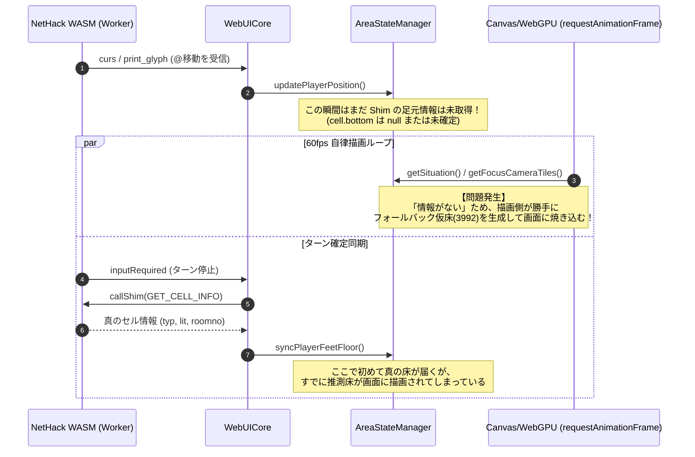
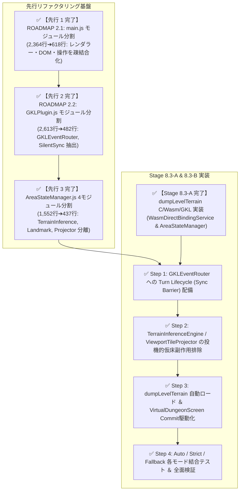

# 🏛️ Shim-Driven 確定同期型レンダリング・パイプライン アーキテクチャ設計書

- **ステータス**: `🟢 implemented` (先行 Step 1〜3 および Stage 8.3-A / 8.3-B 完遂)
- **関連ドキュメント**:
  - [ROADMAP.md](../ROADMAP.md)
  - [official_shim_direct_binding_implementation_plan.md](../1_driver/official_shim_direct_binding_implementation_plan.md)
  - [unified_renderer_and_screen_architecture_plan.md](./unified_renderer_and_screen_architecture_plan.md)
  - [gkl_client_modularization_plan.ja.md](./archive/gkl_client_modularization_plan.ja.md)
- **策定日**: 2026-10-10 (最終更新: 2026-10-11)

---

## 1. 課題の背景と問題の本質 (Problem Statement)

### 1.1 現象
Stage 8.2-B（公式Shim直接調停 ＆ フォールバック検証環境）の実機検証において、以下の現象が発生した：
1. **Autoモード時のフォールバック誤爆**:
   Shim経由で足元の真の床情報が取得できる環境であるにもかかわらず、画面描画においてフォールバックである推測仮床（3992 / ROOM）が優先・描画されてしまう。
2. **Strictモード時の床欠落**:
   フォールバックを完全遮断する `strict` モードでは、足元を含めてTOPレイヤー（`@` やモンスター等の文字）のみが表示され、床が消滅したように見える。

### 1.2 根本原因 (Root Cause: レンダリングと同期のライフサイクル不一致)
これは単なるグリッドデータの更新不備にとどまらず、**「クライアントの描画ループ（60fps 無条件自律ループ）」と「NetHack C言語コア（WASM Worker）のターン確定同期ライフサイクル」が非同期に乖離していること**に起因する。



従来のクライアントは「NetHackから文字列やグリフが届くたびに推測で補いながら即座に描画する」という前提で組まれていたため、**C言語コアから確定情報（Ground Truth）が取れるようになった現代のアーキテクチャと描画タイミングの前提が衝突している**。

---

## 2. アーキテクチャ設計目標 (Design Goals)

1. **Ground Truth Prioritization (真値最優先保証)**:
   Shim による確定情報が利用可能な場合、いかなる場合もフォールバック推測床（3992）を描画に先行させない。
2. **Sync Barrier (同期バリア型フレーム制御)**:
   ユーザーアクション送出からターン確定・Shim 同期完了までの過渡期（トランジション中）において、未確定なセルを投機的にでっち上げて描画ループに渡さない。
3. **Dirty State Propagation & Event-Driven Flush**:
   Shim 同期完了トリガー（`syncPlayerFeetFloor` / `dumpLevelTerrain`）とレンダラー（`VirtualDungeonScreen` / `MainViewportRenderer` / `WebGPUHD2DRenderer`）の連携をイベント駆動で確実に同期させる。

---

## 3. コアコンポーネントと設計仕様

### 3.1 ターン同期ライフサイクル (Turn Lifecycle Model)

NetHack の 1 ターンを以下の 4 つのフェーズに厳格にモデル化する：

```
[ Phase 1: ACTION ] ──▶ [ Phase 2: STREAMING ] ──▶ [ Phase 3: SETTLED & SHIM ] ──▶ [ Phase 4: COMMIT ]
ユーザー入力送出           グリフ・メッセージ受信       inputRequired 到着               正規フレーム描画
(userActionSent)          (print_glyph, curs)         Shim メモリ一括同期               (画面確定・解放)
```

1. **Phase 1 (ACTION)**:
   プレイヤーのキー入力が Worker へ送出される。足元や移動先は「遷移中（TRANSITIONING）」としてマーク。
2. **Phase 2 (STREAMING)**:
   NetHack コアからグリフ・カーソルがストリーミング送信される。
   - ※この間、描画ループは「前フレームの確定背景」を維持するか、スプライトのみを追従させ、**未確定な床の勝手な生成・上書きを禁止する**。
3. **Phase 3 (SETTLED & SHIM SYNC)**:
   NetHack が入力を待ち受ける状態（`inputRequired` かつ `isTopLevelTurn`）で停止。
   - `syncFromWorkerBridge()` により、足元セルおよび Stage 8.3-A で実装されたフロア全域の地形バッファ（`dumpLevelTerrain`）を一括ロード。
   - `AreaStateManager` のグリッドに真のエンティティを反映し、Dirty セルを確定。
4. **Phase 4 (COMMIT & RENDER FLUSH)**:
   状態が 100% 確定したシグナル（`areaStateCommitted`）を発行。
   - レンダラーがオフスクリーンバッファ（`VirtualDungeonScreen`）をフラッシュし、確定フレームを画面へコミットする。

### 3.2 投機的フォールバックの廃止 (Elimination of Speculative Inferred Floor)

`AreaStateManager.js` の `getGenuineFloor()` および `getFocusCameraTiles()` において：
- `isPlayer` のマスやアイテム・モンスター下のマスで真値が未確定の場合、**自動で `createInferredFloor()`（3992）を生成して `cell.bottom` に書き込む副作用を撤廃**する。
- 真値が取得できるまでは `pendingSync` 状態として扱い、背景バッファ（NetHack ネイティブの `glyphGridBuffer`）を透過表示するか、Shim 同期完了までコミットを遅延させる。

### 3.3 Stage 8.3（全フロア地形ダンプ）との接続設計

本アーキテクチャは、Stage 8.3-A で実装完了した `SHIM_CMD_DUMP_LEVEL_TERRAIN`（`WasmDirectBindingService.dumpLevelTerrain()` / `AreaStateManager.dumpLevelTerrain()` による 80×21 全フロア地形ダンプ）と統合される：
- フロア移動時（`clear_nhwindow` ➔ 階段到着）：
  フロア全体の `dumpLevelTerrain()` が完了するまで画面暗転（フェードまたはローディング）を維持し、全フロアの真値が揃った瞬間に 1 フレームで全展開する。
- これにより、画面の一部がチラついたり、歩くたびに推測床が真床に置き換わるような不自然な現象を根絶する。

---

## 4. 実施ロードマップ（先行リファクタリング連携と実施手順）

本改修は、クライアントエントリポイント（`main.js`: 旧 2,364行 ➔ 618行へ分割完了）およびGKLコア（`GKLPlugin.js`: 2,551行）の神クラス状態に直接手を入れるため、コードの複雑化・退行リスクを根絶すべく、**ROADMAP 2.1（完了済み）および 2.2（モジュール分割）を先行実施**した上で、整理された新モジュール基盤に統合する。

### 4.1 全体進行順序


### 4.2 段階別作業手順
- [x] **先行 Step 1: ROADMAP 2.1 (`main.js` モジュール分割)** `[完了: 2026-10-10]`
  - `modules/i18n/`, `modules/layout/`, `modules/effects/`, `modules/startup/`, `modules/interaction/` の 5 モジュールへ分離完了（`main.js` を 2,364行 ➔ 618行へ削減）。
  - レンダリングループ・オフスクリーンフラッシュをオーケストレーターから明瞭に分離し、Commit駆動描画を受け入れ可能にした。
- [x] **Stage 8.3-A: 全フロア地形ダンプ基盤 (`dumpLevelTerrain`)** `[完了: 2026-10-10]`
  - `sys/wasm/shim_bridge.c` (`SHIM_CMD_DUMP_LEVEL_TERRAIN = 12`)、`WasmDirectBindingService.dumpLevelTerrain()`、および `AreaStateManager.dumpLevelTerrain()` による 80×21 セル一括同期を実装完了。
- [x] **先行 Step 2: ROADMAP 2.2 (`GKLPlugin.js` モジュール分割)** `[完了: 2026-10-11]`
  - `coordinators/GKLEventRouter.js`、`coordinators/SilentSyncCoordinator.js`、`coordinators/GKLFxCoordinator.js`、`services/InspectionService.js`、`services/AutoTravelService.js` の分離（`GKLPlugin.js` を 2,613行 ➔ 482行へ削減）。
  - Coreイベントルーティングと非同期同期調停を独立させ、ターン確定ライフサイクル（Phase 1〜4）をクリーンに導入可能にした。
- [x] **先行 Step 3: `AreaStateManager.js` 4モジュール分割** `[完了: 2026-10-11]`
  - `area/TerrainInferenceEngine.js`、`area/DungeonLandmarkRegistry.js`、`area/ViewportTileProjector.js` を分離（`AreaStateManager.js` を 1,552行 ➔ 437行へ削減）。
- [x] **Stage 8.3-B 本番実装** `[完了: 2026-10-11]`:
  - `GKLEventRouter` への Sync Barrier 組み込み（`areaStateCommitted` シグナル）および `WasmDirectBindingService` の世代管理（`_syncGeneration` / `notifyActionSent`）
  - `TerrainInferenceEngine` / `ViewportTileProjector` の `createInferredFloor` 投機的副作用排除（Direct Binding アクティブ時の真値最優先保証）
  - `MainViewportRenderer` / `VirtualDungeonScreen` の Commit 駆動型描画制御（`flushCommittedState` / `flushCommittedArea`）
  - `dumpLevelTerrain()` のフロア移動時・初回ターン確定時自動ロード連携
  - 各モード結合テスト（全138スイート・1,712テスト 100% PASS 維持）

---

## 5. まとめ
本設計により、「Shim で真の情報が取れるようになった現代の WebUI」にふさわしい、チラつきや誤爆の一切ない極めてクリーンで堅牢なレンダリング基盤が、整理されたモジュール構造の上で確立される。
