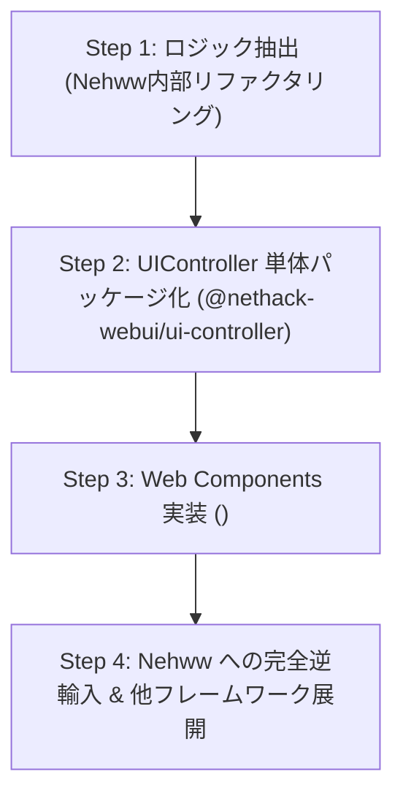

# 🏛️ UIController (Headless UI) アーキテクチャ設計仕様書
## 〜 Model/View の完全分離とシグナル吸収による長寿命クライアントの実現 〜

---

## 1. 概要・背景と目的

### 1.1 背景：リファレンスクライアント `Nehww` の大成功と新たな課題
NetHack WASM WebUI プロジェクトにおいて、公式リファレンスクライアント **`Nehww`**（`examples/gkl-pure-js-client/`）は Phase A〜D を経て劇的な進化を遂げました。
- **全画面ダンジョンマップ ＋ イマーシブHUD**（100vw × 100vh、フローティングHUD群、過去ログドロワー）
- **高度なゲーム操作支援**（二画面ファイラー型コンテナUI、部位判定付きペーパードール、詳細ナレッジ図鑑、スマートコンテキストアクション）
- **Neo-Retro Dark Glass UI**（サイバーシアン `#38bdf8` とフロストガラスマテリアルによる全体統一）

これらの機能により、「ブラウザで動く最高峰の NetHack クライアント」としての仕様とUXは完全に実証されました。

しかし、開発が急速に進んだ結果、**「高度なUI状態管理・計算ロジック」が `Nehww` のクライアントコード内部に強く結合している** という新たな構造的課題が浮き彫りになりました。

### 1.2 直面する2つの本質的リスク
1. **多重実装・二重保守の壁（Web Components・他フレームワーク展開の負荷）**:
   - 将来的に Web Components（`<nh-*>`）や React / Vue / Svelte 移植版を作成する際、モーダルスタック管理、フォーカストラップ、HUDのピン留め・ドック状態、D&Dドラフト計算、キーバインド調停といったUIロジックをクライアントごとに再実装する必要が生じ、膨大な工数とバグの温床になります。
2. **Model（Cコア / WASM / GKL）のシグナル進化に伴う「手戻り」**:
   - Phase 5〜8 で推進されている「状況シグナル基盤」「メッセージパースの高度化」「Direct Memory Binding (`CALL_SHIM`)」「NetHack本体の将来アップデート」など、Model側の内部仕様が変わるたびに、画面側（HTML/CSS/DOM）のコードまで修正・テストし直さなければならないリスクを孕んでいます。

### 1.3 本設計の目的
これらの課題を根底から解決するため、GKL（Model）とクライアント（View）の間に、DOM非依存のUI状態・操作機械である **「UIController（Headless UI層）」** を定義・確立します。
**「Model側のシグナルがどれほど高度化・激変しても、UIController がその差分を吸収・正規化し、View側クライアントは1行もコードを変えずに動作し続ける」** という長寿命アーキテクチャの実現をゴールとします。

---

## 2. 4層アーキテクチャ（MVC / Presenterモデル）

システム全体を以下の4層に整理します。

```text
+-------------------------------------------------------------------------------+
| Layer 4: Client View / Components (具象描画・CSS・DOM)                        |
|  - Nehww (Vanilla JS リファレンスクライアント)                                |
|  - Web Components (<nh-floating-hud>, <nh-modal>, <nh-paperdoll>,             |
|    <nh-container-filer>, <nh-ui-config>)                                      |
|  - フレームワーク移植版 (React 18, Vue 3, SolidJS, Svelte)                    |
+-------------------------------------------------------------------------------+
                                    ▲▼ (UI State & UI Events)
+-------------------------------------------------------------------------------+
| Layer 3: ★ UIController (@nethack-webui/ui-controller)                        |
|  【防腐層 (Anti-Corruption Layer) & UI状態マシン (DOM非依存)】                |
|  - FloatingMessageHudController.js (最新行キュー・ピン留め・世代減衰・フェード)|
|  - ModalStackController.js (スタック順序・ESCキー優先度・排他制御)            |
|  - PaperdollPresenter.js / ContainerDraftController.js (装備適合・D&Dドラフト)|
|  - InputCoordinator.js (ゲームキー vs UIフォーム入力の排他調停)               |
|  - UIConfigStore.js (テーマ・HUD配置・透過度のスキーマ検証 & 永続化)         |
+-------------------------------------------------------------------------------+
                                    ▲▼ (Domain State & Actions)
+-------------------------------------------------------------------------------+
| Layer 2: GKL (Game Knowledge & Logic Layer - DOM非依存)                       |
|  - 知識ベース (アイテム種別、装備部位マスター、モンスター危険度)              |
|  - レシピ実行エンジン (IRC: 換装マクロ、コンテナ出し入れ自動化)                |
|  - ゲーム状態モデル (Inventory, Map, PlayerStatus, SituationCache)            |
+-------------------------------------------------------------------------------+
                                    ▲▼ (RPC / Dispatch / CALL_SHIM)
+-------------------------------------------------------------------------------+
| Layer 1: WASM / NetHack C Core & WebUI Core                                   |
|  - NetHack C エンジン本体 (Emscripten WebAssembly / shim_bridge.c)            |
|  - 仮想端末 (Driver), メッセージストリーム, ウィンドウイベント                |
+-------------------------------------------------------------------------------+
```

---

## 3. UIController の中核的役割：防腐層（Anti-Corruption Layer）

UIController の最も本質的な役割は、**Modelの進化に対する衝撃緩衝材（防腐層）** として機能することです。

```text
[ Model側の変化・進化 ]
  - シグナル粒度の微細化 (例: HP差分ストリーム、状態異常フラグ更新)
  - 通信方式の高速化 (JSON / CALL_SHIM Direct Binding)
  - C層フックの追加・メッセージカタログの再編
               │
               ▼ (激変)
     ┌────────────────────────┐
     │ ★ UIController         │ ◀── ここでシグナルを吸収・正規化！
     └────────────────────────┘
               │
               ▼ (常に安定したUI向け契約: UI Contract)
[ View側 (Nehww / Web Components) ]
  - 変更不要！ 既存のHTML/CSS/コンポーネントがそのまま動作
```

### 3.1 吸収の具体例
- **シナリオ: HP更新シグナルの仕様変更**
  - *変更前*: ターン終了時に `core.on('playerStatus', status)` で全ステータスがまとめて送られてくる。
  - *変更後*: パフォーマンス向上のため、`signal:hp_changed { current: 15, max: 18, delta: -3 }` のような細粒度ストリームに変更された。
  - *UIControllerの吸収動作*:
    - UIController内部で `status.hp` を更新し、View側にはこれまで通り安定したUI状態通知を発行。
    - **View側のコード（ステータスバーHUDのDOM更新）は1行も修正する必要がない。**

- **シナリオ: 装備換装レシピのステップ拡張**
  - *変更内容*: NetHackのバージョンアップにより、呪われた指輪を外す前の追加確認プロンプトが発生するようになった。
  - *UIControllerの吸収動作*:
    - UIControllerとGKLの間でプロンプト処理シーケンスを完結させる。
    - ペーパードールView側は「換装要求を出して待つ」だけなので、画面ロジックには一切影響しない。

---

## 4. レイヤー別 責務境界マトリクス

「どこまでがGKLで、どこからがUIControllerで、どこがViewか」の境界ルールを厳密に定義します。

| 領域 | GKL (Layer 2) の責務 | UIController (Layer 3) の責務 | View / Client (Layer 4) の責務 |
| :--- | :--- | :--- | :--- |
| **装備 (Paperdoll)** | - アイテムの装備可否判定<br>- 換装キーシーケンス（レシピ）の生成・実行<br>- 呪縛（Cursed）状態の追跡 | - `PaperdollPresenter`: 現在選択中のアイテムが適合する「スロットのハイライト配列」の算出<br>- スロットメタデータ定義・ステータスサマリ生成 | - `<nh-paperdoll>` / `PaperdollModal`: スロット枠のフロストガラス描画<br>- サイバーネオングローのアニメーション<br>- クリック/ドラッグイベントの検知 |
| **コンテナ (Container)** | - バッグ/チェストへの格納・取出コマンド発行<br>- 手品袋（Bag of Holding）爆発安全ガード | - `ContainerDraftController`: ユーザーが画面上で選んでいる「移動予定アイテム群（ドラフト）」の一時保持と安全検証連携 | - `<nh-container-filer>` / `ContainerModal`: 二画面ファイラーのリストDOM描画<br>- ドラッグ中のゴースト要素表示 |
| **HUD・メッセージ** | *関与しない* | - `FloatingMessageHudController`: 最新メッセージ行のキュー管理、ピン留め (`isPinned`)、ターン世代管理 (`turnAge`)、ゴールド獲得デルタ計算 | - `<nh-floating-hud>` / `FloatingMessageHud`: CSS Flexbox/Grid、`backdrop-filter` の適用とトランジション描画 |
| **モーダル・入力** | - NetHackプロンプト（`ynaq`、`--More--` 等）の解析 | - `ModalStackController`: 開いているモーダルのスタック管理・ESCキー押下時の最前面モーダル閉塞<br>- `InputCoordinator`: ゲームキー入力とUIテキスト入力の排他調停 | - `<nh-modal>` / 各種Modal: モーダル外枠のHTML描画<br>- フォーカス枠のスタイル適用 |
| **設定 (Config)** | - ゲーム内設定（オートピックアップ、コマンドディレイ等）の保持 | - `UIConfigStore`: UI設定（プリセット、HUD表示有無、透過度等）のバリデーションと LocalStorage 永続化 | - `<nh-ui-config>` / `LayoutController`: 設定変更UI（スライダー、チェックボックス等）のレンダリング |

---

## 5. UIController の主要サブシステム設計 (`src/ui-controller/`)

UIController はフレームワーク非依存の純粋な ES Modules クラス群として `src/ui-controller/` に実装・公開されています。

### 5.1 `FloatingMessageHudController.js`
- **役割**: 全画面マップ上に浮遊するフローティングメッセージHUDのメッセージキュー、ターン世代減衰（`turnAge`）、ピン留め（`isPinned`）、ゴールド差分バッジを管理するステートマシン。
- **提供API**:
  ```javascript
  hudController.pushMessage({ text: 'You hit the kobold.', isBold: true });
  hudController.onUserAction(); // ターン進行による世代加算・古い行のフェードアウト
  hudController.setPinned(true);
  hudController.subscribe((state) => { /* View側で行リスト・ピン状態を更新 */ });
  ```

### 5.2 `ModalStackController.js`
- **役割**: 多重モーダル（例: ペーパードール、コンテナ、設定モーダル等）のアクティブスタック順序と ESC キーによる最前面閉塞を一元制御。
- **提供API**:
  ```javascript
  modalStack.push('paperdoll', { onClose: () => paperdollModal.hide() });
  modalStack.closeTop(); // ESCキー等で最前面モーダルを閉じる
  modalStack.hasOpenModals(); // モーダルが開いているか判定
  ```

### 5.3 `PaperdollPresenter.js` & `ContainerDraftController.js`
- **役割**: ペーパードールの 14 部位スロット定義・装備適合ハイライト算出（`PaperdollPresenter`）、およびコンテナファイラーの一括移動ドラフト・手品袋（BoH）爆発防止チェック（`ContainerDraftController`）を DOM 非依存で管理。
- **提供API**:
  ```javascript
  // PaperdollPresenter: 選択アイテムに適合するスロットID群と全スロット表示モデルを構築
  const compatibleSlots = paperdollPresenter.getCompatibleSlots(selectedItem);
  const viewModel = paperdollPresenter.buildViewModel(equipmentData, inventoryItems);

  // ContainerDraftController: 出し入れ候補のステージングと安全性検証
  draftController.stageItem('in', item, count);
  const safety = draftController.validateDraft();
  ```

### 5.4 `InputCoordinator.js`
- **役割**: ブラウザのキーボード入力を受け取り、「今このキーはNetHackに渡すべきか、UIショートカットか、あるいはフォーム入力中か」を判定してルーティング。
- **競合解決ルール**:
  1. モーダルやドロワー内の `<input>` / `<textarea>` / `<select>` にフォーカスがある ➔ NetHack入力を**完全ブロック**。
  2. `ModalStackController` にアクティブなモーダルがある ➔ `Escape` キーは最前面モーダル閉塞へルーティングし、背後のゲームキー暴発を防止。
  3. 全画面マップ状態 ➔ グローバルUIショートカット（`Ctrl+P` 過去ログ等）を処理し、それ以外を NetHack（GKL/Driver）へパススルー。

### 5.5 `UIConfigStore.js`
- **役割**: レイアウトプリセット（`immersive`, `classic`, `minimal`）、各HUDパネルの表示/非表示、透過度などのユーザー設定を管理。
- **スキーマ駆動**: 設定値のバリデーションと正規化を行い、不正な値が渡された場合は安全なデフォルト値へフォールバックして永続化。

---

## 6. Web Components（`<nh-*>`）連携アーキテクチャ (`src/components/`)

UIController の具象 View 層として、Shadow DOM と Neo-Retro Dark Glass テーマ（`theme.css.js`）を備えた **Web Components** 群が `src/components/` に実装されています。

```text
+-------------------------------------------------------------+
| Custom Element: <nh-paperdoll> (NhPaperdoll.js)             |
|  #shadow-root (open)                                        |
|    <style> /* Neo-Retro Dark Glass CSS が完全カプセル化 */ </style>|
|    <div class="paperdoll-grid">                             |
|       <!-- 14部位スロット & 候補リスト -->                   |
|    </div>                                                   |
+-------------------------------------------------------------+
         │                                    ▲
         │ (CustomEvent: nh-equip / unequip)  │ (ViewModel Update)
         ▼                                    │
+─────────────────────────────────────────────────────────────+
| ★ UIController (PaperdollPresenter.js)                      |
+─────────────────────────────────────────────────────────────+
```

### 提供される Custom Elements 一覧
- `<nh-floating-hud>` (`NhFloatingHud.js`): `FloatingMessageHudController` と連動する透過最新メッセージHUD
- `<nh-modal>` (`NhModal.js`): `ModalStackController` と連動するフロストガラス汎用モーダル枠
- `<nh-paperdoll>` (`NhPaperdoll.js`): `PaperdollPresenter` と連動する14部位装備ペーパードール
- `<nh-container-filer>` (`NhContainerFiler.js`): `ContainerDraftController` と連動する二画面コンテナファイラー
- `<nh-ui-config>` (`NhUiConfig.js`): `UIConfigStore` と双方向バインドするレイアウト・HUD設定パネル

### Web Components化の利点
1. **フレームワーク・アグノスティック**:
   ```html
   <!-- React, Vue, Svelte, 素のHTML いずれでも配置するだけで最高品質UIが動作 -->
   <script type="module" src="./src/components/index.js"></script>
   <nh-floating-hud></nh-floating-hud>
   <nh-modal id="nh-modal-settings" title="UI Settings">
     <nh-ui-config></nh-ui-config>
   </nh-modal>
   <nh-paperdoll></nh-paperdoll>
   <nh-container-filer></nh-container-filer>
   ```
2. **スタイルの汚染防止（CSSカプセル化）**:
   - Neo-Retro Dark Glass の精緻なCSS変数やアニメーションが、ホストアプリケーションのCSSと衝突しない。

---

## 7. 段階的マイグレーション実績（Phase E 完了）

既存の動作を1ミリも壊さない「非破壊的アプローチ」で全4ステップを完了し、現在の最新テストスイート（**全136テストスイート・1,670テスト PASS**）で継続的に保護されています。



- **Step 1: ロジック抽出（Nehww 内部での Headless 化）** `[完了: 2026-09-27]`:
  - `Nehww` 内部から純粋計算ロジック（`UIConfigStore.js`, `ModalStackController.js`, `InputCoordinator.js`, `FloatingMessageHudController.js`, `PaperdollPresenter.js`, `ContainerDraftController.js`）を抽出・分離。
- **Step 2: 独立パッケージ化（`src/ui-controller/`、`@nethack-webui/ui-controller`）** `[完了: 2026-09-27]`:
  - DOM に依存しない UIController を共通モジュール `src/ui-controller/` に昇格・配置。
  - `index.js` 一元エクスポート、`package.json` 配備。
  - `Nehww`（`main.js`, `KeyHandler.js`, `FloatingMessageHud.js`, `PaperdollModal.js`, `ContainerModal.js`）および単体テストのインポート先を切り替え。
- **Step 3: Web Components 化（`<nh-*>`）** `[完了: 2026-09-27]`:
  - `src/components/` ディレクトリ新設および `NhBaseElement`（Shadow DOM, ライフサイクル, 購読自動解除）配備。
  - Neo-Retro Dark Glass UI 共通 CSS トークン・スタイルシート（`theme.css.js`）配備。
  - 切り出された UIController にバインドする Custom Elements 群（`<nh-floating-hud>`, `<nh-modal>`, `<nh-paperdoll>`, `<nh-container-filer>`, `<nh-ui-config>`）を実装。
  - `src/components/index.js` 一括エクスポート & `customElements.define` 自動/一括登録。
  - インタラクティブデモカタログ (`examples/web-components-demo/index.html`) 配備。
- **Step 4: Nehww への逆輸入・共通化と最高峰 UX の完全復元** `[完了: 2026-09-27]`:
  - フローティング HUD の最高峰アニメーション・世代遷移・ゴールド演出を 100% 維持しつつ `FloatingMessageHudController`（Headless）と完全同期。
  - モーダル外枠（`#container-modal`, `#paperdoll-modal`）の 2 ペイン全画面美麗 GUI を維持し、設定モーダル（`<nh-modal id="nh-modal-settings">`）および `KeyHandler` のスタック調停・ESC 閉塞と安全連携。
  - 設定パネル / プリセット管理を `<nh-ui-config>` および `UIConfigStore`（未定義値安全正規化）と双方向バインド連携。
  - `PaperdollModal` の部位メタ定義を `PaperdollPresenter` の SSOT へ集約。
  - 逆輸入連携テスト（`NehwwWebComponentsIntegration.test.js`）を含む全自動テスト（現行 **136テストスイート・1,670テスト 100% PASS**）および全4サンプルクライアント（Vue, React, Solid, Svelte）のビルド成功を維持。

---

## 8. まとめ

本アーキテクチャにより：
1. **Modelの進化（シグナル高度化・バイナリ化）に対する手戻りがゼロになる。**
2. **新しいUIクライアントやWeb Componentsの作成工数が激減する。**
3. **UIロジックの完全自動テスト（Headlessテスト）が可能になり、品質が飛躍的に向上する。**

リファレンスクライアント `Nehww` で得られた貴重な知見を結晶化させ、NetHack WASM WebUI を真のオープンプラットフォームへと押し上げる中核基盤として本仕様を推進します。
