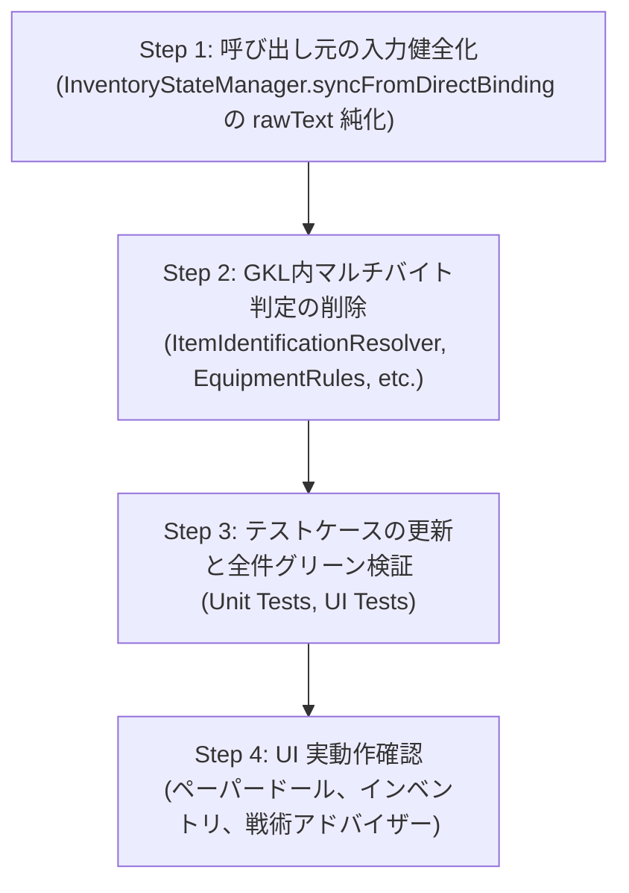

# GKL/装備判定ロジックからの不要なマルチバイト文字（日本語）判定の削除およびASCII/確定メタデータ純化計画

## 1. 背景と目的

現在、`src/core/knowledge/engines/ItemIdentificationResolver.js` や `src/core/knowledge/equipment/EquipmentRules.js`、`InventoryStateManager.js` などのナレッジ判定ロジックにおいて、フォールバックや過剰防衛的な実装として「日本語（複数バイト文字）文字列の正規表現・部分一致判定」が残存しています。
NetHack C-Core (WASM) の出力は100% 英語（ASCII）であり、Phase 8 の Direct Binding により現在は `onum` / `oclass` / `armorSlot` などの確定メタデータ（SSOT）が利用可能です。

データフロー上、UI表示用の日本語文字列をモデル層（GKL）に逆流させて判定することは設計原則に反し、誤判定（偽陽性）のリスクやコードの可読性低下を招いています。
本計画書は、**これら不要なマルチバイト文字判定を安全に削除し、英語ASCII正規表現および確定メタデータ判定へ純化するための調査報告と安全な移行計画**をまとめたものです。

---

## 2. マルチバイト文字判定箇所の全量調査結果

### ① 主要対象ファイル（コアロジック）

| ファイルパス | 該当関数 / メソッド | 対象行 | 判定対象分類 | 検出コード例 / 概要 |
| :--- | :--- | :--- | :--- | :--- |
| `src/core/knowledge/engines/ItemIdentificationResolver.js` | `cleanTextAndExtractBuc` | L301-308 | BUC状態 | `/祝福された\s*/`, `/呪われた\s*/`, `/呪われていない\s*/` |
| `src/core/knowledge/engines/ItemIdentificationResolver.js` | `inferCategory` | L561-574 | アイテム種別 | `ポーション`, `薬`, `巻物`, `杖`, `鎧`, `甲冑`, `兜`, `盾`, `マント`, `ブーツ`, `靴`, `手袋`, `指輪`, `魔除け`, `アミュレット`, `呪文書`, `魔道書`, `剣`, `刀`, `短剣`, `斧`, `槍`, `弓`, `矢`, `食料`, `宝石` 等 |
| `src/core/knowledge/equipment/EquipmentRules.js` | `estimateActionTurns` | L56, 58, 62 | 防具重装・脱衣ターン数 | `鎧`, `プレート`, `鎖帷子` |
| `src/core/knowledge/equipment/EquipmentRules.js` | `resolveEligibleSlots` | L108-116 | 防具スロット | `外套`, `マント`, `ローブ`, `鎧`, `甲冑`, `胴着`, `着物`, `シャツ`, `兜`, `帽子`, `手袋`, `籠手`, `盾`, `靴`, `ブーツ` |
| `src/core/knowledge/equipment/EquipmentRules.js` | `resolveEligibleSlots` | L127, 131, 136, 141 | 装身具・ツール・弾薬 | `魔よけ`, `魔除け`, `お守り`, `アミュレット`, `護符`, `首飾り`, `指輪`, `目隠し`, `タオル`, `矢`, `ボルト`, `ダーツ`, `手裏剣` |
| `src/core/knowledge/equipment/EquipmentRules.js` | `isTwoHandedWeapon` | L162 | 両手武器 | `/両手\|ツルギ\|マトック\|長柄/` |
| `src/core/knowledge/equipment/EquipmentRules.js` | `isCockatriceCorpse` | L173, 175 | 接触石化ハザード | `死体`, `コカトリス`, `チカトリス` |
| `src/core/knowledge/equipment/EquipmentRules.js` | `isTwoWeaponEligible` | L183, 191, 211 | 二刀流職業・スキル適性 | `侍`, `バーバリアン`, `盗賊`, `騎士`, `二刀流` 等 |
| `src/core/knowledge/equipment/EquipmentDependencyAnalyzer.js` | `extractEquippedState` | L42, 82-106 | 装備状態・スロット解析 | `[左右両]?手に装備中`, `副武器`, `逆の手に持っている`, `矢筒`, `準備完了`, `着用`, `装備中`, `左手`, `右手`, `首`, `盾`, `マント`, `鎧`, `手袋` 等 |
| `src/core/knowledge/equipment/EquipmentDependencyAnalyzer.js` | `analyzeDependency` | L333, 337 | BUC状態 | `/呪われ/`, `/祝福/` |
| `src/core/knowledge/state/InventoryStateManager.js` | `syncFromDirectBinding` | L505-524, 550 | **生データ汚染 (逆流源)** | `rawText` 合成時に `lang === 'ja'` の場合、`〜の死体`, `〜の像`, `〜の缶詰`, `[真名]` を直接混入 |
| `src/core/knowledge/state/InventoryStateManager.js` | `determineDefaultAction` | L1579-1664 | デフォルトアクション | `ポーション`, `薬`, `巻物`, `魔導書`, `杖`, `指輪`, `魔除け`, `鎧`, `兜`, `靴`, `手袋`, `盾`, `鍵`, `袋`, `剣`, `刀`, `斧` 等 |
| `src/core/knowledge/state/InventoryStateManager.js` | `parseEquipState` | L1736-1788 | 装備状態・スロット解析 | `副武器`, `逆の手に持っている`, `[左右両]?手に装備中`, `二刀流中`, `矢筒`, `準備完了`, `着用`, `装着中` 等 |
| `src/core/knowledge/state/InventoryStateManager.js` | `resolveArmorSlotFromText` | L1835-1840 | 防具スロット | `盾`, `兜`, `帽子`, `手袋`, `ガントレット`, `靴`, `ブーツ`, `外套`, `マント`, `ローブ`, `シャツ`, `ｔシャツ` |

### ② 関連・周辺ナレッジファイル（戦術・行動判定等）

- `src/core/knowledge/engines/TacticalAdvisor.js`: L630 (`コカトリスの死体`), L810 (`手品袋`), L823 (`打ち消しの杖`), L860 (`刀|剣|槍|斧`), L893-894 (`祝福|呪われ`), L1070 (`回復の薬`), L1091 (`食料|パン`), L1115-1131 (`短剣|小剣|長剣|刀|両手剣|斧|ツルハシ` 等)
- `src/core/knowledge/engines/ContextActionEngine.js`: L1415-1447 (`getWeaponSkillCategory` における武器名称の日本語判定)
- `src/core/knowledge/engines/glyphClassifier.js`: L235 (`isShopkeeper` での `店主` 判定)
- `src/core/knowledge/data/CHARACTER_KNOWLEDGE_BASE.js`: L513-544 (`normalizeRace`, `normalizeRole` での和名判定)
- `src/core/knowledge/state/SkillStateManager.js`: L118-136 (スキルランク `未熟|入門|熟練|達人|名人|師範` 判定)

> [!NOTE]
> 辞書ファイル（`MONSTER_JP_MAP.js`, `OBJECT_JP_MAP.js`, `OBJECT_APPEARANCE_DICT.js`）や UI 文言プロパティ（`nameJa`, `descJa`, `templateJa` 等）は、表示用多言語化リソース（純粋な辞書データ）であるため、今回の削除対象外（維持）とします。

---

## 3. 呼び出し元およびテストコードへの影響度評価

### (1) データフロー上の根本原因（UI日本語文字列のモデル層逆流）

`InventoryStateManager.js` の `syncFromDirectBinding()` において、C言語生メモリからインベントリを構築する際に **`lang === 'ja'` の場合に `rawText` に和名を合成してしまっている箇所** が特定されました。
```javascript
// InventoryStateManager.js (現在)
baseName = (lang === 'ja') ? `${monName}の死体` : `${mon?.name || monName} corpse`;
rawText += baseName;
// → この結果、rawText に日本語が含まれたまま ItemIdentificationResolver.resolve({ rawText, ... }) に渡される
```
これにより、GKLモデル層が「`rawText` に日本語が入ってくるかもしれない」と過剰防衛せざるを得ない構造となっていました。

### (2) 影響度分類

| 分類 | 対象箇所 | 影響度と対応方針 |
| :--- | :--- | :--- |
| **A. 直ちに削除しても影響がない安全な箇所** | `EquipmentRules.js` (`resolveEligibleSlots`, `estimateActionTurns`)<br>`EquipmentDependencyAnalyzer.js` | **安全**。すでに呼び出し元（`PaperdollPresenter.js` や `NhPaperdoll.js`）は `onum`, `armorSlot`, `category` 等のメタデータオブジェクトを渡しており、フォールバックの英語正規表現のみで NetHack の全アイテムを 100% 網羅可能。 |
| **B. 呼び出し元の修正が先行して必要な箇所** | `InventoryStateManager.js` (`syncFromDirectBinding`) | **先行修正必須**。`syncFromDirectBinding` で `rawText` を 100% 英語（C-Coreの真の `rawText`）で構築し、日本語名は `nameJa` や `displayName` 等の表示用プロパティに分離する。 |
| **C. 更新が必要なテストケース** | 後述の 4 テストファイル | **テスト修正必須**。手動で日本語テキストを渡しているレガシーなテストケースが存在するため、英語入力またはメタデータ付きオブジェクトを渡すように更新する。 |

### (3) 更新が必要なテストケース一覧

1. **`src/core/knowledge/__tests__/ItemIdentificationResolver.test.js` (L240-L249)**
   - `it('13. 複数形ポーション (4 potions of extra healing) および日本語名アイテムの識別判定')`:
     - `ItemIdentificationResolver.resolve('4本の超回復のポーション')`
     - `ItemIdentificationResolver.resolve('祝福された回復のポーション')`
     - **対応**: NetHack C-Core (WASM) の入力仕様に合わせ、英語表記（`4 potions of extra healing`, `blessed potion of healing`）または `onum` 付きオブジェクトを渡す形へテストを正規化。
2. **`src/core/knowledge/__tests__/EquipmentDependencyAnalyzer.test.js` (L19-L22, L297, L307)**
   - `it('resolveEligibleSlots: 装身具・武器・矢筒の適合スロットを解決できること')`:
     - `resolveEligibleSlots({ itemCategory: 'AMULET', name: '超感覚の魔よけ' })`
     - `resolveEligibleSlots({ name: '円形の魔よけ' })`
     - `resolveEligibleSlots({ name: 'イェンダーの魔除け' })`
     - `resolveEligibleSlots({ name: '生命維持のお守り' })`
     - **対応**: `name` に和名単体ではなく、本来の英語名（`amulet of ESP`, `circular amulet`, `Amulet of Yendor`）または `category: 'AMULET'` / `onum` を指定する形に更新。
   - `it('extractEquippedState: アミュレット (being worn) が EQUIP_SLOTS.AMULET に正しくマッピングされること')`:
     - `{ letter: 'q', name: '超感覚のアミュレット', isWorn: true, rawText: 'q - 超感覚のアミュレット (装備中)' }`
     - **対応**: `rawText` を英語（`q - an amulet of ESP (being worn)`）に更新。
3. **`src/core/knowledge/__tests__/InventoryStateManager.test.js` (L628-L640)**
   - `it('複数個所持している武器 (3 daggers (wielded) / 3本の短剣 (装備中)) が正しくメイン武器として認識されること')`:
     - `const jaLines = ["a - 3本の短剣 (装備中)", ...];`
     - **対応**: WASM C-Core は日本語メニュー行を出力しないため、このテストケースを C-Core 実態の英語行（または C-Core メモリ結合テスト）へ統合・整理。
4. **`tests/ui/PaperdollModal.test.js` (L480)**
   - `{ letter: 'q', name: '超感覚の魔よけ', rawText: 'q - 超感覚の魔よけ' }`
   - **対応**: `category: 'AMULET'` または `rawText: 'q - an amulet of ESP'` を付与。

---

## 4. 段階的移行計画（ステップ別ToDoリスト）



### [ ] Step 1: 呼び出し元の入力健全化（生データ純化）
- [ ] `InventoryStateManager.js` の `syncFromDirectBinding` を修正:
  - `rawText` の組み立て時に `baseName` へ日本語文字列（死体・像・缶詰・賢者の知恵真名）を混入させず、常に 100% 英語（ASCII）で生成する。
  - 表示用の和名は `rawText` ではなく、`item.nameJa` や `item.displayName` に格納する。

### [ ] Step 2: GKL内マルチバイト判定の削除およびASCII判定への正規化
- [ ] `ItemIdentificationResolver.js`:
  - `cleanTextAndExtractBuc` から `祝福された`, `呪われた`, `呪われていない` を削除し、`blessed`, `cursed`, `uncursed` のみとする。
  - `inferCategory` から日本語正規表現（`ポーション`, `巻物`, `鎧`, `剣` 等）を削除し、英語キーワード・ASCII 正規表現のみとする。
  - `cleanLower.includes(nameJa)` の判定を削除し、英語真名・複数形・`onum` 照合に純化。
  - > [!IMPORTANT]
    > `extractCalledName`（`called ...`）および `extractNamedInstance`（`named ...`）は、プレイヤー命名の日本語を正常に保持できるよう維持する。
- [ ] `EquipmentRules.js`:
  - `estimateActionTurns` から `鎧`, `プレート`, `鎖帷子` を削除。
  - `resolveEligibleSlots` から `外套`, `マント`, `兜`, `手袋`, `魔よけ`, `指輪`, `矢` 等の日本語判定を削除。
  - `isTwoHandedWeapon` から `/両手|ツルギ|マトック|長柄/` を削除し、英語正規表現（`two-handed|tsurugi|mattock|...`）および `isTwoHanded` メタデータ判定のみとする。
  - `isCockatriceCorpse` から `死体`, `コカトリス`, `チカトリス` を削除。
  - `isTwoWeaponEligible` から和名職業配列および `二刀流` スキル名判定を削除。
- [ ] `EquipmentDependencyAnalyzer.js`:
  - `extractEquippedState` および `analyzeDependency` から `[左右両]?手に装備中`, `副武器`, `着用`, `魔よけ`, `呪われ` 等の日本語正規表現を削除。
- [ ] `InventoryStateManager.js`:
  - `determineDefaultAction`, `parseEquipState`, `resolveArmorSlotFromText` から不要な日本語判定を削除。

### [ ] Step 3: テストの更新・実行
- [ ] レガシーな日本語入力テストケースを更新（`ItemIdentificationResolver.test.js`, `EquipmentDependencyAnalyzer.test.js`, `InventoryStateManager.test.js`, `PaperdollModal.test.js`）。
- [ ] `vitest` を全件実行し、リグレッションが発生していないことを確認。

### [ ] Step 4: UI（ペーパードール、インベントリ等）の実動作確認
- [ ] ペーパードールモーダル（`<nh-paperdoll>` / `PaperdollPresenter`）での部位スロット判定・二刀流ボタン活性化・差分プレビューが正常に機能することを確認。
- [ ] インベントリ一覧のデフォルト推奨アクション（wield, wear, quaff 等）が正常に付与されることを確認。

---

## 5. 削除前・削除後のコード差分（Diffイメージ）

### ① `EquipmentRules.js`
```diff
--- a/src/core/knowledge/equipment/EquipmentRules.js
+++ b/src/core/knowledge/equipment/EquipmentRules.js
@@ -53,13 +53,13 @@ export function estimateActionTurns(action, item) {
     if (action === 'wear' || action === 'take_off') {
         const slot = item.armorSlot || item.equipSlot;
         const weight = item.weight || item.owt || 0;
-        if (slot === 'suit' || (!slot && (raw.includes('mail') || raw.includes('armor') || raw.includes('suit') || raw.includes('鎧')))) {
+        if (slot === 'suit' || (!slot && (raw.includes('mail') || raw.includes('armor') || raw.includes('suit')))) {
             // 重装甲冑（Plate mail 等）: 約5ターン
-            if (weight >= 300 || /plate|crystal|bronze plate|プレート/.test(raw)) {
+            if (weight >= 300 || /plate|crystal|bronze plate/.test(raw)) {
                 return 5;
             }
             // 中装甲冑（Chain mail, Splint mail 等）: 約3ターン
-            if (weight >= 150 || /splint|banded|chain|scale|ring mail|鎖帷子/.test(raw)) {
+            if (weight >= 150 || /splint|banded|chain|scale|ring mail/.test(raw)) {
                 return 3;
             }
             // 軽装甲冑（Leather armor, Studded leather 等）: 1ターン
@@ -105,16 +105,16 @@ export function resolveEligibleSlots(item) {
         }
 
         // armorSlot 未設定時のフォールバック推定
-        if (/cloak|mantle|cape|robe|外套|マント|ローブ/.test(raw)) return ['cloak'];
-        if (/suit|mail|armor|jacket|shirt|鎧|甲冑|胴着|着物/.test(raw)) {
-            if (/shirt|シャツ/.test(raw)) return ['shirt'];
+        if (/cloak|mantle|cape|robe/.test(raw)) return ['cloak'];
+        if (/suit|mail|armor|jacket|shirt/.test(raw)) {
+            if (/shirt/.test(raw)) return ['shirt'];
             return ['suit'];
         }
-        if (/helmet|helm|hat|cap|兜|帽子/.test(raw)) return ['helm'];
-        if (/gloves|gauntlets|mittens|手袋|籠手/.test(raw)) return ['gloves'];
-        if (/shield|盾/.test(raw)) return ['shield'];
-        if (/boots|shoes|靴|ブーツ/.test(raw)) return ['boots'];
+        if (/helmet|helm|hat|cap/.test(raw)) return ['helm'];
+        if (/gloves|gauntlets|mittens/.test(raw)) return ['gloves'];
+        if (/shield/.test(raw)) return ['shield'];
+        if (/boots|shoes/.test(raw)) return ['boots'];
     }
 
     // 2. 装身具 (RING, AMULET)
-    if (cat === 'AMULET' || item.itemCategory === 'AMULET' || item.equipSlot === 'amulet' ||
-        /amulet|魔よけ|魔除け|お守り|アミュレット|護符|首飾り/i.test(raw)) {
+    if (cat === 'AMULET' || item.itemCategory === 'AMULET' || item.equipSlot === 'amulet' ||
+        /amulet/i.test(raw)) {
         return ['amulet'];
     }
-    if (cat === 'RING' || item.itemCategory === 'RING' || item.equipSlot === 'ring_left' || item.equipSlot === 'ring_right' ||
-        /\brings?\b|指輪/i.test(raw)) {
+    if (cat === 'RING' || item.itemCategory === 'RING' || item.equipSlot === 'ring_left' || item.equipSlot === 'ring_right' ||
+        /\brings?\b/i.test(raw)) {
         return ['left_ring', 'right_ring'];
     }
 
     // 3. 目隠し・タオル
-    if (/blindfold|towel|目隠し|タオル/.test(raw) || item.isBlindfoldOrTowel) {
+    if (/blindfold|towel/.test(raw) || item.isBlindfoldOrTowel) {
         return ['blindfold'];
     }
 
     // 4. 矢・投擲物 (Quiver適合)
-    if (item.isAmmo || item.isThrowable || cat === 'AMMO' || /arrow|bolt|dart|shuriken|rock|矢|ボルト|ダーツ|手裏剣/.test(raw)) {
+    if (item.isAmmo || item.isThrowable || cat === 'AMMO' || /arrow|bolt|dart|shuriken|rock/.test(raw)) {
         return ['quiver', 'main_hand'];
     }
@@ -159,7 +159,7 @@ export function isTwoHandedWeapon(item) {
     if (item.knowledge?.stats?.isTwoHanded !== undefined) return Boolean(item.knowledge.stats.isTwoHanded);
 
     const raw = (item.rawText || item.name || '').toLowerCase();
-    return /two-handed|tsurugi|mattock|halberd|glaive|spetum|poleaxe|polearm|great|bow|crossbow|両手|ツルギ|マトック|長柄/.test(raw);
+    return /two-handed|tsurugi|mattock|halberd|glaive|spetum|poleaxe|polearm|great|bow|crossbow/.test(raw);
 }
```

### ② `ItemIdentificationResolver.js`
```diff
--- a/src/core/knowledge/engines/ItemIdentificationResolver.js
+++ b/src/core/knowledge/engines/ItemIdentificationResolver.js
@@ -298,15 +298,15 @@ export class ItemIdentificationResolver {
     static extractBuc(text) {
         if (!text) return { bucStatus: 'UNKNOWN', textWithoutBuc: '' };
 
-        if (/\bblessed\b/i.test(text) || /祝福された\s*/.test(text)) {
-            return { bucStatus: 'BLESSED', textWithoutBuc: text.replace(/\bblessed\s+/i, '').replace(/祝福された\s*/, '').trim() };
+        if (/\bblessed\b/i.test(text)) {
+            return { bucStatus: 'BLESSED', textWithoutBuc: text.replace(/\bblessed\s+/i, '').trim() };
         }
-        if (/\bcursed\b/i.test(text) || /呪われた\s*/.test(text)) {
-            return { bucStatus: 'CURSED', textWithoutBuc: text.replace(/\bcursed\s+/i, '').replace(/呪われた\s*/, '').trim() };
+        if (/\bcursed\b/i.test(text)) {
+            return { bucStatus: 'CURSED', textWithoutBuc: text.replace(/\bcursed\s+/i, '').trim() };
         }
-        if (/\buncursed\b/i.test(text) || /呪われていない\s*/.test(text)) {
-            return { bucStatus: 'UNCURSED', textWithoutBuc: text.replace(/\buncursed\s+/i, '').replace(/呪われていない\s*/, '').trim() };
+        if (/\buncursed\b/i.test(text)) {
+            return { bucStatus: 'UNCURSED', textWithoutBuc: text.replace(/\buncursed\s+/i, '').trim() };
         }
 
         return { bucStatus: 'UNKNOWN', textWithoutBuc: text };
@@ -558,20 +558,20 @@ export class ItemIdentificationResolver {
     static inferCategory(name) {
         if (!name) return 'TOOL';
         const lower = name.toLowerCase();
-        if (lower.includes('potion') || lower.includes('ポーション') || lower.includes('薬')) return 'POTION';
-        if (lower.includes('scroll') || lower.includes('blank paper') || lower.includes('巻物')) return 'SCROLL';
-        if (lower.includes('wand') || lower.includes('杖')) return 'WAND';
+        if (lower.includes('potion')) return 'POTION';
+        if (lower.includes('scroll') || lower.includes('blank paper')) return 'SCROLL';
+        if (lower.includes('wand')) return 'WAND';
         if (lower.includes('armor') || lower.includes('suit') || lower.includes('cloak') || lower.includes('helm') ||
             lower.includes('boots') || lower.includes('gloves') || lower.includes('shield') || lower.includes('mail') ||
-            lower.includes('鎧') || lower.includes('甲冑') || lower.includes('兜') || lower.includes('盾') || lower.includes('マント') || lower.includes('ブーツ') || lower.includes('靴') || lower.includes('手袋')) return 'ARMOR';
-        if ((/\brings?\b/i.test(lower) || lower.includes('指輪')) && !lower.includes('ring mail') && !lower.includes('ringmail') && !lower.includes('リングメイル')) return 'RING';
-        if (lower.includes('amulet') || lower.includes('魔除け') || lower.includes('アミュレット')) return 'AMULET';
-        if (lower.includes('spellbook') || lower.includes('book') || lower.includes('呪文書') || lower.includes('魔道書')) return 'SPELLBOOK';
+            lower.includes('shirt') || lower.includes('robe') || lower.includes('gauntlets')) return 'ARMOR';
+        if (/\brings?\b/i.test(lower) && !lower.includes('ring mail') && !lower.includes('ringmail')) return 'RING';
+        if (lower.includes('amulet')) return 'AMULET';
+        if (lower.includes('spellbook') || lower.includes('book')) return 'SPELLBOOK';
         if (lower.includes('sword') || lower.includes('dagger') || lower.includes('knife') || lower.includes('axe') ||
             lower.includes('spear') || lower.includes('bow') || lower.includes('arrow') || lower.includes('dart') ||
             lower.includes('mace') || lower.includes('flail') || lower.includes('hammer') || lower.includes('whip') ||
-            lower.includes('剣') || lower.includes('刀') || lower.includes('短剣') || lower.includes('斧') || lower.includes('槍') || lower.includes('弓') || lower.includes('矢')) return 'WEAPON';
-        if (lower.includes('food') || lower.includes('ration') || lower.includes('corpse') || lower.includes('apple') ||
-            lower.includes('食料') || lower.includes('食物') || lower.includes('リンゴ') || lower.includes('死体') || lower.includes('死骸')) return 'FOOD';
-        if (lower.includes('gem') || lower.includes('stone') || lower.includes('glass') ||
-            lower.includes('宝石') || lower.includes('石') || lower.includes('ガラス')) return 'GEM_STONE';
+            lower.includes('blade') || lower.includes('halberd') || lower.includes('lance') || lower.includes('polearm')) return 'WEAPON';
+        if (lower.includes('food') || lower.includes('ration') || lower.includes('corpse') || lower.includes('apple')) return 'FOOD';
+        if (lower.includes('gem') || lower.includes('stone') || lower.includes('glass')) return 'GEM_STONE';
         return 'TOOL';
     }
```

### ③ `InventoryStateManager.js` (`syncFromDirectBinding` の rawText 純化)
```diff
--- a/src/core/knowledge/state/InventoryStateManager.js
+++ b/src/core/knowledge/state/InventoryStateManager.js
@@ -503,11 +503,11 @@ export class InventoryStateManager {
             if (onum === 265 && corpsenm >= 0) {
                 const mon = MONSTER_KNOWLEDGE_MAP.get(corpsenm);
-                const monName = (lang === 'ja' && mon?.nameJa) ? mon.nameJa : (mon?.name || 'corpse');
-                baseName = (lang === 'ja') ? `${monName}の死体` : `${mon?.name || monName} corpse`;
+                baseName = `${mon?.name || 'monster'} corpse`;
             } else if (onum === 476 && corpsenm >= 0) {
                 const mon = MONSTER_KNOWLEDGE_MAP.get(corpsenm);
-                const monName = (lang === 'ja' && mon?.nameJa) ? mon.nameJa : (mon?.name || 'statue');
-                baseName = (lang === 'ja') ? `${monName}の像` : `statue of a ${mon?.name || monName}`;
+                baseName = `statue of a ${mon?.name || 'monster'}`;
             } else if (onum === 296) {
                 // 缶詰 (spe は強化値ではなくほうれん草/自家製フラグ)
                 if (rawItem.spe === 1) {
-                    baseName = (lang === 'ja') ? 'ほうれん草の缶詰' : 'tin of spinach';
+                    baseName = 'tin of spinach';
                 } else if (corpsenm < 0) {
-                    baseName = (lang === 'ja') ? '空の缶詰' : 'empty tin';
+                    baseName = 'empty tin';
                 } else {
                     const mon = MONSTER_KNOWLEDGE_MAP.get(corpsenm);
-                    const monName = (lang === 'ja' && mon?.nameJa) ? mon.nameJa : (mon?.name || 'meat');
                     if (rawItem.spe < 0) {
-                        baseName = (lang === 'ja') ? `自家製の${monName}の缶詰` : `homemade tin of ${mon?.name || monName} meat`;
+                        baseName = `homemade tin of ${mon?.name || 'meat'} meat`;
                     } else {
-                        baseName = (lang === 'ja') ? `${monName}の缶詰` : `tin of ${mon?.name || monName} meat`;
+                        baseName = `tin of ${mon?.name || 'meat'} meat`;
                     }
                 }
@@ -544,9 +544,6 @@ export class InventoryStateManager {
                 }
 
-                // 🧙 賢者の知恵モード時のみ真名を併記
-                if (this.sagesWisdomMode && objInfo?.name) {
-                    const revealedName = (lang === 'ja' && (objInfo.nameJa || objInfo.japaneseName))
-                        ? (objInfo.nameJa || objInfo.japaneseName)
-                        : objInfo.name;
-                    baseName += ` [${revealedName}]`;
-                }
             }
```
