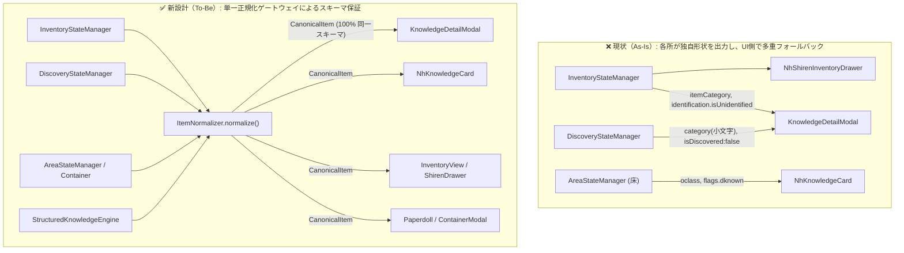

# 📐 JS層アイテムデータモデルの単一正規化（Canonical Item Schema）基本設計書

## 1. 背景と課題（なぜ機能更新のたびにデグレが発生するのか）

### 1.1 問題の所在：生成経路ごとに異なる「アイテムオブジェクト形状」の乱立
本プロジェクトは、初期の「TTYテキストパース方式」から「GKL構造化知識エンジン」、そして Phase 8 の「WASM C構造体メモリ直結（Direct Binding）」へと段階的に進化してきました。また、UI層も「Pure JS Client」「Web Components (`<nh-*>`)」「シレン風ゲームパッドドロワー」など複数のモジュールへと拡大しています。

その過程で、**同じ「1つのアイテム」を表す JavaScript オブジェクトであるにもかかわらず、生成元（Producer）によってプロパティ名・階層・型がバラバラに定義される状態**（スキーマの断片化）が発生しました。

### 1.2 断片化が引き起こす悪循環（デグレの構造的温床）
スキーマが統一されていないため、データを受け取る UI コンポーネントや判定ロジック（Consumer）の末端において、以下のような**防御的フォールバック（`||` 演算子の連鎖）**が至る所に記述される結果となりました。

```javascript
// ❌ 悪しき対症療法コードの例（バグ・デグレの温床）
const letter = data.letter || data.invlet || rawTarget.letter || data.item?.letter || data.charStr;
const category = data.category || data.itemCategory || data.onumCategory || (data.isPotion ? 'POTION' : 'OTHER');
const isUnid = Boolean(
  data.isUnidentified ||
  data.identification?.isUnidentified ||
  data.knowledge?.isUnidentified ||
  data.isDiscovered === false ||
  data.identification?.idLevel === 'UNIDENTIFIED'
);
```

この構造には以下の致命的な欠陥があります：
1. **新機能追加時のリグレッション（先祖返り）**:
   ある画面（例: ディスカバリー図鑑）向けに条件式を調整した際、別の画面（例: インベントリ）から渡されるオブジェクト固有のプロパティ階層（`identification.isUnidentified` や `itemCategory` 等）との整合性が崩れ、**今まで動いていたボタンや機能が突然消えるデグレ**を引き起こす。
2. **テストと実機の乖離**:
   単体テストで `{ category: 'POTION', isUnidentified: true, letter: 'a' }` のような「理想的なモック」を作って PASS させても、実機の `InventoryStateManager` が吐き出すオブジェクトにはトップレベルの `category` や `isUnidentified` が存在しないため、実機でのみ不具合が発生する。
3. **開発ガイドライン（`AGENTS.md`）への抵触**:
   `AGENTS.md` 第4項「対症療法の禁止・レガシーコードの全廃・型定義への準拠」に反し、場当たり的な分岐が増殖し続ける。

### 1.3 本設計の目的
JavaScript 層におけるアイテムデータの表現を **単一の正規化スキーマ（`CanonicalItem`）** に完全統一します。  
すべてのデータ生成元（Producer）の出口で単一の正規化器（`ItemNormalizer`）を通すことを義務付け、UI 層および GKL 判定層（Consumer）から冗長なフォールバックコードを **100% 根絶** します。

---

## 2. 現状のプロパティ不統一・分散状況の全量調査（As-Is）

現在コードベース内に散在しているアイテム属性の異名・階層違いの全量マッピングは以下の通りです。

| 意味・属性 | InventoryStateManager<br>(テキストパース経路) | InventoryStateManager<br>(Direct Binding経路) | InventoryWasmAdapter<br>(Wasm生ダンプ / 床アイテム) | DiscoveryStateManager<br>(ディスカバリー図鑑) | StructuredKnowledgeEngine<br>(マスタ / 知識解決) |
| :--- | :--- | :--- | :--- | :--- | :--- |
| **インベントリ文字** | `item.letter` (`'a'`) | `item.letter` (`'a'`)<br>`item.directObject.invlet` | `raw.invlet` (`'a'`) | `item.letter` (所持時のみ)<br>未所持時は `undefined` | `resolved.letter` (引継時) |
| **アイテム種別** | `item.onumCategory` (`'POTION'`)<br>`item.itemCategory`<br>`item.isPotion` (個別フラグ) | `item.onumCategory`<br>`item.itemCategory`<br>`item.oclass` (`3`) | `raw.oclass` (C数値 `1`〜`17`)<br>`raw.category` | `item.category` (**小文字** `'potion'`) | `k.category` (**大文字** `'POTION'`) |
| **未識別フラグ** | `item.identification.isUnidentified`<br>(※直下 `item.isUnidentified` は無し) | `item.identification.isUnidentified`<br>`item.flags.known === false` | `raw.flags.dknown`<br>`raw.flags.known` | `item.isDiscovered === false`<br>`item.isUnidentified: true` | `k.isUnidentified`<br>`k.identification.isUnidentified` |
| **アイテムID (otyp)** | `item.onum` (未識別時 `-1` の場合あり) | `item.onum` (`0`〜`480`) | `raw.otyp` / `raw.onum` | `item.onum` | `k.onum` |
| **名称（英語）** | `item.rawText`<br>`item.identification.coreName` | `item.name` / `item.baseName`<br>`item.rawText` | `raw.name` | `item.trueName`<br>`item.appearance` | `k.name` / `k.nameEn`<br>`k.oc_name` / `k.trueName` |
| **名称（日本語）** | `item.identification.displayName` | `item.nameJa` | - | `item.nameJa`<br>`item.appearanceJa` | `k.nameJa` / `k.japaneseName` |
| **プレイヤー仮名** | `item.identification.calledName` | `item.identification.calledName` | - | `item.calledName` | `k.calledName` |
| **個別銘 (Named)** | `item.identification.namedInstance` | `item.identification.namedInstance` | `raw.oname` | - | `k.namedInstance` |
| **BUC（祝呪）** | `item.identification.bucStatus` | `item.bucStatus`<br>`item.identification.bucStatus` | `raw.flags.bknown / blessed / cursed` | - | `k.bucStatus` |
| **強化値 / チャージ** | `item.spe`<br>`item.identification.enchantment / charges` | `item.spe`<br>`item.identification.enchantment / charges` | `raw.spe` | - | `k.spe` |

> [!WARNING]
> 特に顕著な問題として、**`InventoryStateManager` の出力オブジェクトにトップレベルの `category` プロパティと `isUnidentified` プロパティが存在しない**（`itemCategory` / `onumCategory` および `identification.isUnidentified` に分かれている）こと、また **`DiscoveryStateManager` のみ `category` が小文字（`'potion'`）になっている**ことが、UI 側での判定ミスを誘発していました。

---

## 3. 基本設計：正規化アイテムスキーマ（`CanonicalItem`）

### 3.1 設計原則
1. **トップレベル即応性（Flat Access for Common Predicates）**:
   UI やルールエンジンが高頻度で参照する基本属性（`letter`, `category`, `isUnidentified`, `isDiscovered`, `bucStatus`, `calledName`, `onum`, `glyphId`）は、**必ずトップレベルに正規化された型で存在することを保証**する。
2. **大文字・列挙型の厳格統一**:
   `category` はいかなる経路（図鑑・インベントリ・床・マスタ）であっても、必ず大文字の `ItemCategory` 列挙型（`'POTION'`, `'WEAPON'` 等）に統一する（小文字 `'potion'` や未定義を許容しない）。
3. **ソース（出所）の明示**:
   そのアイテムデータが「所持品（`INVENTORY`）」「床（`FLOOR`）」「コンテナ内（`CONTAINER`）」「図鑑エントリ（`CODEX`）」のどれであるかを `source` フィールドで明示する。
4. **Cコア真値（SSOT）と表示名の分離**:
   `rawText` は 100% 英語 ASCII を維持し、UI 表示用の名称は `displayName`（英語）および `displayNameJa`（日本語）として明確に分離する。

### 3.2 `CanonicalItem` 型定義（`src/core/index.d.ts` 準拠）

```typescript
/**
 * 正規化アイテムカテゴリ（全レイヤー共通・大文字固定）
 */
export type ItemCategory =
  | 'WEAPON'
  | 'ARMOR'
  | 'RING'
  | 'AMULET'
  | 'TOOL'
  | 'FOOD'
  | 'POTION'
  | 'SCROLL'
  | 'SPELLBOOK'
  | 'WAND'
  | 'GOLD'
  | 'GEM'
  | 'ROCK'
  | 'BALL'
  | 'CHAIN'
  | 'VENOM'
  | 'CORPSE'
  | 'STATUE'
  | 'OTHER';

/**
 * アイテムデータの発生源（コンテキスト）
 */
export type ItemSourceType =
  | 'INVENTORY'   // プレイヤー所持品
  | 'FLOOR'       // 足元・マップ上の床落ちアイテム
  | 'CONTAINER'   // 箱・袋の中身
  | 'CODEX'       // ディスカバリー図鑑・知識カタログ
  | 'VIRTUAL';    // 検索・静的辞書参照

/**
 * BUC（祝福・呪い）ステータス
 */
export type BucStatusType = 'BLESSED' | 'UNCURSED' | 'CURSED' | 'UNKNOWN';

/**
 * 識別段階レベル
 */
export type IdentificationLevelType =
  | 'UNIDENTIFIED'      // Lv.0: 完全未識別
  | 'BUC_KNOWN'         // Lv.1: BUCのみ判明
  | 'NAMED'             // Lv.2: プレイヤー仮名付与済み
  | 'TYPE_IDENTIFIED'   // Lv.3: 種別（真名）識別済み
  | 'FULLY_IDENTIFIED'; // Lv.4: 強化値・チャージ含め完全識別済み

/**
 * 単一正規化アイテムデータモデル (Canonical Item Schema)
 */
export interface CanonicalItem {
  // --- 1. 識別子・出所 ---
  readonly _canonical: true;          // 正規化済みマーカー
  source: ItemSourceType;             // 発生源 ('INVENTORY' | 'FLOOR' | 'CONTAINER' | 'CODEX' | 'VIRTUAL')
  letter: string | null;              // インベントリレター ('a'〜'z', 'A'〜'Z', '$' 等。非所持時は null)
  onum: number;                       // Cコアオブジェクト番号 (0〜480, 不明時は -1)
  glyphId: number;                    // 描画グリフID (不明時は -1)
  rawObjPtr: number;                  // Cコア struct obj* ポインタ (非実体時は 0)
  o_id: number;                       // Cコア固有オブジェクトID (非実体時は 0)
  corpsenm: number;                   // 死体・像・缶詰のモンスター番号 (非該当時は -1)

  // --- 2. カテゴリ・分類 ---
  category: ItemCategory;             // 正規化カテゴリ（必ず大文字。例: 'POTION', 'WEAPON'）
  oclass: number;                     // Cコア oclass 数値 (不明時は 0)

  // --- 3. 識別・命名状態（トップレベル保証） ---
  isUnidentified: boolean;            // 未鑑定かどうか（真名未判明なら必ず true）
  isDiscovered: boolean;              // 種別識別済みかどうか（!isUnidentified と一致）
  idLevel: IdentificationLevelType;   // 5段階識別レベル
  bucStatus: BucStatusType;           // 'BLESSED' | 'UNCURSED' | 'CURSED' | 'UNKNOWN'
  calledName: string | null;          // プレイヤー種別仮名 (oc_uname / called "...")
  namedInstance: string | null;       // 個別銘・アーティファクト名 (ONAME / named "...")

  // --- 4. 名称・テキスト（ASCII真値と多言語表示の分離） ---
  rawText: string;                    // 100% 英語 ASCII インベントリ表記
  name: string;                       // 現在の基準英語名（未識別時は外見名、識別済時は真名）
  nameJa: string;                     // 現在の基準日本語名
  appearanceName: string | null;      // 英語外見名 (例: "smoky potion")
  appearanceNameJa: string | null;    // 日本語外見名 (例: "煙った薬")
  trueName: string | null;            // 英語真名 (未識別かつ非透視時は null でネタバレ保護)
  trueNameJa: string | null;          // 日本語真名 (未識別かつ非透視時は null)
  displayName: string;                // 安全な表示用英語フルテキスト
  displayNameJa: string;              // 安全な表示用日本語フルテキスト

  // --- 5. 数量・スペック・装備状態 ---
  quan: number;                       // 個数 (デフォルト 1)
  spe: number | null;                 // 強化値またはチャージ数 (不明時は null)
  weight: number;                     // 重量 (不明時は 0)
  equipSlot: string | null;           // 装備中スロット ('weapon', 'suit', 'ring_left' 等。非装備時は null)
  isEquipped: boolean;                // いずれかのスロットに装備中か
  isWielded: boolean;                 // メイン武器装備中か
  isOffhand: boolean;                 // 副武器装備中か
  isQuivered: boolean;                // 矢筒セット中か
  isWorn: boolean;                    // 防具・装身具着用中か

  // --- 6. アクション・詳細構造（既存互換＆拡張） ---
  defaultVerb: string | null;         // 推奨主アクションキー ('q', 'r', 'w' 等)
  defaultSequence: string[];          // 推奨実行シーケンス (['q', 'a'] 等)
  defaultActionLabel: string | null;  // 英語アクションラベル
  defaultActionLabelJa: string | null;// 日本語アクションラベル
  alternativeActions: Array<{
    verb: string;
    sequence: string[];
    labelJa: string;
    isDefault?: boolean;
  }>;
  identification: Record<string, any>;// 詳細識別オブジェクト（トップレベル属性と完全同期）
  knowledge: Record<string, any> | null; // 静的・動的マスタ知識
  skillBadge: Record<string, any> | null;// 武器熟練度バッジ情報
}
```

---

## 4. アーキテクチャ設計：正規化パイプライン（`ItemNormalizer.js`）

### 4.1 データフローのBefore / After



### 4.2 `ItemNormalizer` の責務と実装仕様
新設する `src/core/knowledge/models/ItemNormalizer.js` は、どのような生データや部分オブジェクトが渡されても、決定論的に `CanonicalItem` を生成・返却する純粋関数を提供します。

1. **カテゴリの正規化 (`normalizeCategory`)**:
   - `input.category || input.itemCategory || input.onumCategory || input.identification?.category || input.knowledge?.category` を抽出し、必ず `.toUpperCase()` で `ItemCategory` 列挙値に変換する。
   - `oclass` 数値しかない場合は `OCLASS_TO_CATEGORY_MAP` から解決する。
2. **レターの正規化 (`normalizeLetter`)**:
   - `input.letter || input.invlet || input.directObject?.invlet || input.charStr || input.selector || null` を単一の `letter: string | null` に統一する。
3. **識別・仮名状態のトップレベル昇格と同期 (`syncIdentificationState`)**:
   - `isUnidentified` と `isDiscovered`（`= !isUnidentified`）をトップレベルと `item.identification` の双方で完全に一致させる。
   - `calledName` を変更・更新する際は、`ItemNormalizer.withCalledName(item, newCall)` ヘルパーを通すことで、`item.calledName` と `item.identification.calledName` の片方だけが更新されてズレるバグを防止する。
4. **後方互換フラグの提供（段階的移行用）**:
   - 既存の戦術ルール等で参照されている `isPotion`, `isPickAxe`, `isBag` 等の補助フラグも `ItemNormalizer` 内で一括付与し、既存ロジックを一切壊さずに移行する。

### 4.3 UI・Consumer 側の劇的な簡潔化（コード純化例）

正規化導入後、各 UI コンポーネントの判定コードは以下のように純化されます：

```javascript
// ✅ To-Be: KnowledgeDetailModal / NhKnowledgeCard の _canCallItem()
_canCallItem() {
  const item = this.currentItem; // CanonicalItem 保証済み
  if (!item || !item.isUnidentified) return false;
  return Boolean(item.letter || item.source === 'CODEX');
}
```

これまで 25 行以上にわたって書かれていた `rawTarget.isUnidentified || id.isUnidentified || data.knowledge?.isUnidentified || ...` といった防御的コードはすべて不要となり、**条件の抜け漏れによるデグレが構造的に発生しなくなります**。

---

## 5. 段階的移行計画（マイグレーション・ロードマップ）

既存機能への影響（デグレ）をゼロに抑えつつ確実に移行するため、以下の 4 フェーズで段階的に実施します。

### Phase 1: `CanonicalItem` 型定義と `ItemNormalizer.js` 基盤の実装
- [x] `src/core/index.d.ts` に `ItemCategory`, `ItemSourceType`, `CanonicalItem` インターフェースを追加。
- [x] `src/core/knowledge/models/ItemNormalizer.js` を実装（全 Producer パターンの入力から `CanonicalItem` への変換、および不変条件バリデータ `assertCanonicalItem()` の実装）。
- [x] `tests/core/knowledge/ItemNormalizer.test.js` を作成し、テキストパース・Direct Binding・床アイテム・図鑑エントリ・未識別・仮名付き等の全パターン変換を 100% 検証。

### Phase 2: Producer（データ生成層）の出口統一
- [x] `InventoryStateManager.js` (`updateFromMenuItems`, `syncFromDirectBinding`):
  - 生成される各アイテムを `ItemNormalizer.normalize(rawItem, { source: 'INVENTORY' })` 経由に統一。
  - トップレベルに `category`（大文字）、`isUnidentified`、`calledName` が常に存在する状態を保証。
- [x] `DiscoveryStateManager.js` (`getDiscoveredItems`):
  - 出力エントリを `ItemNormalizer.normalize(entry, { source: 'CODEX' })` 経由に統一（`category` の小文字混在を解消）。
- [x] `AreaStateManager.js` / `InventoryWasmAdapter.js` / `ContainerModal` / `ModalManager` (標準メニュー結合):
  - `AreaStateManager` 床アイテム、`ContainerModal` の左右パネル、および `ModalManager` の実インベントリ `i` メニュー行描画において `CanonicalItem` 結合＆ `ItemDisplayPresenter` 適用を完了。
  - ※ `StructuredKnowledgeEngine.js` 内部のレガシー推論フォールバック等の物理的撤廃は、次期マイルストーン「ROADMAP §3.3 Direct-Only アーキテクチャ純化」へ統合。

### Phase 3: Consumer（UI・モーダル・カード層）の純化とフォールバック撤廃・描画統一
- [x] `src/core/knowledge/presenters/ItemDisplayPresenter.js` を新設し、UI層共通のアイテム表示ロジック（表示タイトル・英和フォーマット・BUCバッジ・装備状態バッジ・仮名タグ・強化値・アイテムメニュー行HTML）を単一責務として集約。
- [x] `ModalManager.js` (`handleInputRequired` の MENU 描画):
  - 標準 `i` メニュー等のアイテム行描画において、`invlet` から `InventoryStateManager` の `CanonicalItem` を解決し、`ItemDisplayPresenter.getItemMenuRowContentHtml()` を適用してリッチバッジ（BUC、装備状態、和名・仮名）を表示。
- [x] `ContainerModal.js`:
  - 左右パネル（インベントリ ⇄ コンテナ中身）のアイテム描画を `ItemDisplayPresenter` に統一。BUC バッジや和名・仮名が左右対称・同一フォーマットで描画されるよう改修。
- [x] `InventoryView.js`:
  - ツールチップの英語決め打ちを撤廃し、`ItemDisplayPresenter.getFormattedTitle()` および `getCalledTagHtml()` に統一。スロット内の装備・BUCバッジ描画も統一。
- [x] `PaperdollModal.js`:
  - 70行以上に及ぶ自前の正規表現置換や `OBJECT_JP_MAP` 手動走査を全廃。`ItemDisplayPresenter` による描画および `ItemNormalizer` の和名自動解決へ集約。
- [x] `KnowledgeDetailModal.js`:
  - `_resolveData()` 出口で `ItemNormalizer.normalize()` を適用。ヘッダータイトルの文字列合成を `ItemDisplayPresenter.getFormattedTitle()` に集約。
- [x] `CodexModal.js`:
  - オブジェクトタブ一覧および詳細カードでのタイトル生成を `ItemDisplayPresenter` に統一。
- [-] 未使用 WebComponents (`<nh-container-filer>`, `<nh-paperdoll>`, `<nh-knowledge-card>`, `<nh-discovery-codex>`, `<nh-shiren-inventory-drawer>`):
  - 現在のクライアント（Nehww）で使用されていないため、将来の実装調整時（使用時）に対応する方針。

### Phase 4: スキーマ契約テスト（Schema Contract Tests）の常設化
- [x] `tests/core/knowledge/CanonicalItemContract.test.js` を新設。
- [x] `tests/core/knowledge/ItemDisplayPresenter.test.js` を新設し、各ステータス・フォーマット出力契約を検証。

---

## 6. 定量的効果測定・余剰フォールバックコード削減見込み（実測値）

現在のコードベース（テストコードおよび静的辞書・マスタデータを除く実ロジック **308 ファイル**）を対象に、アイテム属性の不統一に起因する防御的フォールバックコードの出現数を実測した結果は以下の通りです。

### 6.1 コードベース内の重複プロパティ探り（`||` 連鎖）実測数

| 冗長フォールバックの種別 | 典型的なコードパターン | 実測出現箇所数 |
| :--- | :--- | :---: |
| **① レター（文字）の探り** | `item.letter \|\| item.invlet \|\| item.charStr \|\| item.selector` | **120 箇所** |
| **② 名称・仮名の探り** | `data.oc_name \|\| data.nameEn \|\| data.trueName \|\| data.rawName \|\| data.name` | **100 箇所** |
| **③ カテゴリの探り** | `data.category \|\| data.itemCategory \|\| data.onumCategory` | **83 箇所** |
| **④ 未識別状態の探り** | `data.isUnidentified \|\| id.isUnidentified \|\| data.isDiscovered === false` | **69 箇所** |
| **⑤ `onum` 数値の階層探り** | `typeof data.onum === 'number' ? data.onum : id.onum ?? knowledge.onum` | **66 箇所** |
| **合計（アイテム属性の多重参照）** | - | **438 箇所** |

### 6.2 主要ファイル別の削減行数見込み（概算）

特にアイテム処理・UI描画が集中している主要 10 ファイル（合計 12,619 行）における段階別の削減見込みは以下の通りです：

- **第1段階（本設計：`CanonicalItem` スキーマ統一のみ）**:
  新設する `ItemNormalizer.js`（約 150 行）へ変換責務を一元化する代わりに、各ファイルに散在する **438 箇所の `||` チェーン（約 800〜1,200 行）を撤廃**。
- **第2段階（ROADMAP §3.3「Direct-Only 純化」との相乗効果）**:
  WASM Direct Binding 完全化に伴い不要となった旧 TTY テキスト正規表現パース・推測フォールバック群を合わせて撤廃することで、**最大約 2,500〜3,000 行規模のコード削減** を達成。

| 対象ファイル | 現在の行数 | 第1段階：スキーマ統一での削減見込 | 第2段階：Direct-Only純化込みの削減見込 | 主な撤廃対象・純化内容 |
| :--- | :---: | :---: | :---: | :--- |
| `src/core/knowledge/state/InventoryStateManager.js` | 1,949 行 | **▲ 250〜350 行** | **▲ 800〜1,000 行** | `onumCategory` / `itemCategory` / `category` の三重管理の撤廃。第2段階で TTY テキスト逆算・正規表現分類を丸ごと撤廃 |
| `examples/gkl-pure-js-client/modules/components/KnowledgeDetailModal.js` | 1,525 行 | **▲ 120〜180 行** | **▲ 200 行** | `_resolveData()` の複雑なマージ処理、`_canCallItem()` 等の20行超の防御的プロキシ判定を数行へ圧縮 |
| `src/components/NhKnowledgeCard.js` | 1,634 行 | **▲ 100〜150 行** | **▲ 180 行** | `data.X \|\| data.identification?.X \|\| data.knowledge?.X` の3階層参照を `item.X` の単一参照へ統一 |
| `src/core/knowledge/engines/StructuredKnowledgeEngine.js` | 1,644 行 | **▲ 150〜200 行** | **▲ 350 行** | 入力オブジェクトが何者かを推測する曖昧な分岐群を `item.source` と `item.onum` 直結へ純化 |
| `src/core/knowledge/engines/ItemIdentificationResolver.js` | 680 行 | **▲ 80 行** | **▲ 350〜400 行** | Cコアの `known` / `bknown` / `dknown` フラグと `oc_descr_idx` 直結により、文字列からの BUC・強化値・外見推測正規表現の大半を撤廃 |
| `examples/gkl-pure-js-client/modules/components/ModalManager.js` | 2,611 行 | **▲ 80〜120 行** | **▲ 150 行** | ダイアログ起動時のターゲット属性抽出・仮名同期時の二重書き換え処理を `ItemNormalizer` へ集約 |
| `src/core/knowledge/equipment/EquipmentRules.js` & `EquipmentDependencyAnalyzer.js` | 1,053 行 | **▲ 80〜100 行** | **▲ 250 行** | `equipSlot` と `category` がトップレベルで保証されるため、テキストから装備部位や呪いを推測するフォールバックを撤廃 |
| `src/core/knowledge/presenters/ItemSpecPresenter.js` & `ItemCandidateResolver.js` | 1,632 行 | **▲ 60〜90 行** | **▲ 150 行** | スペック抽出・価格候補抽出時の多重フィールド走査を単一フィールド参照へ純化 |

