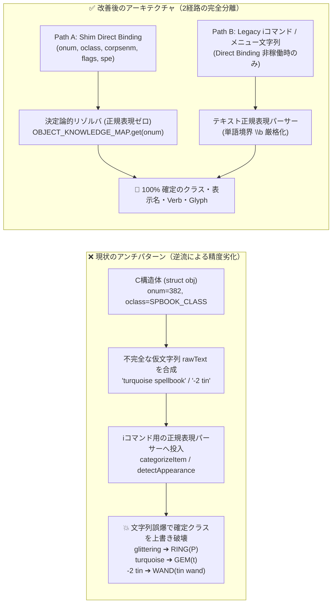

# 🛠️ Direct Binding 確定情報（Ground Truth）純化 ＆ 足元地形・インベントリ不具合是正計画書

**対象ロードマップ**: `docs/ROADMAP.md` §1.1 (Stage 8.3-C) / §2.6 連携  
**関連ドキュメント**: [official_shim_direct_binding_implementation_plan.md](../1_driver/official_shim_direct_binding_implementation_plan.md), [floor_item_direct_binding_and_peek_wisdom_architecture.ja.md](./floor_item_direct_binding_and_peek_wisdom_architecture.ja.md)

---

## 1. 背景とアーキテクチャ上の根本課題

Stage 8.2〜8.3 にて C 言語構造体（`struct obj`, `struct rm`）からの Direct Memory Binding を導入した際、以下の**構造的アンチパターン（構造体 ➔ 仮文字列合成 ➔ 正規表現による再パースの逆流）**が発生していました。



### 設計大原則：Shim 直結経路における文字列正規表現フォールバックの完全廃止
1. **Direct Binding 経路 (`source: 'SHIM_DIRECT'`) と `i` コマンド文字列解析経路 (`source: 'TEXT_PARSER'`) を明確に分離する**。
2. **Shim から直接取得したアイテム情報には、文字列正規表現によるカテゴリ推論・外見推論・装備スロット推論を一切適用しない**。
   - `onum` (`0..480`)、`oclass`、`corpsenm`、`flags` (`blessed`, `cursed`, `bknown`, `known`, `dknown`)、および装備ポインタ照合結果 (`equipSlot`) が **100% の Ground Truth（絶対的な正）** である。
   - `rawText` は UI 表示や既存インターフェース互換のための「最終出力結果」として生成するのみとし、`rawText` を再度正規表現にかけて `isRing` や `isGem` 等のフラグを書き換える処理を完全に遮断する。
3. **文字列正規表現パーサーは、`fallback` モード（`i` コマンドのメニュー行入力時）または `onum < 0` の純粋な文字列入力時のみ呼び出す専用関数へ隔離する**。

---

## 2. 確認された不具合の全件原因分析と修正仕様

### 2.1 足元判定時の地形・エンティティ Glyph 表示の違和感不具合

#### (1) 扉のないドア (`CMAP: 3985`) の上に乗ると閉じたドア (`CMAP: 3988`) が表示される
* **原因**:
  1. `src/core/knowledge/services/WasmDirectBindingService.js` (`getCellInfo`: L802-809, L1042-1049) の扉状態デコードに `D_NODOOR (0x00)` の判定がなく、`flags === 0` のときに `{ isOpen: false, isClosed: false, isBroken: false }` となる。
  2. `src/core/knowledge/state/area/TerrainInferenceEngine.js` (`getGlyphForTerrainType`: L63-64) が以下の実装になっているため、`!doorState.isOpen` がすべて閉じたドア (`3988`) になってしまう：
     ```javascript
     case 23: // DOOR
         return (doorState && doorState.isOpen) ? 3986 : 3988;
     ```
     これにより、扉のないドア枠 (`D_NODOOR: 0x00`) や壊れたドア (`D_BROKEN: 0x01`) の上に乗ると閉じたドア (`3988`) に化ける。
* **修正仕様**:
  - `WasmDirectBindingService.js` の `door` オブジェクトに `isNoDoor: (flags & 0x0F) === 0` を追加する（併せて L1079 のフォールバック時に `typ === 23` で `{ isOpen: true }` を捏造している処理も、`flags` に忠実なデコードへ修正する）。
  - `TerrainInferenceEngine.getGlyphForTerrainType` の `case 23 (DOOR)` で、`doorState.isNoDoor || doorState.isBroken` の場合は **`3985` (`S_ndoor`: 扉のないドア枠)** を返す。

#### (2) 開いたドアの上に移動すると、目視更新したものと縦横の向きが違うドア (`CMAP: 3986` vs `3987`) で表示される
* **原因**:
  1. `TerrainInferenceEngine.getGlyphForTerrainType` (L63-64) が縦向きのドア（開:`3986` / 閉:`3988`）しか返さず、横向きのドア（開:`3987` / 閉:`3989`）の判定を持たない。
  2. `src/core/knowledge/state/AreaStateManager.js` の `updatePlayerPosition` (L603-605) および `syncPlayerFeetFloor` (L668-675) が、プレイヤーがタイルに乗った際、すでに `print_glyph` / `bkglyphInfo` で目視確定していた `cell.bottom` のドアグリフ（`3985`〜`3989`）を無条件に `getGenuineFloor(x, y)` の結果（縦向き固定）で上書きしている。
* **修正仕様**:
  - **目視確定済みドア向きの保持**: `cell.bottom` にすでにドアグリフ（`3985`〜`3989`）が存在する場合、その縦横の向き（横:`3987`/`3989`、縦:`3986`/`3988`）を維持したまま開閉・破損状態（`isNoDoor`/`isBroken` ➔ `3985`、`isOpen` ➔ `3986` or `3987`、`isClosed`/`isLocked` ➔ `3988` or `3989`）のみを反映する。
  - **隣接壁による向き判定**: 未観測状態から直接ドアの向きを求める場合は、NetHack C コア (`src/display.c`) と同じく左右隣接セル `(x-1, y)` または `(x+1, y)` が壁 (`typ 1..11`) またはドア (`typ 23`) であれば横向き（開:`3987` / 閉:`3989`）、それ以外は縦向き（開:`3986` / 閉:`3988`）と判定する。

#### (3) 足元および拾った後のモンスター像が専用グリフではなくただの `statue (onum: 476)` になる
* **原因**:
  1. **Cシム層の `corpsenm` 未出力**: `src/driver/shim/shim_bridge.c` の `SHIM_CMD_DUMP_OBJECT_INFO` (L205-226) と `SHIM_CMD_DUMP_ALL_INVENT` (L227-259) が、像や死体のモンスターIDである **`o->corpsenm`** を出力していない（`SHIM_CMD_DUMP_ALL_INVENT` の `out[base + 11]` は `0 /* 予約 */` のまま未使用）。
  2. **足元同期の古い `otyp` ハードコード**: `src/core/knowledge/state/AreaStateManager.js` (`syncPlayerFeetObjects`: L550-558) のグリフ維持条件が旧バージョンの番号になっている：
     ```javascript
     } else if (cell.middle && cell.middle.type === ENTITY_TYPES.BODY && otyp === 295) { // ← NetHack 5.0 では CORPSE は 265
     } else if (cell.middle && cell.middle.type === ENTITY_TYPES.STATUE && otyp === 474) { // ← NetHack 5.0 では STATUE は 476 (474 は rock)
     ```
     このため、`otyp === 476` の像に乗ると条件から外れ、`GLYPH_OBJ_OFF + 476`（汎用像アイテムグリフ `3924`）で上書きされる。
  3. **所持品同期のグリフ固定計算**: `src/core/knowledge/state/InventoryStateManager.js` (`syncFromDirectBinding`: L463) が常に `GLYPH_OBJ_OFF + onum` しか計算しておらず、像 (`onum === 476`) のときに `GLYPH_STATUE_OFF (7226) + corpsenm` を使用していない。
* **修正仕様**:
  - `shim_bridge.c` で `o->corpsenm` を出力する（インベントリダンプでは予約枠 `out[base + 11] = o->corpsenm`、単体オブジェクトダンプでは `out[8] = o->corpsenm`）。
  - `AreaStateManager.syncPlayerFeetObjects` と `InventoryStateManager.syncFromDirectBinding` の双方で：
    - `onum === 476` (`STATUE`) かつ `corpsenm >= 0` の場合：`glyphId = GLYPH_OFFSETS.GLYPH_STATUE_OFF + corpsenm`（`corpsenm < 0` でも既存 `cell.middle.type === ENTITY_TYPES.STATUE` があればそのグリフを維持）。
    - `onum === 265` (`CORPSE`) かつ `corpsenm >= 0` の場合：`glyphId = GLYPH_OFFSETS.GLYPH_BODY_OFF + corpsenm`（山積み時は `GLYPH_BODY_PILETOP_OFF + corpsenm`）。

---

### 2.2 アイコンインベントリ・ナレッジの動作不具合

#### (1) 死体名称にモンスター名が付かず、ただの `corpse` として表示される（ナレッジも汎用死体になる）
* **原因**:
  - `shim_bridge.c` から `o->corpsenm` が渡っていないため、`InventoryStateManager.syncFromDirectBinding` (L494-495) で `OBJECT_KNOWLEDGE_MAP.get(265).name` である `"corpse"` がそのまま使われ、`glyphId` も汎用死体オブジェクト (`GLYPH_OBJ_OFF + 265`) になっている。
  - その結果、`StructuredKnowledgeEngine` でもどのモンスターの死体か判別できず、個体別の死体ナレッジ（耐性獲得確率・石化危険性・ベジタリアン判定等）が引けない。
* **修正仕様**:
  - `rawItem.corpsenm >= 0` の場合、`MONSTER_KNOWLEDGE_BASE[rawItem.corpsenm]` からモンスター名（英語 `name` / 日本語 `nameJa`）を取得し：
    - 死体 (`onum === 265`): `baseName = "${monName} corpse"`、`glyphId = GLYPH_OFFSETS.GLYPH_BODY_OFF + rawItem.corpsenm`
    - 像 (`onum === 476`): `baseName = "statue of a ${monName}"`、`glyphId = GLYPH_OFFSETS.GLYPH_STATUE_OFF + rawItem.corpsenm`
    - フィギュア (`onum === 262` 等該当ID): `baseName = "figurine of a ${monName}"`
  - `StructuredKnowledgeEngine.getItemKnowledge` / `getCorpseKnowledge` / `getStatueKnowledge` に `corpsenm` を直接渡し、文字列パースを介さずに `corpsenm` から直接モンスター別死体・像ナレッジを生成する。

#### (2) `glittering spellbook` が `glittering` となり、アクションコマンドが「装備（指輪）」になる
* **原因（4重の複合バグ）**:
  1. **`glyphClassifier.js` の魔法書・杖 `onum` 範囲ズレ**:
     - NetHack 5.0 の実データ（`OBJECT_KNOWLEDGE_BASE.js`）では、**魔法書 (`SPELLBOOK`) は `onum: 366〜409`**（`401` が初期外見 `"glittering"` の `create familiar`）、**杖 (`WAND`) は `onum: 410〜438`**。
     - しかし `src/core/knowledge/engines/glyphClassifier.js` (`getCategoryFromOnum`: L109-113, `getItemInfoFromOnum`: L196-200) と `InventoryStateManager.categorizeItem` (L895-896) では **`366〜400` が SPELLBOOK、`401〜438` が WAND** と誤定義されている。
  2. **`"glittering"` の末尾 `"ring"` に対する単語境界 `\b` なし正規表現の誤爆**:
     - `"glittering"` は末尾が `"ring"` (`glitte` + `ring`) で終わるため、以下の `\b` なし判定がすべて `true`（指輪）と誤判定する：
       - `InventoryStateManager.categorizeItem` (L915): `(/ring|指輪/i.test(cleanText))` ➔ `isRing = true`
       - `EquipmentRules.resolveEligibleSlots` (L125): `if (cat === 'RING' || /ring|指輪/.test(raw)) return ['left_ring', 'right_ring'];` ➔ 指輪スロット装備対象と判定
       - `ItemIdentificationResolver.inferCategory` (L564): `lower.includes('ring')` が `spellbook` (L566) より先に評価され `'RING'` を返す
  3. **表示名から `spellbook` が消える原因**:
     - `OBJECT_APPEARANCE_DICT.formatAppearanceNameStatic` (L183) の `case 'RING': return /ring$/i.test(cleanDescr) ? cleanDescr : ...` に `"glittering"` が入ると、`/ring$/i.test("glittering")` が `true` になりサフィックスが付かず `"glittering"` 単体になる。
     - また `GKLEventRouter.js` (L552-555) で存在しない `discoveryStateManager.getUnidentifiedAppearanceName()` を呼んで生の `objInfo.descr` (`"glittering"`) にフォールバックしている。
  4. **アクション決定の優先順位逆転**:
     - `InventoryStateManager.determineDefaultAction` (L1308-1354) で、`categoryFlags.isRing` (L1308) が `categoryFlags.onumCategory === 'SPELLBOOK'` (L1335) より前にあるため、`isRing` の誤爆が優先され装備コマンド（`P`）になる。
* **修正仕様**:
  - `glyphClassifier.js` および `InventoryStateManager.js` の `onum` 境界を **`SPELLBOOK: 366〜409`、`WAND: 410〜438`** に修正する。
  - Shim 直結時は `onum` / `oclass` から確定したカテゴリのみを使用し、文字列による `isRing` 等の推論を実行しない。
  - レガシー文字列パーサー側でも、すべての `/ring/`・`/ring$/`・`.includes('ring')` を単語境界付きの **`/\brings?\b/i`** に統一する。
  - `GKLEventRouter.js` (L552-555) の未識別外見名解決を `discoveryStateManager.getAppearance(onum)` ＋ `ItemIdentificationResolver.formatAppearanceName(descr, category, 'en')` に統一する。

#### (3) `turquoise spellbook` のアクションコマンドが `t`（投げる＝石・宝石）になる
* **原因**:
  1. `InventoryStateManager.categorizeItem` (L931) で、`onum` から `onumCategory === 'SPELLBOOK'` が確定しているにもかかわらず、Layer 2 の文字列正規表現が実行され、`"turquoise"`（や `"ruby"`, `"emerald"`, `"jade"`, `"sapphire"`, `"opal"` 等）という色名単語に反応して **`isGem = true`** がセットされる。
  2. `InventoryStateManager.determineDefaultAction` (L1281-1354) で、未識別魔法書の `knowledge` には `defaultVerb` が含まれないため L1257 を通過し、L1281 の `else if (categoryFlags.isGem || ...)` が L1335 の `SPELLBOOK` 分岐より先に評価され、`defaultVerb = 't'`（投げる）が選択される。
* **修正仕様**:
  - **Direct Binding 時のカテゴリ固定**: `onum >= 0`（または `oclass`）が存在する場合、`categorizeItem` は `OBJECT_KNOWLEDGE_MAP.get(onum)` / `getItemInfoFromOnum(onum)` の確定カテゴリのみからフラグを構築し、文字列による他クラス（`isGem`, `isRing`, `isArmor` 等）の上書きを一切行わない。
  - **未識別ナレッジへのクラス標準 `defaultVerb` 付与**: `StructuredKnowledgeEngine.getUnidentifiedItemKnowledge` でも、確定したアイテムクラス（`SPELLBOOK` ➔ `'r'`, `POTION` ➔ `'q'`, `WAND` ➔ `'z'`, `SCROLL` ➔ `'r'`, `RING`/`AMULET` ➔ `'P'`）の標準 `defaultVerb` / `verbKey` を保持させる。
  - レガシー文字列パーサー側でも、`isGem` の除外条件に `/\b(potion|scroll|spellbook|book|wand|ring|amulet)s?\b/i` を追加する。

#### (4) 缶詰を作成しても `-2 tin` などになり、ナレッジが `tin wand`（錫の杖）になる
* **原因A（`-2 tin` の表示）**:
  - NetHack C コアの `struct obj` において、`o->spe` はアイテムクラスごとに意味が異なる：
    - 武器・防具・指輪：強化値（`+1`, `-2` 等。ただし **`o->known == 1` のときのみプレイヤーに既知**）
    - 杖 (`WAND`)・魔道具（魔法のマーカー、角笛、ランプ等）：残りチャージ数（**`o->known == 1` のときのみ既知**）
    - **缶詰 (`TIN`, `onum: 296`)**：`spe = 1` はほうれん草、`spe = 0` は通常の肉、`spe < 0`（`-1`, `-2` 等）は**自作缶詰（homemade tin）や罠付き缶詰の内部識別フラグ**であり、強化値ではない！
    - **魔法書 (`SPELLBOOK`)**：読書回数カウンタ等
  - `InventoryStateManager.syncFromDirectBinding` (L536-538) が `if (rawItem.spe !== 0)` で全アイテム無条件に `+spe` / `-spe` を出力していたため、自作缶詰が `-2 tin` と表示されていた。
* **原因B（ナレッジが `tin wand` になる）**:
  - `"tin"` は食料の缶詰 (`onum: 296`) であると同時に、杖の外見素材（`"tin wand"`＝錫の杖）として `APPEARANCE_PATTERNS.WAND` にも含まれる。
  - `ItemIdentificationResolver.detectAppearance` (L528-531) の Step 10（単独形容詞マッチング）が `onum: 296`（`FOOD` クラス）を無視して `lowerCore === "tin"` を `APPEARANCE_PATTERNS.WAND` にマッチさせ、`{ isAppearance: true, category: 'WAND', appearanceName: 'tin wand' }` を返していた。
  - さらに `StructuredKnowledgeEngine.getItemKnowledge` (L840) が `onum` チェックより先に `this.isUnidentifiedAppearance(rawName)` を呼ぶため、`onum: 296` の缶詰を「未識別の錫の杖 (`tin wand`)」として処理していた。
* **修正仕様**:
  - **`spe` の出力ガード**:
    - `shim_bridge.c` の `SHIM_CMD_DUMP_ALL_INVENT` および `SHIM_CMD_DUMP_OBJECT_INFO` の `flags` に **`o->known`** と **`o->dknown`** を追加する。
    - `InventoryStateManager.syncFromDirectBinding` では、`rawItem.flags.known`（または `sagesWisdomMode`）が真であり、かつカテゴリが **`WEAPON` / `ARMOR` / `RING`**（および強化値を持つ `TOOL`：つるはし `253`、ユニコーンの角 `261`）のときのみ `+spe` / `-spe`（`+0` 含む）を表示する。
    - `WAND`（およびチャージ制 `TOOL`）で `known` が真のときは `(${spe} charges)` または `(0:${spe})` を付与する。
    - **`FOOD` (`tin`: `onum === 296`)**：`spe` を強化値として出力しない。代わりに `known`（または自作・識別済み）時に `corpsenm` と `spe` から `"tin of spinach"` (`spe === 1`) / `"empty tin"` (`corpsenm < 0`) / `"homemade tin of ${monName} meat"` (`spe < 0 && corpsenm >= 0`) / `"tin of ${monName} meat"` (`corpsenm >= 0`) を正確に組み立てる。
  - **Shim 直結時の `ItemIdentificationResolver` / `StructuredKnowledgeEngine` 短絡解決**:
    - `onum >= 0` が渡されている場合、`OBJECT_KNOWLEDGE_MAP.get(onum)` の `category` と `canBeUnidentified` を絶対優先とし、`canBeUnidentified === false`（`FOOD`, `TOOL`, `CONTAINER` 等）のアイテムに対して `detectAppearance` や `isUnidentifiedAppearance` による未識別外見マッチを一切行わない。

---

## 3. 全ドメイン横断：Direct Binding ⇄ フォールバックの排他ルーティング・優先順位原則

今回のインベントリや足元地形の問題と同根の「確定情報と推測フォールバックの混線・二重処理」をシステム全体で防ぐため、全ドメインに対して以下の **3階層データ優先度（Tier 1〜3）** と **入口排他ルーティング** を適用します。

### 3.1 データソース優先順位の3階層モデル
1. **Tier 1: C 構造体メモリ直結 (`SHIM_DIRECT` / Ground Truth)**
   - `struct obj` (`onum`, `oclass`, `corpsenm`, `spe`, `quan`, `flags`)、`levl[x][y]` (`typ`, `flags`, `seenv`)、`fmon` (`mpeaceful`, `mtame`)、`objects[i]` (`oc_name_known`, `oc_descr_idx`)、`u` (`dnum`, `ublesscnt`, `uprops`)。
   - **原則**: 最優先かつ絶対的な正。下位層（Tier 3 の文字列正規表現や推測）による上書きを一切禁止する。
   - **例外なきゲームルール遵守**: C 構造体内の「プレイヤー既知フラグ（`dknown`, `bknown`, `known`, `seenv`）」は Tier 1 の一部として厳守し、未確認情報をプレイヤーに漏洩させない（Peek Wisdom 明示解放時を除く）。
2. **Tier 2: C コア送出の視覚観測イベント (`VISUAL_OBSERVATION`)**
   - `print_glyph(x, y, glyph)` で一度観測・確定した視覚固有属性（例：ドアの縦横の向き `3986` vs `3987`、遠距離視認のグリフ種別）。
   - **原則**: Tier 1 の構造体が持たない視覚表現（縦横向き等）を保持しており、Tier 1 の状態フラグ（開閉・破損等）と矛盾しない限りそのまま維持する。
3. **Tier 3: 文字列正規表現・ヒューリスティック推論 (`FALLBACK_INFERENCE`)**
   - `i` / `\` / `^X` コマンドのテキスト行正規表現パース、メッセージ文字列からの状態逆算、Direct Binding 無効時の仮床推測（`3992`）、大岩移動推測など。
   - **原則**: **`directBindingMode === 'fallback'` の場合、または Direct Binding 非接続の純粋テキスト入力時のみ起動する完全隔離パス**とする。Tier 1 が稼働している通常時（`auto` / `strict`）には呼び出し自体をスキップし、無駄な計算や副作用（誤爆上書き）を発生させない。

### 3.2 ドメイン別の排他ルーティング監査マトリクス

| ドメイン / モジュール | Tier 1 (Direct Binding 時) の正規ルート | 遮断・隔離すべき Tier 3 (余計なフォールバック/逆流) |
| :--- | :--- | :--- |
| **所持品・装備**<br>`InventoryStateManager`<br>`EquipmentRules` | `SHIM_CMD_DUMP_ALL_INVENT` + `GET_EQUIPMENT_PTRS` ➔ `onum` / `oclass` からマスター辞書を $O(1)$ 直引き | ❌ 合成した `rawText` に対する `categorizeItemByText`（色名・末尾 `"ring"` 等の正規表現）の実行を禁止<br>❌ `i` コマンドのサイレントマクロ発行をスキップ |
| **アイテム識別・ナレッジ**<br>`ItemIdentificationResolver`<br>`StructuredKnowledgeEngine`<br>`DiscoveryStateManager` | `SHIM_CMD_DUMP_DISCOVERIES` + `DUMP_DESCR_INDEXES` + `onum` / `corpsenm` / `flags.known` から決定論的に解決 | ❌ `onum >= 0` が判明しているアイテムへの文字列 `detectAppearance` / `inferCategory`（`"tin"` ➔ `"tin wand"` 誤爆等）を禁止<br>❌ `\` コマンドのサイレントマクロ発行をスキップ |
| **空間・地形・足元**<br>`AreaStateManager`<br>`TerrainInferenceEngine` | `SHIM_CMD_GET_CELL_INFO` + `GET_OBJECT_AT` + `DUMP_LEVEL_TERRAIN` + Tier 2（目視確定済みの扉向き等） | ❌ Direct Binding 有効時の `DEFAULT_INFERRED_FLOOR_GLYPH (3992)` 仮床注入を禁止<br>❌ 目視確定済みの横向き扉 (`3987`/`3989`) を縦固定推論 (`3986`/`3988`) で上書きすることを禁止 |
| **コンテキストアクション**<br>`ActionSignalResolver`<br>`ContextActionEngine` | 扉の `door.isLocked` / `isTrapped`、箱の `olocked` / `otrapped`、モンスターの `mpeaceful` / `mtame` を直接参照 | ❌ 英語/日本語メッセージ文字列からの「鍵がかかっている」「罠がある」推測によるアクション上書きを禁止 |
| **総重量・負荷状態**<br>`EncumbranceStateManager` | `SHIM_CMD_GET_INV_WEIGHT` (`inv_weight()`) + 構造体から算出した可搬限界 (`weightCap`) | ❌ インベントリ文字列からの重量手計算合算で真の重量を上書きすることを禁止 |
| **属性・耐性 (Stage 8.4)**<br>`AttributeStateManager` | `SHIM_CMD_GET_PLAYER_PROPS` (`uprops` 配列) からの直接注入 | ❌ Direct Binding 稼働時の `^X` サイレントマクロやメッセージ逆算による不確実な耐性推定をスキップ |

---

## 4. テストランク制度（Test Rank S / A / B / C）とトレードオフ整理方針

現在 138 スイート・1,718 件存在するテストの中には、Phase 8 以前の「文字列正規表現パース」「仮床 `3992` 推測」「構造体から仮文字列を作って既存パーサーに流す実装詳細」を前提として書かれたテストが含まれています。  
**「過去の古いテストを無条件にすべて通すために、本番コードに不必要なフォールバック混在や互換ハックを残す」という本末転倒を防ぐ**ため、テストスイートに以下の **4段階ランク（Rank S / A / B / C）** を導入し、トレードオフ発生時の明確な優先順位と整理（削除・改修・隔離）を行います。

| ランク | 定義・対象テスト | 優先度・トレードオフ時の取扱方針 |
| :---: | :--- | :--- |
| **Rank S**<br>*(最重要・絶対死守)* | **SSOT マスター整合性・Direct Binding 真値契約・プロトコル防壁**<br>・`WasmDirectBindingService.test.js`, `DirectBindingVerificationEnvironment.test.js`<br>・`KnowledgeIntegrityAudit.test.js`, `ObjectKnowledgeIntegrity.test.js`, `AllGlyphsVerification.test.js`<br>・`sequenceProtocol.test.js`, `ArchitectureBoundary.test.js` | **最優先（100% PASS 必須）**。<br>C コアの真値（`onum` 境界、`corpsenm`、`known` フラグ、扉状態、UI境界規約）を保証するテスト。ここが落ちた場合は必ずプロダクションコードを修正する。 |
| **Rank A**<br>*(主軸・現行仕様)* | **各 Manager / Engine の公開契約 ＆ 実機シナリオ統合テスト**<br>・Direct Binding (`auto` / `strict`) モード下での `AreaStateManager`, `InventoryStateManager`, `StructuredKnowledgeEngine`, `EquipmentRules`, `UIController` 等の機能テスト<br>・`realScenarios.test.js` | **高優先（仕様進化に合わせて更新）**。<br>新仕様（2経路分離・確定描画・ネタバレ防止マスク）の振る舞いを検証する主軸テスト。旧仕様の期待値とトレードオフになる場合は、**新仕様（Direct Binding 確定挙動）に合わせてテストの期待値を更新**する。 |
| **Rank B**<br>*(フォールバック隔離)* | **レガシー文字列解析・ヒューリスティック推論専用テスト**<br>・`i` / `\` / `^X` コマンドのテキスト行パーステスト<br>・Direct Binding 非稼働時（`fallback` モード）の仮床 `3992` 推論・大岩移動推論テスト | **条件付き維持（`fallback` モードへ明示隔離）**。<br>Direct Binding 経路のテストと混ざらないよう、テスト内で明示的に `directBindingMode: 'fallback'`（またはテキスト専用関数 `parseInventoryLine` 等）を指定して隔離する。Direct Binding の妨げになる場合は Rank S/A を優先する。 |
| **Rank C**<br>*(廃止・統合対象)* | **旧アーキテクチャの内部実装詳細・廃止仕様に依存した冗長テスト**<br>・Direct Binding 稼働中に文字列正規表現フォールバックが動くことを前提としたテスト<br>・モジュール分割前の内部プライベートメソッドや重複モックを叩くだけのテスト | **積極整理（削除または Rank A/B へ統合）**。<br>このランクのテストを通すために本番コードへ余計な処理を入れることは**厳禁**とし、発見次第速やかに削除（Prune）または統合してテストスイートをスリム化する。 |

---

## 5. 実装フェーズ別タスクリスト（次回セッション用チェックリスト）

### Step 1: C シム層 (`shim_bridge.c`) ＆ `WasmDirectBindingService.js` の拡張と WASM リビルド
- [ ] `src/driver/shim/shim_bridge.c`:
  - `SHIM_CMD_DUMP_ALL_INVENT` (0x43): `flags` (`out[base + 6]`) に `o->known` (`1 << 9`)、`o->dknown` (`1 << 3`)、`o->rknown` (`1 << 4`) を追加し、予約枠 `out[base + 11]` に **`o->corpsenm`** を格納する。
  - `SHIM_CMD_DUMP_OBJECT_INFO` (0x42): `out[6]` の `flags` に `o->known` 等を追加し、`out[8]` に **`o->corpsenm`** を追加出力する（§2.6 の `long[12]` 拡張と統合可能）。
- [ ] `scripts/build_wasm_50.ps1` を実行し、WASM バイナリをリビルド・同期する。
- [ ] `src/core/knowledge/services/WasmDirectBindingService.js`:
  - インベントリおよび床オブジェクトのアンパック処理で `corpsenm` と `flags.known` / `flags.dknown` / `flags.rknown` を展開する。
  - `getCellInfo` の `door` オブジェクトに `isNoDoor: (flags & 0x0F) === 0` を追加し、`_cachedLevelTerrain` フォールバック時（L1079）の不当な `{ isOpen: true }` 仮定を修正する。

### Step 2: 足元地形（扉向き・扉なし）＆ 足元モンスター像/死体グリフの修正
- [ ] `src/core/knowledge/state/area/TerrainInferenceEngine.js`:
  - `getGlyphForTerrainType` の `case 23 (DOOR)` を改修：
    - `doorState.isNoDoor || doorState.isBroken` ➔ **`3985`** (`S_ndoor`)
    - 開閉ドアの縦横判定：既存 `cell.bottom.glyph`（Tier 2: `3986`〜`3989`）の向き、または隣接セル `(x-1, y)`, `(x+1, y)` の地形を参照し、縦向きなら 開:`3986` / 閉:`3988`、横向きなら 開:`3987` / 閉:`3989` を返す。
- [ ] `src/core/knowledge/state/AreaStateManager.js`:
  - `updatePlayerPosition` (L603-605) および `syncPlayerFeetFloor` (L668-675) で、既存の `cell.bottom` が確定ドアグリフ（`3985`〜`3989`）である場合に横向き情報を失わないよう保護する。
  - `syncPlayerFeetObjects` (L550-558) の `otyp === 295` を **`265` (`CORPSE`)**、`otyp === 474` を **`476` (`STATUE`)** に修正し、`corpsenm >= 0` が取得できている場合は `GLYPH_BODY_OFF + corpsenm` / `GLYPH_STATUE_OFF + corpsenm` を直接セットする。
- [ ] `src/core/knowledge/coordinators/GKLEventRouter.js`:
  - L552-555 の存在しない `getUnidentifiedAppearanceName` 呼び出しを `getAppearance(onum)` ＋ `ItemIdentificationResolver.formatAppearanceName` に修正する。

### Step 3: `glyphClassifier.js` 境界修正 ＆ Direct Binding / テキスト解析パスの完全分離
- [ ] `src/core/knowledge/engines/glyphClassifier.js`:
  - `getCategoryFromOnum` (L109-113) と `getItemInfoFromOnum` (L196-200) の魔法書範囲を **`366〜409`**、杖範囲を **`410〜438`** に修正する。
- [ ] `src/core/knowledge/state/InventoryStateManager.js`:
  - **Path A: Direct Binding 専用解決 (`syncFromDirectBinding`)**:
    - `corpsenm` による死体 (`265`)・像 (`476`)・缶詰 (`296`) のモンスター名合成と専用グリフ (`GLYPH_BODY_OFF + corpsenm`, `GLYPH_STATUE_OFF + corpsenm`) の設定。
    - `spe` の付与を `flags.known`（または `sagesWisdomMode`）かつ強化値対象クラス（`WEAPON`, `ARMOR`, `RING`, 一部 `TOOL`）に限定し、缶詰 (`296`) や魔法書に `-2` 等の不正な強化値が付かないようにする。
    - `categorizeItemFromOnum(onum, oclass)` を新設・分離し、`syncFromDirectBinding` では文字列正規表現（Layer 2）を一切呼ばず `onum` マスターデータのみから `categoryFlags` を決定する。
    - `determineDefaultAction` で `onumCategory`（および `OBJECT_KNOWLEDGE_MAP.get(onum)` のクラス標準アクション）を最優先とする。
  - **Path B: レガシー文字列パーサー (`categorizeItemByText`)**:
    - `/ring|指輪/i` を `/\brings?\b|指輪/i` に修正し、`isGem` の除外条件に `spellbook|potion|wand|scroll` を追加する。
- [ ] `src/core/knowledge/equipment/EquipmentRules.js`:
  - `resolveEligibleSlots` (L125) で `item.onumCategory` / `item.itemCategory` が確定している場合はそれを絶対優先（`'SPELLBOOK'` 等の非装備クラスなら即 `[]` を返却）とし、テキストフォールバック時の `/ring|指輪/` も `/\brings?\b|指輪/i` に修正する。
- [ ] `src/core/knowledge/engines/ItemIdentificationResolver.js` ＆ `OBJECT_APPEARANCE_DICT.js` ＆ `StructuredKnowledgeEngine.js`:
  - `onum >= 0` が指定されている場合は `OBJECT_KNOWLEDGE_MAP.get(onum)` の `category` と `canBeUnidentified` を Ground Truth として固定し、文字列からの `inferCategory` や単独形容詞マッチ（`"tin"` ➔ `"tin wand"`）を完全にバイパスする。
  - `OBJECT_APPEARANCE_DICT.js` (L183) の `/ring$/i` を `/\bring$/i` に、`ItemIdentificationResolver.inferCategory` (L564) の `lower.includes('ring')` を `/\brings?\b/i.test(lower)` に修正する。
  - `StructuredKnowledgeEngine.getItemKnowledge` に `corpsenm` を連携し、所持品・足元の死体や像でもモンスター固有ナレッジが 100% 返るようにする。

### Step 4: テストランク（Rank S/A/B/C）に基づくテスト検証とレガシーテスト整理
- [ ] **Rank S / A テストの追加・更新**:
  - 扉なし (`3985`)、縦横開扉 (`3986` / `3987`)、縦横閉扉 (`3988` / `3989`) の足元移動時保持テスト
  - 足元・所持品のモンスター像 (`onum: 476, corpsenm`) および死体 (`onum: 265, corpsenm`) の専用グリフ・名称・ナレッジ検証テスト
  - `glittering spellbook` (`onum: 401`)、`turquoise spellbook` (`onum: 382`)、自作缶詰 (`onum: 296, spe: -2, corpsenm`) の Direct Binding 決定論的解決テスト
- [ ] **Rank B / C テストの隔離・整理**:
  - 旧仕様（構造体入力時に文字列正規表現フォールバックが混ざる前提や、Direct Binding 有効時に仮床推測が走る前提）に依存している既存テストを棚卸しし、Rank B（`fallback` モード明示指定）への隔離または Rank C（不要テストの削除）を実施する。
