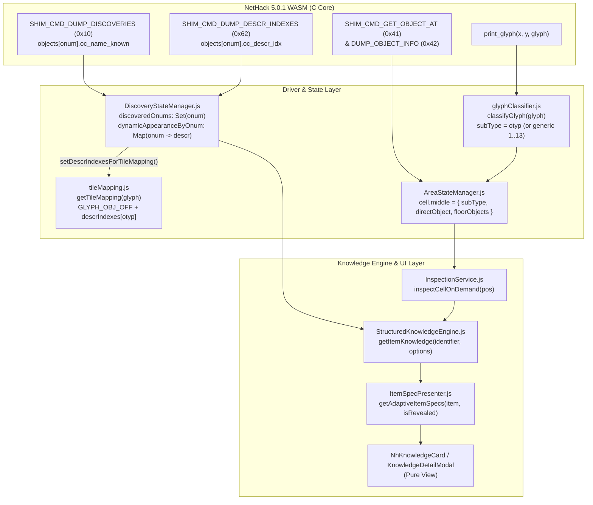

# 床落ちアイテム・コンテナ・死体の Direct Binding 完全化 ＆ 覗き見知恵（Peek Wisdom）統合アーキテクチャ設計書

**対象ロードマップ**: `docs/ROADMAP.md` §2.6  
**関連ステージ**: Stage 8.2-C（シャッフル外見＆床オブジェクト直結）/ Stage 8.3（モジュール分割完了後）  
**最終更新**: 2026-10-11（最新モジュール構成 `InspectionService.js` / `AreaStateManager.js` / `StructuredKnowledgeEngine.js` / `ItemSpecPresenter.js` 対応版）

---

## 1. 背景と現在の到達点

以前、床落ちアイテムの未鑑定マスク表示と「覗き見知恵（Peek Wisdom / 賢者の知恵の一時解放）」を実装しようとした際、以下の3つの要因が重なり混乱が生じていました。

1. **グリフIDとシャッフル外見（`oc_descr_idx`）の混同**: NetHack C コアが `print_glyph` に送出するオブジェクトグリフが「真の `otyp`」なのか「外見インデックス」なのか、また遠距離の未視認オブジェクト（`dknown == 0`）で何が送られるかの整理が不十分だった。
2. **巨大ファイル内のロジック分散**: 旧 `GKLPlugin.js` や旧 `AreaStateManager.js`、さらに UI コンポーネント（`KnowledgeDetailModal.js`, `NhKnowledgeCard.js`）に独自の `OBJECT_KNOWLEDGE_MAP` 参照や `getOnumFromGlyph` 逆引きが散在していた。
3. **床落ち `struct obj` インスタンス属性の未伝搬**: インベントリアイテムと異なり、床落ちアイテム（`cell.middle`）にはスタック数（`quan`）、BUC状態（`blessed`/`cursed`/`bknown`）、強化値（`spe`）、箱の施錠状態（`olocked`/`lknown`）、死体・像のモンスター種別（`corpsenm`）や鮮度（`age`）が伝搬されていなかった。

### 完了済みの基盤（現在利用可能な資産）
- **Stage 8.2-C 完了**:
  - `src/driver/shim/shim_bridge.c` および `WasmDirectBindingService.js` に `SHIM_CMD_DUMP_DESCR_INDEXES` (0x62: `objects[i].oc_descr_idx` 配列ダンプ) と `SHIM_CMD_GET_OBJECT_AT` (0x41) / `SHIM_CMD_DUMP_OBJECT_INFO` (0x42) が実装済み。
  - `DiscoveryStateManager.syncDescrIndexes()` と `tileMapping.js` (`setDescrIndexesForTileMapping`) の連携が稼働済み。
- **Stage 8.3 モジュール分割完了**:
  - `GKLPlugin.js` から調査・座標検査ロジックが `src/core/knowledge/services/InspectionService.js` へ分離済み。
  - `AreaStateManager.js` が 4 サブモジュール（`LevelMapStore.js`, `ViewportTileProjector.js`, `MonsterTrackSynchronizer.js`, `TerrainSemanticsResolver.js`）へ分離済み。
  - アイテム仕様の整形が `src/core/knowledge/presenters/ItemSpecPresenter.js` へ分離済み。

---

## 2. 調査結果①：シャッフル外見（`descr_idx`）と `otyp` の解決フロー

### 2.1 NetHack 5.0.1 C コアにおける床オブジェクトのグリフ生成仕様
C コアの `include/display.h` (L806-968) および `src/display.c` (`map_object`, `see_nearby_objects`) の実装調査により、C 側が `print_glyph` に渡す `glyphId` の仕様は以下のように確定しました。

1. **近傍視認済み（`dknown == 1`）または外見非シャッフル品の通常オブジェクト**:
   - `normal_obj_to_glyph(obj)` により **`GLYPH_OBJ_OFF (3448) + obj->otyp`**（スタック最上位なら `GLYPH_OBJ_PILETOP_OFF (7992) + obj->otyp`）が出力される。
   - **重要**: C コアはグリフ番号自体には `oc_descr_idx` を加算せず、**真のアイテムIDである `obj->otyp` をそのままグリフオフセットとして送出**する。
2. **遠距離で外見未確認（`dknown == 0`）の薬・宝石・魔法書（Generic Object Glyph）**:
   - `obj_is_generic(obj)` マクロ（`!obj->dknown` かつ `POTION_CLASS` / 宝石類 `FIRST_REAL_GEM..LAST_GLASS_GEM` / 魔法書 `FIRST_SPELL..LAST_SPELL`）に該当する場合、プレイヤーが半径2マス（または `xray_range`）以内に近づいて `observe_object(obj)` で `dknown = 1` になるまでは、`generic_obj_to_glyph(obj)` により **`GLYPH_OBJ_OFF + obj->oclass`（`1..13` の汎用クラスオブジェクト番号）** が出力される。
   - この状態では、描画グリフからは「何らかの薬（`onum = 7`）」「何らかの宝石（`onum = 12`）」「何らかの魔法書（`onum = 9`）」であることしか分からない（C コアの遠目視認ルール）。
3. **死体（`CORPSE`）および像（`STATUE`）**:
   - 死体は `GLYPH_BODY_OFF (3056) + obj->corpsenm`（または `GLYPH_BODY_PILETOP_OFF (8507) + obj->corpsenm`）。
   - 像は性別（`spe & CORPSTAT_GENDER`）に応じて `GLYPH_STATUE_MALE_OFF (7201) + obj->corpsenm` 等が出力される。
   - 一方、**缶詰（`TIN`）やフィギュア（`FIGURINE`）** は通常オブジェクトグリフ（`GLYPH_OBJ_OFF + TIN`）であり、グリフIDからは中身のモンスター（`corpsenm`）を判別できない（`struct obj` の `corpsenm` 直読が必須）。

### 2.2 JS レイヤーでの「タイル描画」と「知識解決（通常時 vs Peek時）」の分離構造
現在の JS コードベースでは、以下の4モジュールが連携して `otyp` と `descr_idx` を変換しています。

1. **タイル描画（`tileMapping.js`）**:
   - `DiscoveryStateManager.syncDescrIndexes()` が `setDescrIndexesForTileMapping(descrIndexes)` を呼び出す。
   - `getTileMapping(glyphId)` は、`glyphId = GLYPH_OBJ_OFF + otyp` を受け取ると、`appOnum = activeDescrIndexes[otyp]` にリマップしてタイル画像を返す。これにより、マップ上のタイルは常に「今ゲームでシャッフルされた外見（例: 赤紫色の薬のタイル）」で描画される。
2. **`DiscoveryStateManager` の状態保持**:
   - `this.discoveredOnums`: `SHIM_CMD_DUMP_DISCOVERIES` から同期された、`oc_name_known == 1` の `onum` セット。
   - `this.dynamicAppearanceByOnum`: `onum`（真の `otyp`）をキーとし、`OBJECT_KNOWLEDGE_MAP.get(descrIndexes[onum]).descr`（例: `"purple-red"`）を保持するマップ。
3. **`StructuredKnowledgeEngine.getItemKnowledge()` の解決フロー**:
   - **Direct Binding 有効時**:
     - `targetOnum` は `directObject.otyp`（または `dknown == 1` 時の `glyphClassifier.subType`）から確定する。
     - **【重要・ネタバレ防止ルール】遠距離未確認（`directObject.flags.dknown === false` かつ Generic Object 対象クラス）の場合**:
       - **通常表示（`sagesWisdomMode: false`）**: プレイヤーはまだ色や材質すら見ていないため、`dynamicAppearanceByOnum` の外見名（「赤紫色の薬」等）すら伏せ、純粋な汎用クラス表示（例: **`"薬 (Potion)"` / `"未確認の薬"`**）を返す。
       - **Peek 時（`sagesWisdomMode: true`）**: `directObject.otyp` から真名とシャッフル外見の両方を解放し、**`"赤紫色の薬 [超回復の薬]"`** を表示する。
     - **近傍視認済み（`dknown === true`）かつ未鑑定（`!isIdentified(targetOnum)`）の場合**:
       - **通常表示（`sagesWisdomMode: false`）**: `discoveryStateManager.getAppearance(targetOnum)` からシャッフル外見記述子（例: `"purple-red"`）を取得し、`ItemIdentificationResolver.formatAppearanceName` で翻訳した外見名（例: **`"赤紫色の薬 (purple-red potion)"`**）を `name` / `nameJa` として返す。この際、真名や真の効果は `wisdomTrueName` / `wisdomEffectSummary` 等に格納して通常フィールドからは完全に隠蔽する。
       - **Peek 時（`sagesWisdomMode: true`）**: `OBJECT_KNOWLEDGE_MAP.get(targetOnum)` の真名・真の仕様（効果・BUC効果・重量・材質）をメインフィールドに展開し、`nameJa: "赤紫色の薬 [超回復の薬]"` の形式で外見と正体を同時表示する。
   - **フォールバック時（Direct Binding 無効時）**:
     - `dknown == 0` の遠距離アイテムはグリフから `subType = 1..13`（Generic Class）しか得られないため、通常時・Peek 時ともに「未鑑定の薬（遠距離のため外見・正体不明）」として安全にフォールバックする。
     - `dknown == 1` の近傍アイテムはグリフから `targetOnum = otyp` が得られるため、`/` や `\` コマンドのテキスト解析で学習済みの `appearanceMap` があれば外見名を表示し、未学習なら「未鑑定の薬」を表示しつつ、Peek 時には `targetOnum` から `OBJECT_KNOWLEDGE_MAP.get(targetOnum)` で真名（「超回復の薬」）を100%確実に表示できる。

### 2.3 発見された既存バグ（`StructuredKnowledgeEngine.getUnidentifiedItemKnowledge`）
調査の結果、`StructuredKnowledgeEngine.js` (L669-702) の `getUnidentifiedItemKnowledge()` において、せっかく `getItemKnowledge()` (L427) で `onum: targetOnum` を渡しているにもかかわらず、内部で生成する `rawObj` に **`onum: rawInput.onum` と `directObject: rawInput.directObject` を引き継いでいない**ことが判明しました。
- この欠落により、未鑑定知識オブジェクトから `onum` が消失し、後からその知識オブジェクトを `getKnowledge(item, { sagesWisdomMode: true })` に渡した際に真名解決が失敗する原因となっていました。改修時に `rawObj` へ `onum`, `directObject`, `floorObjects`, `isPile` を確実に保持させます。

---

## 3. 調査結果②：床アイテム `struct obj` フィールドの伝搬経路と具体的改修箇所

現在、床落ちアイテム（`cell.middle`）はグリフ種別しか持っておらず、C 構造体 `struct obj` のインスタンス情報が `StructuredKnowledgeEngine` や `ItemSpecPresenter` に届いていません。以下の4段階のパイプライン改修により、床アイテム・コンテナ・死体・スタックの全情報を欠落なく伝搬させます。

### 3.1 C シム層（`src/driver/shim/shim_bridge.c`）と `WasmDirectBindingService.js` の拡張
現在の `SHIM_CMD_DUMP_OBJECT_INFO` (0x42, `shim_bridge.c` L205-226) は `long[8]` (32 bytes) しか返しておらず、死体・缶詰・像のモンスター種別（`corpsenm`）や箱の施錠・罠フラグ、死体の経過ターン（`age`）、床スタックの次ポインタ（`nexthere`）が欠落しています。

#### 改修内容（`shim_bridge.c` & `WasmDirectBindingService.js`）
`SHIM_CMD_DUMP_OBJECT_INFO` (0x42) の出力バッファを **`long[12]` (48 bytes)** に拡張（後方互換性を維持しつつ末尾に4ワード追加、および `flags` ビット拡張）します。

| インデックス | C 構造体フィールド (`struct obj`) | 用途・意味 |
| :--- | :--- | :--- |
| `out[0]` | `o->otyp` | 真のオブジェクト種別 ID (`onum`) |
| `out[1]` | `o->owt` | キャッシュ重量 |
| `out[2]` | `o->quan` | スタック個数（矢・巻物・薬等の束） |
| `out[3]` | `o->spe` | 強化値 / 杖・魔道具のチャージ数 / 像の性別フラグ (`CORPSTAT_GENDER`) |
| `out[4]` | `o->oclass` | アイテムクラス文字 |
| `out[5]` | `o->invlet` | インベントリ文字 |
| `out[6]` | `flags` (ビットフィールド拡張) | 下記ビット割り当て参照 |
| `out[7]` | `weight(o)` | コンテナの中身込み実重量 |
| `out[8]` | `o->corpsenm` | **【新規】** 死体・像・缶詰・フィギュアのモンスター種別 ID (`PM_*`, 未設定時 `-1`) |
| `out[9]` | `o->age` | **【新規】** 生成ターン（死体の鮮度・蘇生判定、燃焼経過等の算出用） |
| `out[10]` | `(long)(uintptr_t)o->cobj` | **【新規】** コンテナ内オブジェクトリストの先頭ポインタ（非0なら中身あり） |
| `out[11]` | `(long)(uintptr_t)o->nexthere` | **【新規】** 同一床セル上の次オブジェクトポインタ（Worker ブリッジでのスタック全件走査用） |

**`out[6]` (`flags`) のビット拡張**:
- Bit 0: `blessed`, Bit 1: `cursed`, Bit 2: `bknown`, Bit 3: `dknown`, Bit 4: `rknown`
- Bit 5..6: `oeroded` (錆/焼損度 0..3), Bit 7..8: `oeroded2` (腐食/虫食い度 0..3)
- **Bit 9 (`0x0200`)**: `o->known`（強化値 `spe`・チャージ数既知フラグ）
- **Bit 10 (`0x0400`)**: `o->cknown`（コンテナの中身の有無既知フラグ）
- **Bit 11 (`0x0800`)**: `o->lknown`（コンテナの施錠/解錠状態既知フラグ）
- **Bit 12 (`0x1000`)**: `o->tknown`（コンテナの罠有無既知フラグ）
- **Bit 13 (`0x2000`)**: `o->olocked`（箱が施錠されている）
- **Bit 14 (`0x4000`)**: `o->obroken`（箱の錠前が壊れている）
- **Bit 15 (`0x8000`)**: `o->otrapped`（箱に罠が仕掛けられている）
- **Bit 16 (`0x10000`)**: `o->oerodeproof`（錆止め・耐火コーティング済み）
- **Bit 17 (`0x20000`)**: `o->greased`（グリース塗布済み）
- **Bit 18 (`0x40000`)**: `o->unpaid`（店の未払い品）

さらに、`WasmDirectBindingService.fetchObjectsAt(x, y)` (L1467-1488) において、`out[11]` (`nexthere`) を辿ることで、Worker ブリッジ経由でも床上のスタック（最大10件程度まで安全上限付き）を配列として全件取得できるようにし、コンテナで `cobj != 0` の場合は中身リスト（`contents`）も1階層取得可能にします。

### 3.2 `GKLEventRouter.js` ＆ `AreaStateManager.js`（`cell.middle` への格納）
1. **プレイヤー足元および近傍の自動同期**:
   - `AreaStateManager.syncPlayerFeetFloor()` (L489-504) および `syncFromDirectBinding()` (L510-554) にて、地形（`cell.bottom`）・モンスター（`cell.top`）だけでなく、`cell.middle` が存在するセル（またはプレイヤー足元 `(px, py)`）に対して `directBindingService.getObjectsAt(x, y)` を呼び出し、`cell.middle.directObject = floorObjs[0]` および `cell.middle.floorObjects = floorObjs`、`cell.middle.isPile = floorObjs.length > 1` を格納する。
   - `GKLEventRouter.js` (L88-100) の `syncFromWorkerBridge` 呼び出しでも、プレイヤー足元 `(px, py)` の床オブジェクトを同期する。
2. **`updateGlyph` 時のキャッシュ維持と更新**:
   - `AreaStateManager.updateGlyph(x, y, glyphId, ...)` (L356-370) で `ITEM` / `BODY` / `STATUE` が描画された際、Direct Memory が即座に読める場合は `getObjectsAt(x, y)` をアタッチし、また `glyphClassifier.classifyGlyph` の `isPile` フラグ（`GLYPH_OBJ_PILETOP_OFF` 等）も `cell.middle.isPile` に反映する。

### 3.3 `InspectionService.js`（オンデマンド検査時の床オブジェクト取得とデータ受け渡し）
`src/core/knowledge/services/InspectionService.js` を以下のように改修します。

1. **`inspectCellOnDemand(targetPos, options)` (L78-95)**:
   - 対象セルに `cell.middle` があり、まだ `cell.middle.directObject` が未取得（または最新ターンでない）の場合、`await p.wasmDirectBindingService.fetchObjectsAt(targetPos.x, targetPos.y)` を実行し、`cell.middle.directObject = floorObjs[0]`、`cell.middle.floorObjects = floorObjs`、`cell.middle.isPile = floorObjs.length > 1 || cell.middle.isPile` をセットする。
2. **`getInspectionTargetAt(targetPos)` (L97-170) および `getKnowledgeForEntity(entityInfo, options)` (L172-255)**:
   - `cell.middle` から検査ターゲットを生成する際、`directObject`、`floorObjects`、`isPile` を `target` オブジェクトに欠落なくコピーする。
   - `getKnowledgeForEntity` 内で `p.knowledgeEngine.getKnowledge()` を呼ぶ際、単なる `{ subType, category, glyph }` だけでなく、`{ ...entityInfo, onum: entityInfo.directObject?.otyp ?? entityInfo.subType, directObject: entityInfo.directObject, floorObjects: entityInfo.floorObjects, isPile: entityInfo.isPile }` を渡す。

### 3.4 `StructuredKnowledgeEngine.js` ＆ `ItemSpecPresenter.js`（動的インスタンス仕様の構築）
1. **`StructuredKnowledgeEngine.js`**:
   - **アイテム解決 (`getItemKnowledge`, L411-530)**:
     - `const directObj = identifier?.directObject || null;` を受け取る。
     - `targetOnum` は `directObj?.otyp ?? identifier?.onum ?? identifier?.subType` で解決する（これにより、`dknown == 0` でグリフが Generic Class `1..13` の場合でも、`directObj.otyp` から真の `onum` を保持できる）。
     - 前述の 2.2 のルールに従い、`directObj && !directObj.flags?.dknown` で Generic Object 対象クラスの場合は、通常モードでは外見名も伏せた汎用クラス名（`"未確認の薬"` 等）を返し、`sagesWisdomMode: true`（または `wisdomTrueName`）にのみ外見名＋真名を格納する。
     - **缶詰 (`TIN`, `onum = 247`)・フィギュア (`FIGURINE`, `onum = 419`) 対応**: `directObj?.corpsenm >= 0` が存在する場合、`MONSTER_KNOWLEDGE_MAP.get(directObj.corpsenm)` から中身・対象モンスター名を取得し、鑑定済み（`rknown` / `known`）または Peek モード時に「〜の缶詰（ホウレンソウ／モンスター名）」「〜のフィギュア」を正確に表示する。
   - **死体・像解決 (`getCorpseKnowledge` L536-620, `getStatueKnowledge` L626-667)**:
     - `directObj?.corpsenm >= 0` があればグリフ逆引きよりも優先してモンスター種別を特定する。
     - 死体の場合、`directObj?.age` と現在のゲームターン数（`u.umoved` / `moves`）の差分から経過ターン数を計算可能にし、像の場合は `directObj?.cobjPtr !== 0`（像の中に本やアイテムが入っているか）や歴史的彫像フラグを保持する。
   - **スタック・束（Pile）情報の付与**:
     - `directObj?.quan > 1`（同一アイテムの束、例: 12本の矢）と、`floorObjects?.length > 1 || isPile`（複数種類のアイテムの山）を知識データの `instanceInfo` として付与する。
2. **`ItemSpecPresenter.js` (`getAdaptiveItemSpecs`, L19-289)**:
   - 静的マスタデータだけでなく、`item.directObject` / `item.instanceInfo` が存在する場合に以下の動的スペックバッジ・項目を生成する（**通常時はプレイヤー既知フラグ `bknown` / `known` / `lknown` / `tknown` / `cknown` が `true` の項目のみ表示し、`isWisdomRevealed: true` (Peek 時) は全項目を紫色の `[知恵]` ハイライト付きで開示**）：
     - **個数・山状態**: `quan > 1` なら個数（例: `×12`）、`isPile` なら「複数アイテムの山（計Nスタック）」および下層アイテム一覧（Peek 時または足元視認時）。
     - **BUC 状態**: `bknown` または Peek 時に「祝福 (Blessed) / 無呪 (Uncursed) / 呪い (Cursed)」を表示（未知時は「不明 (Unknown)」）。
     - **強化値・チャージ数 (`spe`)**: 武器・防具・杖・魔道具・指輪で、`known` または Peek 時に `+2` や `(0:5)` 等の数値を表示。
     - **劣化・コーティング状態**: `oeroded` / `oeroded2`（錆・腐食・焼損・虫食い度）、`oerodeproof`（耐食処理済）、`greased`（グリース塗布）を表示（これらは視覚的に外観から判別可能な属性）。
     - **コンテナ（箱・鞄）専用スペック**:
       - 施錠状態: `lknown` または Peek 時に「施錠 (Locked) / 解錠 (Unlocked) / 錠前破損 (Broken)」。
       - 罠状態: `tknown` または Peek 時に「罠あり (Trapped) / 罠なし (Untrapped)」。
       - 中身状態: `cknown` または Peek 時に「中身あり (Contains N items) / 空 (Empty)」および実重量（`weight`）。

---

## 4. 調査結果③：UI 層の「View 特化」純化チェック

`NhKnowledgeCard.js` と `KnowledgeDetailModal.js` を精査した結果、以下の不純物（ビジネスロジックの混入）と、一時的にコメントアウトされている Peek UI が確認されました。

### 4.1 `KnowledgeDetailModal.js` の問題点と純化方針
`examples/gkl-pure-js-client/modules/components/KnowledgeDetailModal.js` には、現在以下の直接参照と独自解決ロジックが残存しています：

1. **直接インポートの排除対象 (L2-3)**:
   - `import { OBJECT_KNOWLEDGE_MAP } from "../../../../src/core/knowledge/data/OBJECT_KNOWLEDGE_FULL.js";`
   - `import { getOnumFromGlyph } from "../../../../src/core/knowledge/engines/glyphClassifier.js";`
2. **`_resolveData()` (L453-548) の独自マージロジックの排除**:
   - 現在 `_resolveData()` 内で、未鑑定アイテムに対して `getOnumFromGlyph(g)` を呼び出し、自前で `OBJECT_KNOWLEDGE_MAP.get(targetOnum)` を引いて `name`, `effectSummary`, `bucEffects`, `weight`, `material` を上書き合成している。
   - **純化方針**: `KnowledgeDetailModal` は自前でマスタデータを一切検索せず、`GKLPlugin` / `StructuredKnowledgeEngine.getKnowledge(this.currentRawData, { sagesWisdomMode: this.isPeekWisdom || this.isGlobalWisdom })` を呼び出すだけの純粋な View とする。これにより、エンジン側で構築した `specs`（コンテナ状態や BUC・強化値等を含む）と `[外見名 [真名]]` フォーマットがそのままモーダルに描画される。
3. **Peek Wisdom ボタンとキーバインドの復元 (L205-229, L798-800)**:
   - 現在省略されているヘッダーの `#btn-modal-peek-wisdom`（👁️ 覗き見知恵トグルボタン）と、モーダル表示中の `w` / `W` キーによるトグル操作を復元する。

### 4.2 `NhKnowledgeCard.js` の問題点と純化方針
`src/components/NhKnowledgeCard.js` には以下の課題があります：

1. **Peek トグル時のデータ再解決または完全参照**:
   - `togglePeekWisdom()` (L480-483) は `this.isPeekRevealed = !this.isPeekRevealed; this.render();` を行っているが、`_renderLayer1Spec()` (L940-985) では `Category` / `Weight` / `Material` / `BUC Status` の4ボックスしか描画しておらず、`ItemSpecPresenter.getAdaptiveItemSpecs()` が生成する適応型スペック（または `directObject` の個数・強化値・コンテナ施錠状態・床スタック情報）が表示されていない。
   - **純化方針**: `StructuredKnowledgeEngine.getItemKnowledge()` が通常データ（`specs`）と併せて `wisdomSpecs`（`isWisdomRevealed: true` で `getAdaptiveItemSpecs` を呼んだ配列）および `instanceSpecs`（個数・BUC・コンテナ状態等）を返却するようにし、`NhKnowledgeCard` は `isPeekRevealed` の状態に応じて `wisdomSpecs` と `specs` を切り替えて描画するだけの View に純化する。
2. **Peek Wisdom UI トリガーの復元 (L613-631, L850-857)**:
   - カードヘッダー／フッターの `#peekWisdomBtn`（👁️ ボタン）および `w` キーのショートカットを復元する。

---

## 5. 最新モジュール構成に即した実装計画（ファイル別改修タスクリスト）

本体コードの実装フェーズでは、以下の順序とモジュール分担で改修を実施します。

### Phase 1: C シム層 ＆ Direct Binding サービスの拡張
1. **[`src/driver/shim/shim_bridge.c`](file:///c:/Users/e3-sh/Documents/GitHub/Nethack-wasm-webUI/src/driver/shim/shim_bridge.c) (L205-226)**
   - `SHIM_CMD_DUMP_OBJECT_INFO` (0x42) の出力を `long[12]` (48 bytes) に拡張。
   - `flags` (`out[6]`) に `known`, `cknown`, `lknown`, `tknown`, `olocked`, `obroken`, `otrapped`, `oerodeproof`, `greased`, `unpaid` を追加。
   - `out[8] = corpsenm`, `out[9] = age`, `out[10] = cobj`, `out[11] = nexthere` を追加。
   - `scripts/build_wasm_50.ps1` を用いて WASM バイナリをリビルド（または既存のメモリレイアウト読み取りと併用）。
2. **[`src/core/knowledge/services/WasmDirectBindingService.js`](file:///c:/Users/e3-sh/Documents/GitHub/Nethack-wasm-webUI/src/core/knowledge/services/WasmDirectBindingService.js) (L650-688, L1467-1535)**
   - `_decodeObjectInfoFromWords(words, ptr)` ヘルパーに統一し、`long[12]` から拡張フラグ・`corpsenm`・`age`・`cobjPtr`・`nextherePtr` をデコード。
   - `fetchObjectsAt(x, y)` で `nextherePtr` を辿り、床上のスタック全件（`floorObjects` 配列）と、コンテナ（`cobjPtr !== 0`）の中身リストを取得するよう強化。

### Phase 2: 状態管理 ＆ 検査サービス（`AreaStateManager` / `InspectionService`）の連携
3. **[`src/core/knowledge/state/AreaStateManager.js`](file:///c:/Users/e3-sh/Documents/GitHub/Nethack-wasm-webUI/src/core/knowledge/state/AreaStateManager.js) (L356-370, L489-554) ＆ [`GKLEventRouter.js`](file:///c:/Users/e3-sh/Documents/GitHub/Nethack-wasm-webUI/src/core/knowledge/coordinators/GKLEventRouter.js) (L88-100)**
   - `syncPlayerFeetFloor()` および `syncFromDirectBinding()` にて、`cell.middle` に `directObject`（最上位オブジェクト）、`floorObjects`（スタック配列）、`isPile` を同期。
4. **[`src/core/knowledge/services/InspectionService.js`](file:///c:/Users/e3-sh/Documents/GitHub/Nethack-wasm-webUI/src/core/knowledge/services/InspectionService.js) (L78-255)**
   - `inspectCellOnDemand(targetPos, options)` で `cell?.middle` が存在する場合に `fetchObjectsAt(targetPos.x, targetPos.y)` を実行して `cell.middle.directObject` / `floorObjects` を最新化。
   - `getInspectionTargetAt` と `getKnowledgeForEntity` で `directObject`, `floorObjects`, `isPile` を `StructuredKnowledgeEngine` へ引き渡す。

### Phase 3: 知識エンジン ＆ プレゼンター（`StructuredKnowledgeEngine` / `ItemSpecPresenter`）の統合
5. **[`src/core/knowledge/engines/StructuredKnowledgeEngine.js`](file:///c:/Users/e3-sh/Documents/GitHub/Nethack-wasm-webUI/src/core/knowledge/engines/StructuredKnowledgeEngine.js) (L411-702)**
   - `getUnidentifiedItemKnowledge()` が `onum`, `directObject`, `floorObjects`, `isPile`, `wisdomSpecs` を欠落なく保持するよう修正。
   - `getItemKnowledge()` にて、`directObject` がある場合の `dknown == 0`（遠距離未確認マスク）と `dknown == 1`（シャッフル外見名表示）の出し分け、および `sagesWisdomMode: true` での真名・全属性解放を実装。
   - 缶詰（`TIN`）・フィギュア（`FIGURINE`）・死体（`CORPSE`）・像（`STATUE`）で `directObject.corpsenm` と `directObject.age` を反映。
6. **[`src/core/knowledge/presenters/ItemSpecPresenter.js`](file:///c:/Users/e3-sh/Documents/GitHub/Nethack-wasm-webUI/src/core/knowledge/presenters/ItemSpecPresenter.js) (L19-289)**
   - `getAdaptiveItemSpecs(item, isWisdomRevealed)` に `directObject` / `floorObjects` の動的インスタンス情報（個数 `quan`、BUC状態、強化値/チャージ `spe`、錆/腐食度、箱の施錠/罠/中身有無、床スタック一覧）を組み込み、通常時は既知フラグ（`bknown`, `known`, `lknown`, `tknown`, `cknown`）に従い、Peek 時は全開示するロジックを追加。

### Phase 4: UI 層の「View 特化」純化 ＆ Peek Wisdom 操作の復元
7. **[`examples/gkl-pure-js-client/modules/components/KnowledgeDetailModal.js`](file:///c:/Users/e3-sh/Documents/GitHub/Nethack-wasm-webUI/examples/gkl-pure-js-client/modules/components/KnowledgeDetailModal.js)**
   - `OBJECT_KNOWLEDGE_MAP` と `getOnumFromGlyph` の直接 import を削除。
   - `_resolveData()` を `GKLPlugin` / `StructuredKnowledgeEngine.getKnowledge(rawData, { sagesWisdomMode })` の呼び出しに一本化。
   - ヘッダーの `#btn-modal-peek-wisdom` ボタンと `w`/`W` キーのショートカットを復元。
8. **[`src/components/NhKnowledgeCard.js`](file:///c:/Users/e3-sh/Documents/GitHub/Nethack-wasm-webUI/src/components/NhKnowledgeCard.js)**
   - エンジンから渡された `specs` / `wisdomSpecs` / `instanceInfo` を描画する純粋な View に整理。
   - `#peekWisdomBtn` ボタンと `w` キーのショートカットを復元。
9. **単体テストの追加・検証**:
   - `tests/unit/floor_item_direct_binding_peek.test.js` を新設し、①遠距離未確認（`dknown=0`）、②近傍未鑑定（`dknown=1, oc_name_known=0` でのシャッフル外見表示）、③Peek Wisdom トグル時の真名・BUC・箱状態・死体種別の完全開示、④Direct Binding 無効時のフォールバックの4ケースを自動検証する。
