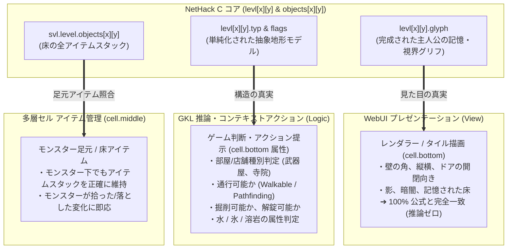

# 🏛️ NetHack Cコア直接グリフ (levl.glyph) ＆ 抽象地形 (typ) ハイブリッドアーキテクチャ設計計画書

## 1. 背景と課題

Stage 8.2〜8.3 における DirectBinding の導入時、「画面描画（見た目）は `print_glyph` に任せ、DirectBinding では不可視な真実（`levl.typ` や HP・重量など）のみを取得する」という一般的なモデル/ビュー分離の先入観に基づいて設計されました。

しかし、NetHack の C コアは 40 年以上の歴史の中で、**マップ構造体自身（`struct rm`）の先頭にプレイヤーの記憶・視界グリフそのもの（`int glyph`）をキャッシュする特有のアーキテクチャ**を持っています。

### 現状アーキテクチャの課題
1. **ドア向き・壁形状の推論による破綻**:
   DirectBinding で `typ`（ROOM や DOOR などの大分類）しか取得しなかったため、WebUI 側でドアの縦横や壁の角を逆算・推論する必要が生じ、目視確定した向きと足元同期の向きが食い違う不具合が発生した。
2. **確定地形グリフ完全保護による動的変化の硬直化**:
   逆算による誤上書きを防ぐために導入された「確定地形グリフ完全保護（上書き防止ガード）」によって、壁の掘削やドアの破壊、氷の融解などの「真の動的変化」が DirectBinding 側から反映できないジレンマに陥っている。
3. **モンスター足元アイテム・影・暗闇の放置**:
   C コアには全セルのアイテムリンクリスト（`svl.level.objects[x][y]`）や照明状態（`lit`）が存在するにもかかわらず、プレイヤー足元以外では参照されておらず、モンスターが上に乗ったアイテムの消滅や追跡が未対応のままとなっている。

---

## 2. 基本設計思想：「両使い（ハイブリッド二重管理）」アーキテクチャ

本設計では、**「見た目の真実（View）」と「構造の真実（Logic）」を完全に役割分担**させます。



### 役割分担マトリクス
| 取得データ | 担当レイヤー | 用途とメリット |
| :--- | :--- | :--- |
| **`levl[x][y].glyph`** | **描画・可視化 (View)** | **【完全な表示再現】**<br>・壁の角や縦横、ドアの開閉向きを 100% 公式一致で描画<br>・影になった床や視野外の記憶状態をそのまま表示<br>・推測・逆算の辻褄合わせコードを完全撤廃 |
| **`levl[x][y].typ` & `flags`** | **推論・判定 (Logic)** | **【シンプルなルール判断】**<br>・「ここは部屋か通路か？」（`ROOM` / `CORR`）<br>・「ドアはあるか？ 施錠されているか？ 罠はあるか？」<br>・「掘削できる壁か？ 溶岩か水か？」<br>・店舗種別（`rtype`）や祭壇アライメントの特定 |
| **`objects[x][y]`** | **多層セル (Model)** | **【モンスター足元の正確な復元】**<br>・モンスターが上に乗っても、足元のアイテムスタック（`cell.middle`）を正確に維持・更新 |

---

## 3. 各コンポーネントの詳細改修仕様

### 3.1 C言語ディスパッチャーブリッジ (`src/driver/shim/shim_bridge.c`)
全フロア (80×21) の `levl[x][y].glyph` を一括ダンプする新コマンドを追加します。

* **コマンド定義**:
  ```c
  SHIM_CMD_DUMP_LEVEL_GLYPHS = 0x15, /* buf=int[80*21], len=80*21*sizeof(int) -> 全フロアglyph一括コピー */
  ```
* **ハンドラ実装**:
  ```c
  case SHIM_CMD_DUMP_LEVEL_GLYPHS: {
      if (!buf || len < (int)(COLNO * ROWNO * sizeof(int))) return -1;
      int *out = (int*) buf;
      for (int y = 0; y < ROWNO; y++) {
          for (int x = 0; x < COLNO; x++) {
              out[y * COLNO + x] = levl[x][y].glyph;
          }
      }
      return 0;
  }
  ```
  *(※NetHack の `int glyph` は負数や 8000 番台の特殊グリフを含むため、`sizeof(int)` で確実に全ビットを転送します)*

### 3.2 JS アダプタ層 (`BindingConstants.js`, `SpatialWasmAdapter.js`, `WasmDirectBindingService.js`)
* **`BindingConstants.js`**:
  `SHIM_CMD.DUMP_LEVEL_GLYPHS = 0x15` を追加。
* **`SpatialWasmAdapter.js`**:
  * `_cachedLevelGlyphs`（`Int32Array`）プロパティを追加。
  * `dumpLevelGlyphs(memory, isAvailable, hasLiveMemory)` を実装（ヒープバッファ割り当て、`readInt32Array`、キャッシュ保存）。
  * `fetchLevelGlyphs(bridge, memory, isAvailable, hasLiveMemory)` を実装（Worker 通信対応）。
  * `clearFloorCaches()` で `_cachedLevelGlyphs = null` にリセット。
* **`WasmDirectBindingService.js`**:
  * `dumpLevelGlyphs()` / `fetchLevelGlyphs()` への委譲プロキシを追加。

### 3.3 空間状態マネージャー (`src/core/knowledge/state/AreaStateManager.js`)
* **`dumpLevelMap()` の新設**:
  従来の `dumpLevelTerrain()`（`typ` のみ）を `dumpLevelMap()` に昇格させ、`typ`（構造）と `glyphs`（表示）を同時に取得。
* **`cell.bottom` の二刀流解決**:
  * **グリフ**: `_cachedLevelGlyphs[y * 80 + x]` を採用。公式 C コアが算出した完成形グリフをそのまま使用するため、ドアの向きや壁形状の逆算ロジックは完全バイパス。
  * **属性**: `_cachedLevelTerrain[y * 80 + x]`（`typ`）および `flags`、`door`、`room`、`trap`、`engraving` をセット。
* **「確定地形グリフ完全保護（`isBottomTerrainConfirmed`）」の撤廃**:
  無理な逆算グリフによる上書き崩れが起きなくなるため、無条件保護を撤廃。前ターンの `glyph` または `typ` と比較し、変化があれば `cell.bottom` を最新化して Dirty マークを付与（動的破壊・変化への完全追従）。
* **モンスター足元アイテム同期 (`syncMonstersFeetObjects`)**:
  `cell.top !== null` のマスに対して、`directBindingService.getObjectAt(x, y)` を照合し、モンスター下の `cell.middle`（床アイテム）を正確に復元・更新。

### 3.4 推論エンジンのスリム化 (`src/core/knowledge/state/area/TerrainInferenceEngine.js`)
* `getGlyphForTerrainType` のドア向き判定や壁推論コードは、DirectBinding 非稼働時（テスト・フォールバック環境）のみ呼び出されるレガシーフォールバックへ隔離。
* DirectBinding 稼働時は C コアの `levl[x][y].glyph` を最優先採用する純粋なショートカットを構築。

---

## 4. 実装タスクリスト (Task List)

- [ ] **Phase 1: C コア Direct Binding 拡張**
  - [ ] `src/driver/shim/shim_bridge.c` に `SHIM_CMD_DUMP_LEVEL_GLYPHS (0x15)` を実装
  - [ ] `scripts/build_wasm_50.ps1` を実行し Wasm バイナリへ同期・ビルド
- [ ] **Phase 2: JS バインディング層の整備**
  - [ ] `src/core/knowledge/services/binding/BindingConstants.js` にコマンド定数を追加
  - [ ] `src/core/knowledge/services/binding/SpatialWasmAdapter.js` に `dumpLevelGlyphs` / `fetchLevelGlyphs` を追加
  - [ ] `src/core/knowledge/services/WasmDirectBindingService.js` にプロキシを追加
  - [ ] 単体テスト（Vitest）で `dumpLevelGlyphs` のダンプとデコードを検証
- [ ] **Phase 3: AreaStateManager の二刀流リファクタリング**
  - [ ] `AreaStateManager.js` に `dumpLevelMap()` を実装し、`glyph` と `typ` の両方をロード
  - [ ] `getGenuineFloor` / `cell.bottom` 解決ロジックを「見た目は `glyph`、属性は `typ`」へ刷新
  - [ ] 「確定地形グリフ完全保護」のハードコードを撤廃し、差分検知ベースの更新へ移行
  - [ ] `syncMonstersFeetObjects` を新設し、モンスター足元のアイテム同期を実装
- [ ] **Phase 4: イベント調停・テスト検証**
  - [ ] `GKLEventRouter.js` のターン同期時に `dumpLevelMap` とモンスター足元同期を接続
  - [ ] 既存の `AreaStateManager.directBinding.test.js` および新規テストケースで挙動を検証
