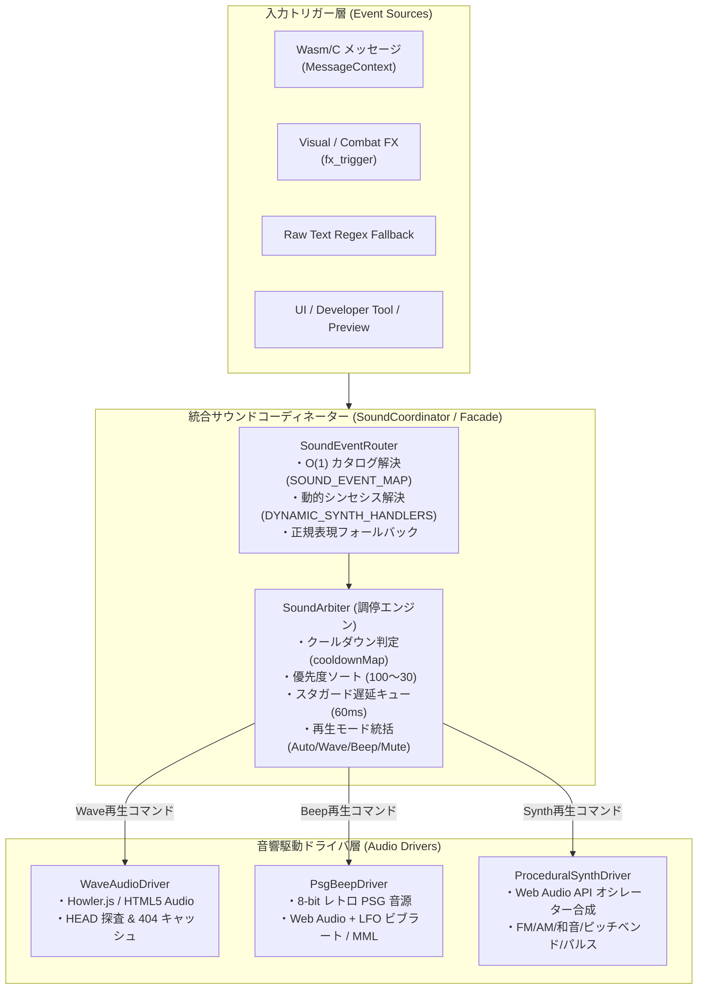
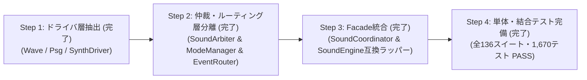

# 🎵 統合サウンドコーディネーター ＆ 音響駆動ドライバ分離アーキテクチャ仕様書 (Sound Coordinator & Multi-Driver Architecture)

## 1. 背景と課題意識 (Context & Motivation)

NetHack WASM WebUI の音響システムは、ROADMAP 1.2 Stage 5.4（決定論的SE・Audio Queue）および Stage 5.6（動的音程シンセシス）を経て、音声ファイル再生（Wave）や PSG 風 Beep 音に加え、Web Audio API の数式オシレーター合成（ピッチベンド、和音、AM/FM変調、アルペジオ、短パルス）など複数の発音方式に対応してきました。

しかし、機能の追加に伴い、中核クラスである `SoundEngine.js` に以下の **3つの異なる関心事（責務）** が集中し、コードの肥大化と責務混在が生じていました：

1. **入力トリガーの受付・照合責務**:
   - Wasm/C メッセージ（`MessageContext` の `messageId`, `placeholders`）の $O(1)$ 照合
   - Visual FX / Combat FX（`KILL_CONFIRMED`, `ATTACK_HIT`, `DAMAGE_TAKEN`）の購読・受信
   - 英語生テキストに対する正規表現フォールバックマッチング
   - カタログ直接試聴・テストベンチ（`sound_test.html`）からの直接再生要求
2. **調停・仲裁（Arbitration）責務**:
   - 同一・類似音のクールダウン管理（`cooldownMap`）
   - 優先度ソート（Priority 100〜30 による割り込み制御）
   - Audio Queue とスタガード遅延（50〜80ms）による音割れ・同時発振防止
   - 再生モード統括（Auto / Wave / Beep / Mute の判定とフォールバック順序の決定）
3. **物理音響駆動（Driver / Backend）責務**:
   - Waveファイル再生（Howler.js / HTML5 Audio、HEAD探査、404ブラックリスト）
   - レトロ 8-bit PSG 音源（Web Audio 矩形波発振、周波数変換、LFO ビブラート）
   - Web Audio API 多段オシレーター合成（LFO、Gain、変調接続、急激ピッチベンド、和音発振）

### 顕在化した問題点と分離の動機
- **ロジックの漏れ**: カタログ試聴ボタンにおいて動的シンセシスのハンドラ解決が漏れ、無音（Mute同等）になる不具合が発生した。
- **モード判定の重複・分散**: 「いま Mute か」「いま Wave か Beep か」の判定が、キュー投入口・キュー取り出しループ・各再生関数の3箇所に分散していた。
- **拡張の難しさ**: 新しい出力バックエンド（例: WebMIDI音源、チップチューンエミュレータ、立体空間音響）を追加しようとすると、`SoundEngine.js` の基幹コードに直接手を入れる必要があった。

---

## 2. 設計目標とコア原則 (Design Goals & Core Principles)

1. **完全な後方互換性（Non-Breaking API）**:
   - `WebUICore` やクライアントUI、既存のテストから見て、外部APIシグネチャ（`processMessageContext`, `handleFxTrigger`, `setSoundMode`, `enqueueSound` 等）は 100% 変更しない。
2. **システム単一窓口（Unified Facade）**:
   - システム全体からは **`SoundCoordinator`（および互換ラッパーとしての `SoundEngine`）** の1つだけが見え、内部の複雑なドライバ群は完全に隠蔽される。
3. **仲裁層と駆動ドライバの完全分離（Arbiter vs Drivers）**:
   - **仲裁層 (`SoundArbiter` / `Coordinator`)**: ゲームロジック、メッセージID、優先度、クールダウン、モード判定に専念。オーディオハードウェアの直接操作は行わない。
   - **駆動ドライバ層 (`AudioDrivers`)**: 音を鳴らすことだけに特化し、ゲームロジックやメッセージIDを一切知らなくてよいステートレス/クリーンな設計とする。
4. **プラガブル・マルチドライバ構成**:
   - ドライバをインターフェース経由で着脱可能とし、ユニットテスト時の完全モック化を容易にする。

---

## 3. アーキテクチャ全体像 (Architecture Overview)



---

## 4. 詳細コンポーネント設計 (Detailed Component Design)

### 4.1 仲裁層: `SoundCoordinator` & `SoundArbiter`

システム外部（WebUICoreやUI）との単一窓口となる Facade クラス。

```javascript
export class SoundCoordinator {
    constructor(options = {}) {
        this.modeManager = new SoundModeManager(options.soundMode || 'auto');
        this.arbiter = new SoundArbiter({
            staggerIntervalMs: options.staggerIntervalMs || 60,
            modeManager: this.modeManager,
            onLogCallback: options.onLogCallback
        });

        // 駆動ドライバの登録
        this.drivers = {
            wave: new WaveAudioDriver({ soundDir: options.soundDir }),
            beep: new PsgBeepDriver(),
            synth: new ProceduralSynthDriver()
        };
        this.arbiter.bindDrivers(this.drivers);
    }

    // --- 既存完全互換 API ---
    processMessageContext(context, fallbackText = '') { ... }
    handleFxTrigger(fx) { ... }
    processLogMessage(text) { ... }
    enqueueSound(ruleOrDef, context = null) { ... }
    setSoundMode(mode) { ... }
    setVolume(vol) { ... }
    unlockAudio() { ... }
}
```

#### `SoundArbiter` の調停アルゴリズム（SSOT）
キューからアイテムを取り出す瞬間に、現在のモード（`Auto`, `Wave`, `Beep`, `Mute`）とアイテム定義（`sound`, `beep`, `synth`）を評価し、どのドライバを呼ぶかを一元的に判定します：

| モード | `rule.sound` (Wave) | `rule.synth` (プロシージャル合成) | `rule.beep` (PSG) | 動作 |
| :--- | :---: | :---: | :---: | :--- |
| **`mute`** | - | - | - | **即座に破棄・消音** (`SKIP_MUTE`) |
| **`wave`** | 存在 | - | - | `WaveDriver.play()` を実行。失敗時は `WARN_WAVE_NOT_FOUND` |
| **`wave`** | なし | 存在 | - | `SynthDriver.play()` を実行（ファイル不在のプロシージャル音） |
| **`beep`** | - | 存在 | - | `SynthDriver.play()` を実行 |
| **`beep`** | - | なし | 存在 | `BeepDriver.play()` を実行 |
| **`auto`** | 存在 | - | - | `WaveDriver.play()` を試行。失敗時は `Synth` / `Beep` へフォールバック |
| **`auto`** | なし | 存在 | - | `SynthDriver.play()` を実行 |
| **`auto`** | なし | なし | 存在 | `BeepDriver.play()` を実行 |

---

### 4.2 駆動ドライバ層: `BaseAudioDriver` と具象ドライバ

各ドライバは、ゲームの文脈を一切持たない純粋なオーディオ再生エンジンです。

```javascript
// 共通ドライバインターフェース
class BaseAudioDriver {
    setVolume(volume) {}
    unlockAudio() {}
    stopAll() {}
}
```

#### ① `WaveAudioDriver` (`src/core/sound/drivers/WaveAudioDriver.js`)
- **責務**: 音声ファイル（MP3/OGG/WAV）のロード・キャッシュ・再生。
- **機能**:
  - `Howler.js` がグローバルにあれば最優先使用。
  - なければ HTML5 `new Audio()` を使用。
  - `HEAD` 探査による 404 エラー抑止と `failedAssetCache` の自己管理。

#### ② `PsgBeepDriver` (`src/core/sound/drivers/PsgBeepDriver.js`)
- **責務**: 8-bit レトロ PSG（プログラマブル・サウンド・ジェネレータ）効果音の再生。
- **独立音量ゲイン制御 (バランス補正)**:
  - オーディオアセット（WAV/MP3）と合成音（Beep/矩形波等）の物理的な音量特性の差を整えるため、マスター音量とは独立したバランス補正ゲインを搭載しています：
    - **`waveGain`** (デフォルト `1.0` / 100%): オーディオファイル再生用の音量補正倍率。
    - **`beepGain`** (デフォルト `0.3` / 30%): Beep 合成音再生用の音量補正倍率（アタックの強い矩形波やノコギリ波を 30% に減衰させることで、WAV との聴感上の音量バランスを自然に揃えます）。
  - 音量計算式:
    $$\text{WAV最終音量} = \left(\frac{\text{rule.volume}}{100}\right) \times \left(\frac{\text{マスター音量}}{100}\right) \times \text{waveGain}$$
    $$\text{Beep最終音量} = \left(\frac{\text{rule.volume}}{100}\right) \times \left(\frac{\text{マスター音量}}{100}\right) \times \text{beepGain}$$
- **LFO (ビブラート) パラメータ仕様**:
  - `beep` オブジェクト内において `"lfo"` オブジェクトの有無によって LFO (ビブラート/モジュレーション) の ON/OFF を切り替えます（省略時はストレートなピュア音）。
  - パラメータ詳細:
    - `freq`: LFO の速度 (Hz)。例: `6` (自然なビブラート), `20` (高速トレモロ)
    - `depth`: LFO の変調の深さ (ピッチの揺れ幅)。例: `15` 〜 `30`
    - `wave`: LFO 自身の変調波形 (`"sine"` [滑らか・推奨], `"square"`, `"sawtooth"`, `"triangle"`)
  ```json
  "beep": {
    "notes": ["C4", "E4", "G4", "C5"],
    "wave": "sine",
    "duration": 70,
    "lfo": { "freq": 6, "wave": "sine", "depth": 15 }
  }
  ```
- **MML (Music Macro Language) シーケンサー構文仕様**:
  - `beep` オブジェクト内の `notes`（または `mml`）プロパティでは、配列形式（`["C4", "E4", "G4"]`）やカンマ/スペース区切り文字列に加え、**MML風文字列**（例: `"T180 O4 L8 C E G O5 C."`）による直感的なメロディ記述に対応しています：
    - `T10` 〜 `T600`: テンポ指定 (BPM)。$\text{L4の基準時間 (ms)} = \frac{60000}{\text{BPM}}$ により各音符のミリ秒長さを動的計算（曲途中の変速対応。`T` 未指定時は `duration` デフォルト 80ms を採用）。
    - `O1` 〜 `O9`: オクターブ指定 (デフォルト: `O4`)
    - `L1` 〜 `L64`: デフォルト音長指定 (`L4`: 4分音符, `L8`: 8分音符 等)
    - `V0` 〜 `V15`: 音量指定 (0 〜 15.0)
    - `A` 〜 `G`: 音名指定 (`#` / `+` で半音上げ、音符直後に長さ数値指定可能 例: `C8`, 付点 `.` 対応)
    - `R`: 休符 (Rest)

#### ③ `ProceduralSynthDriver` (`src/core/sound/drivers/ProceduralSynthDriver.js`)
- **責務**: Web Audio API による数式オシレーターリアルタイム合成（外部音源ゼロ）。
- **機能**:
  - ROADMAP 2.3 Stage 5.6 で実装された 6 大合成コア（単一波形/ピッチベンド `oscillator`、和音 `chord`、AM変調 `am`、FM変調 `fm`、シーケンス `sequence`、短パルス `pulses`）の完全独立モジュール化。
  - ゲームループやメッセージパーサーに一切依存しない、純粋なオーディオグラフ構築。

---

### 4.3 将来拡張: BGM・環境音統括とフロア連動調停 (Ambient, BGM & Floor Adaptation)

調停層（Coordinator）と物理駆動層（Drivers）が分離されたことで、将来の BGM や環境音（アンビエント）の導入が極めて自然に行えます：

1. **フロア・ブランチ連動の自動判定**:
   - ゲーム状態（通常ダンジョン、鉱山街、倉庫番、城、ゲヘナ、アストラルプレーン等）に応じて、調停層が適切な環境音やBGMループを判定してドライバへ指示。
   - 音響ドライバ側は「指定された音声を再生・ループする」ことに専念し、ダンジョン仕様を知る必要がありません。
2. **ダッキング制御 (Audio Ducking)**:
   - 死亡音、罠作動、モンスター咆哮、跳ね橋メロディなどの高優先度 SE 発音時に、調停層が一時的に BGM 音量を下げ（ダッキング）、効果音の視認性・明瞭度を保ちます。
3. **SE と BGM の独立ボリューム・モード管理**:
   - `BGM Mute` や `BGM Volume` を個別に調停層で管理し、ユーザー設定（`nh.config`）とスムーズに同期可能となります。

---

## 5. 実装完了構成 (Completed Implementation Architecture)

本リファクタリング（Phase 6）は以下の全ステップを完了し、**全136テストスイート・1,670テスト PASS** の品質基準のもとで本番稼働しています：



- **Step 1 (完了): ドライバ層の独立パッケージ化 (`src/core/sound/drivers/`)**
  - `BaseAudioDriver.js`, `WaveAudioDriver.js`, `PsgBeepDriver.js`, `ProceduralSynthDriver.js` を実装。
  - 各ドライバの独立単体テスト（`WaveAudioDriver.test.js`, `PsgBeepDriver.test.js`, `ProceduralSynthDriver.test.js`）を配備。
- **Step 2 (完了): 仲裁エンジン (`SoundArbiter.js`) およびルーター (`SoundEventRouter.js`) の分離**
  - キュー管理、優先度ソート、スタガード遅延、クールダウン、モード判定（`SoundModeManager.js`）を純粋ロジックとして分離。
  - O(1) カタログ解決・動的シンセシス解決・正規表現フォールバックを `SoundEventRouter.js` に集約。
- **Step 3 (完了): `SoundCoordinator.js` 統合および `SoundEngine.js` の完全後方互換 Facade 化**
  - `SoundEngine.js` を `SoundCoordinator` の委譲ラッパーとして再編し、`WebUICore`, `sound_test.html`, 各種クライアントとの 100% 互換性を維持。
- **Step 4 (完了): 包括的テストスイートによる検証**
  - 全136テストスイート・1,670テストが 100% PASS。

---

## 6. 達成された品質・境界保証 (Verified Architecture Guarantees)

1. **アーキテクチャ境界の遵守**:
   - `SoundArbiter` 内に Web Audio API の生ノード（`createOscillator` 等）や `fetch` 呼び出しは 1 行も存在しない。
   - 各ドライバ（`WaveAudioDriver`, `PsgBeepDriver`, `ProceduralSynthDriver`）内に `MessageContext` や `messageId` などのゲーム知識は一切存在しない。
2. **品質保証**:
   - `src/core/sound/` 配下の単体テスト（`SoundCoordinator.test.js`, `SoundArbiter.test.js`, `SoundEventRouter.test.js`, `SoundModeManager.test.js`, 各ドライバテスト）がすべて PASS。
   - リポジトリ全テストスイート（全136スイート・1,670テスト）が 100% PASS。
3. **テストベンチ検証**:
   - `sound_test.html` において、モード変更、独立ゲイン調整、MML/LFO試聴、動的シンセシス試聴、カタログ試聴がすべて正確に動作。

