# 📦 足元山積み（Floor Pile）の二画面ファイラー統合 ＆ ダイアログ操作系（Key/Pad）完全統一構想

> [!NOTE]
> **ステータス**: `💡 proposed` (将来構想 / Backlog)  
> **着手の前提条件 (Prerequisite)**:  
> 本機能を実装して快適なUXを得るためには、先行して **「全モーダル・ダイアログにおけるキーボード／ゲームパッド操作の完全統一（マウスへの強制持ち替え解消）」**（[`modal_interaction_and_navigation_guide.ja.md`](../2_client_ui/modal_interaction_and_navigation_guide.ja.md) 準拠の実装徹底）が完了している必要がある。

---

## 1. 背景と課題認識

### 1.1 先行実装された「📚 山積み (PileTop)」バッジによる視認性向上
NetHack の画面出力では、1つのマスに複数のアイテム・死体・石像が重なっている場合、`GLYPH_OBJ_PILETOP_OFF (7992)` 〜 `GLYPH_UNEXPLORED_OFF - 1 (9621)` の PileTop グリフが送出される。  
GKL ナレッジ解決層（`StructuredKnowledgeEngine` / `GKLPlugin.inspectCellOnDemand`）および UI（`FloatingContextActions`, `KnowledgeDetailModal`, `NhKnowledgeCard`）において `isPile: true` を伝搬し **「📚 山積み (PileTop)」** バッジを表示したことで、遠目からでも「単一アイテムか、下に何かが埋まっている山積みか」を即座に判別できるようになった。

### 1.2 山積みマス到達後の操作課題とコンテナUI応用の着眼点
実際にそのマスへ移動した後、山積みのアイテムを整理（必要なものを拾い、不要な手持ち品を床に置く）する際、標準の NetHack では以下の別々のコマンドを往復する必要がある：
- 床から拾う：`,` (`pickup`)
- 床に置く：`d` (`drop`) / `D` (`drop several`)
- 足元を見る：`:` (`look here`)

一方、現行の [`ContainerController.js`](../../src/core/container/ContainerController.js) および [`ContainerModal.js`](../../examples/gkl-pure-js-client/modules/components/ContainerModal.js) は、C コアのメニューを開きっぱなしにするのではなく **「常に `turn_ready`（通常ターン待機）に着地し、1操作＝1 IRC トランザクション（`querySequenceSilent`）で出し入れを実行する設計」** となっている。  
このアーキテクチャをそのまま応用すれば、**「左ペイン：手持ちインベントリ ⇄ 右ペイン：足元の山積み（Floor Pile）」** という二画面ファイラーUIとしてシームレスに統合できる。

### 1.3 なぜ今すぐ実装せず「ダイアログ操作系の最適化」を先行させるのか
現状のクライアントUIでは、マップ移動やコマンド入力をキーボード（またはパッド）で行っていても、**ダイアログやモーダルが開いた瞬間にマウス操作へ手を移動させなければならない箇所**が残っている。  
この状態で山積み操作まで二画面モーダル化すると、かえって「拾うたびにキーボードとマウスを行き来する」という操作ストレスを生むことになる。  
したがって、**各ダイアログのキーボード・ゲームパッド操作最適化を完了させること**を本構想の必須前提条件とする。

---

## 2. 前提基盤：全ダイアログのキーボード／パッド操作完全統一

[`modal_interaction_and_navigation_guide.ja.md`](../2_client_ui/modal_interaction_and_navigation_guide.ja.md) で定義された3大原則を、`ContainerModal` を含むすべてのダイアログに完全適用する。

1. **キーボード ⇄ マウス間の持ち替えゼロ化 (Zero Hand-Switching)**:
   - 二画面ファイラー（`ContainerModal` / `NhContainerFiler`）において、以下のキー操作のみで 100% 完結させる：
     - `↑` / `↓` (`j` / `k` / 十字キー上下): アクティブペイン内のアイテム選択移動
     - `Tab` または `←` / `→` (`h` / `l` / `LB` / `RB`): 左ペイン（所持品）⇄ 右ペイン（コンテナ／足元山積み）のフォーカス切り替え
     - `Enter` / `Space` (Pad `A`): 選択中アイテムを反対側ペインへ転送（1操作アトミック実行）
     - 数量指定ショートカット（数値キーまたは左右増減）による分割移動
     - `Escape` / `q` (Pad `B`): 即座にモーダルを閉じてマップ操作へ復帰
2. **双方向フォーカス同期**:
   - マウスホバー時にも内部のフォーカスインデックスを同期し、どの入力デバイスからでもカーソル飛びを起こさない。

---

## 3. アーキテクチャ設計：Floor Pile モード (`isFloorPile`)

### 3.1 全体構成と `ContainerController` の拡張

新規に別コントローラを乱立させるのではなく、既存の [`ContainerController`](../../src/core/container/ContainerController.js) に **`ContainerType.FLOOR_PILE`（`isFloorPile: true`）** モードを追加し、UI コンポーネント（`ContainerModal` / `NhContainerFiler`）をそのまま再利用する。

```mermaid
sequenceDiagram
    participant Player as プレイヤー (Key/Pad/Mouse)
    participant Core as WebUICore / GKL
    participant CC as ContainerController (isFloorPile)
    participant IRC as InteractiveRequestController
    participant C as NetHack C-Core
    participant UI as ContainerModal (二画面UI)

    Player->>Core: 足元の山積みで「山積み整理」または `,` (Pickup)
    CC->>IRC: acquireSessionLock('container')
    
    Note over CC,C: 【1. 初期一覧取得 / Sync】<br/>Phase 8 Direct Binding (`SHIM_CMD_GET_OBJECT_AT`) または<br/>`,` -> SIGNAL_PICKUP_ITEM_SELECT から一覧抽出 -> ESC で turn_ready 着地
    
    CC->>UI: containerTransaction (FLOOR_PILE, contents)
    UI->>UI: 左: 所持品 ⇄ 右: 足元の山積み を表示

    rect rgb(30, 41, 59)
        Note over Player,C: 【2. 右➔左：床から拾う (direction: 'out')】
        Player->>UI: 右ペインのアイテムで Enter (Take Out / Pickup)
        UI->>CC: transferItem({ direction: 'out', item, count })
        CC->>IRC: querySequenceSilent(RECIPE_FLOOR_PILE_PICKUP)
        IRC->>C: start: [',']
        alt 床に複数アイテムが存在しメニューが開く場合
            C-->>IRC: SIGNAL_PICKUP_ITEM_SELECT ("Pick up what?")
            IRC->>C: resolver.resolve([{ identifier: targetId, count }])
        else 床に最後の1スタックのみの場合
            Note over IRC,C: `,` 単発で即座に取得完了 (または数量応答)
        end
        C-->>IRC: turn_ready
        CC->>UI: ローカルモデル & 所持品同期して再描画
    end

    rect rgb(30, 41, 59)
        Note over Player,C: 【3. 左➔右：床に置く (direction: 'in')】
        Player->>UI: 左ペインのアイテムで Enter (Put In / Drop)
        UI->>CC: transferItem({ direction: 'in', item, count })
        CC->>IRC: querySequenceSilent(RECIPE_FLOOR_PILE_DROP)
        IRC->>C: start: ['d', itemLetter] (または ['D'])
        opt スタック数量プロンプトが出た場合
            C-->>IRC: SIGNAL_COUNT_PROMPT ("How many?")
            IRC->>C: `${count}\r` (全量なら `a\r`)
        end
        C-->>IRC: turn_ready
        CC->>UI: ローカルモデル & 所持品同期して再描画
    end

    Player->>UI: Esc / q で閉じる
    UI->>CC: closeSession()
    CC->>IRC: releaseSessionLock('container')
```

---

### 3.2 各トランザクションの詳細仕様

#### ① 初期一覧の取得（Open Floor Pile Session）
足元のアイテム一覧を取得する方法は、以下の2系統（ハイブリッド）をサポートする：
1. **Phase 8 公式 Shim メモリ直結（最優先・0ミリ秒）**:
   - [`WasmDirectBindingService.js`](../../src/core/knowledge/services/WasmDirectBindingService.js) の `SHIM_CMD_GET_OBJECT_AT(playerX, playerY)` により、`level.objects[x][y]` から `nexthere` 連結リストを辿って全床アイテムの構造体（`o_id`, `otyp`, `quan`, `bknown`, `blessed`, `cursed`, `spe`, `glyph`）を非侵襲かつキー送信ゼロで即時取得する。
2. **IRC レシピによるメニュー抽出（フォールバック）**:
   - `,` コマンドで `"Pick up what?"` メニュー（`select_menu`）が開いた際の `ctx.menuItems` をキャプチャし、即座に `\x1b` (ESC) でキャンセルして `turn_ready` に着地する。

#### ② 床から拾う（`direction: 'out'` = Pickup）
- **レシピ (`RECIPE_FLOOR_PILE_PICKUP`)**:
  - `start: [',']`
  - **ケースA（床に2スタック以上ある場合）**:
    - C コアから `"Pick up what?"`（`SIGNAL_PICKUP_ITEM_SELECT`）または `"What kinds of things do you want to pick up?"`（`SIGNAL_PICKUP_CLASSES` → `'a'` 応答）が発行される。
    - `ContainerController` と全く同じ 16バイト構造体配列 `[{ identifier: targetId, count }]` を返却し、`turn_ready` に着地する。
  - **ケースB（床に最後の1スタックしか残っていない場合）**:
    - `,` を送信しただけでメニューが出ずに直接拾われ、`turn_ready` に着地する。
    - ※もし部分個数指定（`count > 0 && count < item.count`）で最後の1スタックを拾う場合は、数値プレフィックス `[String(count), ',']` を送出することでメニューなしでも指定個数だけ正確に拾うことができる。

#### ③ 床に置く（`direction: 'in'` = Drop）
- **レシピ (`RECIPE_FLOOR_PILE_DROP`)**:
  - [`ActionRecipeFactory.createDropItemRecipe(itemLetter, count)`](../../src/core/request/ActionRecipeFactory.js#L221-L235) と同等のプロトコル、または `D`（複数ドロップメニュー）を使用する：
  - `start: ['d', itemLetter]`
  - `SIGNAL_COUNT_PROMPT`（`"How many?"`）が来た場合は、全量（`count === -1`）なら `'a\r'`、個数指定なら `${count}\r` を返却して `turn_ready` に着地する。
- **バリデーション (`validatePutIn`)**:
  - 装備中アイテム（`EQUIPPED`）のドロップ抑止ガードはそのまま有効に機能する。
  - 床へのドロップであるため、Bag of Holding 防爆ガード（`BOH_CRITICAL` / `BOH_SUSPICIOUS`）は自動的にスキップされる（ただし祭壇上でのドロップ時は「祭壇BUC鑑定」バッジ等のヒント表示が可能）。

---

### 3.3 制御シグナルカタログ (`ControlSignalCatalog.js`) への追加項目

将来実装時には、[`ControlSignalCatalog.js`](../../src/core/prompt/ControlSignalCatalog.js) に以下のメニュー同定シグナルを追加する：

| シグナルID | `subCategory` | `inputType` | マッチパターン例 | 用途 |
| :--- | :--- | :--- | :--- | :--- |
| **`SIGNAL_PICKUP_ITEM_SELECT`** | `PICKUP_ITEM_SELECT` | `MENU` | `^Pick up what\?` | `,` 実行時の床アイテム選択メニュー |
| **`SIGNAL_DROP_CATEGORY_SELECT`** | `DROP_CATEGORY_SELECT` | `MENU` | `^What kinds of things do you want to drop\?` | `D` 実行時のドロップ種別選択 |
| **`SIGNAL_DROP_ITEM_SELECT`** | `DROP_ITEM_SELECT` | `MENU` | `^Drop what\?` | `D` 実行時のドロップアイテム選択メニュー |

---

## 4. 段階的導入ロードマップ

1. **Step 0（前提条件）: モーダル・ダイアログ群のキーボード／パッド操作完全統一**
   - `ContainerModal` / `NhContainerFiler` におけるペイン間移動（`Tab` / `←→` / `LB・RB`）、上下選択、決定、数量指定、キャンセルをマウスレスで完結させる。
2. **Step 1: `ControlSignalCatalog` 拡張と `RECIPE_FLOOR_PILE_*` の整備**
   - `Pick up what?` / `Drop what?` シグナル定義と、最後の1スタック時の数量付き `,` ハンドリングを実装。
3. **Step 2: Phase 8 `SHIM_CMD_GET_OBJECT_AT` 連携による足元山積み一覧の即時取得**
   - 足元マスに複数アイテムがある状態で、ターン消費・キー送信なしで中身リストを構築。
4. **Step 3: `ContainerController` & `ContainerModal` の `FLOOR_PILE` モード対応**
   - コンテキストアクション（足元が `isPile: true` の場合）やショートカットから二画面ファイラーとして開閉可能にする。
