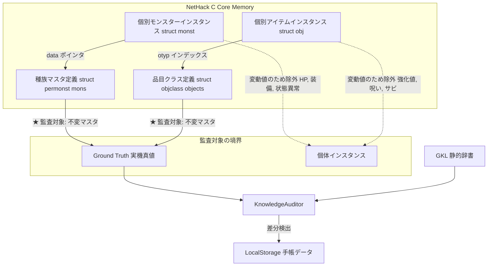
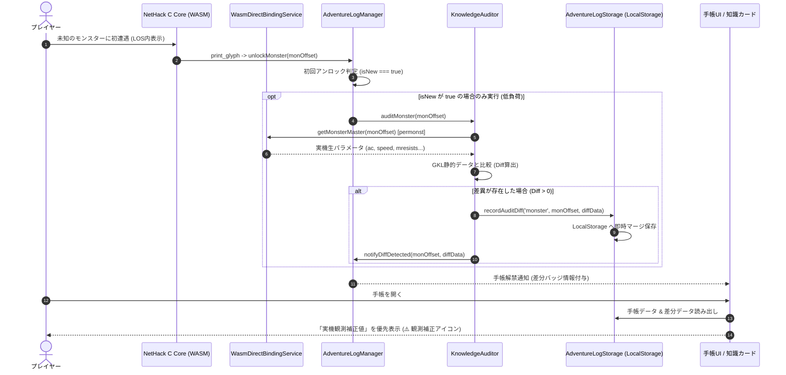

# 実機観測駆動型ナレッジ監査・動的オーバーライド将来構想 (Ground Truth Knowledge Audit & Dynamic Override Architecture)

## 1. エグゼクティブサマリー (Executive Summary)

本ドキュメントは、NetHack Wasm Cコア（WASMメモリ/構造体）から直接高精度なゲーム内パラメータを取得可能となったアーキテクチャ（Stage 8.2+ `WasmDirectBindingService`）を最大限に活かし、**「実機受信パラメータを唯一の正（Ground Truth）として静的ナレッジ（GKL）を監査・自動補正・更新支援する仕組み」**の将来構想仕様書である。

常時監視によるCPU/Wasmブリッジ負荷を完全に排除するため、**「冒険手帳（AdventureLogManager）におけるモンスター・アイテムの新規遭遇・識別登録（初回アンロック）時」**に限定してピンポイント突合を行う。
さらに、検出された相違は手帳の既存永続化基盤（`LocalStorage`）に同居させることで、余計なストレージ機構を増やすことなく**「ゲームプレイを通じてナレッジが自律的に校正・オーバーライドされる」**仕組みを実現する。

これは単なる差分チェックにとどまらず、**将来のNetHackバージョンアップや未知のバリアント向けGKLを、実機メモリから半自動的にスキャフォールディング（自動構築）するための強力な足掛かり**となる。

---

## 2. 課題と着想の背景 (Background & Problem Statement)

### 2.1 静的ナレッジ辞書の宿命的ドリフト（乖離）
現在、GKLが保持するモンスター・アイテム知識（`MONSTER_KNOWLEDGE_FULL.js` や `OBJECT_KNOWLEDGE_FULL.js` 等）は、事前のソースコード解析・正規表現抽出・手動キュレーションによって構築されている。
しかし、以下の要因により実機挙動との乖離（Knowledge Drift）が不可避に発生する：
1. **バージョン間の微修正**: マイナーバージョンアップやパッチ適用によるモンスターAC、移動速度、アイテム重量の数値調整。
2. **抽出スクリプトのパース限界**: C言語のマクロ展開（`#ifdef`, `#define`）やビットフラグ合成の解釈漏れ。
3. **バリアントの独自仕様**: バリアントごとに改変された攻撃ダイスや耐性設定。

### 2.2 常時監視の無駄と「冒険手帳」契機の秀逸さ
* **常時監視（毎フレーム/毎ターン）の弊害**:
  画面上やインベントリ内の全オブジェクトを毎ターン突合・検証することは、Wasmブリッジ通信コストおよびオブジェクト走査の計算資源を浪費する。
* **冒険手帳（新規アンロック時）のイベント駆動**:
  `AdventureLogManager.unlockMonster(monOffset)` や `unlockObject(onum)` は、**「プレイヤーがその実体に初めて遭遇・識別した瞬間（`isNew === true`）」**にのみ発火する。
  この単一イベント契機に監査を絞ることで、実行コストを実質ゼロに抑えつつ、プレイヤーのゲーム進行に合わせて自然に全マスタの監査網を広げることができる。

---

## 3. NetHack固有のデータ構造との親和性 (Architectural Suitability)

Diablo等のハック＆スラッシュRPGでは「同じ剣でもランダム接頭辞で威力が変わり、同じ敵でもエリート属性で耐性が変化する」ためベース定義の監査が困難を極める。
しかし、**NetHackのC内部設計は「不変のマスタ定義（Prototype）」と「動的な個体値（Instance State）」が完全に分離**されており、本監査アーキテクチャと100%合致する。



* **モンスター**: 個体の一時的なAC変動（防具着用）や現在HP（`mhp`）ではなく、`struct permonst`（`mons[monOffset]`）の基本AC・移動速度・耐性・攻撃ダイスを突合する。
* **アイテム**: 個体の強化値（`spe`）や呪い・サビではなく、`struct objclass`（`objects[otyp]`）の基本重量・価格・材質・小型/大型ダメージを突合する。
  * **※覗き見知恵（Peek Wisdom）との役割分担**: 強化値（`spe`）・BUC・箱の罠や中身・死体種別（`corpsenm`）といった `struct obj` の動的個体値は、本監査の対象外とする一方、ゲーム内の検査アクションである「覗き見知恵」（[`floor_item_direct_binding_and_peek_wisdom_architecture.ja.md`](file:///c:/Users/e3-sh/Documents/GitHub/Nethack-wasm-webUI/docs/3_gkl/floor_item_direct_binding_and_peek_wisdom_architecture.ja.md) §5.1）側でフル開示する。
* **結論**: 「マスタポインタ（`permonst` / `objects[otyp]`）を突合する」という原則を守る限り、ゲーム中の動的バフ・デバフによる誤検知は100%発生せず、また「正式鑑定によるアンロック」と「覗き見（`SAGE_GUIDE` モード）によるアンロック」のどちらを契機としても同一の不変マスタを安全に監査できる。

---

## 4. 監査対象パラメータ・マッピング表

| 分類 | C構造体フィールド (`permonst` / `objclass`) | GKL静的辞書フィールド | 監査内容 |
| :--- | :--- | :--- | :--- |
| **モンスター基本値** | `ac` | `ac` | 基本アーマークラスの一致 |
| | `mmove` | `speed` | 移動基本速度（12=標準等）の一致 |
| | `mlevel` | `level`, `difficulty` | 基準モンスターレベルの一致 |
| **属性耐性** | `mresists` (ビットフラグ) | `resistances` (文字列配列) | 火・冷・電・毒・眠・石化・分解耐性のビット解読一致 |
| **特性フラグ** | `mflags1`, `mflags2`, `mflags3` | `attributes`, `flags` | 浮遊 (`M1_FLY`), アンデッド (`M2_UNDEAD`), 肉食 (`M1_CARNIVORE`) 等 |
| **攻撃手段** | `mattk[6]` (`aatyp`, `adtyp`, `damn`, `damd`) | `attacks` (配列) | 攻撃種別（噛みつき, 爪, 武器等）とダイス面数・回数 |
| **アイテム基本値** | `oc_weight` | `weight` | 基礎重量 (weight units) |
| | `oc_cost` | `cost`, `price` | 基礎店頭売買価格 (zorkmids) |
| | `oc_material` | `material` | 材質（鉄, 木, 銀, ガラス等）の数値→文字列照合 |
| **アイテム性能** | `oc_wsdam`, `oc_wldam` | `damageSmall`, `damageLarge` | 対小型・対大型ダメージダイス |

---

## 5. アーキテクチャ設計とデータフロー

### 5.1 全体処理シーケンス



### 5.2 LocalStorage 永続化スキーマ構想
手帳の既存キー（`nethack_webui_adventure_log`）内に、3段階ガイド支援モード（`guideAssistanceMode`）・覗き見解禁記録（`peekedObjects`：正式鑑定時に削除・昇格）と併せて `auditDiffs` セクションを増設する：

```json
{
  "guideAssistanceMode": "VETERAN",
  "unlockedMonsters": [0, 15, 42],
  "unlockedObjects": [10, 105, 210],
  "peekedObjects": [210],
  "unlockedRumors": ["rumor_001"],
  "stats": { "monstersCount": 3, "objectsCount": 3, "peekedObjectsCount": 1 },

  "auditDiffs": {
    "version": "5.0.0-wasm",
    "updatedAt": "2026-10-09T17:00:00.000Z",
    "monsters": {
      "42": {
        "name": "giant spider",
        "observedAt": "2026-10-09T17:00:00.000Z",
        "diffs": {
          "ac": { "knowledge": 4, "actual": 2 },
          "speed": { "knowledge": 12, "actual": 15 },
          "resistances": { "missingInKnowledge": ["poison"] }
        },
        "actualMaster": {
          "ac": 2,
          "speed": 15,
          "mlevel": 5,
          "mresists": 8
        }
      }
    },
    "objects": {
      "105": {
        "name": "heavy hammer",
        "observedAt": "2026-10-09T17:05:00.000Z",
        "diffs": {
          "weight": { "knowledge": 50, "actual": 60 }
        },
        "actualMaster": {
          "weight": 60,
          "cost": 40
        }
      }
    }
  }
}
```

---

## 6. 3大活用モデル (Diff Management Models)

本アーキテクチャでは、検出された差異を以下の3系統で活用する。

### モデルA: 【UI体験】冒険手帳・知識カードでの観測補正表示
* **ゲーム的フレーバー**: 「古文書（静的辞書）にはAC 4と記されていたが、実地調査によりAC 2であることが判明した」という冒険者的な解明感を演出。
* **表示**: 手帳詳細およびゲーム中の `NhKnowledgeCard` 上で、該当ステータスに「🔍 実機観測補正」バッジを表示。

### モデルB: 【ランタイム】動的オーバーレイによる即時補正
* **即応性**: ナレッジファイルを再ビルド・デプロイせずとも、`StructuredKnowledgeEngine` が戦闘予測や戦術アドバイスを計算する際、`auditDiffs` の実機値を最優先適用する。
* **フォールバック保証**: 実機から取得できないフレーバーテキスト（日本語訳、由来）は静的辞書をそのまま使い、数値・フラグのみをオーバーレイパッチする。

### モデルC: 【開発・保守】監査レポートとパッチJSONエクスポート
* **開発者ツール統合**: `tools/knowledge-inspector.html` に「ナレッジ監査差分ビューア」を追加。
* **ワンクリック出力**: プレイヤーやテスターがプレイ中に蓄積した `auditDiffs` をワンクリックで `knowledge_patch_5.0.json` としてエクスポート可能にし、GKLマスターデータのメンテナンス工数を90%以上削減する。

---

## 7. 長期展望：バリアント自動適応とZero-Shot GKL生成

本文書で提案する仕組みは、将来のマルチバリアント・新バージョン対応におけるキーストーンとなる。

```mermaid
graph LR
    subgraph 新バリアント Wasm
        V[SLASH'EM / 5.0新コア]
    end

    subgraph 自動構築パイプライン
        V -->|全件ダンプモード実行| D[DumpScript: objects[] & mons[] 全走査]
        D -->|実機マスタ全抽出| G[Raw Wasm Masters]
        G -->|KnowledgeAuditor| P[GKL Delta Patch JSON]
    end

    subgraph 完成
        P -->|既存GKLに適用| NG[新バリアント用 GKL 即時完成]
    end
```

1. **実プレイによる自律的自己治癒 (Self-Healing)**:
   辞書を事前に完璧に整備せずとも、コミュニティが新バリアントをプレイするだけで、遭遇したエンティティから順次辞書が正値へ自動修復されていく。
2. **全件一括ダンプツール（開発用）への発展**:
   手帳の「1体ずつアンロック」ロジックを、テスト環境でループ（`for (let i = 0; i < NUM_MONS; i++)`）実行するだけで、**未知のバリアントに対するGKL完全定義ファイルを数秒で自動スキャフォールディング（Zero-Shot生成）**できるようになる。

---

## 8. 段階的導入ロードマップ (Phased Roadmap)

* **Stage F-1: 監査コアと差分検出のプロトタイピング**
  * `KnowledgeAuditor.js` の新設。
  * `WasmDirectBindingService` にマスタ取得メソッド（`getMonsterMaster(monOffset)`, `getObjectMaster(otyp)`）を追加。
  * 単体テスト（Jest）での突合・差分算出ロジックの検証。
* **Stage F-2: 冒険手帳・LocalStorage への統合**
  * `AdventureLogManager.unlockMonster/Object` へのフック接続。
  * `AdventureLogStorage` のスキーマ拡張と差分データの永続化。
* **Stage F-3: ランタイムオーバーレイ & UIバッジ表示**
  * `StructuredKnowledgeEngine` におけるオーバーレイ優先参照の実装。
  * `AdventureLog` / `NhKnowledgeCard` への観測差分インジケータ追加。
* **Stage F-4: 開発者ツール（エクスポート）と全件ダンプ機能**
  * `knowledge-inspector.html` への差分一覧ビューおよび JSON エクスポートUIの提供。
  * バリアント自動抽出用ダンプスクリプトの整備。
