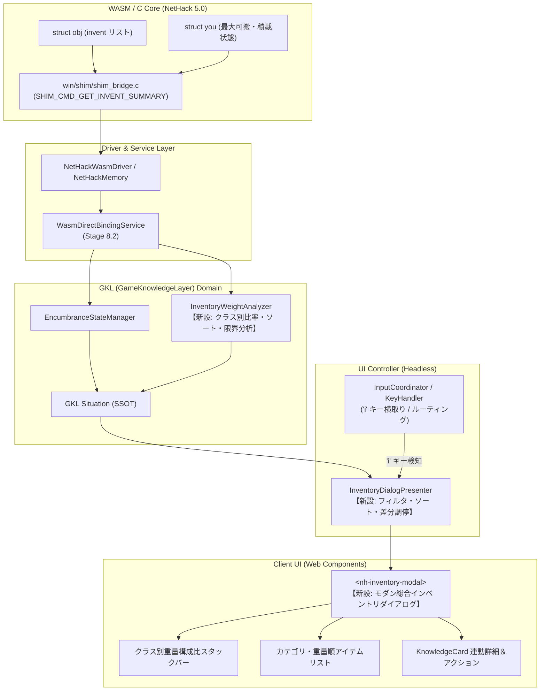
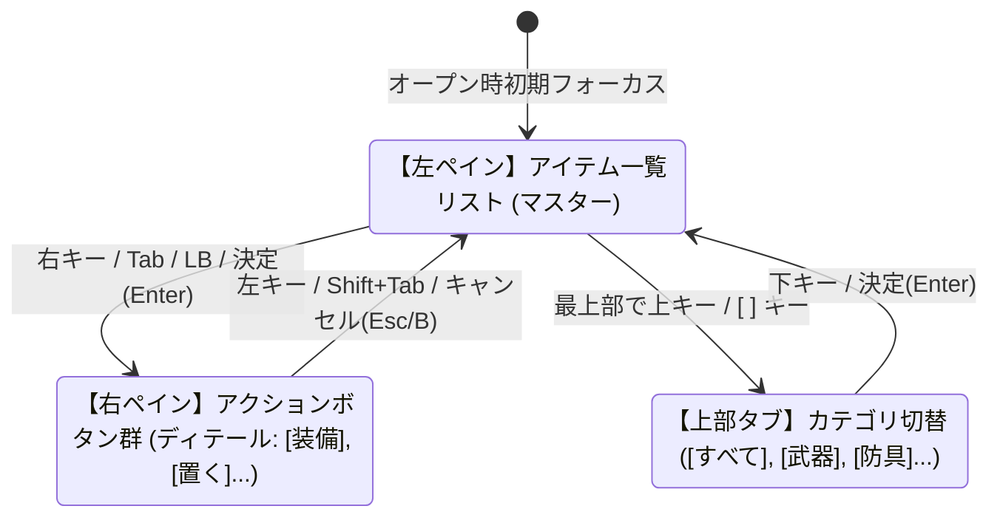

# 🎒 モダン総合インベントリダイアログ ＆ 重量アナリティクス構想
*(Modern Integrated Inventory Dialog & Encumbrance Analytics Architecture)*

---

## 1. 背景と課題認識 (Background & Problem)

### 1.1 原作 NetHack のインベントリ表示の制約
NetHack において、プレイヤーが最も頻繁に呼び出すコマンドの一つが所持品一覧（`i` キー / `display_inventory`）です。しかし、原作 CUI および従来の移植では以下の課題を抱えています：
1. **テキストの羅列による低い視認性**:
   - アルファベット記号とアイテム名が単なる縦並びテキストリストとして表示されるのみで、アイテムの種別、状態、価値、グラフィックス（タイル）が直感的に結びつかない。
2. **重量・積載負荷の不可視性**:
   - 画面上には「各アイテムの個別の重さ」や「どのカテゴリ（防具、食料、薬品など）が全体の重さを占めているか」が表示されない。
   - プレイヤーは「なぜか足が遅くなった」「いつの間にか負荷（Burdened）状態になっていた」という事態に直面しても、どのアイテムを捨てたり軽量化の鞄にしまえば解決するのかを即座に判断できない。
3. **操作の単一性**:
   - アイテム一覧を見る画面から直接「食べる」「飲む」「装備する」「置く」といったコンテキストアクションへシームレスに遷移できず、一度閉じてから別コマンドを打ち直す必要がある。

### 1.2 NetHack における重量管理 (Encumbrance) の死活的重要性
NetHack において積載重量は単なる利便性パラメータではなく、**生存に直結するシビアなゲームルール**です：
- **通常 (Normal)**: 速度 100%, 基礎消費
- **負荷 (Burdened)**: 速度低下 (約 3/4), 隠密性低下
- **重荷 (Stressed)**: 速度低下 (約 1/2), 魔法詠唱ペナルティ, 空腹度消費倍増
- **酷使 (Strained)**: 速度低下 (約 1/4), テレポート不可, 階段から転落死するリスク
- **過積載 / 移動不能 (Overtaxed / Overloaded)**: ほぼ行動不能, 窒息・即死リスク

「何が原因で重いのか」を瞬時に特定し、適切に荷物整理（ドロップ、コンテナ収納）を行える能力は、ダンジョン踏破率を劇的に左右します。

### 1.3 なぜ Phase 8 (公式Shim構造化バインディング) が前提となるのか？
従来の正規表現テキストパースやサイレントマクロ駆動では、以下の理由により正確なインベントリ重量アナリティクスの実現が困難でした：
1. **内部重量計算式の複雑性**: アイテムの真の重量（`obj->owt` や `weight(obj)`）は、素材、充填状態、スタック数、コンテナ減量効果（軽量化の鞄）などによって複雑に変化し、外部の文字列パースから正確に逆算するのは誤差の原因となる。
2. **非侵襲・同期待ちゼロの要請**: インベントリ画面を開くたびにバックグラウンドでマクロを送信していては、ミリ秒単位のレスポンスが失われ、UIの快適性を損なう。

**[Phase 8: 公式Shim構造化バインディング ＆ ゼロオーバーヘッド・メモリ直結](../1_driver/official_shim_direct_binding_implementation_plan.md)** の **Stage 8.2（コンテナ・アイテム・所持重量の完全直結）** が完成することで、C構造体 `struct obj` から以下の情報が $O(1)$・同期待ち時間 0ms で直接得られます：
- 全所持アイテムの正確な重量（`owt` / 単体およびスタック合計）
- 正確な BUC（祝福・未呪い・呪い / `bknown`）
- 充填回数、素材、アイテム固有フラグ
- プレイヤーの最大可搬重量および現在の積載ランク

本構想は、この **Phase 8 の成果を最大限に活かし、NetHack の象徴である `i` キーをモダン RPG の総合所持品画面へと昇華させる** ための設計です。

---

## 2. システムアーキテクチャ全体像 (System Architecture)



---

## 3. UI/UX ＆ 画面レイアウト仕様 (UI/UX Specification)

### 3.1 全体レイアウト構成 (2ペイン + ヘッダーコックピット)
Dark Glass UI デザイントークン（`--glass-bg`, `--glass-blur`, `--glass-border`）に準拠した、高密度かつ見通しの良い 2 ペイン構成を採用します。

```text
┌────────────────────────────────────────────────────────────────────────────────────────┐
│  🎒 所持品総合インベントリ (Inventory & Weight Analyzer)             [ ✕ 閉じる (Esc/i) ]│
├────────────────────────────────────────────────────────────────────────────────────────┤
│  【積載ステータス】 総重量: 1,240 / 1,500 aum   ランク: ⚠️ 負荷 (Burdened)               │
│  [■■■■ 防具 42% ■■■ 食料 24% ■■ 道具 18% ■ 薬品 10% ■ 他 6%                     ]     │
│  ※ あと 90 aum 減らすと「通常 (Normal)」に戻ります                                    │
├────────────────────────────────────────────────────────────────────────────────────────┤
│  [すべて] [⚔️ 武器] [🛡️ 防具] [🍖 食料] [🧪 薬品] [📜 巻物] [🪄 杖] [📦 道具] [💎 貴重品]│
│  並び順: [重量の重い順 ▼]   絞り込み: [未識別のみ □] [呪いのみ □]     [🔍 アイテム名検索]│
├──────────────────────────────────────────┬─────────────────────────────────────────────┤
│  記号  アイテム名                    重量 │  【アイテム詳細 ＆ アクション】             │
├──────────────────────────────────────────┼─────────────────────────────────────────────┤
│  [a] * 👘 +1 エルフのクローク       40 aum│   👘 +1 エルフのクローク (着用中)           │
│  [b]   🍖 大きな食料 × 5            200 aum│   ───────────────────────────────────────── │
│  [c]   🧪 癒しの薬 × 3               60 aum│   ・種別: 防具 (クローク / 肩)              │
│  [d]   💼 軽量化の鞄                 15 aum│   ・状態: 祝福 (Blessed) / 識別済           │
│  [e] ! 🛡️ 鉄の盾 (呪い)             100 aum│   ・重量: 40 aum (全体重量の 3.2%)          │
│  [f]   📜 鑑定の巻物 × 2             10 aum│   ・効果: AC +2, 隠密性付与                 │
│  [g]   🥖 クラッカー × 8             160 aum│   ───────────────────────────────────────── │
│  ...                                     │   [脱ぐ (T)]  [置く (d)]  [鞄に入れる (#loot)] │
│                                          │   [名前を付ける (#call)]  [図鑑を見る (/)]   │
└──────────────────────────────────────────┴─────────────────────────────────────────────┘
```

### 3.2 上部: 重量アナリティクス・コックピット
1. **総重量 ＆ 積載ゲージ**:
   - `現在重量 / 最大可搬重量` を数値とプログレスバーで表示。
   - Burdened, Stressed, Strained などの境界値（閾値）をゲージ上にマーカー表示。
2. **クラス別重量構成比スタックバー (Stacked Color Bar)**:
   - 防具（青）、食料（緑）、道具（黄）、薬品（紫）、巻物（シアン）、武器（赤）など、アイテムクラスごとの重量比率を色分けされた 1 本のバーで直感表示。
   - 各セグメントにマウスオーバーすると `食料: 360 aum (29.0%)` のようにツールチップがポップアップ。
3. **アドバイザリーインジケーター**:
   - 「あと何 aum 減らすとペナルティが解除されるか（例: `あと 90 aum 減らすと通常に戻ります`）」を自動計算して提示。荷物整理の明確な目標をプレイヤーに与える。

### 3.3 左ペイン: アイテム一覧リスト ＆ フィルタ
1. **カテゴリタブ切り替え**:
   - すべて / 武器 / 防具 / 食料 / ポーション / 巻物 / 杖 / 道具 / 貴重品
2. **スマートソート機能**:
   - **重量の重い順 (デフォルト推奨)**: 捨てるべき重い荷物を最上位に提示。
   - **アルファベット順 (NetHack 原作順)**: `a`, `b`, `c`... の伝統的なキー文字順。
   - **カテゴリ順**: 原作インベントリのクラス別グループ順。
   - **推定価値順**: 高価なアイテムの把握用。
3. **視覚的バッジ表示**:
   - 装備中マーク（`*`）、呪い警告バッジ（赤色 `!`）、祝福バッジ（金色）、未識別バッジ（青色 `?`）。
   - 単体重量だけでなく、**スタック合計重量**（例: `大きな食料 × 5 = 200 aum`）を明瞭に表示。

### 3.4 右ペイン: 詳細ナレッジ ＆ クイックアクション
1. **ナレッジカード連携 (`NhKnowledgeCard`)**:
   - 選択されたアイテムの完全な構造化情報（AC/ダメージ、素材、B/U/C状態、効果、未鑑定別名、伝承引用）を表示。
2. **ワンタップ・コンテキストアクション**:
   - アイテムの種別に応じて有効なアクションボタンを自動配置：
     - 装備中防具: `[脱ぐ (T)]`, `[置く (d)]`, `[鞄に入れる]`
     - 食料: `[食べる (e)]`, `[置く (d)]`
     - ポーション: `[飲む (q)]`, `[投げる (t)]`, `[浸す (#dip)]`
     - 巻物: `[読む (r)]`
     - 杖: `[振る (z)]`
     - 鞄・コンテナ: `[開く (#loot)]`
   - ボタンをクリックすると、IRC（連続リクエストコントローラ）経由で C コアへ正規のコマンドシーケンスが送信され、即座に実行される。

---

## 4. 既存 UI との役割分担 ＆ 共存戦略

本総合インベントリダイアログは、既存のインベントリ関連コンポーネントと競合せず、明確に住み分けを行います。

| コンポーネント | 主な役割 | 表示タイミング | 特徴・フォーカス |
| :--- | :--- | :--- | :--- |
| **アイコンインベントリ (`InventoryView.js`)** | 常設クイック HUD | ゲーム画面右下（常時） | 視界を遮らないコンパクト表示。直近のアイテム確認や即時クイックスロット用。 |
| **ペーパードール UI (`PaperdollModal.js`)** | 装備換装 ＆ レイヤード防御プレビュー | 装備変更時 / 専用ボタン | 人型スロット配置、3層レイヤード装甲、AC差分・耐性差分のシミュレーションに特化。 |
| **モダン総合インベントリダイアログ (`NhInventoryModal.js`)** | **所持品全体の棚卸し ＆ 荷物整理管制塔** | **`i` キー押下時** | **全所持品の一覧性、正確な重量分析、クラス別構成比、未識別/呪い整理、アクション実行に特化。** |

> [!NOTE]
> **将来的なタブ統合（案C）への発展性**:  
> 本ダイアログの上部に `[🎒 所持品一覧 & 重量分析]` と `[🛡️ 装備ペーパードール]` のタブを設け、モーダルを閉じずにワンクリックでペーパードール画面へ切り替えられるように設計することで、RPG としての完成度をさらに高めることが可能です。

---

## 5. 入力・ナビゲーション・実行選択仕様 (Interaction & Navigation Specification)

本ダイアログは、[`modal_interaction_and_navigation_guide.ja.md`](../2_client_ui/modal_interaction_and_navigation_guide.ja.md) の **「3大アクセシビリティ憲法」** および **「③ 2ペイン複合型 (Master-Detail)」** トポロジーに完全準拠し、**マウスに一切触れることなくキーボード方向キー / ゲームパッド十字キーのみで100%快適に選択・実行できる操作体系** を備えます。

### 5.1 ゾーン構造とフォーカス状態機械 (Zone State Machine)

モーダル内部は 3 つのフォーカスゾーンに分割され、状態機械（State Machine）として調停されます。



| ゾーン名 | 管理要素 | フォーカス視覚表現 | 決定キー (Enter / Aボタン) の挙動 |
| :--- | :--- | :--- | :--- |
| **`ZONE_ITEMS` (初期)** | 左ペインの所持品一覧行 | 青色のアウトライン枠（`--primary-color`）＋行全体のグロー効果 | 右ペイン（`ZONE_ACTIONS`）の先頭ボタンへフォーカス移動（またはデフォルト主アクション即時実行） |
| **`ZONE_ACTIONS`** | 右ペインのアクションボタン群 | 選択ボタンの明色ハイライト ＆ 拡大スケール（`scale(1.04)`） | フォーカス中アクションを確定し、C コアへコマンド送信 |
| **`ZONE_TABS`** | 上部カテゴリタブバー | タブのアンダーライン ＆ アクティブカラー点灯 | 該当カテゴリへ絞り込みを確定し、`ZONE_ITEMS` 先頭へ移動 |

### 5.2 カーソル移動・ナビゲーション操作体系

| 操作デバイス | 入力キー / ボタン | コンテキスト | 動作詳細 |
| :--- | :--- | :--- | :--- |
| **カーソル上下移動** | ↑ / ↓, `k` / `j`, 十字キー上下, Lスティック上下 | `ZONE_ITEMS` | 前後のアイテムへカーソル移動 (`focusedIndex ± 1`)。<br>項目が画面外にある場合は `scrollIntoView({ block: 'nearest' })` で自動スクロール。 |
|  | ↑ / ↓, `k` / `j`, 十字キー上下 | `ZONE_ACTIONS` | アクションボタン間（[装備] ⇄ [置く] ⇄ [鞄へ]）の縦移動。 |
| **ゾーン間跳躍** | → / ←, `Tab` / `Shift+Tab`, 十字キー左右 | 全ゾーン | **左ペイン（アイテムリスト） ⇄ 右ペイン（アクションボタン群）の跳躍**。 |
| **カテゴリ切替** | `[` / `]`, ショルダー `LB` / `RB`, `LT` / `RT` | どこでも | カテゴリタブ（すべて ⇄ 武器 ⇄ 防具 ⇄ 食料...）を即座にローテーション切替。 |
| **ダイレクト文字選択** | `a` 〜 `z`, `A` 〜 `Z` | 全ゾーン | **NetHack伝統の文字キー即時選択**。<br>押下した文字スロットのアイテムへカーソルが $O(1)$ でワープし、詳細プレビューを更新。 |

### 5.3 実行選択（Submit / Action Execution）の多段パイプライン

プレイヤーのプレイスタイルに応じて、3 通りの直感的な実行選択をサポートします：

1. **クイック文字実行 (伝統派・高速プレイ)**:
   - ダイアログ上でアイテム文字（例: `a`）を打つと該当アイテムにフォーカス。続けてアクション文字（例: 装備なら `w`, 食べるなら `e`, 置くなら `d`）を押すことで、ダイアログを開いたまま 2 キーで即時実行。
2. **カーソル移動 ＋ 決定 (ゲームパッド・矢印キー派)**:
   - 方向キーでアイテムを選び、**Enter (またはパッド A ボタン)** を押す。
   - 右ペインの主アクション（例: 食料なら `[食べる (e)]`、防具なら `[装備する (w)]`）へフォーカスが飛び、もう一度 **Enter (A)** を押すことで確定実行。
3. **マウスクリック ＆ ホバー双方向同期 (マウス派)**:
   - アイテム行にマウスカーソルを乗せると内部の `focusedIndex` が即座に同期（キーボードへの持ち替えでカーソル飛びが発生しない）。
   - 右ペインのボタンをクリックして即時実行。

### 5.4 キャンセル・離脱ルール (Cancel & Escape)

- **`ZONE_ACTIONS` フォーカス時**: `Esc` または ゲームパッド `B` ボタン押下で、モーダルを閉じずに **左ペイン（`ZONE_ITEMS`）へカーソルを戻す**（安全な階層的戻り）。
- **`ZONE_ITEMS` または `ZONE_TABS` フォーカス時**: `Esc`、`i` キー、または `B` ボタン押下で、**ダイアログを閉じてゲームプレイ画面へ復帰**。

### 5.5 C コアへの安全なコマンドディスパッチ (IRC 連携)

アクションが決定されると、以下の安全パイプラインを経て NetHack コアへ命令が発行されます：
1. ダイアログを閉じる（あるいは連続操作モード時は開いたまま待機）。
2. `InteractiveRequestController (IRC)` 経由で `core.driver.queueSequence([actionKey, item.letter])` を送信。
3. C コアからの状態変化（装備完了、満腹度更新、重量変化）を受け、GKL `Situation` が更新される。

---

## 6. 実装フェーズ ＆ バックログ計画 (Implementation Phases)

本機能は **Phase 8 (Stage 8.2) の完了後** に以下の順序で着手します。

### Phase I: ドメイン分析コア整備 (`InventoryWeightAnalyzer.js`)
- [ ] GKL ドメインに `InventoryWeightAnalyzer.js` を新設
- [ ] アイテムクラス別（WEAPON, ARMOR, FOOD, POTION, SCROLL, WAND, TOOL, GEM, GOLD）の合計重量・占有率（%）算出ロジック実装
- [ ] プレイヤーの筋力・現在重量から、積載ペナルティ解除に必要な目標重量（デルタ aum）の算出ロジック実装
- [ ] スタックアイテムの単体重量・総重量集計ユニットテストの作成

### Phase II: UI Controller (Headless Presenter ＆ ナビゲーション調停)
- [ ] `src/ui-controller/InventoryDialogPresenter.js` を新設
- [ ] **2ペイン複合型ナビゲーション調停 (`TwoPaneNavigationHelper`) の統合**:
  - `focusedZone` (`ZONE_ITEMS` / `ZONE_ACTIONS` / `ZONE_TABS`) の状態機械管理
  - `focusedItemIndex` および `focusedActionIndex` の双方向インデックス管理
  - 左右キー・Tab によるペイン間跳躍と、上下キーによるペイン内リスト循環
- [ ] フィルタリング（カテゴリ別、呪いのみ、未識別のみ、検索クエリ）およびソート（重量順、原作順、価値順）の状態管理
- [ ] アイテム種別に応じた実行可能アクション一覧（`getAvailableActions(item)`）の導出ロジック実装

### Phase III: Web Component 実装 (`<nh-inventory-modal>`)
- [ ] `src/components/NhInventoryModal.js` を新設（Dark Glass UI 準拠）
- [ ] **アクセシビリティ・フォーカスレンダリングの実装**:
  - `.is-focused` 枠線・グローのリアルタイム適用
  - `scrollIntoView({ block: 'nearest' })` によるフォーカス追従自動スクロール
  - マウスホバーとキーボードカーソルの完全双方向同期
- [ ] クラス別重量構成比スタックバー（CSS Flexbox によるプログレッシブバー）の実装
- [ ] アイテム一覧リスト（仮想スクロールまたは高密度グリッド）の実装
- [ ] 右ペイン詳細カード（`NhKnowledgeCard` の埋め込み利用）とアクションボタン列の実装

### Phase IV: クライアント統合 ＆ 操作系連携
- [ ] `KeyHandler.js` および `InputCoordinator.js` に `i` キーのモーダル起動ルートを登録
- [ ] ゲームパッドコントローラ（`GamepadInputController`）の十字キー・ボタンマッピング結合
- [ ] クイックアクションボタンから IRC（`queueSequence`）経由での安全なコマンド実行パイプラインを結合
- [ ] ペーパードールUIとの相互リンク（タブまたは遷移ボタン）の配備

---

## 7. 期待される効果 (Expected Impact)

1. **シビアな重量管理のストレスを「戦略的楽しさ」へ転換**:
   - 「何が重いのか分からない」という理不尽さを根絶し、「余分な食料を置いていこう」「軽量化の鞄に重い道具をまとめよう」という判断を瞬時に下せるようになります。
2. **現代的なダンジョン RPG と同等の快適な UX**:
   - Diablo や Baldur's Gate などの現代 RPG と同等の情報一覧性と操作性を NetHack 5.0 にもたらし、初心者からベテランまで荷物管理の快適性が飛躍的に向上します。
3. **Phase 8 メモリ直結アーキテクチャの真価の発揮**:
   - 推測やテキスト画面パースに依存せず、C コアの真の値をダイレクトに美しい UI へ反映させることで、システム全体の堅牢性と高速性が証明されます。

---

## 8. プロジェクト横断的な意義：モダン操作系アーキテクチャの基準テストケース (Canonical Test Case & Reference Implementation)

本総合インベントリダイアログの実装は、単なる 1 つの画面追加にとどまらず、**WebUI 全体における「モダン操作系アーキテクチャの標準テストケース（Golden Standard）」** としての決定的な意義を持ちます。

### 8.1 なぜ本ダイアログが究極のテストケースとなるのか？
これまでに策定された設計規約（[`modal_interaction_and_navigation_guide.ja.md`](../2_client_ui/modal_interaction_and_navigation_guide.ja.md)）の要素が、すべて最も過酷な条件で凝縮されています：
1. **最大の利用頻度と状態変動**:
   - ゲームプレイ中に数百回呼び出され、アイテム数（0〜52個）の変動、スタック、動的なアクション可否など、状態の複雑さが全UI中で最も高い。
2. **全空間トポロジーの網羅**:
   - **縦リスト（アイテム行の上下移動）**
   - **横タブ（カテゴリ切替）**
   - **2ペイン複合跳躍（左リスト ⇄ 右アクション）**
   - **階層的キャンセル（ディテールからマスターへ戻る）**
   - **3大デバイス同期（キーボード、ゲームパッド、マウスのカーソル双方向同期）**
3. **高速操作（テンポ）への耐性**:
   - ローグライク特有の「高速キー入力（`a` ➔ `d` など）」と「十字キー＋決定」の双方が破綻なく共存できることの最高難度の実証場となる。

### 8.2 Headless Presenter による 100% 自動テスト実証
DOM（ブラウザ画面）を介さずとも、`InventoryDialogPresenter` および `TwoPaneNavigationHelper` に対する入力シグナルと状態遷移を **Vitest で完全決定論的にテスト可能** です：
- [ ] 方向キー入力に対するインデックス循環・境界停止テスト
- [ ] Tab / 左右キーによるゾーン跳躍（`ZONE_ITEMS` ⇄ `ZONE_ACTIONS`）テスト
- [ ] カテゴリ切り替え時のフォーカスリセット・初期位置テスト
- [ ] 階層的キャンセル（`ZONE_ACTIONS` で Esc ➔ `ZONE_ITEMS` へ戻る）テスト
- [ ] マウスホバー位置同期テスト

### 8.3 他モーダルへの標準テンプレート波及
本ダイアログで操作系コンポーネントおよびテストスイートが完成・実証されることで、今後登場するあらゆるリッチダイアログ（**呪文詠唱ダイアログ、スキル強化ダイアログ、店舗取引ダイアログ、拡張コンテナUI等**）に対して、コピペではなく同一のナビゲーション基盤とテスト構造を水平展開できるようになります。

