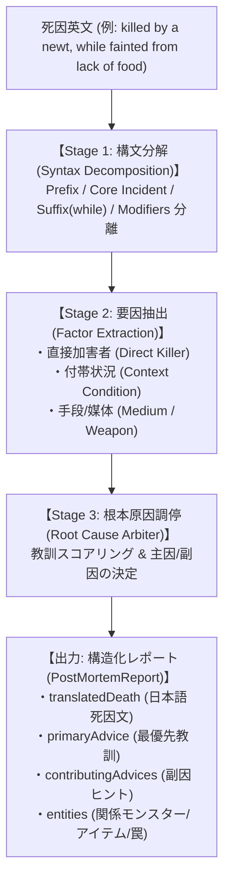

# 事後ナレッジ連携＆戦術アドバイザー刷新 設計構想 (Future Vision)

- **文書ID**: `DOC-FUTURE-POST-MORTEM-ADVICE-01`
- **対象領域**: Core Knowledge層 (`PostMortemKnowledgeResolver.js`, `ADVICE_DEFINITIONS.js`) / UI層 (`scoreboard.html`, ゲームオーバー画面)
- **ステータス**: `in-progress (Core Resolver & Scoreboard implemented)`
- **最終更新**: 2026-10-11

---

## 1. 背景と目的

NetHack 5.0対応の単体スコアボード画面 (`tools/scoreboard.html`) およびゲームオーバー画面において、NetHackが出力する生の死因テキスト（英文）を解析し、日本語化および戦術アドバイザー (`ADVICE_DEFINITIONS.js`) / GKL (Game Knowledge Layer) と連動する基盤 `PostMortemKnowledgeResolver.js` を導入した。

現状は主要な基本死因構文（`killed by`, `died of starvation`, `petrified`, `choked on`, `drowned`, `ascended`, `quit`）の翻訳と初期的なアドバイス接続が動作しているが、NetHack特有の多様で残酷な死因パターンに対しては、以下のような課題が顕在化していた（コア部分は Stage 1〜3 ハイブリッドパイプラインとして実装完了）：
1. **「直接原因（トドメ）と根本原因（無力化）の二重構造」**（気絶中のイモリ撃破など）
2. **「モンスター戦闘死への過剰フォールバックと誤分類」**（実運用で確認された課題）：
   - `poisoned by a rotted rothe corpse` がモンスター名 `rothe` に誤一致し **「ロゼに倒された」** と戦闘死扱いになる（本来は腐敗死骸の食中毒・毒殺）
   - `killed by an explosion` がモンスター扱いになり **「explosionに倒された」** と英名混じりになる（本来は環境・物理爆発ハザード）
   - `killed by an exploding large box` がモンスター扱いになり **「exploding large boxに倒された」** となる（本来は箱・チェストの爆弾トラップ）
3. **「アイテム・死骸複合語の分解欠如」**（`OBJECT_JP_MAP` と連携したコンテナ識別や `corpse` プレフィックスの未分離）

本構想は、将来的な「アドバイスシステム全体の包括的刷新」のマイルストーンとして、死因解析の精度向上、プレイヤーにとって実用的で納得感のある「敗因分析・サバイバル教訓」の提供方式、およびアーキテクチャ設計を体系的にまとめたものである。

---

## 2. 設計原則とコアドメイン概念

### 2.1 SSOT (Single Source of Truth) の堅持
- ヒントやモンスター情報を個別ハードコードせず、既存マスターデータ（`ADVICE_DEFINITIONS.js`、`MONSTER_JP_MAP`、`OBJECT_JP_MAP`、`MONSTER_KNOWLEDGE_MAP` 等）を一元参照する。

### 2.2 直接死因 (Direct Finisher) vs 根本原因 (Root Cause) の分離
プレイヤーが知るべきは「何にトドメを刺されたか」だけでなく、**「何が致命的な隙を生み、回避すべき真の教訓だったのか」**である。
- **直接死因 (Direct Finisher)**: HPを0にした直接の攻撃者・事象（例: `a newt`, `a goblin`）
- **根本原因 (Root Cause)**: 回避可能かつ致命的な無力化状態・引き金（例: `fainted from lack of food`, `frozen by a floating eye`, 手袋なし死体接触）

---

## 3. 解析パイプライン アーキテクチャ

単一の正規表現マッチングから、多段パイプライン方式へと昇格する。

### 3.1 Stage 1: 構文分解 (Syntax Decomposition)
NetHack 5.0 の Cソース（`src/topten.c` の `formatkiller()`）の出力仕様に準拠して分解する：
$$\text{DeathString} = [\text{Prefix}] + [\text{Core Incident / Entity}] + [\text{Helpless Suffix}]$$

1. **Suffix (`while`) の先行分離**:
   - 末尾の `(?:,\s+)?while\s+(.+)` を抽出し、無力化理由（`gm.multi_reason`）を独立取得。
2. **Prefix（動詞句）の分離**:
   - `killed by `, `choked on `, `poisoned by `, `died of `, `drowned in `, `burned by `, `dissolved in `, `crushed to death by `, `petrified by `, `turned to slime by `
3. **修飾子のトークナイズ**:
   - 冠詞: `a`, `an`, `the`
   - 所有格: `his own`, `her own`, `their own`
   - 状態形容詞: `invisible`, `peaceful`, `tame`, `hostile`
   - 固有名詞/別名: `called "..."`, `, the shopkeeper`, `, priest of <God>`

### 3.2 Stage 2: 要因抽出 (Factor Extraction)
クレンジング後のコア句から、単なるモンスター名だけでなく**複合エンティティ（死骸・アイテム・環境ハザード・トラップ）**を識別・分解する：

1. **死骸・食中毒・毒物パターンの先行分解**:
   - `poisoned by a rotted <monster> corpse` $\rightarrow$ モンスター `<monster>` を抽出しつつ、死骸（Corpse）および腐敗（Rotted）状態を識別。
   - `poisoned by eating a <monster> corpse` $\rightarrow$ 食事（Eating）による毒死を識別。
   - 単なるモンスター戦闘死（`THREAT_MONSTER`）と明確に分離し、`FOOD_POISONING` カテゴリとして調停。
2. **コンテナ・罠爆発パターンの先行分解**:
   - `killed by an exploding <item>` $\rightarrow$ `<item>`（例: `large box`, `chest`）を `OBJECT_JP_MAP` で逆引き（`大きな箱`, `箱`）。
   - 「コンテナ爆弾トラップ（`TRAP_CONTAINER`）」として識別。
3. **環境・物理爆発ハザードの識別**:
   - `killed by an explosion` / `blasted by an explosion` $\rightarrow$ モンスターではなく環境ハザード（`HAZARD_EXPLOSION`）として識別。
4. **コア名詞の辞書照会**:
   - モンスター名: `MONSTER_JP_MAP` / `MONSTER_KNOWLEDGE_MAP`
   - アイテム・コンテナ: `OBJECT_JP_MAP` / `OBJECT_KNOWLEDGE_MAP`
   - 罠（Pit, Dart, Spikes, Drawbridge）、環境（Lava, Pool, Moat）、神罰（Wrath of...）等のキーワード辞書とマッチング。

### 3.3 Stage 3: 根本原因調停 (Root Cause Arbiter)
- 付帯状況と直接死因の危険度・学習価値をスコアリングし、最優先で提示すべきアドバイスを選出する。

---

## 4. 死因パターンの体系的分類（NetHack 5.0準拠マトリクス）

| カテゴリ | 英文パターン例 | 特徴・抽出ターゲット | 期待される日本語訳 | 紐付けるべきアドバイス |
| :--- | :--- | :--- | :--- | :--- |
| **① 生理的・食中毒・自滅死 (Physiological & Ingestion)** | `died of starvation` `choked on a meatball` `poisoned by a rotted rothe corpse` `poisoned by eating a kobold corpse` `strangled by an amulet of strangulation` | 飢餓、窒息、首絞め、腐敗死骸食中毒、毒肉摂取。 ・モンスター名（死骸の元） ・腐敗/毒フラグ | 飢えにより力尽きた ミートボールを喉に詰まらせて窒息死した **腐ったロゼの死骸の毒で命を落とした** 首絞めの魔除けにより絞殺された | `ADVICE_SURVIVAL_STARVATION` `ADVICE_HAZARD_ROTTEN_CORPSE` 窒息・首絞め対策 |
| **② 環境・物理爆発 (Explosion Hazard)** | `killed by an explosion` `blasted by an explosion` | ガス胞子誘爆、杖過充填、魔法・爆風等の環境爆発 | **爆発に巻き込まれて爆死した** | `ADVICE_HAZARD_EXPLOSION` （耐火・退避教訓） |
| **③ トラップ・コンテナ爆発 (Trap & Exploding Box)** | `killed by an exploding large box` `killed by an exploding chest` `poisoned by a poisoned dart trap` `fell into a pit of iron spikes` `crushed to death by a collapsing drawbridge` | 宝箱の爆弾トラップ、毒矢罠、落とし穴、跳ね橋巻き込み。 ・対象アイテム（`OBJECT_JP_MAP`） ・罠種別 | **大きな箱の爆発（罠）に巻き込まれて死亡した** 箱の爆発罠により命を落とした 毒矢の罠に当たって毒死した 跳ね橋に押し潰されて死亡した | `ADVICE_HAZARD_EXPLODING_CONTAINER` `ADVICE_HAZARD_TRAP` `ADVICE_HAZARD_DRAWBRIDGE` |
| **④ モンスター直接脅威 (Direct Monster)** | `killed by an orc` `killed by a master mind flayer` `killed by a floating eye` `crushed to death by a minotaur` | モンスター名、特殊攻撃（知性吸い・石化・麻痺視線・直接毒針） | オークに倒された マスター・マインドフレアに倒された | `ADVICE_THREAT_MIND_FLAYER` `ADVICE_THREAT_FLOATING_EYE` `ADVICE_THREAT_POISON` など |
| **⑤ 自爆・跳ね返り・操作事故 (Player Mishap)** | `blasted by a bolt of lightning bounced off a wall` `killed by exploding a wand of striking` `petrified by touching a chickatrice corpse without gloves` `killed by a wand of striking exploding in a bag of holding` | プレイヤー自身の行為が引き金。 ・杖過充電爆発 ・手品袋爆発 ・反射光線 ・手袋なし死体接触 | 壁で跳ね返った稲妻に打たれて自滅した 打撃の杖の過充填暴発で死亡した 素手でヒナコカトリスの死骸に触れて石化した | `ADVICE_HAZARD_BAG_OF_HOLDING_EXPLOSION` `ADVICE_HAZARD_PETRIFY_CORPSE` `ADVICE_SURVIVAL_BOUNCED_RAY` |
| **⑥ 環境・地形死 (Environmental Hazard)** | `burned by molten lava` `drowned in a moat` `dissolved in molten lava` | 溶岩、水場、堀（浮遊・耐火不足） | 溶岩に落ちて焼け死んだ 堀に沈んで溺死した | `ADVICE_HAZARD_LAVA` `ADVICE_HAZARD_WATER` |
| **⑦ 神罰・禁忌行動 (Divine Wrath & Taboo)** | `killed by the wrath of Anhur` `killed by the anger of Tyr` `killed by kicking a wall` `killed by trying to pray too soon` | 神の怒り、祈りインターバル不足、壁キック事故 | アンフールの神罰により死亡した 祈りの間隔が早すぎて神の怒りに触れた | `ADVICE_SURVIVAL_DIVINE_WRATH` |

---

## 5. 主因 vs 寄与要因の調停ロジック (RCA)

### 判定ルール例
1. **無力化状態優先原則**:
   - `killed by a newt, while fainted from lack of food`
     - 直接打撃: `newt`（脅威度: Very Low）
     - 付帯状況: `fainted from lack of food`（教訓スコア: 1000 - 飢餓・祈り教訓）
     - **判定**: `ADVICE_SURVIVAL_STARVATION` を最優先教訓（Primary）とし、死因文は「飢餓で気絶中にイモリに倒された」と翻訳。
   - `killed by a goblin while frozen by a floating eye`
     - 直接打撃: `goblin`
     - 付帯状況: `frozen by a floating eye`
     - **判定**: `ADVICE_THREAT_FLOATING_EYE` を最優先教訓とする。
2. **操作ミス・自爆事故優先原則**:
   - プレイヤー操作によって引き起こされた事故（手袋なしコカトリス接触、手品袋の異次元爆発など）は、モンスターの通常攻撃よりも回避可能性が高いため、最優先教訓とする。

---

## 6. 戦術アドバイザー (`ADVICE_DEFINITIONS.js`) 連動拡張一覧

### 6.1 既存定義へのマッピング
- 毒死 $\rightarrow$ `ADVICE_THREAT_POISON`
- マインドフレア脳食い死 $\rightarrow$ `ADVICE_THREAT_MIND_FLAYER`
- スライム化死 $\rightarrow$ `ADVICE_THREAT_GREEN_SLIME`
- 水没・溺死 $\rightarrow$ `ADVICE_THREAT_DROWNING` / `ADVICE_HAZARD_WATER`
- 溶岩死 $\rightarrow$ `ADVICE_HAZARD_LAVA`
- 手品袋爆発 $\rightarrow$ `ADVICE_HAZARD_BAG_OF_HOLDING_EXPLOSION`
- 店主の逆鱗 $\rightarrow$ `ADVICE_THREAT_PEACEFUL_SHOPKEEPER`

### 6.2 新規追加検討アドバイス
- `ADVICE_HAZARD_ROTTEN_CORPSE`: 腐敗死体の食中毒・毒殺対策（死後ターン経過死骸の危険、毒耐性、新鮮な死骸・保存食/缶詰作成）
- `ADVICE_HAZARD_EXPLOSION`: 環境・物理爆発ハザード対策（ガス胞子等の誘爆、火炎耐性・反射の盾、安全距離確保）
- `ADVICE_HAZARD_EXPLODING_CONTAINER`: 箱・チェスト爆弾トラップ対策（開錠スキル/鍵/ノックの呪文、遠隔飛び道具破壊、耐火）
- `ADVICE_HAZARD_TRAP`: 毒矢・毒針・落石トラップ対策（探索スキル、毒耐性、HP管理）
- `ADVICE_SURVIVAL_BOUNCED_RAY`: 壁反射による自爆光線対策（角度・反射の盾・耐性）
- `ADVICE_HAZARD_DRAWBRIDGE`: 跳ね橋開閉巻き込み即死対策
- `ADVICE_SURVIVAL_DIVINE_WRATH`: 神の怒り・祈りインターバル超過対策

---

## 7. TDD検証用コーパス仕様 (Corpus Benchmark)

| No | 入力死因英文 | 期待される分類 | 期待される日本語死因文 | 期待される最優先教訓 | 備考 |
| :--- | :--- | :--- | :--- | :--- | :--- |
| 1 | `killed by a newt, while fainted from lack of food` | `STARVATION` | 飢餓で気絶中にイモリに倒された | `ADVICE_SURVIVAL_STARVATION` | 付帯状況優先 |
| 2 | `killed by a goblin while frozen by a floating eye` | `THREAT_MONSTER` | 浮遊する目玉に麻痺させられている間にゴブリンに倒された | `ADVICE_THREAT_FLOATING_EYE` | 麻痺原因優先 |
| 3 | `killed by an elf while sleeping` | `THREAT_MONSTER` | 眠っている間にエルフに倒された | 睡眠注意 / エルベレス | 行動不能フラグ |
| 4 | **`poisoned by a rotted rothe corpse`** | **`FOOD_POISONING`** | **腐ったロゼの死骸の毒で命を落とした** | **`ADVICE_HAZARD_ROTTEN_CORPSE`** | **死骸食中毒（モンスター戦闘死除外）** |
| 5 | **`killed by an explosion`** | **`EXPLOSION`** | **爆発に巻き込まれて爆死した** | **`ADVICE_HAZARD_EXPLOSION`** | **環境爆発（英名露出防止）** |
| 6 | **`killed by an exploding large box`** | **`TRAP_CONTAINER`** | **大きな箱の爆発（罠）に巻き込まれて死亡した** | **`ADVICE_HAZARD_EXPLODING_CONTAINER`** | **箱トラップ（アイテム辞書連動）** |
| 7 | `poisoned by a poisoned dart` | `TRAP` | 毒矢の罠に当たって毒死した | `ADVICE_HAZARD_TRAP` | 罠毒針 |
| 8 | `blasted by a bolt of lightning bounced off a wall` | `BOUNCED_RAY` | 壁で跳ね返った稲妻に打たれて自滅した | `ADVICE_SURVIVAL_BOUNCED_RAY` | 自爆光線 |
| 9 | `killed by exploding a wand of striking` | `ITEM_MISHAP` | 打撃の杖の過充填暴発で死亡した | 杖過充電教訓 | 杖爆発 |
| 10 | `petrified by touching a chickatrice corpse without gloves` | `PETRIFICATION` | 素手でヒナコカトリスの死骸に触れて石化した | `ADVICE_HAZARD_PETRIFY_CORPSE` | 手袋未着用 |
| 11 | `crushed to death by a collapsing drawbridge` | `HAZARD_ENVIRONMENT` | 跳ね橋に押し潰されて死亡した | `ADVICE_HAZARD_DRAWBRIDGE` | トラップ即死 |
| 12 | `dissolved in molten lava` | `HAZARD_ENVIRONMENT` | 溶岩に落ちて焼け死んだ | `ADVICE_HAZARD_LAVA` | 溶岩即死 |
| 13 | `killed by an invisible master mind flayer called Bob` | `THREAT_MONSTER` | 姿の見えないマスター・マインドフレアに倒された | `ADVICE_THREAT_MIND_FLAYER` | 修飾子・別名クレンジング |
| 14 | `killed by Mr. Morgan, the shopkeeper` | `THREAT_MONSTER` | 店主モーガンに倒された | `ADVICE_THREAT_PEACEFUL_SHOPKEEPER` | 店主識別 |
| 15 | `turned to slime by a green slime` | `TURNED_SLIME` | グリーンスライムによりスライム化して死亡した | `ADVICE_THREAT_GREEN_SLIME` | スライム化 |
| 16 | `killed by the wrath of Anhur` | `DIVINE_WRATH` | アンフールの神罰により死亡した | `ADVICE_SURVIVAL_DIVINE_WRATH` | 天罰 |

---

## 8. 実装ロードマップ (Implementation Phases)

> [!WARNING]
> **【2026-10-16 実コード突合による進捗ステータス是正】**  
> 以前の本ドキュメントでは Phase 1〜3 が `[x] 実装完了` と記載されていましたが、`src/core/knowledge/services/PostMortemKnowledgeResolver.js`（全301行）および `tests/core/knowledge/PostMortemKnowledgeResolver.test.js` の実コード監査により、**現在は「基本8パターンの解決と `tools/scoreboard.html` 統合」までが完了しており、複合エンティティ抽出（`rotted ... corpse`, `exploding <item>`, `explosion`）および `while` 付帯状況の主因優先調停（RCA）は未実装**であることが確認されました。以下のチェックリストを実態に合わせて是正します。

- [x] **Phase 0: 基本死因リゾルバと公式スコアボード (`tools/scoreboard.html`) 連携（実装完了）**
  - [x] 基本死因構文（`ascended`, `quit`, `escaped`, `starvation`, `petrified`, `choked on`, `drowned`, 基本モンスター撃破、`floating eye` 麻痺）の日本語翻訳とアドバイス紐付け。
  - [x] 単体スコアボード画面（`tools/scoreboard.html`）および `PostMortemKnowledgeResolver.test.js`（基本12テスト）の配備・PASS。
- [ ] **Phase 1: 複合エンティティ先行抽出 ＆ 構文分解パイプラインの実装（残タスク）**
  - [ ] **死骸食中毒（`rotted <monster> corpse`）・環境爆発（`explosion`）・コンテナ罠爆発（`exploding <item>`）** が一般モンスター戦闘死（`THREAT_MONSTER`）に誤フォールバックしないよう先行抽出・辞書照会ロジックを実装。
  - [ ] 修飾子（`invisible`, `peaceful`, `shopkeeper`, `called ...`）と接尾辞 `while ...` の精密分離。
- [ ] **Phase 2: 根本原因調停器 (Root Cause Arbiter: RCA) の実装（残タスク）**
  - [ ] `while fainted from lack of food` 等の無力化状態（Helpless Suffix）を直接打撃（`a newt` 等）より優先して主教訓（Primary Advice）に選出する調停ロジック。
- [ ] **Phase 3: `ADVICE_DEFINITIONS.js` 包括バインド拡張と TDD コーパステスト完備（残タスク）**
  - [ ] 未接続アドバイス（`ADVICE_THREAT_MIND_FLAYER`, `ADVICE_THREAT_GREEN_SLIME`, 新規ハザード定義等）の包括バインドと第7章の全16+ケース TDD 検証。

