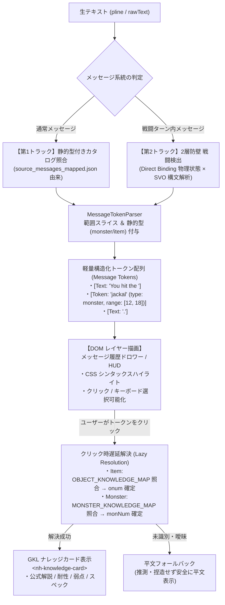
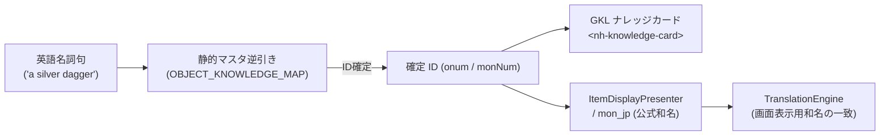

# 🧩 セマンティック・メッセージトークン化 ＆ インタラクティブ描画仕様書
*(Semantic Message Tokenization & Interactive Rendering Specification: Static-Typed Catalog to GKL Pipeline)*

## 1. 背景と基本方針 (Background & Core Philosophy)

### 1.1 「メッセージ内の名詞特定 → クリック → GKL ナレッジ表示」への純化
NetHack のテキスト出力（WASM C コアからの `putstr` / `pline` 等）は、伝統的に単一のフラットな文字列として画面に流されてきました。
本仕様は、**NetHack 本体の C コアを一切改変せず（公式 C 非改変・SSOT 原則）**、C ソースコード静的解析データ（`c_arguments`）および Direct Binding 物理状態監視を活用し、メッセージ内の名詞（モンスター名・アイテム名）を安全にトークン化し、ユーザーのクリック操作から GKL ナレッジカード（`<nh-knowledge-card>`）へシームレスに連携するアーキテクチャを定義します。



### 1.2 確定設計方針（不変原則）
1. **NetHack C コア非改変の SSOT 原則**:
   - C 側でメッセージに型情報を能動的に付与する改変（`putmixed` 等）は不採用。
   - `shim_bridge.c` はプロジェクト管理下の読み取り専用拡張とし、メッセージ発生時のリアルタイム状態照会も行わない。
2. **2 つのトラックによる完全カバー**:
   - **第 1 トラック（通常メッセージ）**: ビルド時に `tools/data/source_messages_mapped.json` の `c_arguments`（C 引数式）から静的に分類・カタログ化。
   - **第 2 トラック（戦闘メッセージ）**: バッファ組立て文に対し、「Direct Binding 物理状態遷移」と「S-V-O 構文解析」の 2 層防壁で誤検出ゼロの動的判定。
3. **クリック時遅延解決（Lazy Resolution）と名詞解決の一本化**:
   - トークン自身は「範囲（range）＋型（type: monster/item）＋原文（rawText）」のみを保持し、冠詞・複数形正規化の新規実装は行わない。
   - ID 解決（`onum` / `monNum`）はクリック時に既存の静的名称表（`OBJECT_KNOWLEDGE_MAP` / `MONSTER_KNOWLEDGE_MAP`）へ委譲する。一意に決まらない場合は推測せず平文のままとする。
4. **スコープの明確な分離**:
   - **VFX/SFX 演出**: Direct Binding から直接駆動済みのため本仕様のスコープ外とする。
   - **インベントリ連携**: `InventoryStateManager` および `ItemNormalizer` で別途実現済みのため除外。
   - **既存カタログ保護**: 既存の `MessageContextCatalog.js`（250KB 上限・DoD 準拠）は既存機能が依存しているため破壊せず、トークン化用カタログを独立して設計する。

---

## 2. トークン・データ構造仕様 (Message Token Schema)

トークン構造体は不要なメタデータ（関係性や推測属性）を削ぎ落とし、最小限の構造を保ちます。

### 2.1 MessageToken スキーマ
```typescript
export type TokenType = 'monster' | 'item' | 'text';

export interface MessageToken {
  // トークン種別: 'text' (平文) | 'monster' (モンスター) | 'item' (アイテム)
  type: TokenType;
  
  // 表示文字列 (原文)
  text: string;
  
  // 原文メッセージ内の文字範囲 [startIndex, endIndex]
  range: [number, number];
  
  // クリック操作可能フラグ (type !== 'text')
  interactive: boolean;
  
  // メタデータ (静的カタログまたは戦闘検出由来)
  meta?: {
    callee?: string;       // C 呼出元 ('You', 'pline' 等)
    sourceFile?: string;   // C ソースファイル ('eat.c', 'uhitm.c' 等)
    cArgExpr?: string;     // 分類根拠となった引数式 ('mon_nam(mtmp)', 'doname(otmp)' 等)
    combatRole?: 'attacker' | 'target'; // 戦闘時ロール (主語/目的語)
  };
}
```

### 2.2 出力例
メッセージ: `"You displace the kitten."`
```json
[
  { 
    "type": "text", 
    "text": "You displace the ", 
    "range": [0, 17], 
    "interactive": false 
  },
  { 
    "type": "monster", 
    "text": "kitten", 
    "range": [17, 23], 
    "interactive": true,
    "meta": {
      "callee": "You",
      "sourceFile": "do.c",
      "cArgExpr": "mon_nam(mtmp)"
    }
  },
  { 
    "type": "text", 
    "text": ".", 
    "range": [23, 24], 
    "interactive": false 
  }
]
```

---

## 3. 第 1 トラック: 通常メッセージの静的型付けカタログ

### 3.1 `%s` 静的型付けルール (`tools/data/source_messages_mapped.json`)
C ソース全メッセージ（14,849 件）のうち、プレースホルダーを持つメッセージの引数式（`c_arguments`）を以下の決定ルールで分類します：

| 分類先型 (`TokenType`) | 抽出対象となる主な C 引数式・関数パターン | カバー率（実測） |
| :--- | :--- | :---: |
| **`monster`** | `Monnam`, `mon_nam`, `y_monnam`, `some_mon_nam`, `x_monnam`, `noit_mon_nam`, `Shknam`, `shkname`, `Amonnam`, `a_monnam`, `noit_mhis`, `m_monnam`, `mons[...]` | **18.79%** (829件) |
| **`item`** | `doname`, `xname`, `yname`, `Yname2`, `the()`, `an()`, `simpleonames`, `cxname`, `aobjnam`, `Tobjnam`, `bare_why_name`, `objects[...]` | **13.85%** (611件) |
| **平文 / 対象外** | `body_part`（部位）, `u_gname`（神名）, `buf`/`msg`（バッファ変数）, `what`/`verb`/`something`（代名詞・動詞） | **67.36%** |

> **合計網羅性**: `%s` 全 4,413 件中、モンスター・アイテムの特定エンティティだけで **1,440 件 (32.63%)**、拡張型付け全体で **1,825 件 (41.36%)** を静的に確定可能。

### 3.2 クリック時遅延解決（Lazy Resolution）フロー
トークンがクリックされた際、以下の決定論的パイプラインで GKL ナレッジカードへ渡す ID を解決します。

1. **アイテム (`type: 'item'`)**:
   - `OBJECT_KNOWLEDGE_MAP` の名称辞書（英語名 `name`、外見名 `appearance`）と照合。
   - 冠詞（`a `, `an `, `the `）や数量・修飾語を除去した文字列で `onum` を逆引き。
   - `onum` が確定した場合: `ItemNormalizer.normalize({ onum })` を生成し、`<nh-knowledge-card>` の `setTarget(canonicalItem)` を呼び出す。
2. **モンスター (`type: 'monster'`)**:
   - `MONSTER_KNOWLEDGE_MAP` の名称辞書（英語名 `name`）と照合。
   - 冠詞等を除去した文字列で `monNum`（PM 番号: 0〜390）を逆引き。
   - `monNum` が確定した場合: 対象モンスターオブジェクトを構築し、`<nh-knowledge-card>` の `setTarget(monsterData)` を呼び出す。
3. **解決失敗時**:
   - 推測や捏造を行わず、カードを開かない（安全な平文フォールバック）。

---

## 4. 第 2 トラック: 戦闘メッセージ検出（2層防壁方式）

### 4.1 なぜテキスト単体の後追い正規表現ではいけないのか
`uhitm.c` / `mhitu.c` / `mhitm.c` の戦闘メッセージは、C 側で主語・動詞・目的語・追加効果が動的に結合（`pline("%s", buf)` 等）されています。
これらをテキスト単体の正規表現（例: `/(hits|bites|misses)/`）で評価しようとすると、店主のセリフ（`"That bites!"`）やベアトラップの作動メッセージ（`"A bear trap bites into your leg!"`）を戦闘と誤認する誤検出（False Positive）が発生します。

これを根絶するため、**「Direct Binding 物理状態」と「S-V-O 構文解析」を組み合わせた 2 層防壁** を採用します。

```mermaid
flowchart TD
    subgraph Wall1["第 1 防壁: Direct Binding 物理状態遷移の確認"]
        Frame["1操作のメッセージフレーム (ContextFrameBuffer)"]
        --> CheckState{"このフレームで戦闘状態が発生したか？<br>① 直前の入力が攻撃方向キー (GKLFxCoordinator)<br>② プレイヤーHPの減少 (u.uhp 差分)<br>③ 視界内モンスターのHP減少 または 死亡"}
    end

    CheckState -->|No (通常ターン)| Bypass["戦闘パーサーを完全バイパス<br>(誤検出リスク 0%)"]
    CheckState -->|Yes (戦闘ターン)| Wall2

    subgraph Wall2["第 2 防壁: S-V-O 構文解析 (戦闘動詞 × モンスター辞書)"]
        Parser["S-V-O 構文パーサー<br>[主語] + [戦闘動詞] + [目的語]"]
        --> DictCheck{"主語または目的語が<br>MONSTER_KNOWLEDGE_MAP (390種) に合致するか？"}
    end

    DictCheck -->|No| Plain["平文維持 (推測せず)"]
    DictCheck -->|Yes| CombatToken["確実な戦闘メッセージとしてトークン化<br>・モンスター名部分を 'monster' 型で抽出<br>・クリックで <nh-knowledge-card> 連携"]
```

### 4.2 第 1 防壁：物理状態遷移によるフレーム限定
- メッセージを 1 行ずつバラバラに評価するのではなく、1 ターンのメッセージフレーム（`ContextFrameBuffer`）単位で評価します。
- そのターン内で以下の **Direct Binding 物理的事実** のいずれかが発生している場合のみ、「戦闘コンテキスト」のフラグを立てます：
  1. 直前のユーザー入力が「隣接敵対モンスターへの方向キー（攻撃）」である（`GKLFxCoordinator` で既に検知可能）。
  2. プレイヤーの現在 HP（`u.uhp`）が前フレームから減少した。
  3. 攻撃対象マスのモンスター HP が減少した、またはモンスターが死亡消滅した（`DEADMONSTER()`）。
- **効果**: 探索中・売買中・祈り時などはこの条件を満たさないため、戦闘パーサー自体が起動せず、**誤検出の可能性が構造的にゼロ**になります。

### 4.3 第 2 防壁：S-V-O 構文解析（戦闘動詞マスター × モンスター辞書）
第 1 防壁を通過したフレーム内のメッセージに対してのみ、NetHack の規則正しい英文法（主語-動詞-目的語）を評価します。

C ソース（`attack.h`, `uhitm.c`, `mhitu.c`）で定義された攻撃動詞は有限個（約30語）に限定されています：
- **プレイヤー攻撃動詞**: `hit`, `slash`, `stab`, `thrust`, `chop`, `hack`, `cleave`, `smite`, `strike`, `punch`, `kick`, `miss`
- **モンスター攻撃動詞**: `bites`, `claws`, `stings`, `touches`, `butts`, `engulfs`, `crushes`, `hugs`, `kicks`, `misses`

構文解析器は、文中の主語または目的語が **`MONSTER_KNOWLEDGE_MAP`（390種）の英語名と完全一致するか** を検証します：
- 例: `"The jackal bites you!"`  
  → 主語: `"jackal"`（モンスター辞書に完全一致 → `monNum` 確定）  
  → 動詞: `"bites"`（モンスター攻撃動詞テーブルに完全一致）  
  → 目的語: `"you"`  
  ⇒ **100% の確度で戦闘メッセージと断定**し、`"jackal"` のみを `monster` トークンとして抽出。

### 4.4 連鎖メッセージ（撃破・状態異常）のコンテキスト継承
戦闘メッセージ直後に同一フレーム内で届く撃破・状態異常メッセージ（`"You kill the newt!"`, `"The newt is killed!"`, `"The newt is poisoned!"`）は、直前の攻撃メッセージで確定した対象モンスターのコンテキストを引き継ぎ、定型パターン（`is killed!`, `dies!`, `is destroyed!` 等の 10 パターン）と照合して安全にトークン化します。

---

## 5. 名詞解決の一本化（翻訳システムとの整合性）

### 5.1 二重化の解消アーキテクチャ
既存の `TranslationEngine`（`dictionary.csv` の文字列置換）と `ItemNormalizer`（`OBJECT_KNOWLEDGE_MAP` の構造化）の間で発生していた和名や判定の不一致を、以下のパイプラインに一本化します。



- **単一源泉化**: アイテムの和名は `OBJECT_KNOWLEDGE_MAP`（`objects.c` 準拠）、モンスターの和名は `MONSTER_KNOWLEDGE_MAP`（`mon_jp.c` 準拠）を真値（SSOT）とする。
- **翻訳エンジンへの還元**: `TranslationEngine` がアイテム・モンスターを和名化する際も、この同一の ID 解決機構を共有することで、メッセージ内の翻訳名とナレッジカードの名称が完全に一致する。

---

## 6. UI / UX 実装仕様 (Interaction & Rendering)

### 6.1 メッセージ履歴ドロワー（主戦場）
- `FloatingMessageHud` はゲームプレイを阻害しないよう `pointer-events: none` で設計されているため、**トークンのインタラクティブ操作の主戦場はメッセージ履歴ドロワー（History Drawer / Message Log）** とする。
- ドロワー内では、トークンが `<span class="nh-token ...">` として描画される。
  - `.token-monster`: モンスター固有の視認色（アンバー/赤系）＋点線下線
  - `.token-item`: アイテム固有の視認色（シアン/緑系）＋点線下線
- キーボード（`Tab` / `Shift+Tab`）およびゲームパッドのフォーカス移動に対応（`tabindex="0"`）。
- `Enter` キー、クリック、またはゲームパッド `A` ボタンでナレッジカードを開く。

### 6.2 ダイレクト・アクションパレット（条件付き有効化）
メッセージ内のアイテムトークンからクイックアクション（拾う、調べる、食べる等）を実行するアクションパレットは、以下の**厳格な安全条件**を満たす場合のみ有効化する：
1. **コマンド入力待ち（poskey 等）状態であること**:
   - `ContextFrameBuffer` または `WebUICore.driver` がプロンプト待機中であることを確認。
2. **Yes/No 等の質問プロンプト待機中ではないこと**:
   - 割り込み入力を防止し、安全なタイミングでのみコマンド入力を WASM キューへ注入する。

---

## 7. パフォーマンス制約・受入基準 (DoD)

1. **カタログサイズ制限**:
   - トークン化専用カタログの追加に伴う JS バンドル増分は **300KB 以内** に抑制すること。
   - 既存の `MessageContextCatalog.js`（250KB 制約）の挙動を破壊・劣化させないこと。
2. **実行時性能**:
   - メッセージ 1 件あたりのトークン化処理時間は **0.01ms 以内**（正規表現および部分文字列スライスのみで完了すること）。
   - クリック時の GKL ナレッジ表示開始までのレイテンシは **16ms（1フレーム）以内** であること。
3. **誤検出防止の厳格保証**:
   - 第 2 トラック（戦闘メッセージ）において、非戦闘メッセージが誤って戦闘トークン化される誤検出率 **0%** を維持すること（第 1 防壁の物理状態ゲートによる保証）。
4. **SSOT 原則の遵守**:
   - C コアのコード変更は 0 行。
   - トークン化の失敗や ID 未解決によって、メッセージの平文表示が欠落・破壊されないこと（安全なフォールバック保証）。
