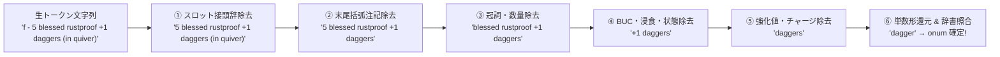

# 🧩 セマンティック・メッセージトークン化 ＆ 物理コンテキスト制約アーキテクチャ仕様書 (V2)
*(Context-Constrained Semantic Message Tokenization & Interactive Rendering Specification)*

## 1. 背景とパラダイムシフト (Background & Paradigm Shift)

### 1.1 V1（文字列先行・全カタログ照合方式）の反省と構造的欠陥
初期実装（V1）では、「画面に流れてきた文字列（`rawText`）を、C ソース全 14,849 件から自動抽出した静的正規表現カタログ（第 1 トラック）に無差別で当てはめる」というボトムアップ（文字列ドリブン）のアプローチを採っていました。
その結果、実際のゲームプレイにおいて以下の **「重要情報とノイズの優先度逆転（本末転倒）」** が発生しました：

1. **最重要である「拾ったアイテム・置いたアイテム・足元の品」が一切リンク化されない**:
   - **拾得時 (`f - 5 daggers.`)**: C コアの `prinv()` が `pline("%s%s%s%s", ...)` という動的バッファ結合で出力するため、固定文字列を持たず静的カタログから 100% 除外されていた。
   - **足元確認 (`You see here an uncursed dagger.`)**: `invent.c` の `You("%s here %s.", ...)` が固定語 `"here"` をストップワード判定されてカタログから脱落していた。
   - **ドロップ時 (`You drop an uncursed +0 dagger.`)**: カタログにはマッチするものの、`TokenKnowledgeResolver` 側に B/U/C（`uncursed`）や強化値（`+0`）の除去パイプラインがなく、辞書（真名 `"dagger"`）との完全一致照合が 100% 失敗して平文にフォールバックしていた。
2. **無意味な地形や環境物（`"the door"` 等）がモンスター/アイテムとして誤爆する**:
   - `steed.c`（騎乗動物の抵抗: `^(.*?) resists!$`）や `pickup.c`（宝箱の施錠: `^(.*?) is locked\.$`）、`dokick.c`（`^You kick (.*?)\.$`）など、動詞 1 語しか固定部分を持たない過剰一般化パターンが、扉を開けようとした時や蹴った時の `"The door resists!"` / `"The door is locked."` に誤爆し、扉をモンスターやアイテムとしてリンク化していた。
3. **金貨メッセージで「最初の数字（100）」だけが切り取られてモンスターになる**:
   - `steal.c:L867`（番兵死亡時の所持金消滅: `pline("%s gold %s.", s_suffix(Monnam(mtmp)), ...)`）から生成された `^(.*?) gold (.*?)\.$`（第 1 引数 = `monster` 型）が、通常の `"100 gold pieces."` にマッチし、数値の **`"100"` だけをモンスターとして切り取る** 致命的誤爆を引き起こしていた。

---

### 1.2 V2 の基本思想：「周辺環境・物理コンテキストによる予測範囲の狭小化」
NetHack の世界において、**「プレイヤーが今どこに立ち、足元に何が落ち、インベントリに何を持ち、隣接マスにどのモンスターや地形（扉・祭壇等）が存在するか」は、Wasm Direct Binding および GKL（Game Knowledge Layer）がすでに 100% 把握している【確定した物理真値（SSOT）】** です。

馬にも乗っていないのに騎乗メッセージを疑い、番兵もいないのに泥棒メッセージを疑う必要はありません。
V2 アーキテクチャでは発想を 180 度転換し、**「単純にメッセージ文字列から推察するのではなく、自己の周辺環境・地形・持ち物（物理コンテキスト）からメッセージの予測範囲を事前に狭める」** トップダウン制約方式を採用します。

```mermaid
flowchart TD
    subgraph World["1. 自己の周辺環境・物理状態 (Direct Binding / GKL SSOT)"]
        Inv["所持品 (Inventory)<br>InventoryStateManager"]
        Floor["足元オブジェクト (Floor)<br>AreaStateManager / Floor Stack"]
        Env["周囲の地形・環境 (Terrain)<br>扉・壁・祭壇・罠・泉"]
        Mon["視界内・隣接モンスター<br>MonsterTracker"]
    end

    Raw["受信メッセージ (rawText)"]
    --> GateEnv{"【環境・地形遮断ゲート】<br>対象が地形・環境物 (door, wall, altar 等) か？"}

    GateEnv -->|Yes (扉の施錠・抵抗・壁蹴り)| PlainEnv["平文維持 (リンク化完全遮断)<br>※ 'the door' 等の誤爆を根絶"]
    GateEnv -->|No| Track0{"【第1層: 日常アイテム＆所持品・足元バインド】<br>拾得 (f - ...) / ドロップ (You drop ...) / 足元 (You see here ...) / 金貨"}

    Track0 -->|一致| ItemToken["確定アイテムトークン抽出<br>・金貨は '100 gold pieces' 全体を item 化<br>・所持品/足元アイテムと優先照合"]
    Track0 -->|不一致| Track2{"【第2層: 2層防壁 戦闘メッセージ検出】<br>物理戦闘ゲート × S-V-O 構文 × 視界内モンスター"}

    Track2 -->|一致| CombatToken["確定戦闘モンスタートークン抽出"]
    Track2 -->|不一致| Track3{"【第3層: 浄化済 静的カタログ (補助)】<br>+ 事後辞書実在検証ゲート"}

    Track3 -->|パターン一致 ＆ 辞書実在| CatToken["特殊イベントトークン抽出"]
    Track3 -->|不一致 または 辞書不在| PlainFallback["安全な平文フォールバック"]

    World -.->|予測範囲の制限| GateEnv
    World -.->|所持品・足元照合| Track0
    World -.->|隣接敵照合| Track2

    ItemToken --> Resolver["TokenKnowledgeResolver<br>(正規化パイプライン: BUC/強化値/数量除去)"]
    CombatToken --> Resolver
    CatToken --> Resolver

    Resolver --> Card["GKL ナレッジカード (&lt;nh-knowledge-card&gt;)"]
```

---

## 2. 物理コンテキスト制約による 3 層解析パイプライン

### 2.1 環境・地形遮断ゲート (Environmental & Terrain Suppression Gate)
プレイヤーの周辺地形（扉、壁、階段、祭壇、流し台、泉、罠など）に対する操作メッセージが、モンスターやアイテムとして誤検出されることを物理的に防ぐ最前線の防壁です。

- **遮断対象となる環境・地形語彙 (`TERRAIN_AND_ENV_STOP_NOUNS`)**:
  - `door`, `doorway`, `wall`, `rock`, `stone`, `corridor`, `stairs`, `staircase`, `ladder`, `altar`, `sink`, `fountain`, `throne`, `tree`, `bars`, `iron bars`, `drawbridge`, `water`, `lava`, `pool`, `moat`, `ice`, `air`, `floor`, `ground`, `ceiling`, `pit`, `web`, `trap`, `boulder`, `grave`, `headstone`
  - ※石像（`statue`: `onum 476`）および死体（`corpse`: `onum 265`）は C コアで操作・捕食可能な正規アイテムであるため、遮断リストから除外し `type: 'item'` としてモンスター詳細付きで解決。
  - 一般的な身体部位・抽象名詞: `hand`, `hands`, `foot`, `feet`, `head`, `body`, `leg`, `arm`, `finger`, `neck`, `mind`, `stomach`, `purse`, `knapsack`, `bag`, `nothing`, `something`, `someone`, `it`, `yourself`
- **動作ルール**:
  - 抽出された名詞候補（冠詞・指示詞 `the`, `this`, `that`, `a`, `an`, `your` 除去後）が上記リストに一致する場合、あるいは数値のみ（`^\d+$`）である場合は、どのトラックで検出されたとしても **`interactive: false`（平文 `text`）へ強制降格** します。
  - これにより、`"The door resists!"` や `"The door is locked."`、`"You kick the door."`、および数値単体 `"100"` の誤爆は **構造的に 100% 発生しなくなります**。

---

### 2.2 第 1 層: 日常アイテム・インベントリ・足元バインド (Core Item & Inventory Track)
プレイヤーが最も頻繁に確認したい「拾ったもの」「置いたもの」「足元にあるもの」「金貨」を、静的カタログの制約を受けずに **最優先（Track 0/1）で 100% 捕捉** します。

#### (A) インベントリ・ピックアップ構文 (`prinv` / Inventory Line)
NetHack C コアの `prinv()`（`pline("%s%s%s%s")`）が出力するインベントリレター付きメッセージ：
- **対象フォーマット**:
  - `^([a-zA-Z\$]\s+-\s+)(.+?)(\s+\(\d+\s+in\s+total\))?([\.\!]?)$`
  - 例: `"f - 5 daggers."`, `"a - an uncursed +1 long sword (weapon in hand)."`, `"$ - 100 gold pieces."`
- **抽出仕様**:
  - プレフィックス `"f - "` と末尾の `" (10 in total)."` を平文（`text`）として分離し、中央のアイテム記述句（`"5 daggers"`）を確実に `type: 'item'` としてトークン化します。

#### (B) ドロップ・所持品操作構文 (`dodrop` / `use` / `wear`)
プレイヤーの所持品（`InventoryStateManager`）を対象とする操作メッセージ：
- **対象フォーマット**:
  - `^(You\s+drop\s+)(.+?)([\.\!])$` （例: `"You drop an uncursed +0 dagger."`）
  - `^(You\s+(?:put\s+on|wear|take\s+off|remove|wield|read|quaff|eat|zap|apply)\s+)(.+?)([\.\!])$`
- **物理コンテキスト連携**:
  - `context.gkl.inventory`（所持品リスト）が存在する場合、抽出されたアイテム句が直近の所持品（またはドロップされたアイテム）と合致するかを優先検証します。

#### (C) 足元・フロア確認構文 (`look_here` / Floor Items)
プレイヤーが移動した際や `:` コマンドで足元を確認した際のメッセージ：
- **対象フォーマット**:
  - `^(You\s+(?:see|feel)\s+here\s+)(.+?)(\.)$` （例: `"You see here an uncursed dagger."`, `"You see here 100 gold pieces."`）
  - `^(There\s+(?:is|are)\s+)(.+?)(\s+here\.)$` （※ただし中身の対象が環境・地形語彙 `a doorway`, `an altar`, `molten lava` 等の場合は環境遮断ゲートにより平文維持）
- **物理コンテキスト連携**:
  - 足元座標 `(u.ux, u.uy)` の床スタック（`AreaStateManager` / `FloorMarkerService`）に存在する実在オブジェクトと照合します。

#### (D) 金貨（Gold Pieces）の完全一体トークン化
- **対象フォーマット**:
  - 文中または単独の `\b(\d+\s+gold\s+pieces?)\b` または `\b(a\s+gold\s+piece)\b`
- **抽出仕様**:
  - 数値部分（`100`）だけを切り取るのではなく、**`"100 gold pieces"` 全体** を単一の `type: 'item'` トークン（基底名 `"gold piece"`）として抽出します。

---

### 2.3 第 2 層: 2 層防壁 戦闘メッセージ検出 (Combat SVO Track)
戦闘中の動的結合メッセージ（`uhitm.c`, `mhitu.c`, `mhitm.c`）を処理するトラックです（現行設計を継承・強化）。

1. **第 1 防壁（Direct Binding 物理状態ゲート）**:
   - 直前の攻撃入力（`GKLFxCoordinator.lastAttackTarget`）、フレーム内の戦闘ダメージ、または視界内・隣接マスに実在モンスター（`MonsterTracker` / `AreaStateManager`）が存在する場合のみ起動。
2. **第 2 防壁（S-V-O 構文解析 × 実在モンスター照合）**:
   - 視界内にいるモンスター名、および `MONSTER_KNOWLEDGE_MAP`（384種）の英語名と完全一致する場合のみ `type: 'monster'` としてトークン化。

---

### 2.4 第 3 層: 浄化済 静的型付きカタログ ＆ 事後辞書検証ゲート (Sanitized Static Catalog Track)
物理的な日常操作（拾う・置く・戦う）以外の特殊イベント（店主のセリフ、魔法や罠の特殊効果、ペットの行動など）を補完するトラックです。

V1 での誤爆を根絶するため、**ビルド時（`build_token_catalog.py`）の浄化** と **ランタイム（`MessageTokenParser.js`）の事後検証ゲート** の二重対策を施します。

#### (1) ビルド時の危険パターン排除 (`tools/build_token_catalog.py`)
以下の過剰一般化パターン・誤爆パターンをカタログ生成時に完全除外します：

| 除外対象 ID / パターン | 原文フォーマット | 除外理由 |
| :--- | :--- | :--- |
| `steal.c:L867:pline:25` | `"%s gold %s."` | `"100 gold pieces."` に誤爆し、数値 `"100"` をモンスター化するため |
| `steed.c:L134:pline:10` | `"%s resists!"` | `"The door resists!"` 等の地形・環境抵抗メッセージに誤爆するため |
| `spell.c:L1051:pline:44` | `"%s resists."` | 同上（固定語が動詞 1 語のみで主語を限定できないため） |
| `pickup.c:L2068:pline:34` | `"%s is locked."` | `"The door is locked."` 等の扉施錠メッセージに誤爆するため |
| `pickup.c:L4038` / `L4108` | `"%s is locked."` / `"%s is empty."` | 固定語が短すぎ、一般文脈と衝突するため |
| `dokick.c:L209:You:5` | `"You kick %s."` | 蹴る対象はモンスターに限らず扉・壁・箱・流し台など多岐にわたるため |
| **汎用ルール: 単一動詞パターン** | `^%s <verb>[.!]$` | 先頭が `%s` で固定単語が一般動詞・形容詞 1 語のみのパターンは、主語の型を静的に保証できないため原則除外または事後辞書検証必須とする |

また、`STOP_WORDS` から `'here'` を除外（または `You("%s here %s.")` を救済）し、必要な固定文脈が消えないようにします。

#### (2) ランタイムの「事後辞書検証ゲート (Post-Match Dictionary Validation Gate)」
第 3 層（静的カタログ）の正規表現にマッチして切り出されたキャプチャ文字列であっても、**無条件でリンク化（`interactive: true`）してはなりません**。
- キャプチャされた文字列を正規化（`cleanEntityName`）した結果が：
  1. 環境・地形遮断リスト（`"door"`, `"wall"` 等）に含まれる場合は **平文（`text`）に降格**。
  2. `TokenKnowledgeResolver` で `MONSTER_KNOWLEDGE_MAP` または `OBJECT_KNOWLEDGE_MAP`（未識別外見名を含む）、あるいは現在の GKL 物理コンテキスト（所持品・足元・視界内モンスター）のいずれにも解決できない場合は、**`interactive: false`（平文）に降格** します。
- **効果**: 「クリックしてもカードが開かない（あるいは無関係なものがリンクになる）死にリンク・ノイズリンク」が画面上に一切出現しなくなります。

---

## 3. `TokenKnowledgeResolver` の正規化パイプライン刷新

NetHack のアイテム表記（`doname` / `xname` 出力）は多くの状態修飾子を含みます。抽出されたトークン（例: `"an uncursed +0 dagger (weapon in hand)"`、`"5 blessed potions of extra healing"`）から、辞書の基底名（`"dagger"`, `"potion of extra healing"`）を 100% 確実に逆引きするため、以下の **多段正規化パイプライン（Canonical Entity Cleaning Pipeline）** を実装します。



### 3.1 正規化ステップ詳細 (`cleanEntityName`)
以下の順序（ループまたは段階的 RegExp）で先頭・末尾の修飾語を剥離します：

1. **インベントリスロット接頭辞の除去**:
   - `/^[a-zA-Z\$]\s+-\s+/` （例: `"f - "`）
2. **末尾の括弧付き状態注記・価格の除去**:
   - `/(\s*\([^)]*\))+$/` （例: `"(being worn)"`, `"(weapon in hand)"`, `"(0:5)"`, `"(unpaid, 50 zorkmids)"`, `"(f)"`）
   - `/,\s+\d+\s+zorkmids?.*$/i`
3. **冠詞・所有格・数量表現の除去**:
   - `/^(?:the|an?|your|some|several|many|a\s+few|a\s+pair\s+of|\d+|two|three|four|five|six|seven|eight|nine|ten)\s+/i`
4. **B/U/C（祝福・呪い）および既知フラグの除去**:
   - `/^(?:blessed|uncursed|cursed|holy|unholy)\s+/i`
   - `/^(?:partly\s+used| partly\s+eaten|diluted)\s+/i`
5. **浸食度・耐性・状態修飾子の除去（複数連続対応）**:
   - `/^(?:(?:very|thoroughly|extremely)\s+)?(?:rusty|corroded|burnt|rotted|damaged|rustproof|corrodeproof|fireproof|fixed|greased|poisoned|wet|lit|unlit|empty|unlocked|locked|broken)\s+/i`
6. **強化値（Enchantment）の除去**:
   - `/^[+-]\d+\s+/` （例: `"+0 "`, `"+2 "`, `"-1 "`）
7. **命名（`named ...` / `called ...`）の除去**:
   - `/\s+(?:named|called)\s+.+$/i` （プレイヤーが付与した個別名や類推名を剥がし、基底名または外見名を取り出す）
8. **金貨の正規化**:
   - `/^\d*\s*gold\s+pieces?$/i` → `"gold piece"` に正規化。
9. **複数形から単数形への還元（英語形態素ルール）**:
   - `"potions of healing"` のような `A of B` 形式にも対応するため、文末だけでなく `of` の直前の主要名詞の複数形も還元候補に追加します：
     - 例: `"potions of healing"` → `"potion of healing"`
     - 例: `"scrolls of identify"` → `"scroll of identify"`
     - 例: `"wands of striking"` → `"wand of striking"`
     - 例: `"pairs of leather gloves"` → `"pair of leather gloves"` / `"leather gloves"`

---

## 4. リンク化ポリシーと優先順位の明確化

ユーザー体験（UX）を損なわないため、**「何がリンクになるべきで、何が平文であるべきか」** の基準を以下に定めます。

| 優先度 | カテゴリ | 具体例 | リンク化 (`interactive`) | 理由 |
| :---: | :--- | :--- | :---: | :--- |
| **P1 (最高)** | **拾得・ドロップ・足元アイテム** | `f - 5 daggers.`, `You drop an uncursed +0 dagger.`, `You see here a ruby potion.` | **⭕ ON (`item`)** | プレイヤーが最も頻繁に効果・重量・未識別候補を確認したい対象であるため |
| **P1 (最高)** | **戦闘・隣接モンスター** | `You hit the jackal.`, `The goblin bites you!` | **⭕ ON (`monster`)** | 交戦中の敵の危険度・耐性・攻撃手段を即座に確認するため |
| **P2 (高)** | **金貨 (Gold)** | `100 gold pieces.` | **⭕ ON (`item`)** | 数値単体ではなく金貨オブジェクト全体として一貫性を持たせるため |
| **P2 (高)** | **イベント内の確定アイテム/モンスター** | `The nymph steals your ring!`, `Your amulet glows.` | **⭕ ON** | 辞書または所持品で実在が確認できる重要エンティティ |
| **対象外** | **地形・建築物・家具** | `the door`, `the wall`, `the altar`, `the fountain`, `the stairs` | **❌ OFF (`text`)** | インスペクタやナレッジカードを出す対象ではなく、画面上のノイズになるため |
| **対象外** | **身体部位・一般名詞・数値** | `your hand`, `your purse`, `100`, `something` | **❌ OFF (`text`)** | ゲーム知識としての参照価値がないため |

---

## 5. 次期実装ロードマップ (Implementation Steps for V2)

本設計書に基づき、以下の 4 ステップでコード改修と検証を実施します：

- [x] **Step 1: `TokenKnowledgeResolver.js` の多段正規化パイプライン実装**:
  - `cleanEntityName()` を刷新し、B/U/C・強化値・浸食・スロット文字・括弧注記・`A of B` 複数形（`potions of ...` → `potion of ...`）・金貨表記を完全に正規化できるようにする。
  - 環境・地形ストップワード（`door`, `wall` 等）の判定メソッド `isIgnoredEntity(text)` を追加。
- [x] **Step 2: `tools/build_token_catalog.py` のサニタイズとカタログ再生成**:
  - 誤爆を引き起こす危険パターン（`steal.c:L867` の gold、`steed.c` / `spell.c` の resists、`pickup.c` の is locked、`dokick.c` の kick 等）を `EXCLUDED_MESSAGE_IDS` および単一動詞除外フィルタで排除。
  - `MessageTokenCatalog.js` を再ビルド。
- [x] **Step 3: `MessageTokenParser.js` への物理コンテキスト・第 1 層トラック ＆ 事後検証ゲートの実装**:
  - 日常アイテム定型トラック（`prinv` の `f - ...`、`You drop ...`、`You see here ...`、`\d+ gold pieces`）を最優先トラックとして実装。
  - 環境遮断ゲートおよび「辞書で解決できないトークンは `interactive: false`（平文）に戻す」事後検証ゲートを統合。
- [x] **Step 4: 単体テスト・回帰テスト (`MessageTokenParser.test.js`) の全面拡充**:
  - 今回発生した全不具合ケース（`"f - 5 daggers."`, `"You drop an uncursed +0 dagger."`, `"You see here a blessed potion of healing."`, `"The door resists!"`, `"The door is locked."`, `"You kick the door."`, `"100 gold pieces."`）を網羅したテストスイートを追加し、誤爆ゼロ・重要アイテム 100% 解決を検証する。

---

## 6. 受入基準 (Definition of Done for V2)

1. **日常アイテムの 100% リンク化と解決**:
   - `"f - 5 daggers."`、`"You drop an uncursed +0 dagger."`、`"You see here a ruby potion."` 等において、アイテム句が `type: 'item', interactive: true` として抽出され、かつ `TokenKnowledgeResolver.resolveTokenKnowledge()` が `null` ではなく正しいアイテム図鑑データ（未識別時は外見図鑑）を返すこと。
2. **金貨の一体認識**:
   - `"100 gold pieces."` において、`"100"` だけがモンスターになることなく、`"100 gold pieces"` 全体が `type: 'item'` として認識されること。
3. **環境物・地形ノイズの完全排除（誤爆率 0%）**:
   - `"The door resists!"`、`"The door is locked."`、`"You kick the door."` において、`"the door"` がモンスターやアイテムとしてトークン化されず、平文（`type: 'text', interactive: false`）のままであること。
4. **死にリンク（Dead Links）の根絶**:
   - `interactive: true` となったすべてのトークンが、`TokenKnowledgeResolver` によって確実に有効なナレッジまたは和名へ解決できること。
