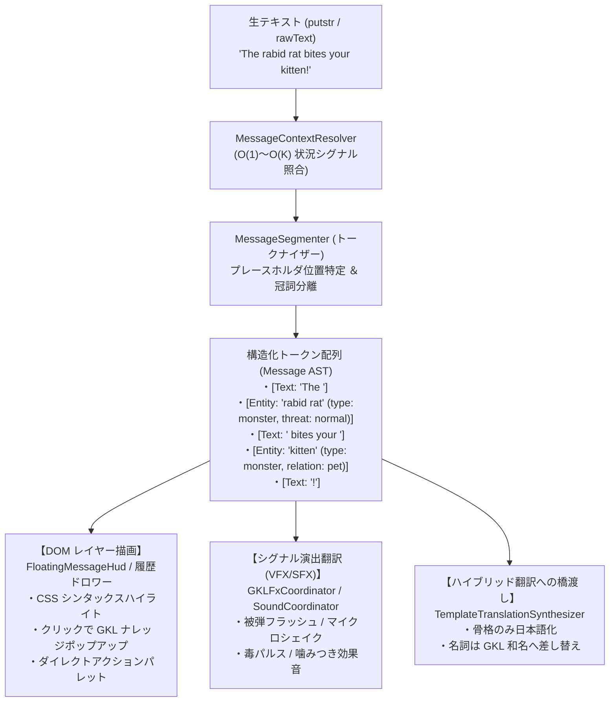

# 🧩 セマンティック・メッセージトークン化 ＆ インタラクティブ描画仕様書
*(Semantic Message Tokenization & Interactive Rendering Specification: Signal-to-UI/VFX Pipeline)*

## 1. 背景と基本方針 (Background & Core Philosophy)

### 1.1 「翻訳」から「意味論的トークン化（Semantic Tokenization）」への昇華
NetHack のテキスト出力（WASM C コアからの `putstr` / `message`）は、伝統的に単一のフラットな文字列（ASCII）として扱われてきました。
しかし、[signal_driven_hybrid_translation_architecture.ja.md](./signal_driven_hybrid_translation_architecture.ja.md) で確立された構文シグナル基盤（[MessageContextResolver.js](file:///c:/Users/e3-sh/Documents/GitHub/Nethack-wasm-webUI/src/core/message/MessageContextResolver.js)）により、メッセージ内の「文骨格」と「変数部分（モンスター名、アイテム名、数値、状態異常）」が分離・特定可能となりました。

本仕様は、**「言語翻訳（日本語化）を使用しない（英語原文でプレイする）」場合であっても、この構文解析シグナルを最大限に活用し、メッセージを意味論的なトークン列（Message AST）へと構造化して描画する**アーキテクチャを定義します。



### 1.2 本設計がもたらす 3 大価値
1. **非翻訳モード（英語原文）でのモダン CRPG 体験**:
   - モンスターやアイテムが色分けされ、メッセージをクリックするだけで GKL の弱点・耐性・持ち物などのナレッジがその場で参照可能。
2. **シグナル演出翻訳（Signal-to-VFX/SFX Engine）**:
   - 言語を訳す代わりに、シグナルを視覚・音響演出（画面振動、フラッシュ、状態異常の視覚化）にマッピング。
3. **ハイブリッド翻訳への最も安全なステップ**:
   - 「トークン分割とリッチ描画」の基盤が確立すれば、翻訳は「文骨格の置換」と「名詞の和名置換」を行うだけで完成するため、翻訳機能の導入リスクと複雑さを劇的に最小化。

---

## 2. トークン・データ構造仕様 (Message AST Schema)

メッセージは 1 つの平文から、以下の `MessageSegment` の配列として表現されます。

### 2.1 MessageSegment スキーマ
```typescript
interface MessageSegment {
  // トークン種別: 'text' (平文) | 'entity' (モンスター/NPC) | 'item' (道具) | 'condition' (状態異常) | 'value' (数値/効果)
  type: 'text' | 'entity' | 'item' | 'condition' | 'value';
  
  // 画面に表示する文字列 (英語原文 または 翻訳後の文字列)
  text: string;
  
  // インタラクティブ操作可能フラグ (クリック/ホバー有効)
  interactive?: boolean;
  
  // 詳細メタデータ (種別に応じた属性)
  meta?: {
    entityId?: string;       // GKL モンスターID ('kitten', 'green_dragon' 等)
    relation?: 'hostile' | 'peaceful' | 'pet' | 'boss'; // 関係性
    itemId?: string;         // GKL アイテム識別子 ('excalibur', 'potion_healing' 等)
    itemClass?: string;      // 武器/防具/巻物/ポーション等
    blessedCursed?: string;  // 'blessed' | 'uncursed' | 'cursed'
    actionHint?: string[];   // 実行可能なクイックアクション (['apply', 'throw', 'examine'])
    colorClass?: string;     // スタイリング用 CSS クラス
  };
}
```

### 2.2 出力例
メッセージ: `"The green dragon breathes fire at you!"`
```json
[
  { "type": "text", "text": "The " },
  { 
    "type": "entity", 
    "text": "green dragon", 
    "interactive": true,
    "meta": {
      "entityId": "green_dragon",
      "relation": "hostile",
      "colorClass": "token-monster-dragon"
    }
  },
  { "type": "text", "text": " breathes " },
  { 
    "type": "condition", 
    "text": "fire", 
    "interactive": false,
    "meta": { "colorClass": "token-element-fire" }
  },
  { "type": "text", "text": " at you!" }
]
```

---

## 3. セグメンテーション（トークナイズ）処理設計

### 3.1 処理パイプライン
1. **シグナル解決 (`MessageContextResolver.resolve(rawText)`)**:
   - `messageId`, `domain`, `placeholders`（正規表現キャプチャグループ）を取得。
2. **プレースホルダ位置特定 ＆ 冠詞分離**:
   - キャプチャされた名詞（例: `"a red dragon"`, `"your +1 dagger"`, `"the kitten"`）から、英語の冠詞（`a `, `an `, `the `）や所有代名詞（`your `, `its `）を分離して平文（`text`）へ戻し、純粋な名詞部分のみをトークン化。
3. **GKL 知識照合**:
   - 名詞を GKL の `LoreCodex` / `MonsterTracker` / `ItemSpec` に照会し、`entityId` やアイテム種別を同定。
4. **安全なフォールバック ($O(1)$ パススルー)**:
   - シグナル未検出（`null`）または完全一致固定文の場合、余計なパースを行わず即座に `[{ type: 'text', text: rawText }]` を返却。CPU 負荷をゼロに抑制。

### 3.2 冠詞・所有格の分離ルール (Article / Possessive Splitter)
```javascript
function stripLeadingSpecifiers(phrase) {
  // 英語の冠詞・所有代名詞を前方分離
  const match = phrase.match(/^(the|a|an|your|its|his|her)\s+(.*)$/i);
  if (match) {
    return { prefix: match[1] + ' ', noun: match[2] };
  }
  return { prefix: '', noun: phrase };
}
```

---

## 4. レンダリング・描画設計 (DOM HUD Architecture)

### 4.1 責務分離：なぜ Canvas / WebGL ではなく DOM なのか
- **Canvas / WebGL**: ダンジョン盤面（マップグリッド、タイル、足元エフェクト）の超高速描画に特化。可変長テキストのヒットテストやマウスホバー、フォーカス管理を Canvas 上で実装するのは極めて脆弱でメンテナンス困難。
- **DOM レイヤー**: [FloatingMessageHudController.js](file:///c:/Users/e3-sh/Documents/GitHub/Nethack-wasm-webUI/src/ui-controller/FloatingMessageHudController.js) およびメッセージ履歴ドロワーは既に HTML / CSS で管理されている。
- **結論**: メッセージおよびリストのリッチ描画・インタラクティブ化は **100% DOM (HTML/CSS) レイヤーに集約**する。

### 4.2 DOM 表現仕様
各トークンは標準的な `<span class="nh-token ...">` 要素として展開されます。

```html
<div class="nh-message-line">
  <span>The </span>
  <span class="nh-token token-entity token-hostile danger-high"
        data-token-type="entity"
        data-entity-id="green_dragon"
        role="button"
        tabindex="0"
        title="Click to view Lore Codex">green dragon</span>
  <span> breathes </span>
  <span class="nh-token token-element token-fire">fire</span>
  <span> at you!</span>
</div>
```

### 4.3 スタイリングとアクセシビリティ
- **シンタックスハイライト**:
  - `.token-hostile`: 警告色（薄い赤/オレンジ）、下線ドット（点線）
  - `.token-pet`: 安心色（シアン/エメラルドグリーン）
  - `.token-artifact`: 鮮やかなマゼンタ/ゴールドの微発光
  - `.token-item-unknown`: 注意色（アンバー/イエロー）
- **キーボード / ゲームパッド操作**:
  - メッセージ履歴ドロワーを開いた際、`Tab` または方向キーで各 `.nh-token` にフォーカス可能（`tabindex="0"`）。
  - `Enter` またはパッド `A` ボタンでナレッジカードを開く。

---

## 5. インタラクティブ連携 (Knowledge & Action Integration)

### 5.1 GKL ナレッジポップアップ（クリック / ホバー）
メッセージ内の `.token-entity` または `.token-item` をクリックした際：
1. **イベント発火**: `window.dispatchEvent(new CustomEvent('gkl:inspect-token', { detail: { type, id } }))`
2. **ナレッジカード表示**:
   - モンスターの場合：既存の `<nh-knowledge-card>` が対象モンスターの「弱点」「耐性」「公式攻撃一覧（3,767行データ）」を表示。
   - アイテムの場合：識別状況、未鑑定時の推定候補、外見対照表を表示。
3. **ゲームの一時停止不要**:
   - ターンは進まず、画面隅に非モーダル（または軽量ポップオーバー）で表示されるため、思考を邪魔しない。

### 5.2 ダイレクト・アクションパレット
メッセージ内のアイテム名をクリックした際、状況に応じたクイックアクションを表示：
- **床のアイテム**: `[拾う (,)]` `[調べる (/)]`
- **所持品**: `[身につける (W)]` `[投げる (t)]` `[食べる (e)]`
- 選択されたアクションのコマンドキーを WASM 入力キューへ送出。

---

## 6. シグナル演出翻訳 (Signal to VFX / SFX Engine)

テキストメッセージを「言語」として訳すだけでなく、「視覚・音響演出」として翻訳・実行します。

| メッセージシグナル (`domain` / `messageId`) | 視覚演出 (VFX) | 音響演出 (SFX: `SoundCoordinator`) |
| :--- | :--- | :--- |
| **戦闘: 致命打 / 大ダメージ** (`uhitm:hit`, `mhitu:hit`) | 画面マイクロシェイク (2〜3px, 150ms)、被弾赤フラッシュ | 重い打撃音 (`se_hit_heavy`) |
| **状態異常: 毒** (`poison`, `eat:poison`) | 画面外周の緑パルスビネット | 毒蝕音 (`se_poison`) |
| **状態異常: 混乱 / 目眩** (`confused`, `stunned`) | 画面がわずかに波打つシェーダー (Wobble) | 幻惑音 (`se_confuse`) |
| **道具破壊** (`worn:break`, `destroy`) | アイテム破片パーティクル | 砕折音 (`se_shatter`) |
| **神託 / 神の怒り** (`pray:angry`, `priest:wrath`) | 画面全体の一瞬の暗転 ＋ 金/雷光フラッシュ | 雷鳴・神聖轟音 (`se_rumble`) |

---

## 7. リスト表示（インベントリ / メニュー）とのフォーマット統一

### 7.1 Phase 8 `struct obj` メモリ直結との統合
メッセージ行だけでなく、インベントリ一覧（`display_nhwindow(WIN_MENU)`）の各行も全く同じ `MessageSegment[]` フォーマットで統一します。

Phase 8 の Direct Binding により、C 構造体から以下のメタデータが直接手に入ります：
- `otyp`: アイテム種別ID
- `spe`: 強化値 (+1, -2 等)
- `blessed`: 祝福/呪いフラグ
- `quan`: 数量

これらを `MessageSegmenter` と共通のフォーマットへ流し込むことで、**メッセージログ内のアイテムも、インベントリ画面内のアイテムも、全く同一の `<nh-token>` コンポーネントと CSS、ナレッジ連携ロジックで動作**するようになります。

---

## 8. プロトタイプ PoC 実装リファレンス (MessageSegmenter.js)

以下は、本構想の中核を担うセグメンテーションエンジンの最小構成プロトタイプです。

```javascript
/**
 * MessageSegmenter.js - セマンティック・メッセージトークナイザー (PoC)
 */
export class MessageSegmenter {
  constructor(messageResolver, knowledgeEngine) {
    this.resolver = messageResolver;
    this.knowledge = knowledgeEngine;
  }

  /**
   * 1行のメッセージを構造化トークン列 (MessageSegment[]) に分割
   * @param {string} rawText 
   * @returns {Array<Object>} segments
   */
  segment(rawText) {
    if (!rawText || typeof rawText !== 'string') {
      return [{ type: 'text', text: '' }];
    }

    // 1. 構文シグナルの照合
    const context = this.resolver ? this.resolver.resolve(rawText) : null;
    if (!context || !context.placeholders || context.placeholders.length === 0) {
      // プレースホルダのない固定文または未定義文は平文として返却 (O(1))
      return [{ type: 'text', text: rawText }];
    }

    const segments = [];
    let currentIdx = 0;

    // 2. プレースホルダ順に文字列をスライス
    for (const ph of context.placeholders) {
      const pos = rawText.indexOf(ph, currentIdx);
      if (pos === -1) continue;

      // プレースホルダより前の平文
      if (pos > currentIdx) {
        segments.push({
          type: 'text',
          text: rawText.substring(currentIdx, pos)
        });
      }

      // 冠詞・所有代名詞の分離
      const { prefix, noun } = this._splitSpecifier(ph);
      if (prefix) {
        segments.push({ type: 'text', text: prefix });
      }

      // 名詞のトークン化 ＆ GKL 属性付与
      const token = this._resolveNounToken(noun, context);
      segments.push(token);

      currentIdx = pos + ph.length;
    }

    // 残りの平文
    if (currentIdx < rawText.length) {
      segments.push({
        type: 'text',
        text: rawText.substring(currentIdx)
      });
    }

    return segments;
  }

  _splitSpecifier(text) {
    const match = text.match(/^(the|a|an|your|its|his|her)\s+(.*)$/i);
    if (match) {
      return { prefix: match[1] + ' ', noun: match[2] };
    }
    return { prefix: '', noun: text };
  }

  _resolveNounToken(noun, context) {
    // GKL への問い合わせ (モンスターまたはアイテム)
    // 簡易判定例:
    const isMonster = context.domain.includes('combat') || context.domain.includes('monster');
    return {
      type: isMonster ? 'entity' : 'item',
      text: noun,
      interactive: true,
      meta: {
        rawDomain: context.domain,
        colorClass: isMonster ? 'token-monster' : 'token-item'
      }
    };
  }
}
```

---

## 9. 結論とロードマップ上の位置づけ

本仕様により、**「翻訳エンジンの開発」が「ゲーム全体のモダンUI・演出エンジンの開発」と完全に一体化**します。
非翻訳モードで本トークン化・DOM描画基盤を先行配備することにより、プレイヤーは即座にリッチなナレッジ連携と視覚体験を享受でき、その後に控えるシグナル駆動ハイブリッド翻訳は、このトークン列に和名・日本語テンプレートをマッピングするだけの安全な作業へと昇華されます。
