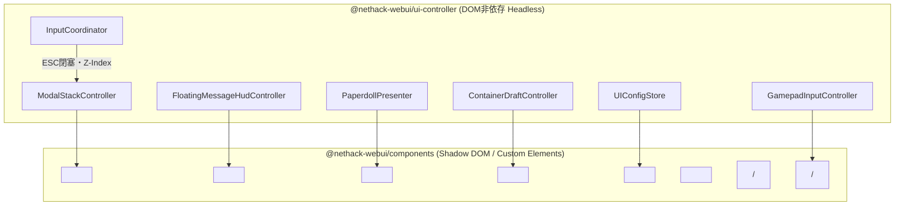
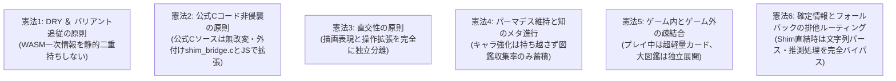

# 🧭 NetHack WASM WebUI システム現有能力カタログ (SYSTEM_CAPABILITIES.md)
### ―― システム全機能・API・データ資産インベントリ ＆ 責務境界・統廃合・ギャップ分析 ――

> [!IMPORTANT]
> **設計・機能提案・リファクタリング時の最重要必読インベントリ**  
> 本ドキュメントは、NetHack WASM WebUI プロジェクトにおける **「現在システムができること・持っている能力・API・データ資産」** を網羅的に集約した公式カタログです。  
> 新機能の提案やリファクタリングを検討する際は、必ず本カタログを参照し、**「既存機能の考慮漏れ」「車輪の再発明（静的二重持ち等）」** を防止してください。

---

## 📑 目次

1. [① コア通信・同期パイプライン (Communication & Sync Capabilities)](#①-コア通信同期パイプライン-communication--sync-capabilities)
2. [② ゲーム状態追跡・解析エンジン (State & Analysis Engines)](#②-ゲーム状態追跡解析エンジン-state--analysis-engines)
   - [2.1 識別の5段階管理 (ItemIdentificationResolver)](#21-識別の5段階管理-itemidentificationresolver)
   - [2.2 適応型スペック生成 (ItemSpecPresenter / MonsterSpecPresenter)](#22-適応型スペック生成-itemspecpresenter--monsterspecpresenter)
   - [2.3 遠隔・足元オンデマンド調査 ＆ 文学引用動的抽出 (OnDemandLookService / OnDemandLookupService)](#23-遠隔足元オンデマンド調査--文学引用動的抽出-ondemandlookservice--ondemandlookupservice)
   - [2.4 装備依存解析 (EquipmentActionPlanner / EquipmentRules)](#24-装備依存解析-equipmentactionplanner--equipmentrules)
   - [2.5 空間状態総合オーケストレーション ＆ 探索知識台帳 (AreaStateManager)](#25-空間状態総合オーケストレーション--探索知識台帳-areastatemanager)
   - [2.6 事後ナレッジ解析 ＆ 冒険手帳メタ進行 (PostMortemKnowledgeResolver / AdventureLogManager)](#26-事後ナレッジ解析--冒険手帳メタ進行-postmortemknowledgeresolver--adventurelogmanager)
   - [2.7 ゲームライフサイクル状態マシン (GameLifecycleManager)](#27-ゲームライフサイクル状態マシン-gamelifecyclemanager)
   - [2.8 アイテムデータモデル単一正規化 (ItemNormalizer / ItemDisplayPresenter)](#28-アイテムデータモデル単一正規化-itemnormalizer--itemdisplaypresenter)
3. [③ データ・伝承資産 (Data & Lore Assets)](#③-データ伝承資産-data--lore-assets)
4. [④ UI制御・操作調停・盤面描画 (UIController & Web Components & Renderers)](#④-ui制御操作調停盤面描画-uicontroller--web-components--renderers)
   - [4.1 キー・ゲームパッド入力調停 (InputCoordinator / GamepadInputController / ModalStackController)](#41-キーゲームパッド入力調停-inputcoordinator--gamepadinputcontroller--modalstackcontroller)
   - [4.2 共通 Web Components (<nh-*>)](#42-共通-web-components-nh-)
   - [4.3 コンテキスト連動型岩盤可視化 ＆ 掘削アシスト・マップ上コマンド数バッジ (Renderers & Overlays)](#43-コンテキスト連動型岩盤可視化--掘削アシストマップ上コマンド数バッジ-renderers--overlays)
5. [⑤ アーキテクチャの基本憲法（設計判断ルール）](#⑤-アーキテクチャの基本憲法設計判断ルール)
6. [⑥ レガシーコード撤廃・Direct-Only純化計画 ＆ UI一本化状況](#⑥-レガシーコード撤廃direct-only純化計画--ui一本化状況)
7. [⑦ ギャップ解消総括 ＆ 品質保証実績](#⑦-ギャップ解消総括--品質保証実績)

---

## ① コア通信・同期パイプライン (Communication & Sync Capabilities)

ブラウザ環境で NetHack C コア (WASM) を安全・高速・非同期に駆動し、画面描画を乱さずに内部データを抽出・同期する中核インフラストラクチャです。Phase 8（全ステージ 8.1〜8.5 完遂）により **「Cメモリ構造体直結 (`CALL_SHIM` / `_shim_bridge_call`)」** と **「サイレント・キーシーケンス (`querySequenceSilent`)」** のハイブリッド二刀流パイプラインを保有しています。

```mermaid
flowchart TD
    subgraph BrowserUI ["フロントエンド / GKL 層"]
        UI["UI / Web Components (<nh-*>)"]
        DBS["WasmDirectBindingService (薄型ファサード)"]
        Adapters["WasmAdapters\n(Inventory / Player / Spatial / Monster / Discovery)"]
        SyncCoord["WasmSyncCoordinator (同期調停)"]
        IRC["InteractiveRequestController (WebUICore)"]
    end

    subgraph DriverLayer ["WASM ドライバ層 (Web Worker / NetHackMemory)"]
        Bridge["NetHackWasmWorkerBridge / NetHackWasmDriver"]
        TaskQueue["TaskQueue / Sequence Buffer"]
    end

    subgraph CCore ["NetHack 5.0.1 C コア (Emscripten)"]
        ShimBridge["shim_bridge.c (_shim_bridge_call)"]
        WASM["NetHack 5.0.1 WASM Binary"]
    end

    UI -->|状態同期・盤面照会| DBS
    DBS --> Adapters
    DBS --> SyncCoord
    SyncCoord -->|"callShim(SHIM_CMD_*, arg0, arg1)"| Bridge
    Bridge -->|0.1ms未満 ゼロ副作用直結| ShimBridge
    ShimBridge <-->|C 構造体読取 (levl/fmon/invent/u)| WASM

    UI -->|マルチステップ操作・フォールバック| IRC
    IRC -->|"querySequenceSilent(['i', ' ', '\x1b'], { suppressPrompts: true, isSilentSync: true })"| Bridge
    Bridge -->|仮想キーストローク注入| TaskQueue
    TaskQueue -->|Asyncify 再開| WASM
```

### 1.0 Phase 8: 単一窓口 C メモリ直結 (`_shim_bridge_call` / `WasmDirectBindingService`)

* **主要クラス / 関数**:
  - `src/driver/shim/shim_bridge.c` (`_shim_bridge_call`)
  - `src/driver/NetHackMemory.js` (`bridgeCall`, `SHIM_CMD`, `SHIM_SYM`)
  - `src/driver/NetHackWasmWorkerBridge.js` (`callShim`)
  - `src/core/knowledge/services/WasmDirectBindingService.js` (6分割・薄型ファサード)
  - `src/core/knowledge/adapters/` (`InventoryWasmAdapter`, `PlayerWasmAdapter`, `SpatialWasmAdapter`, `MonsterWasmAdapter`, `DiscoveryWasmAdapter`)
  - `src/core/knowledge/coordinators/WasmSyncCoordinator.js`
* **できること**:
  - 公式 NetHack C ソースを 1 行も改変せず、単一の外付けブリッジ (`shim_bridge.c`) 経由で C メモリ構造体（`levl[x][y]`, `fmon`, `fobj`, `invent`, `u` 等）を **0.1ms 未満・キー注入副作用ゼロ** で直接読み出し。
  - **主要コマンド実績**:
    1. **フロア全域地形・階段一括ダンプ (`SHIM_CMD_DUMP_LEVEL_TERRAIN` / 0x15)**: 80×21 全マスの真の地形 (`typ`)・扉状態 (`flags`)・階段接続を 1 往復で取得。
    2. **セル詳細＆床アイテム走査 (`SHIM_CMD_GET_CELL_INFO` / `GET_OBJECT_AT`)**: 足元や任意座標の地形・罠・部屋種別・床アイテムの BUC (`blessed`/`cursed`/`bknown`)・箱の施錠状態・死体/像のモンスター種別 (`corpsenm`)・既知フラグ (`known`) を直接取得。
    3. **インベントリ＆装備＆総重量直結 (`SHIM_CMD_DUMP_ALL_INVENT` / `GET_EQUIPMENT_PTRS` / `GET_INV_WEIGHT`)**: 全所持品構造体・14装備スロットポインタ・真の総重量 (`inv_weight()`) を一括取得。
    4. **モンスター＆プレイヤー状態直結 (`SHIM_CMD_GET_MONSTER_AT` / `GET_PLAYER_SUMMARY` / `GET_PLAYER_PROPS`)**: 平和NPC (`mpeaceful`)・ペット (`mtame`) 判定、ダンジョン番号 (`dnum`) による全9ブランチ 100% 確定同定、お祈りタイマー (`ublesscnt`)・神の怒り (`ugangr`) 直結、耐性配列 (`uprops` 69要素) 内因・外因分離直結。
    5. **確定同期待ちによる不可分起動 (Stage 8.5)**: `completeStartup` の完全 async 化と Promise 調停により、セーブ再開時のインベントリ空化や初期描画チラつきを完全根絶。
  - **3モード検証切替 (`DIRECT_BINDING_MODE`)**: `auto`（直結優先＋自動フォールバック）、`strict`（フォールバック遮断・直結強制検証）、`fallback`（旧マクロ強制）を実行時切替可能。

### 1.1 サイレント・キーシーケンス実行 (`querySequenceSilent` / `queueSequence`)

* **主要クラス / 関数**:
  - `InteractiveRequestController.querySequenceSilent(sequenceOrRecipe, options)`
  - `NetHackWasmDriver.queueSequence(tokens, options)` / `canAcceptSequenceInterruption()`
  - `WebUICore.querySequenceSilent(sequenceOrRecipe, options)`
  - `GKLPlugin.syncInventorySilent()` / `syncSpellsSilent()` / `syncAttributesSilent()` / `syncSkillsSilent()` / `syncDiscoveriesSilent()`
* **できること**:
  - `suppressPrompts: true, isSilentSync: true` オプションにより、**画面のちらつきゼロ（UI描画イベントの外部発火なし）** で、C コアに仮想キーストローク列を自走注入し、生成されたテキスト出力バッファを Promise で一括キャプチャ。
  - `--More--` ページ送り中（`isTopLevelTurn === false`）やターゲットモード中は自動待機し、真のトップレベル・ターン待機に復帰した瞬間に安全消化。
* **主要活用実績・ユースケース**:
  1. **マルチステップ自動操作**: コンテナ出し入れトランザクション (`ContainerController.executeTransaction`)、ペーパードール多段着脱 (`EquipmentActionPlanner`)。
  2. **オンデマンド辞書・文学引用クエリ (`OnDemandLookupService`)**: `/` コマンドによる C コア内包 `data.base` 文学引用の動的取得。
  3. **Direct Binding 非対応環境・未直結ドメインのセーフティネット**: 魔法一覧 (`+`)、スキル一覧 (`#enhance`)、および `fallback` モード時の所持品・属性・発見リスト同期。

### 1.2 メッセージ抑止制御 (`suppressMessage` / `suppressedEvents`)

* **主要クラス / 関数**:
  - `NetHackWasmDriver.prototype.emit(event, payload)`（抑止フィルター）
  - `WebUICore.js` / `NetHackWasmDriver.js`
* **できること**:
  - `isSilentSync: true` またはモーダル操作中の一時的メッセージブロック機構。
  - C コアから送出される `putmsg`, `putstr`, `raw_print`, `raw_print_bold`, `putmixed`, `inputRequired`, `display_nhwindow`, `clear_nhwindow` などのイベント通知を一時的にインターセプト・破棄。
* **活用ユースケース**:
  - モーダル（アイテム選択、コンテナ出し入れ、ペーパードール自動換装等）実行中に、C コアが出力する「What do you want to take off?」や「You cannot wear...」といった中間プロンプトが画面上のフローティングHUDやログドロワーに漏れるのを完全に遮断。

### 1.3 2段構えシグナル基盤 (Two-Tier Signal Architecture)

客観的なゲーム事実の抽出と、それに基づく主観的戦術判断を疎結合に分離する2段パイプラインです。

```mermaid
flowchart LR
    subgraph Tier1 ["第1層: WebUICore (客観事実の同定)"]
        Msg[生メッセージ / LORE] --> MCD[MessageContextResolver]
        MCD --> SD[SignalDetector]
        SD -->|situationSignal\n{ type, context }| CoreEmit[core.emit('situationSignal')]
    end

    subgraph Tier2 ["第2層: GKL (主観的判断・キャッシュ化)"]
        CoreEmit --> GKL[GKLPlugin / InteractionContext]
        GKL --> SC[SituationCache]
        SC --> TA[TacticalAdvisor]
        SC --> AS[AssistSignalSynthesizer]
        TA -->|戦術バッジ / 警告| View[クライアントUI / HUD]
        AS -->|アシストスタンス / ContextActions| View
    end
```

* **主要クラス / 関数**:
  - **第1層 (WebUICore)**: `MessageContextResolver`, `SignalDetector`, `ContextFrameBuffer`, `core.emit('situationSignal')`
  - **第2層 (GKL)**: `GKLPlugin`, `InteractionContext`, `SituationCache`, `TacticalAdvisor`, `AssistSignalSynthesizer`
* **できること**:
  - **第1層**: C コアのメッセージ文字列やプロンプトから、「戦闘発生」「空腹警告」「呪詛検知」「床彫り発見」「伝承検知」などの客観的事実を正規化シグナルとして同定。
  - **第2層**: 第1層のシグナルをトリガーに `SituationCache` を自動更新。プレイヤーの現在のステータス・装備・周辺マップ・所持品と複合照合し、推奨アクション（ContextActions）や危険警告（Tactical Advice）を即座に導出。

---

## ② ゲーム状態追跡・解析エンジン (State & Analysis Engines)

WASM 単体では得られない高次のゲーム状態をリアルタイムに追跡・推論・整形する頭脳部です。

### 2.1 識別の5段階管理 (`ItemIdentificationResolver`)

* **主要クラス / 関数**:
  - `src/core/knowledge/engines/ItemIdentificationResolver.js`
  - `IDENTIFICATION_LEVELS`: `UNIDENTIFIED` (Lv.0), `BUC_KNOWN` (Lv.1), `NAMED` (Lv.2), `TYPE_IDENTIFIED` (Lv.3), `FULLY_IDENTIFIED` (Lv.4)
  - `resolveIdentificationState(itemOrStr, discoveryState)`
  - `APPEARANCE_PATTERNS`, `IDENTIFICATION_TIPS`
* **できること**:
  - インベントリ構造体（Phase 8 Direct Binding）やインベントリ行・Look メッセージ文字列から、現在の識別深度を5段階で高精度に同定。
  - ランダム化された外見名（薬の色 26種、指輪の素材 26種、魔法書の装丁 31種、杖の素材 27種、アミュレットの形状 11種、防具の一般名 32種、灰色の石等）を完全照合。
  - **ネタバレ防止マスク**: 未識別アイテムに対しては真の効能を隠蔽し、安全な外見スペックおよびカテゴリ別の鑑定ヒント（床彫り、流し台、価格鑑定等）を自動提示。

### 2.2 適応型スペック生成 (`ItemSpecPresenter` / `MonsterSpecPresenter`)

* **主要クラス / 関数**:
  - `src/core/knowledge/presenters/ItemSpecPresenter.js` (`getAdaptiveItemSpecs`)
  - `src/core/knowledge/presenters/MonsterSpecPresenter.js` (`getAdaptiveMonsterSpecs`)
  - `src/core/knowledge/presenters/EncumbrancePresenter.js`
* **できること**:
  - カテゴリ（武器、防具、指輪、巻物等）ごとに最適なスペックバッジ（重量、材質、AC、攻撃力ダイス、効果）を抽出。
  - **床落ちアイテム Direct Binding 個体スペック動的反映 (Peek Wisdom / Stage 8.5)**: 足元や床に落ちているアイテムの C 構造体 (`directObject`) から、スタック数量 (`quan`)、強化値 (`spe`)、残チャージ (`charges`)、対象生物種別 (`corpsenm`)、BUC (`bucStatus`) を動的にバッジ化。
  - **ASCII 英語純化**: `rawText` からの和名逆流を根絶し、ASCII 英語メタデータのみで決定論的にスペックを導出。
  - `SkillStateManager` と動的に突合し、**プレイヤーのスキル熟練度に応じた適性バッジ（得意武器マーク、向上可能マーク `+`）をリアルタイム付与**。
  - モンスターの危険度レベル、移動速度、耐性一覧、特殊攻撃リスク、死体摂食効果（耐性獲得率等）を適応型バッジとして生成。

### 2.3 遠隔・足元オンデマンド調査 ＆ 文学引用動的抽出 (`OnDemandLookService` / `OnDemandLookupService`)

* **主要クラス / 関数**:
  - `src/core/knowledge/services/OnDemandLookService.js` (`executeLook`, `buildLookSequence`, `parseLookResponse`)
  - `src/core/knowledge/services/OnDemandLookupService.js` (`lookupEntity`, `parseLookupOutput`)
  - `src/core/knowledge/lore/ElberethAnalyzer.js` (`analyze`, `WARD_STATUS`, `DEGRADED_CHAR_MAP`)
  - `src/core/knowledge/lore/EngravingArchaeologist.js`
* **できること**:
  - マップ座標（x, y）指定による Far look（`;`）および `/` コマンドによる C コア内包 `data.base` 公式文学引用のオンデマンド動的抽出（LRU メモリキャッシュ付き）。
  - 個体の動的状態（ペット `mtame`、友好 `mpeaceful`、敵対、自分自身）のリアルタイム判定。
  - **床文字・Elbereth 劣化判定**: 床に刻まれた文字列から残存率（0.0〜1.0）と文字消えを解析し、聖なる結界としての有効性（`ACTIVE`, `DEGRADED`, `NONE`）を判定。

### 2.4 装備依存解析 (`EquipmentActionPlanner` / `EquipmentRules`)

* **主要クラス / 関数**:
  - `src/core/knowledge/equipment/EquipmentActionPlanner.js` (`plan`)
  - `src/core/knowledge/equipment/EquipmentDependencyAnalyzer.js` (`analyzeDependency`)
  - `src/core/knowledge/equipment/EquipmentRules.js` (`EQUIP_SLOTS`, `estimateActionTurns`)
* **できること**:
  - NetHack 5.0 C コア（`do_wear.c`）の厳密な防具・装身具着脱ルールに基づき、多段換装シミュレーションを実行。
  - 呪詛（Cursed）による脱衣ブロッカー検知、手袋なしでのコカトリス死体接触などの致命的事故を事前遮断。
  - **ASCII純化**: モデル層から日本語正規表現を全廃し、確定メタデータと純粋な英語判定で完結。

### 2.5 空間状態総合オーケストレーション ＆ 探索知識台帳 (`AreaStateManager`)

* **主要クラス / 関数**:
  - `src/core/knowledge/state/AreaStateManager.js` (4分割オーケストレーター)
  - `src/core/knowledge/state/area/` (`TerrainInferenceEngine`, `DungeonLandmarkRegistry`, `ViewportTileProjector`)
  - 詳細仕様書: [AreaStateManager_Architecture_and_Specification.ja.md](./3_gkl/AreaStateManager_Architecture_and_Specification.ja.md)
  - `updateGlyph(x, y, glyphId, glyphInfo, bkglyphInfo)`
  - `syncPlayerFeetFloor(x, y)` / `dumpLevelTerrain()`
  - `seedInitialStair(x, y)` / `applyStairCacheForFloor(floorKey)`
  - `extractLandmarkEntity(x, y, glyphId)` / `getFloorLandmarks(floorKey)`
  - `getAreaState(cx, cy, radius)` / `getFocusCameraTiles(radiusX, radiusY, options)`
* **できること**:
  - **4層空間モデル＆差分追跡**: 単一グリフから `bottom`（地形）、`middle`（アイテム/岩）、`top`（生物/墓石）、`effect`（演出）を復元管理し、描画差分（`dirtyCells`）のみをレンダラーへ高速供給。
  - **観測済み岩盤 (`isObservedStone`) の識別保持**: 受信グリフが `0` または `3929` の場合、空白文字（`' '`）であっても完全未踏領域（`glyph >= 9622`）と明確に区別し、Direct Binding の真の地形（`typ: 0`）とともに `isObservedStone: true` を保持（スマート岩盤可視化の基盤）。
  - **Phase 8 メモリ直結同期**: `dumpLevelTerrain()` による 80×21 フロア全域の真の地形・階段一括確定、および `syncPlayerFeetFloor()` による足元の真の床・罠・床アイテムBUCのゼロ遅延確定（未踏領域ネタバレ防止ガード付き）。
  - **ランドマーク台帳**: 階段・祭壇・泉・玉座・シンク・店舗（店主同定）を自動抽出・永続化（`landmarkCache`）。

### 2.6 事後ナレッジ解析 ＆ 冒険手帳メタ進行 (`PostMortemKnowledgeResolver` / `AdventureLogManager`)

* **主要クラス / 関数**:
  - `src/core/knowledge/services/PostMortemKnowledgeResolver.js`
  - `src/core/knowledge/lore/AdventureLogManager.js`
* **できること**:
  - NetHack 5.0 `formatkiller()` の複合死因文字列（Prefix/Core/Suffix）を3段階で分解し、真の脅威エンティティと根本原因対策アドバイス（RCA）を自動導出。
  - セッションを跨いで遭遇モンスター・発見アイテム・噂・神託・墓碑銘の解禁率（知のメタ進行）を集計・永続化。

### 2.7 ゲームライフサイクル状態マシン (`GameLifecycleManager`)

* **主要クラス / 関数**:
  - `src/core/lifecycle/GameLifecycleState.js` (`GAME_LIFECYCLE_STATE`, `GameLifecycleManager`)
* **できること**:
  - `NOT_STARTED` ➔ `INITIALIZING` ➔ `STARTUP_FLOW` ➔ `IN_GAME` ➔ `GAME_OVER` ➔ `RESETTING` の単一ステートマシンによるライフサイクル遷移管理（SSOT）。
  - 散在していた旧フラグ（`isFirstTurnSyncing`, `isStartingUp` 等）を一元化し、状態遷移リスナーと不正遷移ガードを提供。

### 2.8 アイテムデータモデル単一正規化 (`ItemNormalizer` / `ItemDisplayPresenter`)

* **主要クラス / ファイル**:
  - `src/core/knowledge/models/ItemNormalizer.js` (`normalizeCanonicalItem`, `generateCanonicalDisplayName`)
  - `src/core/knowledge/presenters/ItemDisplayPresenter.js` (`buildItemDisplayModel`)
  - `src/core/knowledge/models/canonicalItem.js` / `src/core/index.d.ts` (`CanonicalItem`, `ItemDisplayModel`)
  - 詳細仕様書: [canonical_item_schema_and_normalization_architecture.ja.md](./3_gkl/canonical_item_schema_and_normalization_architecture.ja.md)
* **できること**:
  - **NetHack 公式 C コア（`src/objnam.c`）準拠の決定論的名称生成**: BUC、スタック数量、未識別外見名、個別名（call/name）、チャージ数、強化値、防具状態を C コアと完全に一致するルールで決定論的に合成。
  - **防御的多重フォールバック（`||` 嵐）の完全根絶**: `item.name || item.rawText || item.dname` のような場当たり的分岐を廃止し、データ正規化層（`ItemNormalizer`）と画面描画整形層（`ItemDisplayPresenter`）の責務を厳格に分離。
  - **型安全性と回帰防止**: TypeScript 型定義（`src/core/index.d.ts`）に完全準拠し、公式 `objnam.c` 網羅テストおよびスキーマ適合性契約テスト（100% PASS）を配備。

---

## ③ データ・伝承資産 (Data & Lore Assets)

NetHack 50年の歴史と公式リソースを完全網羅した構造化データ資産です。

| アセット分類 | 主要ファイル / 配置 | レコード数 / 規模 | 特徴と活用機能 |
| :--- | :--- | :--- | :--- |
| **Cコア公式文学引用** | `dat/data.base` (WASM内包)<br>`OnDemandLookupService.js` | 4,000+ 引用項目 | WASM 内にコンパイル同梱。シェイクスピア、クトゥルフ神話、指輪物語などの公式文学引用を動的クエリし、`dictionary.csv` で日本語対訳表示。 |
| **伝承マスター** | `src/core/knowledge/lore/data/LoreMasterData.js` | 噂 787件<br>神託 20件<br>墓碑銘 48件 | 真偽判定（`isTrue`）完備。噂 366件・神託 19件がアイテム番号（`onum`）・モンスターと完全事前紐付け済み。 |
| **構造化モンスター辞書** | `src/core/knowledge/data/MONSTER_KNOWLEDGE_FULL.js`<br>`MONSTER_OFFICIAL_ATTACKS.js` | 全 384 体<br>(3,767行攻撃定義) | 日英完全対訳、耐性、公式最大6枠攻撃ダイス（`AT_*` / `AD_*`）、速度、死体効果、危険度ランク。静的整合性監査済み。 |
| **構造化アイテム辞書** | `src/core/knowledge/data/OBJECT_KNOWLEDGE_FULL.js` | 全 481 アイテム<br>(onum 0〜480) | 日英完全対訳、防護耐性（`protectsAgainst`）、材質、基本価格、重量、効果。静的整合性監査済み。 |
| **ビジュアルタイルシート** | `pict/nethack_default_32.png`<br>`pict/nethack_default_32_tr.png` | 32×32px タイル<br>(2,307タイル) | NetHack 5.0.1 公式グラフィックスタイル。全グリフ対応。`GlyphHelper.js` による CSS スプライト座標切り出し。 |
| **制御シグナル辞書** | `src/core/prompt/ControlSignalCatalog.js` | 全 115 制御パターン | プロンプト・待機状態の同定と自動応答キー定義。 |

---

## ④ UI制御・操作調停 (UIController & Web Components)

DOM 非依存の Headless UI 層と、モダンなダークガラス Web Components による最高峰のフロントエンド基盤です。



### 4.1 キー・ゲームパッド入力調停 (`InputCoordinator` / `GamepadInputController` / `ModalStackController`)

* **主要クラス / 関数**:
  - `src/ui-controller/InputCoordinator.js` (`evaluateKeyDown`, `ROUTE_ACTIONS`)
  - `src/ui-controller/GamepadInputController.js` / `RadialInputRecognizer.js`
  - `src/ui-controller/ModalStackController.js` (`push`, `pop`, `getTopModal`, `hasModals`)
* **できること**:
  - 多重モーダル表示時のスタック管理と Z-Index 自動解決。
  - `ESC` キー押下時に「最前面のモーダル1枚だけを閉じる」安全な閉塞制御。
  - テキスト入力中（`INPUT` / `TEXTAREA`）の NetHack ゲームキー誤爆防止。
  - **Vanilla / Enhanced の操作直交性**: 純粋なゲーム操作キー（`PASSTHROUGH_GAME_KEY`）と UI ショートカット（Alt+S, Ctrl+P 等）を厳密に調停。

### 4.2 共通 Web Components (`<nh-*>`)

* **主要コンポーネント (`src/components/`)**:
  - `<nh-modal>`: FocusTrap、ESC 閉塞、多重スタック対応の共通モーダル枠。
  - `<nh-floating-hud>`: 全画面ダンジョンマップ上に透過オーバーレイする最新メッセージ行。太字強調・世代別フェードアウト完備。
  - `<nh-paperdoll>`: 人形型装備スロット（頭、鎧、マント、武器、盾、指輪、靴等）。ドラッグ＆ドロップおよび換装差分プレビュー対応。
  - `<nh-container-filer>`: 2画面コンテナ出し入れファイラー。数量スライダー、BoH 防爆安全ガード（Bag of Holding 爆発防止）完備。
  - `<nh-ui-config>`: Neo-Retro Dark Glass UI 設定パネル。プリセット管理・LocalStorage 永続化。
  - `<nh-knowledge-card>`: 3層構造（基本スペック・公式攻撃ダイス・`data.base` 文学引用/伝承）を凝縮した超軽量統合ナレッジカード。
  - `<nh-discovery-codex>` / `<nh-codex-grid>`: ゲーム内 `\` 発見済みアイテム対照図鑑およびシルエット解禁対応の冒険手帳グリッド。
  - `<nh-radial-palette-hud>` / `<nh-shiren-inventory-drawer>` / `<nh-gamepad-guide-bar>` / `<nh-context-hint-pill>`: ゲームパッド・コンソール操作向け UI コンポーネント群。

### 4.3 コンテキスト連動型岩盤可視化 ＆ 掘削アシスト・マップ上コマンド数バッジ (`Renderers & Overlays`)

* **主要クラス / モジュール**:
  - `src/ui-controller/UIConfigStore.js` (`stoneRenderingMode`, `mapActionIndicator`)
  - `examples/gkl-pure-js-client/modules/renderers/MainViewportRenderer.js` (2D Canvas レンダラー)
  - `examples/gkl-pure-js-client/modules/renderers/WebGPUHD2DRenderer.js` (WebGPU 3D ジオラマレンダラー)
  - `examples/gkl-pure-js-client/modules/renderers/hd2d/hd2dFxOverlay.js` (3D 空間 2D オーバーレイ)
  - 詳細仕様書: [context_aware_stone_and_digging_rendering_spec.ja.md](./2_client_ui/context_aware_stone_and_digging_rendering_spec.ja.md)
* **できること**:
  - **スマート岩盤可視化 (`stoneRenderingMode: 'smart'`)**: 普段は部屋・通路のネットワーク構造がくっきり見える「黒抜き」を維持しつつ、つるはし等の掘削アクション（`hasDig`）が発生したときのみ、隣接する観測済み岩盤（`isObservedStone` / `3929`）を浮かび上がらせてアンバー枠（`#fbbf24`）で強調描画。
  - **3大描画モード切替**: `smart`（既定）、`minimal`（常時完全黒抜き）、`classic_tile`（観測済み岩盤の常時クッキリ描画）を `<nh-ui-config>` からオンデマンド切替・LocalStorage 永続化。
  - **HD-2D 3D 壁インスタンス動的投影**: WebGPU 3D モードにおいて、掘削可能岩盤を立体的な壁天面および前面インスタンス（不透明度 0.85）として動的に立ち上げ。
  - **マップ上 ContextActions コマンド数ミニバッジ (`mapActionIndicator`)**: 自キャラ周囲（隣接8方向＋足元）のマス上に、GKL の推奨固有アクション数をピル型ミニバッジ（および控えめなガイド枠）としてオーバーレイ描画。盤面クリックにより `FloatingContextActions` を直接起動可能。

---

## ⑤ アーキテクチャの基本憲法（設計判断ルール）

すべての新機能開発・リファクタリングにおいて遵守すべき **「6大原則」** です。



### 憲法 1: DRY ＆ バリアント追従の原則 (Single Source of Truth)
WASM（C コア）が内部で保持している一次情報（所持品、装備、真の地形、属性値、耐性、発見済みアイテム、公式文学引用）は、JavaScript 側で静的に二重持ちしてはならない。  
Phase 8 の単一窓口 `callShim`（`_shim_bridge_call`）による C メモリ直接参照、または `querySequenceSilent`（`suppressPrompts: true`）を用いて C コアから動的に引き出し、メモリキャッシュで運用する。

### 憲法 2: 公式 C コード非侵襲の原則 (Non-Invasive C-Core)
NetHack 本体の公式 C ソースコード（`win/shim/winshim.c` や `src/*.c`）を独自に改変してはならない。  
C メモリ参照が必要な場合は独立した単一外付けファイル `src/driver/shim/shim_bridge.c`（`_shim_bridge_call`）に集約し、公式 NetHack のコードベースを 100% クリーンに保つことで、本家アップデートへの即時追従を保証する。

### 憲法 3: 直交性の原則 (Orthogonality of Render & Input)
「描画表現（ASCII ⇄ 2Dタイル ⇄ WebGPU HD-2D）」と「操作性（Vanilla 操作 ⇄ Enhanced 拡張操作）」は完全に直交し、独立して切り替え可能でなければならない。  
「タイル描画でクラシックなキーボード操作のみを行う」「ASCII 描画でマウス・ペーパードール操作を行う」など、プレイヤーがあらゆる組み合わせを自由に選択できる自由度を保証する。

### 憲法 4: パーマデス維持と知のメタ進行 (Permadeath & Meta-Knowledge)
NetHack 本来の醍醐味である「パーマデス（死んだらキャラクター能力・所持品は一切持ち越せない）」を厳格に堅持する。  
セッション横断で持ち越す要素は、プレイヤー自身の知識の結晶である「冒険手帳・図鑑収集率（%）」「アイテム発見履歴」「スコアボード・死因アーカイブ」などの **「知の蓄積（メタ進行）」** に限定する。

### 憲法 5: ゲーム内（即時）とゲーム外（鑑賞）の疎結合 (In-Game vs Out-Game Decoupling)
ゲームプレイ中の操作性を阻害してはならない。プレイ中に表示するナレッジは、ミリ秒単位で開き最小限の視線移動で把握できる超軽量な単体カード（`<nh-knowledge-card>`）とする。  
全モンスター・全アイテム・全伝承を一覧・鑑賞する大図鑑や戦歴分析は、独立ツール（`tools/adventure_log.html`, `tools/scoreboard.html`）として分離展開する。

### 憲法 6: 確定情報（Direct Binding）と推論フォールバックの排他ルーティング原則 (Exclusive Routing & Strict Priority)
Phase 8 の C 構造体メモリ直結（`SHIM_DIRECT`）が有効な場合、従来の「画面テキスト正規表現パース」や「ヒューリスティック推論（仮床推測・文字列からのカテゴリ逆算等）」を**同一パイプライン内で混在・後段実行してはならない**。
- **入口での完全分岐**: C 構造体から仮の文字列を合成して既存テキストパーサーに流し込む「逆流アダプタ」を禁止する。`SHIM_DIRECT` 経路は `onum` / `oclass` / `corpsenm` / `flags` 等の確定値のみから $O(1)$ で決定論的に解決し、テキスト解析・推論コードは `fallback` モード専用パスとして完全に隔離する。
- **厳格な3階層優先順位**: **Tier 1（C 構造体 Ground Truth ＋ 既知フラグ `known`/`dknown`/`bknown`/`seenv`） > Tier 2（`print_glyph` で目視確定済みの扉の向き等の視覚属性） > Tier 3（`fallback` 時のみの文字列・推論）** の順序を厳守し、下位層が上位層の確定情報を上書き破壊することを一切禁止する。

---

## ⑥ レガシーコード撤廃・Direct-Only純化計画 ＆ UI一本化状況

Direct Binding（WASM メモリ直結）の全面開通に伴い、コードベースのスリム化・保守性向上・誤爆リスク根絶を目的とした統廃合・退役計画です。

### 6.1 UI コンポーネントの共通基盤一本化

各画面固有の実装から、DOM非依存の Headless コントローラー（`@nethack-webui/ui-controller`）および共通 Web Components（`@nethack-webui/components`）への一本化を完了・推進しています。

| 対象機能 | 一本化・標準化コンポーネント | 現状ステータス ＆ 成果 |
| :--- | :--- | :--- |
| **ナレッジ詳細カード** | `<nh-knowledge-card>` | 3層統合（基本・公式攻撃・文学引用）カードへ集約完了。 |
| **メッセージHUD / ログ** | `FloatingMessageHudController` ＋ `<nh-floating-hud>` | Headless 調停と標準 Custom Elements へ集約完了。 |
| **コンテナ操作** | `<nh-container-filer>` | 2画面ファイラー、数量スライダー、BoH 防爆安全ガードを集約完了。 |
| **ペーパードール装備** | `<nh-paperdoll>` ＋ `PaperdollPresenter` | 人形型スロットUI、ドラッグ＆ドロップ、換装シミュレーションを集約完了。 |
| **モーダルスタック管理** | `ModalStackController` | FocusTrap、ESC 閉塞、多重モーダル Z-Index 解決を完全統一。 |

### 6.2 レガシー文字列パース・推測処理の Direct-Only 純化ロードマップ (Tech Debt Cleanup)

Phase 8 の Direct Binding により、過去のテキスト端末ベースで行われていた画面正規表現パースや地形推論は不要化（またはバイパス化）されました。現在は誤爆バグを根絶するため、これらを物理削除する「Direct-Only 純化」を進めています。

#### A. Direct Binding 移行完了実績 (バイパス・確定値移行済)
- **所持品・装備**: `onum` / `oclass` 直引き ＋ `getEquipmentPtrs()` ＋ ASCII 英語純化（Stage 8.5 完遂）
- **アイテム外見・識別深度**: `oc_name_known` / `oc_descr_idx` ＋ フラグ直結（Stage 8.5 完遂）
- **空間・ダンジョン地形**: `dumpLevelTerrain()` ＋ `getCellInfo()` ＋ `print_glyph` 直結（Stage 8.3-B/C 完遂）
- **属性・耐性・タイマー**: `GET_PLAYER_SUMMARY` ＋ `uprops` ＋ `ublesscnt` 直結（Stage 8.4 完遂）
- **ディスカバリー同期**: `SHIM_CMD_DUMP_DISCOVERIES` ＋ `DUMP_DESCR_INDEXES` 直結（Stage 8.2-C 完遂）

#### B. 今後の完全撤廃・物理削除対象 (Retirement Candidates)
1. **`OnDemandLookService.js`**: `;` キー送信によるメッセージ行パースの完全廃止・ファイル削除（`getFullMonsterAt` / `getFloorItemsAt` への一本化）。
2. **`ItemIdentificationResolver.js`**: 文字列からの `extractBuc`, `extractEnchantmentAndCharges` 正規表現パース群の物理削除（`ItemNormalizer` / C 構造体直結への純化）。
3. **`AreaStateManager.js` / `TerrainInferenceEngine.js`**: 空間推論・仮床（`9622`）捏造コードの完全撤廃（`_cachedLevelGlyphs` / `_cachedLevelTerrain` への一本化）。
4. **`InventoryStateManager.js`**: TTY メニューテキスト逆算パースコードの撤廃。

> **💡 テキスト処理を意図的に残す正当な領域 (SSOT)**:  
> ① `putmsg` 動的メッセージストリームのカタログ照合（`MessageContextResolver`）と翻訳（`TranslationEngine`）  
> ② 対話プロンプト（`yn_function`, `getlin`）および C コアの選択メニューウィンドウ（レター抽出）  
> ③ テキスト自体が一次情報である `dat/data.base`（公式文学引用）と `xlogfile`（スコアボード死因文字列）

---

## ⑦ ギャップ解消総括 ＆ 品質保証実績

初期アーキテクチャ監査で特定された **4 大機能ギャップおよび床アイテム覗き見知恵（Peek Wisdom）はすべて 100% 解消** され、現行機能として安定稼働しています。

| ギャップ項目 | 解消手段 ＆ 現行実装 | 主要メリット |
| :--- | :--- | :--- |
| **1. ディスカバリー図鑑** | `<nh-discovery-codex>` ＋ `SHIM_CMD_DUMP_DESCR_INDEXES` | `\` コマンドの発見済みアイテム（真名⇄外見）をゼロ遅延で即時閲覧。 |
| **2. 命名アシスト** | `ItemCandidateResolver` ＋ `<nh-call-candidate-dialog>` | 未識別アイテムの価格・効果逆引き候補から、ゲームパッド/キーでワンタップ命名。 |
| **3. WASM 動的文学引用** | `OnDemandLookupService` ＋ `<nh-knowledge-card>` | C コア内包の `data.base`（4,000+引用）をオンデマンド抽出・日本語対訳表示。 |
| **4. 冒険手帳メタ進行** | `AdventureLogManager` ＋ `<nh-codex-grid>` / `tools/` | セッション横断の遭遇・発見解禁率（知のメタ進行）と死因分析を完全可視化。 |
| **【拡張】Peek Wisdom** | `SHIM_CMD_GET_OBJECT_AT` ＋ `ItemSpecPresenter` | 床アイテムのスタック・強化値・残チャージ・BUC を動的バッジ化。 |

---

## 8. まとめ

NetHack WASM WebUI は、「通信・同期（Phase 8 Direct Binding + IRC）」「状態解析」「データ・伝承」「UI調停（Headless UI + Web Components）」「マルチドライバ音響（Phase 6）」の各レイヤーにおいて、極めて強固で完成度の高いインフラストラクチャ（**全169スイート・2,177テスト 100% PASS**）を保有しています。  
初期の全ギャップおよび Phase 8 メモリ直結基盤が完遂された現在、**強固な土台の上でセマンティックUIやモダンインベントリダイアログ等の次期構想へ安心して邁進できる状態** が整いました。
